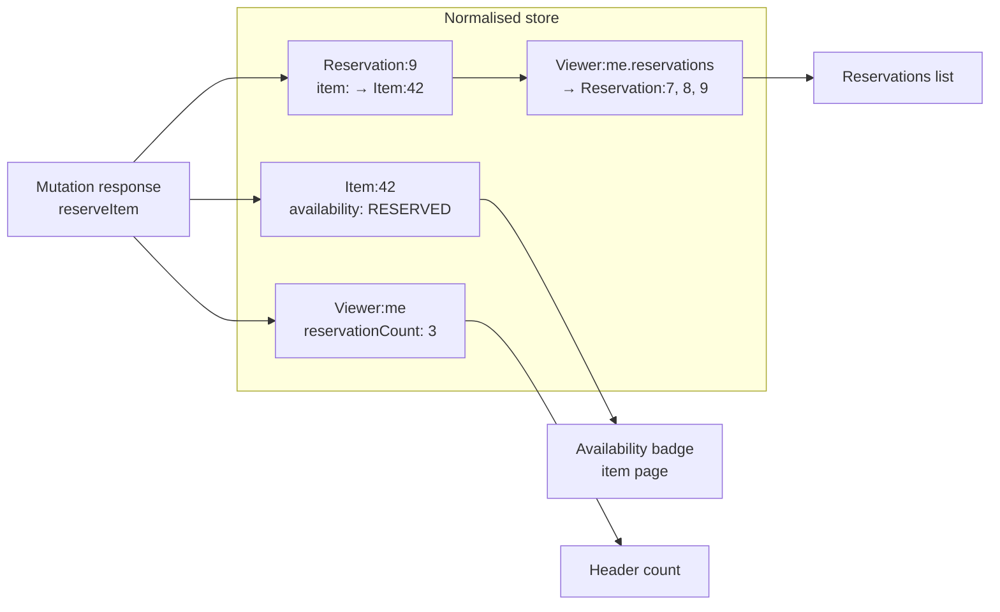
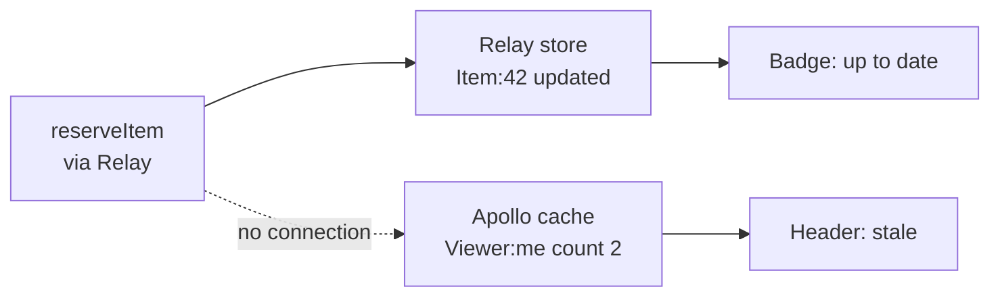

# Keeping data consistent in the browser

> You reserve an item, and the badge on the item page updates, but the counter in the header still shows the old number until you reload. In this topic we look at the data the browser already holds and how to keep every view of it consistent without hand-written sync code. We compare refetching, global stores, query caches and normalised caches, see when optimistic UI is a good idea and when it is not, and keep several open tabs in sync. At the end we look at what goes wrong when an app runs two caches at once.

**Duration:** about 30 minutes

## Contents

- [Where you are coming from](#where-you-are-coming-from)
- [The problem at scale](#the-problem-at-scale)
- [Options](#options)
- [Mutations that select the data of every view](#mutations-that-select-the-data-of-every-view)
- [Optimistic UI](#optimistic-ui)
- [Sync across tabs](#sync-across-tabs)
- [The two-cache problem](#the-two-cache-problem)
- [Briefly: garbage collection and pagination](#briefly-garbage-collection-and-pagination)
- [Takeaways](#takeaways)
- [Further reading](#further-reading)

## Where you are coming from

This topic is about the data **the browser already holds**, not about caching on the server or the CDN. Once a page is on screen, its components keep data in memory, in React state, in a data library or in the router. When the user changes something, all of these copies need to agree. The server cache cannot help here, because the browser does not ask the server again until something tells it to.

In Project 2 your app probably has a handful of components and one or two places that show the same data. After a mutation you reload the page data or refetch a list, and that is fine.

## The problem at scale

Now picture the Lending Desk grown into a company-wide platform. The item catalogue, availability, reservations, reviews, recommendations and notifications each belong to their own team and service, and millions of people use it. A single page combines components from several teams.

A user reserves a drill on its item page. These views must change:

1. The **availability badge** on the item page now says "Reserved until Friday".
2. The **"My reservations" count** in the header goes from 2 to 3.
3. The **reservations list** on the account page has a new row.
4. The **same app in another tab**, where the user left the search results open, shows the drill as reserved.

The header belongs to one team, the item page to another, and the reservations list to a third. Nobody wants to write code like "after a reservation, tell the header, then tell the list, then tell the badge". That code breaks the day a fourth team shows reservations somewhere else.

The goal: **one mutation, every view updates, and no team has to know about the others.**

## Options

### 1. Refetch everything

After the mutation, reload the page data: load the whole page again, or refetch every query on the page.

It is simple and always correct. It also costs a full round trip for every view, including those that did not change, and it does nothing for views that are not on the current page or in other tabs. On a page with many independent parts, that is a lot of wasted work for every click.

### 2. Lift state up or use a global store

Put the reservations in a shared parent, a React context, or a global store such as Zustand or Redux. Every view reads from there, and the mutation writes there.

This works well for a small app. At scale, someone has to decide what goes in the store, in which shape, and who updates it. The store becomes a second copy of server data, and every mutation needs hand-written code to keep it in sync with what the server returned. That is exactly the sync code we wanted to avoid.

### 3. A query cache keyed by query

A **query cache** stores the result of each request under a **query key**, for example `["reservations", userId]`. Any component that asks for the same key gets the same cached data, and the library deduplicates requests. TanStack Query is the best-known example.

After a mutation you **invalidate** keys. Invalidation marks matching entries as stale and refetches those that are currently on screen. Keys match by prefix, so invalidating `["reservations"]` also hits `["reservations", { status: "open" }]`.

```tsx
import { useMutation, useQueryClient } from "@tanstack/react-query";

export function useReserveItem() {
  const queryClient = useQueryClient();

  return useMutation({
    mutationFn: (itemId: string) => reserveItem(itemId),
    onSuccess: (_reservation, itemId) => {
      // 👇 every view that might show reservations must be listed here
      queryClient.invalidateQueries({ queryKey: ["reservations"] });
      queryClient.invalidateQueries({ queryKey: ["item", itemId] });
      queryClient.invalidateQueries({ queryKey: ["header-counts"] });
    },
  });
}
```

This is a big step up from hand-written sync. The cost: the mutation still has to **know** which keys are affected, and each invalidation is one more request. When another team adds a new view with a new key, they also have to remember to add it here.

Docs: [TanStack Query: Query keys](https://tanstack.com/query/latest/docs/framework/react/guides/query-keys), [Query invalidation](https://tanstack.com/query/latest/docs/framework/react/guides/query-invalidation)

### 4. A normalised cache

A **normalised cache** does not store responses. It takes every response apart and stores each **record** once, under its type and ID, for example `Item:42` or `Reservation:9`. Records point to each other by reference instead of holding copies. Every view reads its data from these records.

Relay, Apollo Client and urql's Graphcache work this way, with GraphQL. GraphQL fits well because every object in a response carries its type (`__typename`) and, by convention, an `id`.

When a mutation response arrives with `Item:42` in it, the cache **merges** the new fields into the existing record. Every view that reads `Item:42` re-renders with the new value, without anyone listing those views.



One response, three records updated, three views re-rendered. The header team, the item team and the account team never call each other.

The limit: the cache can only update records **that are in the response**. It cannot guess that a new reservation belongs at the end of a list, or that a count changed, if the response does not say so. That leads to the next section.

### Comparison

| | Refetch everything | Global store | Query cache | Normalised cache |
| --- | --- | --- | --- | --- |
| Example | Reload the page | Context, Zustand, Redux | TanStack Query | Relay, Apollo Client, urql Graphcache |
| Who updates other views | Nobody: everything reloads | Your code | Your code lists keys to invalidate | The cache, by type and ID |
| Extra requests after a mutation | Many | None | One per invalidated key | None, if the response has the data |
| Same record in two views | Two copies | One copy, if you shape it so | Two copies, in two entries | One copy |
| Works best with | Small pages | Small apps, client-only state | REST or any API | GraphQL with IDs |
| Main risk | Slow and wasteful | Hand-written sync code | Forgotten keys | Responses that miss fields |

These are not exclusive. Many apps use a normalised cache for server data and a small store for pure UI state, and still refresh the page after rare, broad changes.

Docs: [Apollo Client: Caching overview](https://www.apollographql.com/docs/react/caching/overview), [urql: Normalized caching](https://nearform.com/open-source/urql/docs/graphcache/normalized-caching/)

## Mutations that select the data of every view

With a normalised cache, a mutation is also a query: you choose which fields the response returns. If the response returns the fields every affected view needs, one response updates all of them, and no view needs to refetch.

```graphql
mutation ReserveItemMutation($itemId: ID!, $connections: [ID!]!) {
  reserveItem(itemId: $itemId) {
    item {
      id
      ...AvailabilityBadge_item
    }
    viewer {
      id
      reservationCount
    }
    reservationEdge @appendEdge(connections: $connections) {
      node {
        ...ReservationRow_reservation
      }
    }
  }
}
```

- `...AvailabilityBadge_item` spreads the fragment the badge component uses. Whatever the badge team adds to its fragment later, the mutation returns it automatically.
- `viewer { id reservationCount }` updates the header count.
- `@appendEdge` adds the new reservation to the list. Lists are the one case the cache cannot infer: a new record does not know which lists it belongs to, so you tell Relay which connections to append it to.

Relay recommends this pattern: spread the fragments of the affected components into the mutation response. Apollo Client and urql have the same model: the response must contain `__typename` and `id` for the merge, and the fields the views need.

This needs the backend to cooperate. The mutation should return the changed objects, not only `{ success: true }`. In a platform with many teams, agree on this as a rule for every mutation.

Docs: [Relay: GraphQL mutations](https://relay.dev/docs/guided-tour/updating-data/graphql-mutations/), [Relay: Updating connections](https://relay.dev/docs/guided-tour/list-data/updating-connections/)

## Optimistic UI

**Optimistic UI** means updating the screen before the server confirms the change, on the assumption that it will succeed. The like button turns red at once, and if the request fails, it turns back.

### When to use it

Use it for actions that are **cheap and reversible**, where being wrong for a second does no harm:

- likes, votes, favourites, "mark as read",
- toggles such as notification settings,
- reordering a personal list.

Do not use it where **money or stock** is involved. A reservation competes with other users for the same drill. If the screen says "Reserved" and the server then answers "Someone else was faster", the user may have already told a colleague, closed the tab or planned the weekend. For a reservation, show a pending state on the button and wait for the server's answer.

### Rollback on failure

Every optimistic update needs a way back: if the request fails, restore what was there before and tell the user. Without a rollback, the screen lies until the next reload.

### React: `useOptimistic`

React 19's `useOptimistic` holds a temporary value while an Action runs. When the Action ends, React renders the real value again. If the Action fails and the real value did not change, the UI goes back to what it showed before, so the rollback comes for free. The setter must be called inside an Action or a Transition.

```tsx
import { startTransition, useOptimistic } from "react";

export function FavouriteButton({ itemId, isFavourite }: { itemId: string; isFavourite: boolean }) {
  const [optimisticFavourite, setOptimisticFavourite] = useOptimistic(isFavourite);

  const toggle = () => {
    startTransition(async () => {
      setOptimisticFavourite(!optimisticFavourite); // 👇 shows at once
      try {
        await toggleFavourite(itemId); // updates isFavourite on success
      } catch {
        showToast("Could not save your favourite.");
      }
    });
  };

  return (
    <button aria-pressed={optimisticFavourite} onClick={toggle}>
      {optimisticFavourite ? "Remove from favourites" : "Add to favourites"}
    </button>
  );
}
```

Docs: [useOptimistic](https://react.dev/reference/react/useOptimistic)

### TanStack Query: `onMutate` with rollback

With a query cache, you write the optimistic value into the cache, keep a snapshot, and restore it on error:

```tsx
const queryClient = useQueryClient();

useMutation({
  mutationFn: toggleFavourite,
  onMutate: async (itemId: string) => {
    // 👇 stop refetches from overwriting the optimistic value
    await queryClient.cancelQueries({ queryKey: ["favourites"] });
    const previous = queryClient.getQueryData<string[]>(["favourites"]);
    queryClient.setQueryData<string[]>(["favourites"], (ids = []) =>
      ids.includes(itemId) ? ids.filter((id) => id !== itemId) : [...ids, itemId],
    );
    return { previous };
  },
  onError: (_error, _itemId, onMutateResult) => {
    queryClient.setQueryData(["favourites"], onMutateResult?.previous);
  },
  onSettled: () => queryClient.invalidateQueries({ queryKey: ["favourites"] }),
});
```

Relay offers the same with an `optimisticResponse` in the mutation config: Relay writes it to the store and rolls it back when the real response or an error arrives.

Docs: [TanStack Query: Optimistic updates](https://tanstack.com/query/latest/docs/framework/react/guides/optimistic-updates), [Relay: GraphQL mutations](https://relay.dev/docs/guided-tour/updating-data/graphql-mutations/)

## Sync across tabs

People open many tabs. The user reserves a drill in one tab, switches to the search results in another, and sees it as available. Each tab has its own JavaScript, its own memory, and its own cache. Nothing connects them by default.

### `BroadcastChannel`

A `BroadcastChannel` is a named channel that every document of the same origin can join: other tabs, windows and iframes. A message posted on it is delivered to every `BroadcastChannel` object with that name, **except the object that sent it**.

That last rule matters. If the header and the item page in the same tab both listen on their own channel objects, they do hear each other. But the usual setup is one shared channel object per tab, and then the tab that made the change never hears its own message. So publish twice: on the channel for other tabs, and as an in-tab event for the current tab. Every listener then handles one code path.

```ts
type CacheEvent =
  | { type: "reservation-changed"; itemId: string }
  | { type: "favourites-changed" };

const channel = typeof window === "undefined" ? null : new BroadcastChannel("lending-desk");
const local = new EventTarget();

export function publish(event: CacheEvent): void {
  channel?.postMessage(event); // other tabs
  // 👇 the channel never delivers to its sender, so notify this tab too
  local.dispatchEvent(new CustomEvent<CacheEvent>("cache", { detail: event }));
}

export function subscribe(listener: (event: CacheEvent) => void): () => void {
  const onMessage = (message: MessageEvent<CacheEvent>) => listener(message.data);
  const onLocal = (event: Event) => listener((event as CustomEvent<CacheEvent>).detail);
  channel?.addEventListener("message", onMessage);
  local.addEventListener("cache", onLocal);
  return () => {
    channel?.removeEventListener("message", onMessage);
    local.removeEventListener("cache", onLocal);
  };
}
```

What the listener does depends on your cache: invalidate a query key, refetch the item, or mark a record as stale. Send small messages ("item 42 changed"), not full data: the other tab may be logged in differently or show a different language, and should load the data itself.

Docs: [BroadcastChannel on MDN](https://developer.mozilla.org/en-US/docs/Web/API/BroadcastChannel)

### Alternative: the `storage` event

Before `BroadcastChannel`, apps wrote a value to `localStorage` and listened for the `storage` event. The event fires in **other** documents of the same origin when one of them changes `localStorage`, never in the document that made the change. It has the same sender gap, and it forces you to write to storage only to send a signal. Use it if you already persist the value in `localStorage` anyway.

Docs: [Window: storage event on MDN](https://developer.mozilla.org/en-US/docs/Web/API/Window/storage_event)

## The two-cache problem

Large apps rarely switch data libraries in one go. A migration from Apollo Client to Relay, or from a hand-written store to TanStack Query, runs for months, page by page and team by team. During that time the app has **two caches**.

Data written through one cache stays invisible to the other. The item page is already on Relay and runs the reservation mutation, so the Relay store updates. The header still uses Apollo Client, and its cache knows nothing about the mutation, so it shows 2 instead of 3.



The workaround is to connect the caches by hand: after the mutation, **refetch** the affected queries in the other client, or **invalidate** them explicitly. With Apollo Client that is `client.refetchQueries({ include: ["HeaderCounts"] })` or a `cache.evict` in its `updateCache` callback. The event channel from the previous section works for this too: publish "reservation changed", and each cache reacts in its own way.

Every one of these bridges is the hand-written sync code that a shared cache was supposed to remove, and each one has to be found and deleted later.

**The lesson: finish migrations.** Plan them with an end date, migrate shared parts such as the header early, track how many views still use the old library, and remove it. A half-finished migration costs more than either library alone.

Docs: [Apollo Client: Refetching queries](https://www.apollographql.com/docs/react/data/refetching)

## Briefly: garbage collection and pagination

**Garbage collection.** A client cache cannot grow forever. Each library removes data that no view uses any more:

- TanStack Query removes a query that has no active observers after `gcTime`, five minutes by default.
- Relay keeps data while a component that loaded the query is mounted. After that, it keeps a small number of recently released queries (ten by default, configurable with `gcReleaseBufferSize`), then removes unreferenced records.
- Apollo Client keeps data until you evict it or call `cache.gc()`.

The gotcha: when the user comes back to a page, its data may be gone, and the page loads again. That is correct behaviour, not a bug. Do not "fix" it by turning garbage collection off, because then memory grows without limit in a long session.

**Pagination merge.** A paginated list is one logical list loaded in several requests, and the cache has to merge them:

- Apollo Client stores each set of arguments separately by default, so `items(offset: 0)` and `items(offset: 20)` end up as two lists. You need a field policy in `typePolicies` with `keyArgs` and a `merge` function. Without a `merge` function, incoming pages overwrite existing ones.
- Relay merges the pages of a `@connection` into one list. Its non-pagination arguments (the filters) are part of the list's identity, so every filter combination is a separate list, and a mutation that adds an item must name each list it belongs to.
- TanStack Query's infinite queries store all pages in one entry. On refetch, they reload every page in order, starting from the first. Use `maxPages` to limit that cost.

Whatever you use, test the merge with a filter change and with a mutation that adds an item, because those are the cases where lists end up duplicated, empty or out of order.

Docs: [TanStack Query: Caching](https://tanstack.com/query/latest/docs/framework/react/guides/caching), [Relay: Presence of data](https://relay.dev/docs/guided-tour/reusing-cached-data/presence-of-data/), [Apollo Client: Core pagination API](https://www.apollographql.com/docs/react/pagination/core-api)

## Takeaways

- Server caching decides what the server sends. The client cache decides whether every view in the browser agrees on what it already has.
- A query cache needs you to list the keys a mutation affects. A normalised cache stores each record once by type and ID, so one mutation response updates every view that reads it.
- Make mutations return the data of every view they affect, for example by spreading the views' fragments into the response.
- Use optimistic UI for cheap, reversible actions with a rollback. Let reservations, payments and stock wait for the server.
- Sync tabs with `BroadcastChannel` plus an in-tab event, and finish data-library migrations so two caches do not drift apart.

## Further reading

- [TanStack Query: Query invalidation](https://tanstack.com/query/latest/docs/framework/react/guides/query-invalidation) and [Optimistic updates](https://tanstack.com/query/latest/docs/framework/react/guides/optimistic-updates)
- [Relay: GraphQL mutations](https://relay.dev/docs/guided-tour/updating-data/graphql-mutations/) and [Updating connections](https://relay.dev/docs/guided-tour/list-data/updating-connections/)
- [Relay: Thinking in GraphQL](https://relay.dev/docs/principles-and-architecture/thinking-in-graphql/), on why a normalised store
- [Apollo Client: Caching overview](https://www.apollographql.com/docs/react/caching/overview)
- [urql: Normalized caching](https://nearform.com/open-source/urql/docs/graphcache/normalized-caching/)
- [React: useOptimistic](https://react.dev/reference/react/useOptimistic)
- [MDN: Broadcast Channel API](https://developer.mozilla.org/en-US/docs/Web/API/Broadcast_Channel_API)
- [TkDodo: Practical React Query](https://tkdodo.eu/blog/practical-react-query), a well-known article series by a TanStack Query maintainer
