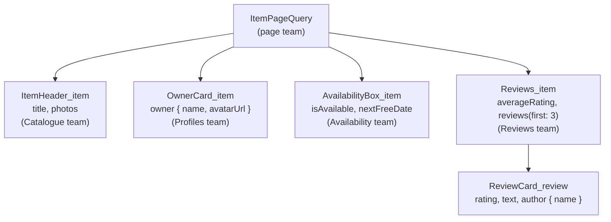

# Who loads which data? Colocation at scale

> Who decides which data a component gets: the component itself, or the page? Both answers work in Project 2, and both break when ten teams build parts of the same page. We look at colocated GraphQL fragments and data masking, compare them honestly with components that fetch their own data on the server, and see how to load the parts of a page that can wait without building a waterfall. The same ideas work with REST.

**Duration:** about 40 minutes

## Contents

- [Where you are coming from](#where-you-are-coming-from)
- [Two common starting points, and why both break](#two-common-starting-points-and-why-both-break)
- [Colocation: each component declares its data](#colocation-each-component-declares-its-data)
- [The page query decides early](#the-page-query-decides-early)
- [Data that can wait](#data-that-can-wait)
- [The same idea with REST](#the-same-idea-with-rest)
- [Takeaways](#takeaways)
- [Further reading](#further-reading)

## Where you are coming from

In earlier evenings you learned *how* to load data well: sequential versus parallel requests, streaming with Suspense, and request memoization. This topic does not repeat any of that. It asks a different question: **who declares which data a component needs?**

In Project 2 you probably did not have to answer it. You wrote the page and all its components, so you knew which fields each part used.

Now imagine the Lending Desk grown into a company-wide platform with millions of users. The item page shows the item header, the owner card, the availability calendar, reviews and recommendations. Each of those parts is built by a different team. The page itself belongs to yet another team. Nobody holds the whole picture in their head any more.

Throughout this topic we use GraphQL as the example, because its fragments express the idea directly. If you have not used GraphQL: a **query** asks a server for exactly the fields you list, and a **fragment** is a named list of fields on one type that you can insert into a query with `...FragmentName`. The [last section](#the-same-idea-with-rest) shows the same idea with REST.

## Two common starting points, and why both break

### Every component fetches its own data

```tsx
export function OwnerCard({ ownerId }: { ownerId: string }) {
  const [owner, setOwner] = useState<User | null>(null);

  useEffect(() => {
    fetch(`/api/users/${ownerId}`)
      .then((response) => response.json())
      .then(setOwner);
  }, [ownerId]);

  // ...
}
```

This feels like good design: the component is self-contained. At scale it causes two problems.

- **Waterfalls.** The parent renders, fetches the item, renders `OwnerCard` with the `ownerId`, and only then does `OwnerCard` start its request. Nested components add a round trip per level. The React docs list this as the main downside of fetching in Effects, together with the fact that Effects only run in the browser, so the server-rendered HTML contains a loading state.
- **Duplicate requests.** The header, the owner card and the reservation box all need the item. Each fetches it. Nothing coordinates them.

### The page fetches everything and passes it down

```tsx
// on the server, before the page renders
const item = await getItemPageData(id); // 👇 one big shape for the whole page

export function ItemPage({ item }: { item: ItemPageData }) {
  return (
    <>
      <ItemHeader item={item} />
      <OwnerCard owner={item.owner} />
      <Reviews reviews={item.reviews} />
    </>
  );
}
```

One request, no waterfall. But look at what the page now has to know:

- **Coupling.** The page query lists every field of every component. When the Reviews team wants to show the reviewer's avatar, they edit the page query, a file owned by another team.
- **Over-fetching.** When a component stops using a field, nobody removes it from the page query, because nobody knows whether another component still reads it. The query only grows.
- **Risky changes.** Ten teams editing one query means every change can break someone else's component. Reviews take longer, and people stop cleaning up.

We want both: the **single request** of the second approach and the **self-contained components** of the first.

## Colocation: each component declares its data

**Colocation** means the data requirements live next to the code that uses them. Each component declares the fields it needs as a GraphQL fragment, in its own file. The page does not list fields. It composes the components' fragments into one query.



The query that goes over the wire contains all fields of the tree, so the page still makes **one request**. But each team edits only its own fragment.

### With Relay

Relay is the GraphQL client that introduced this model. A component reads its fragment with `useFragment`:

```tsx
import { graphql, useFragment } from "react-relay";
import type { OwnerCard_item$key } from "./__generated__/OwnerCard_item.graphql";

export function OwnerCard({ item }: { item: OwnerCard_item$key }) {
  const data = useFragment(
    graphql`
      fragment OwnerCard_item on Item {
        owner {
          name
          avatarUrl
        }
      }
    `,
    item, // 👇 an opaque reference, not the data itself
  );

  return <p>Lent by {data.owner.name}</p>;
}
```

The page spreads the fragments into its query and passes each component the reference it needs:

```tsx
const ItemPageQuery = graphql`
  query ItemPageQuery($id: ID!) {
    item(id: $id) {
      ...ItemHeader_item
      ...OwnerCard_item
      ...Reviews_item
    }
  }
`;

function ItemPage({ queryRef }: { queryRef: PreloadedQuery<ItemPageQueryType> }) {
  const { item } = usePreloadedQuery(ItemPageQuery, queryRef);
  // ...
  return <OwnerCard item={item} />;
}
```

The Relay compiler generates a TypeScript type per fragment (`OwnerCard_item$key` for the reference, `OwnerCard_item$data` for the data) and per query.

Docs: [Relay: fragments](https://relay.dev/docs/guided-tour/rendering/fragments/), [`useFragment`](https://relay.dev/docs/api-reference/use-fragment/)

### Data masking

Notice what the page receives in `item`: not the owner's name, only references. This is **data masking**: a component can read only the fields it declared in its own fragment. The page cannot read the owner's name, and `OwnerCard` cannot read the item title, even though both are in the same response.

That sounds strict. It is what makes the model work with many teams:

- Another team cannot quietly start relying on a field you requested. If they need it, they declare it in their own fragment.
- You can remove a field from your fragment, and the compiler tells you whether anything breaks. Only your component can be affected.
- Two components may ask for the same field. The request contains it once.

### Lint rule for unused fields

Masking prevents others from relying on your fields. It does not stop *you* from requesting fields you no longer use. Relay's ESLint plugin has a rule for that: `relay/unused-fields` reports every field in a `graphql` literal that the module never reads. With it, over-fetching shows up in code review instead of in the payload.

Docs: [eslint-plugin-relay](https://github.com/relayjs/eslint-plugin-relay)

### Without Relay: GraphQL Codegen's client preset

Relay is opinionated and works with React only. GraphQL Codegen's **client preset** brings fragments with masking and generated types to any client (Apollo Client, urql, or plain `fetch`) and any framework.

```ts
// codegen.ts
import type { CodegenConfig } from "@graphql-codegen/cli";

const config: CodegenConfig = {
  schema: "./schema.graphql",
  documents: ["src/**/*.tsx"],
  generates: {
    "./src/gql/": {
      preset: "client",
      presetConfig: {
        fragmentMasking: { unmaskFunctionName: "getFragmentData" },
      },
    },
  },
};

export default config;
```

```tsx
import { graphql } from "@/gql";
import { type FragmentType, getFragmentData } from "@/gql/fragment-masking";

export const OwnerCardFragment = graphql(`
  fragment OwnerCard_item on Item {
    owner { name avatarUrl }
  }
`);

export function OwnerCard(props: { item: FragmentType<typeof OwnerCardFragment> }) {
  const item = getFragmentData(OwnerCardFragment, props.item); // 👇 unmasks your fields only
  return <p>Lent by {item.owner.name}</p>;
}
```

By default the unmask function is called `useFragment`, but it is not a React hook. Renaming it to `getFragmentData`, as above, avoids hook lint warnings and makes clear it can run anywhere, also outside a component. The page query spreads `...OwnerCard_item` like in Relay and passes `data.item` down.

There is no `unused-fields` equivalent for the client preset. GraphQL ESLint's `no-unused-fields` rule looks from the other side: it reports **schema** fields that no operation uses.

Docs: [Codegen client preset: fragment masking](https://the-guild.dev/graphql/codegen/plugins/presets/preset-client#fragment-masking), [Writing GraphQL fragments](https://the-guild.dev/graphql/codegen/docs/guides/react-vue#writing-graphql-fragments)

### Another answer: deduplicate on the server

Some setups let each component fetch its own data while the page is rendered on the server, and deduplicate identical requests per page render: if the header and the owner card both ask for item 42, the server loads it once. That is colocation too, without a schema or a compiler, and it works with any data source. The trade-offs: there is no data masking, so a component gets whatever the function returns. A child that needs its parent's result still waits for it, so waterfalls are possible. Each distinct call is its own request instead of one query per page. And after a change in the browser, the page data is loaded again, where a client store would update every component that shows the changed fields. For a small team that is often enough. With many teams on one page, masking and one query per page are worth the tooling.

## The page query decides early

Colocation moves the field lists into components. One decision should stay at the top: **should this page render at all?**

The item may not exist, or it may have moved to a new URL. If you find that out deep inside the tree, the server has already started streaming the HTML. The status code goes out with the first bytes, so the response stays a `200`, and all you can do is render a "not found" message in place of the content. Search engines and caches see a successful response. If you decide before streaming starts, the server can still answer with a real `404` or a redirect.

```tsx
app.get("/items/:id", async (req, res) => {
  const { id } = req.params;
  const { item } = await runQuery(ItemPageQuery, { id });

  // 👇 before anything streams: a real 404 or a permanent redirect
  if (!item) return res.status(404).send(renderNotFoundPage());
  if (item.canonicalId !== id) return res.redirect(308, `/items/${item.canonicalId}`);

  streamPage(res, <ItemLayout item={item} />);
});
```

The page query is the natural place for these checks. It runs first, and the fields it needs for the decision (`canonicalId`) are its own.

The page also decides **what travels to the browser**. Everything interactive components need is part of the data serialised into the HTML for the browser, for example as the records a GraphQL store starts from. Over-fetched fields are paid for on every page view, in bytes and parsing time. Fragments help here too: a client component's fragment lists exactly what the browser needs, and the lint rule keeps that list short.

Docs: [React: setting the status code when streaming](https://react.dev/reference/react-dom/server/renderToPipeableStream#setting-the-status-code), [Express: `res.status`](https://expressjs.com/en/5x/api/response#resstatus) and [`res.redirect`](https://expressjs.com/en/5x/api/response#resredirect), [MDN: 308 Permanent Redirect](https://developer.mozilla.org/en-US/docs/Web/HTTP/Reference/Status/308)

## Data that can wait

One request per page is the goal for what the user sees first. Not everything belongs in it. Reviews far down the page, recommendations, or the full availability calendar behind a button can load later, with **their own query**. That keeps the page query small and the first response fast.

The trap is in *when* that later request starts.

### The JS→data waterfall

The common mistake: a section is code-split with `lazy`, and its query lives inside the lazy component.

```tsx
const Reviews = lazy(() => import("./Reviews"));

// Reviews.tsx
export default function Reviews({ itemId }: { itemId: string }) {
  // 👇 this request cannot start before the code for Reviews has arrived
  const data = useLazyLoadQuery(ReviewsQuery, { itemId });
  // ...
}
```

The browser downloads the JavaScript, runs it, renders the component, and only then discovers the request. Two round trips in a row.

### Render-as-you-fetch

**Render-as-you-fetch** starts the code download and the data request **at the same moment**, and renders when both have arrived. Relay calls this the preferred pattern. To make it possible, the query must be importable without the component, so it lives in a small separate module.

```tsx
const loadReviewsCode = () => import("./Reviews");
const Reviews = lazy(loadReviewsCode);

export function ReviewsSlot({ itemId }: { itemId: string }) {
  const [queryRef, loadReviews] = useQueryLoader<ReviewsQueryType>(ReviewsQuery);

  const ref = useWhenVisible(() => {
    void loadReviewsCode(); // 👇 both start now, in parallel
    loadReviews({ itemId });
  });

  return (
    <section ref={ref}>
      {queryRef && (
        <Suspense fallback={<ReviewsSkeleton />}>
          <Reviews queryRef={queryRef} />
        </Suspense>
      )}
    </section>
  );
}
```

`useWhenVisible` stands for a small hook of your own around `IntersectionObserver`. Inside `Reviews`, `usePreloadedQuery(ReviewsQuery, queryRef)` reads the data. The same works for a click: start both in the event handler, not in the component that opens.

```mermaid
gantt
    title Reviews section, from "visible" to "rendered"
    dateFormat x
    axisFormat %L ms
    section JS→data waterfall
    Download Reviews code  :w1, 0, 300
    Render, discover query :w2, 300, 350
    Fetch reviews          :w3, 350, 750
    section Render-as-you-fetch
    Download Reviews code  :p1, 0, 300
    Fetch reviews          :p2, 0, 400
    Render                 :p3, 400, 450
```



The numbers are made up, but the shape is not: in the waterfall the times add up, in the parallel version the slower of the two decides.

Docs: [Relay: fetching queries](https://relay.dev/docs/guided-tour/rendering/queries/), [`useQueryLoader`](https://relay.dev/docs/api-reference/use-query-loader/), [React: `lazy`](https://react.dev/reference/react/lazy)

## The same idea with REST

Colocation is not a GraphQL feature. The principle is: **each component declares its data requirements, and a page-level loader aggregates them into as few requests as possible.** With REST you build that yourself:

```ts
// owner-card.data.ts, next to OwnerCard.tsx
export type OwnerCardData = { name: string; avatarUrl: string | null };

export async function loadOwnerCard(ctx: LoadContext): Promise<OwnerCardData> {
  const item = await ctx.get<Item>(`/items/${ctx.itemId}`); // shared, deduplicated
  const owner = await ctx.get<User>(`/users/${item.ownerId}`);
  return { name: owner.name, avatarUrl: owner.avatarUrl }; // 👇 only what the card needs
}

// item page loader
const ctx = createLoadContext(itemId); // ctx.get memoizes by URL for this request
const [header, owner, reviews] = await Promise.all([
  loadItemHeader(ctx),
  loadOwnerCard(ctx),
  loadReviews(ctx),
]);
```

Each team owns its loader and its return type, which gives you the coupling benefits of fragments. Returning a narrow type is your form of data masking: the page passes `owner` to `OwnerCard` and never sees the full user. `ctx.get` deduplicates the item request that every loader makes. What you do not get for free is the server resolving the chain `item → owner` for you: that waterfall stays, unless a backend endpoint returns both.

## Takeaways

- The question is not only *how* to load data but *who declares it*. At scale, the answer should be "the component that uses it".
- Fetching in every component causes waterfalls and duplicates; fetching everything in the page couples every team to one query.
- Colocated fragments give you both: components declare their fields, the page sends one query, data masking keeps teams independent, and a lint rule keeps fragments lean.
- Components that fetch on the server with per-render deduplication are colocation too. They are cheaper to set up but have no masking and can waterfall.
- Let the page query make the early decisions (404, redirect), and start lazy code and its data at the same time.

## Further reading

- [Relay: Thinking in Relay](https://relay.dev/docs/principles-and-architecture/thinking-in-relay/), the reasoning behind colocation and masking
- [Relay: fragments](https://relay.dev/docs/guided-tour/rendering/fragments/) and [fetching queries](https://relay.dev/docs/guided-tour/rendering/queries/)
- [GraphQL Codegen: client preset](https://the-guild.dev/graphql/codegen/plugins/presets/preset-client)
- [React: You Might Not Need an Effect, fetching data](https://react.dev/learn/you-might-not-need-an-effect#fetching-data) and [the `useEffect` deep dive on alternatives to fetching in Effects](https://react.dev/reference/react/useEffect#what-are-good-alternatives-to-data-fetching-in-effects)
- Related topic: [GraphQL vs REST, and why large sites use both](../graphql-vs-rest/README.md)
