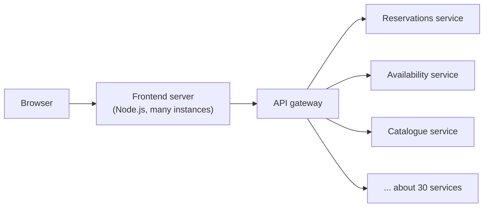
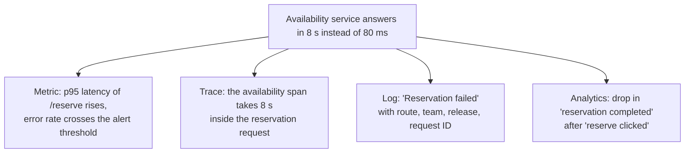
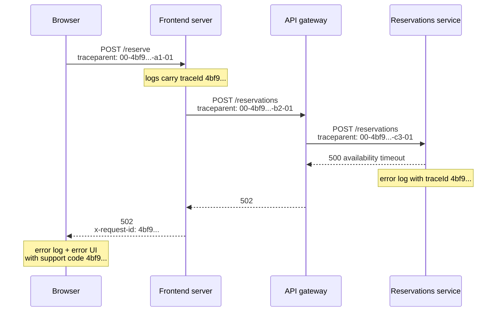

# Debugging production: following one error from end to end

> In Project 2 an error shows up in your terminal, and you fix it. In a large platform, a user sees "Something went wrong", and the cause sits somewhere between their browser, your frontend server, an API gateway and one of about 30 backend services. Let's follow one error through that whole chain: which signals it leaves behind, how one ID ties them together, why the user should see that ID, how to get readable stack traces without publishing your source, and how the error reaches the team that owns it.

**Duration:** about 30 minutes

## Contents

- [Where you are coming from](#where-you-are-coming-from)
- [Four signals, four audiences](#four-signals-four-audiences)
- [Correlation: one ID through the whole chain](#correlation-one-id-through-the-whole-chain)
- [Show an error ID to the user](#show-an-error-id-to-the-user)
- [Readable stack traces](#readable-stack-traces)
- [Ownership at scale](#ownership-at-scale)
- [`Server-Timing`: server time in DevTools](#server-timing-server-time-in-devtools)
- [Takeaways](#takeaways)
- [Further reading](#further-reading)

## Where you are coming from

In Project 2 there is one Node.js server, often on your own machine. When a page breaks, the stack trace appears in your terminal, with your file names and line numbers. You read it, fix the line, and reload.

Now imagine the Lending Desk, the equipment lending service you know from an earlier evening, has grown into a company-wide platform: item catalogue, availability, reservations, reviews, recommendations and notifications, each owned by its own team and service, with millions of users. A reservation fails. Between the user and the cause there are now several layers:



Each layer runs on many machines, writes its own logs, and belongs to a different team. There is no single terminal to look at. The user reports "it broke on Tuesday afternoon". Let's make that report findable.

## Four signals, four audiences

**Telemetry** is the data a running system emits about itself. It comes in four kinds, and each answers a different question for a different audience.

| Signal                | Answers                                         | Mainly for          |
| --------------------- | ----------------------------------------------- | ------------------- |
| **Logs**              | What happened, in detail, at one point          | Developers          |
| **Metrics**           | How often and how much, over time               | Alerting, on-call   |
| **Traces**            | Where the time went, across services            | Developers, on-call |
| **Product analytics** | What users did, as steps in a journey           | Product people      |

A **trace** is the record of one request as it travels through the system. It consists of **spans**: one span per unit of work, such as "frontend renders page" or "reservations service writes to the database", each with a start time, a duration and a parent span.

One incident produces several of these at once. Say the availability service becomes slow:



The metric wakes someone up. The trace shows which service is slow. The log shows the exact error and context. The analytics show how many users gave up. None of them alone tells the full story, and they are only useful together if you can jump from one to the other. That is what correlation is for.

Tools such as Grafana, Datadog or Sentry cover some or all of these signals. The ideas below work regardless of which one you use.

## Correlation: one ID through the whole chain

### A request ID from the edge

The **edge** is the first part of your system a request reaches, for example a CDN, a load balancer or the frontend server. Create an ID there, once per request, and then:

1. pass it to every downstream call in a request header;
2. put it on every server log line, for example with `AsyncLocalStorage` request context;
3. return it to the browser in a response header.

Now you can search all logs of all services for that one ID and see the request's whole story.

### The browser attaches the ID to its own error

When a request fails, the browser logs an error too. Read the ID from the failed response and put it on that log line. Now the browser error and the server logs share the same ID.

```ts
export async function reserve(itemId: string): Promise<Reservation> {
  const response = await fetch(`/api/items/${itemId}/reservations`, { method: "POST" });

  if (!response.ok) {
    // 👇 the same ID the server wrote on its log lines
    const requestId = response.headers.get("x-request-id") ?? undefined;
    browserLogger.error("Reservation failed", { status: response.status, requestId, itemId });
    throw new ReservationError(response.status, requestId);
  }
  return response.json();
}
```

If the API runs on another origin, the browser hides custom response headers from JavaScript unless the server lists them in `Access-Control-Expose-Headers`.

Docs: [`Access-Control-Expose-Headers`](https://developer.mozilla.org/en-US/docs/Web/HTTP/Reference/Headers/Access-Control-Expose-Headers)

### The standard: W3C Trace Context and OpenTelemetry

Every team inventing its own header name does not scale across 30 services. The W3C **Trace Context** Recommendation defines a standard header, `traceparent`:

```http
traceparent: 00-4bf92f3577b34da6a3ce929d0e0e4736-00f067aa0ba902b7-01
```

It has four parts, separated by dashes:

- `00`: the version;
- a 32-character hex **trace ID**, shared by every span of the request;
- a 16-character hex **parent ID**, the span that made this call;
- **trace flags**; `01` means the sampled flag is set: the caller may have recorded this trace.

A companion header, `tracestate`, carries vendor-specific data alongside it.

**OpenTelemetry** is the open standard and set of SDKs for producing traces, metrics and logs, and for propagating context such as `traceparent` between services. Most observability tools accept OpenTelemetry data. If every service uses it, the trace ID becomes your request ID: put it on every log line and in the response header, and logs and traces line up automatically.

Docs: [W3C Trace Context](https://www.w3.org/TR/trace-context/), [OpenTelemetry: Context propagation](https://opentelemetry.io/docs/concepts/context-propagation/)

### Starting the trace in the browser

The request really starts with the user's click, not at your server. You can start the trace in the browser by sending a `traceparent` header with the request. Then the browser's view, including the network time, belongs to the same trace.

OpenTelemetry has browser instrumentation for this, but its documentation marks client instrumentation for the browser as **experimental and mostly unspecified**. The browser packages are moving into a separate repository and are experimental too. Expect API changes. The header itself is stable, and you can create it without any library:

```ts
function randomHex(bytes: number): string {
  const values = crypto.getRandomValues(new Uint8Array(bytes));
  return Array.from(values, (value) => value.toString(16).padStart(2, "0")).join("");
}

export function createTraceparent(sampled: boolean): string {
  const traceId = randomHex(16);
  const spanId = randomHex(8);
  // 👇 version - trace ID - parent ID - flags
  return `00-${traceId}-${spanId}-${sampled ? "01" : "00"}`;
}

await fetch("/api/items/item_812/reservations", {
  method: "POST",
  headers: { traceparent: createTraceparent(true) },
});
```

For a cross-origin API, the server must allow the header with `Access-Control-Allow-Headers`, and the browser sends a preflight request first. Decide which origins may start traces: a server that trusts every incoming `traceparent` lets anyone force it to record traces.

Docs: [`Crypto.getRandomValues()`](https://developer.mozilla.org/en-US/docs/Web/API/Crypto/getRandomValues), [OpenTelemetry: Browser getting started](https://opentelemetry.io/docs/languages/js/getting-started/browser/)

### Forcing a trace to be kept

Recording every trace of millions of requests is expensive, so traces are **sampled**: only a share is kept. With **head sampling** the decision is made at the start of the trace and travels with it in the sampled flag. A service that uses a parent-based sampler follows the decision of its caller. **Tail sampling** decides after the trace is complete, for example "keep every trace that contains an error".

While you debug a specific problem, you want your own requests to be kept, all of them. Give developers and support a way to force it: a cookie or a flag that makes the edge set the sampled flag to `01` for that session. The same switch can turn on full logging for that session. Restrict it to trusted users, so it cannot be used to flood your tracing backend.

Docs: [OpenTelemetry: Sampling](https://opentelemetry.io/docs/concepts/sampling/)

### The whole chain



The trace ID stays the same at every hop. The parent ID changes, because each hop is a new span.

## Show an error ID to the user

The user still only sees "Something went wrong". When they contact support, all you know is roughly when it happened. Among millions of log lines, that is not enough.

Show a short **support code** in the error UI, derived from the request or trace ID. A user can copy it or read it out. Support pastes it into the log search and finds the exact lines from every service.

```tsx
export function ReservationError({ requestId }: { requestId?: string }) {
  return (
    <div role="alert">
      <p>We could not create your reservation. Please try again.</p>
      {requestId && (
        // 👇 turns "it broke" into a searchable log line
        <p>
          If this keeps happening, contact support with the code <code>{requestId.slice(0, 12)}</code>.
        </p>
      )}
    </div>
  );
}
```

Where does `requestId` come from? Take it from the response header the server sets. If there is none, for example because the request never reached a server, generate one in the browser. Either way, log the same value that you show.

```ts
const response = await fetch("/api/reservations", { method: "POST", body });
if (!response.ok) {
  const requestId = response.headers.get("x-request-id") ?? crypto.randomUUID();
  // 👇 the user and the log line get the same ID
  browserLogger.error("Reservation failed", { requestId, status: response.status });
  showReservationError(requestId);
}
```

If the API runs on another origin, the browser hides this header from your script until the server lists it in `Access-Control-Expose-Headers`. `crypto.randomUUID()` is available only on HTTPS pages (and on `localhost`).

Many large sites still show a plain error page without any reference. Usually it was never prioritised: nobody owned the error page, and the request ID did not reach the browser. The cost is paid later, in support tickets that cannot be traced and bugs that are closed as "cannot reproduce". The code reveals nothing about your system, and it turns every complaint into evidence.

Docs: [MDN: `Crypto.randomUUID()`](https://developer.mozilla.org/en-US/docs/Web/API/Crypto/randomUUID), [MDN: `Access-Control-Expose-Headers`](https://developer.mozilla.org/en-US/docs/Web/HTTP/Reference/Headers/Access-Control-Expose-Headers)

## Readable stack traces

### Hidden source maps

Production JavaScript is bundled and minified. A browser stack trace says `at e (main-3f9a.js:1:48213)`. A **source map** is a file that maps positions in the generated code back to the original source files and lines.

You have two options:

- **Public source maps:** the bundle references the map with a `//# sourceMappingURL=` comment, and the map is served next to it. Anyone's DevTools show your original source.
- **Hidden source maps:** the build generates the maps but leaves out the reference comment. You upload the maps to your error platform during the deployment and do not serve them publicly. The error platform turns minified stack traces into readable ones. Webpack calls this mode `hidden-source-map`, and most error platforms offer an upload step for it.

The trade-off: readable stacks for you versus readable source for everyone. Your client code is already public in minified form, so maps do not reveal secrets that were not already there. They do make your source, comments and internal file structure far easier to read. Many teams choose hidden maps for that reason.

Key the uploaded maps by **release version**. A stack trace from yesterday's release must be decoded with yesterday's maps, not today's.

Docs: [webpack `devtool`: `hidden-source-map`](https://webpack.js.org/configuration/devtool/), [MDN: Source map](https://developer.mozilla.org/en-US/docs/Glossary/Source_map)

### Source maps on the server

TypeScript and bundled server code have the same problem in Node. Start Node with `--enable-source-maps` and it reports stack traces relative to the original source files. The Node docs warn that this can add latency when `Error.stack` is accessed, so measure it if your code reads stacks often.

```bash
node --enable-source-maps dist/server.js
```

Docs: [Node.js `--enable-source-maps`](https://nodejs.org/api/cli.html#--enable-source-maps)

### Tag everything with the release version

Put the release version on every log line, every error and every trace: a build number, a date-based version or a Git commit hash. Then you can answer the first question of every incident in seconds: did this start with the latest deployment? It also tells the error platform which source maps to use.

## Ownership at scale

### Route errors to the owning team automatically

With many teams, an error that lands in a shared channel waits until someone feels responsible. Route it to the owner instead, without a person sorting it.

You may know `CODEOWNERS` files from GitHub: they map file paths to the people or teams who must review changes. Apply the same idea to runtime: generate **ownership metadata** from the code at build time, and attach it to telemetry.

- **Routes:** each page or API route declares its owning team; the request context adds it to every log line.
- **Data operations:** each query or service call declares its owner, so a failing call is attributed to the team that owns the data, not the team whose page showed it.
- **Error boundaries:** each boundary declares the team owning the part of the page it wraps, and adds it to the errors it catches.

```ts
// Generated at build time from ownership declarations in the code.
export const routeOwners: Record<string, string> = {
  "/items/[id]": "catalogue",
  "/items/[id]/reserve": "reservations",
  "/me/reviews": "reviews",
};
```

Because the metadata is generated from the code, it stays correct when routes move. A CI check can fail when a new route has no owner.

Docs: [GitHub: About code owners](https://docs.github.com/en/repositories/managing-your-repositorys-settings-and-features/customizing-your-repository/about-code-owners)

### A dashboard per team

With a `team` field on every signal, each team gets its own dashboard and its own alerts: error rate, latency and the top errors for the routes and services it owns. A team sees its own problems first and is not paged for another team's.

## `Server-Timing`: server time in DevTools

When a page is slow, the browser's Network panel only shows "waiting for server response". The `Server-Timing` response header lets the server break that time down. Each metric has a name and optional `dur` (duration in milliseconds) and `desc` (description) parameters.

```ts
app.get("/items/:id", async (req, res) => {
  const start = performance.now();
  const item = await catalogue.getItem(req.params.id);
  const catalogueMs = performance.now() - start;
  // ...
  // 👇 appears in DevTools under Network, Timing
  res.set("Server-Timing", `catalogue;dur=${catalogueMs.toFixed(1)};desc="Catalogue", render;dur=12.4`);
  res.send(html);
});
```

Browsers show these metrics in DevTools next to the request, and JavaScript can read them through the `PerformanceServerTiming` interface. MDN warns that the header can expose sensitive information about your infrastructure. Decide what you send, and consider sending detailed timings only to internal users or debugging sessions.

Docs: [MDN: `Server-Timing`](https://developer.mozilla.org/en-US/docs/Web/HTTP/Reference/Headers/Server-Timing), [MDN: `PerformanceServerTiming`](https://developer.mozilla.org/en-US/docs/Web/API/PerformanceServerTiming)

Core Web Vitals, which measure how fast and stable a page feels to users, are covered in a separate evening: Web Performance Optimization, on 16 December. See [web.dev: Web Vitals](https://web.dev/articles/vitals) until then.

## Takeaways

- Logs, metrics, traces and product analytics answer different questions for different people. One incident shows up in all of them.
- Create one ID at the edge, pass it to every service, put it on every log line, and return it to the browser. W3C `traceparent` with OpenTelemetry is the standard way to do this.
- Show a support code in the error UI, so "it broke" becomes a log search.
- Upload hidden source maps keyed by release, use `--enable-source-maps` on the server, and tag every signal with the release version.
- Generate ownership metadata from code, so every error reaches the team that owns it.

## Further reading

- [W3C: Trace Context](https://www.w3.org/TR/trace-context/)
- [OpenTelemetry: Signals](https://opentelemetry.io/docs/concepts/signals/)
- [OpenTelemetry: Context propagation](https://opentelemetry.io/docs/concepts/context-propagation/)
- [OpenTelemetry: Sampling](https://opentelemetry.io/docs/concepts/sampling/)
- [OpenTelemetry: Browser getting started](https://opentelemetry.io/docs/languages/js/getting-started/browser/)
- [MDN: `Server-Timing`](https://developer.mozilla.org/en-US/docs/Web/HTTP/Reference/Headers/Server-Timing)
- [Node.js: `--enable-source-maps`](https://nodejs.org/api/cli.html#--enable-source-maps)
- [Sentry: Uploading source maps](https://docs.sentry.io/platforms/javascript/sourcemaps/), as an example of an error platform
- [Express: Error handling](https://expressjs.com/en/guide/error-handling.html)
- Related topic: [Logging in a large application](../logging/README.md)
