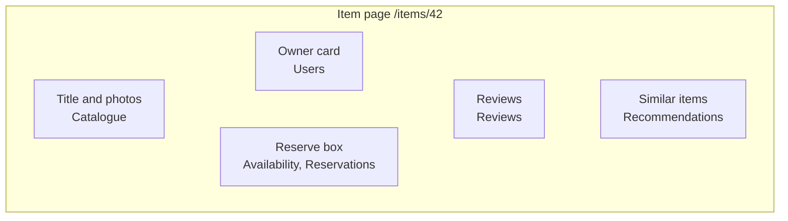
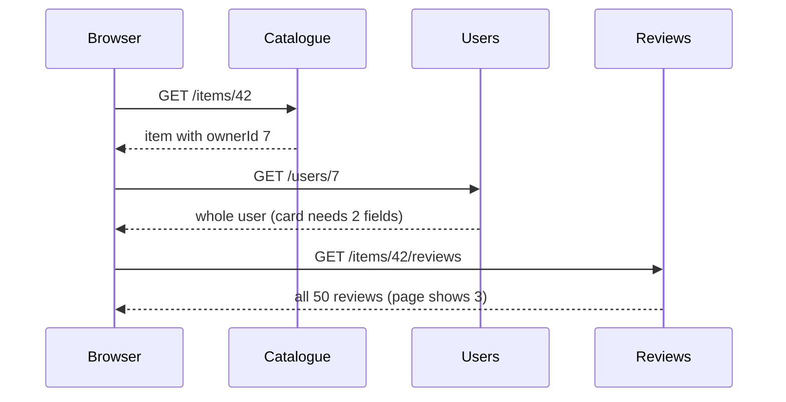
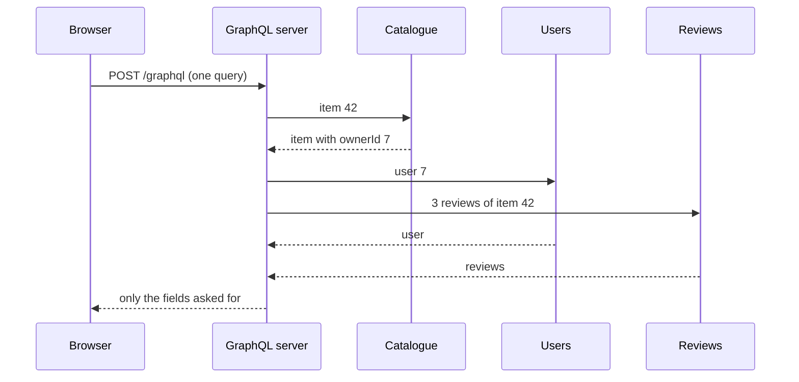
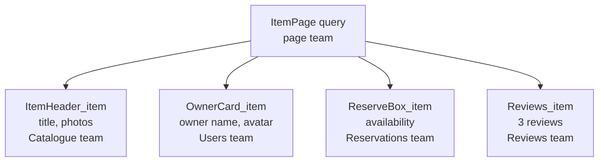
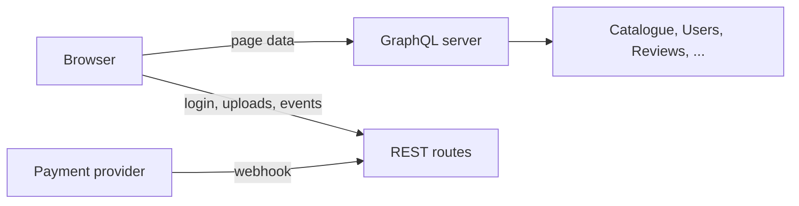

# GraphQL vs REST, and why large sites use both

> You built a REST API with Express, and for one team and one app it is the right tool. Now picture the Lending Desk item page pulling its data from six services, each run by a different team. GraphQL lets that page ask for exactly the data it needs in one request, and lets each component declare its own part. We look at what that solves, what it costs, and why large sites run both.

**Duration:** about 40 minutes

## Contents

- [Where you are coming from](#where-you-are-coming-from)
- [One page, six services](#one-page-six-services)
- [GraphQL in five minutes](#graphql-in-five-minutes)
- [Each component declares its own data](#each-component-declares-its-own-data)
- [What GraphQL costs, and where REST still wins](#what-graphql-costs-and-where-rest-still-wins)
- [When to use which](#when-to-use-which)
- [Takeaways](#takeaways)
- [Further reading](#further-reading)

## Where you are coming from

In an earlier evening you built a REST API with Express: one route per resource, `GET /items/:id`, `POST /reservations`, JSON in and out. For Project 2 that fits. One team owns the API and the frontend, so when a page needs a new field, you add it to the route handler and deploy both.

Now let's grow the Lending Desk into a company-wide platform with millions of users. The item catalogue, users, availability, reservations, reviews and recommendations each belong to a different team and run as a separate service. The item page shows data from all six, and the frontend team owns none of them.



Each box is built and served by another team. **The core idea of this topic:** GraphQL lets the page fetch all of it in one request, with each component naming the fields it needs. That solves real problems when many teams share a page, but it costs things REST gives you for free, so large sites use both.

## One page, six services

Let's load the item page from the REST services. The owner card needs the owner's name, but the item only contains `ownerId`, so the browser has to wait for the item before it can ask for the owner.



Three problems show up:

- **Waterfall.** Each request waits for the one before. `Promise.all` helps for independent calls, but the owner still waits for the item. On a mobile network, one round trip can take hundreds of milliseconds.
- **Over-fetching.** The endpoint returns a fixed shape: the whole user and all reviews, though the page shows two fields and three reviews.
- **Under-fetching.** `GET /items/42` does not contain the owner's name, so you need a second request.

With GraphQL, the browser sends one request to one server. That server calls the services and returns only the fields the page asked for.



The waterfall has not disappeared. It moved into the data centre, where a round trip takes a few milliseconds, and one team can optimise it for every page.

## GraphQL in five minutes

Here is enough GraphQL to read the rest of the page.

**The schema** lists every type and field the API offers, like a TypeScript interface for the whole API. `!` means "never null". Without it, a field may be `null`.

```graphql
type Query {
  item(id: ID!): Item # 👇 null if there is no such item
}

type Item {
  id: ID!
  title: String!
  owner: User!
  reviews(first: Int!): [Review!]!
}

type User {
  name: String!
  avatarUrl: String
}

type Review {
  rating: Int!
  text: String!
}
```

**A query** names the fields the client wants. The response has the same shape.

<table>
<tr><th>Query</th><th>Response</th></tr>
<tr>
<td>

```graphql
query ItemPage($id: ID!) {
  item(id: $id) {
    title
    owner {
      name
    }
    reviews(first: 2) {
      rating
      text
    }
  }
}
```

</td>
<td>

```json
{
  "data": {
    "item": {
      "title": "Cordless drill",
      "owner": { "name": "Mira" },
      "reviews": [
        { "rating": 5, "text": "Strong battery" },
        { "rating": 4, "text": "A bit heavy" }
      ]
    }
  }
}
```

</td>
</tr>
</table>

**Sending it.** Every operation goes to the same URL, usually as a `POST` with the query text and its variables:

```ts
const response = await fetch("/graphql", {
  method: "POST",
  headers: { "Content-Type": "application/json" },
  body: JSON.stringify({ query: itemPageQuery, variables: { id: "42" } }),
});
const { data, errors } = await response.json(); // 👇 check errors yourself
```

**Partial responses.** If the Reviews service fails, you still get the rest. The failed field is `null`, an entry in `errors` says where it failed, and the HTTP status is still `200`:

```json
{
  "data": { "item": { "title": "Cordless drill", "owner": { "name": "Mira" }, "reviews": null } },
  "errors": [{ "message": "Reviews unavailable", "path": ["item", "reviews"] }]
}
```

Two more terms. On the server, each field has a function that produces its value, a **resolver**: the resolver for `Item.owner` calls the Users service. And writes are **mutations**, such as `reserveItem(...)`. They look like queries and return the fields you ask for after the change.

Docs: [Queries](https://graphql.org/learn/queries/), [Schemas and types](https://graphql.org/learn/schema/), [Mutations](https://graphql.org/learn/mutations/), [Response](https://graphql.org/learn/response/), [Serving over HTTP](https://graphql.org/learn/serving-over-http/)

<details>
<summary>Going further: one graph, many teams (federation)</summary>

Few large sites start with GraphQL. A common path has three stages:

1. **REST per team.** Each team runs its own service. Every page orchestrates its own calls.
2. **A GraphQL BFF.** One team builds a Backend for Frontend: a GraphQL server whose resolvers call the REST services. It helps, but every new field needs that one team, so it becomes a bottleneck.
3. **A federated graph.** Each team runs a **subgraph**: a GraphQL service with its own part of the schema. A **gateway** (also called router) composes all subgraphs into one schema and splits each query among them.

The key idea is that several subgraphs contribute fields to the same type. `@key` says how to identify an item, so the gateway can take the `id` from the Catalogue subgraph and ask the Reviews subgraph for the reviews of that item.

```graphql
# Catalogue subgraph
extend schema
  @link(url: "https://specs.apollo.dev/federation/v2.3", import: ["@key"])

type Item @key(fields: "id") {
  id: ID!
  title: String!
}

# Reviews subgraph (with the same @link header)
type Item @key(fields: "id") {
  id: ID!
  reviews(first: Int!): [Review!]!
}
```

This is Apollo Federation 2 syntax. Without the `extend schema @link(...)` line, a subgraph is treated as Federation 1. Another implementation is ChilliCream's GraphQL Fusion. It implements the GraphQL Composite Schemas specification, which a GraphQL Foundation working group develops. That specification is still preliminary (Stage 0), and its repository is titled "GraphQL Federation specification".

Federation needs real infrastructure: the gateway, a schema registry that checks every subgraph change against the others, and usually a team that runs both.

Docs: [graphql.org: Federation](https://graphql.org/learn/federation/), [Apollo Federation: entities](https://www.apollographql.com/docs/graphos/schema-design/federated-schemas/entities/intro), [Apollo Federation: directives](https://www.apollographql.com/docs/graphos/schema-design/federated-schemas/reference/directives), [Fusion](https://chillicream.com/docs/fusion), [GraphQL Federation specification](https://github.com/graphql/graphql-federation-spec)

</details>

## Each component declares its own data

One query per page solves the waterfall. But who writes it?

- If **the page** writes it, it lists every field of every team. When the Reviews team wants the reviewer's avatar, they edit a file the page team owns. When a component stops using a field, nobody dares remove it, so the query only grows.
- If **every component** fetches its own data, the teams are independent again, but we are back to many requests and waterfalls.

The answer is **colocation**: each component declares its fields next to its code, as a **fragment**. A fragment is a named list of fields on one type, and `...Name` inserts it into a query. The page composes the fragments into one query.



Fragment names follow the pattern component, then prop: `OwnerCard_item` is what `OwnerCard` needs from its `item` prop. The owner card declares its fragment. A code generator, here GraphQL Codegen's client preset, reads the `graphql(...)` strings and generates TypeScript types for them.

```tsx
import { graphql } from "./gql";
import { type FragmentType, getFragmentData } from "./gql/fragment-masking";

export const OwnerCardFragment = graphql(`
  fragment OwnerCard_item on Item {
    owner {
      name
      avatarUrl
    }
  }
`);

export function OwnerCard(props: { item: FragmentType<typeof OwnerCardFragment> }) {
  const item = getFragmentData(OwnerCardFragment, props.item); // 👇 only these fields
  return <p>Lent by {item.owner.name}</p>;
}
```

The page spreads the fragments into its query and hands each component the item:

```tsx
import type { ItemPageQuery } from "./gql/graphql"; // generated result type
// ...

export const itemPageDocument = graphql(`
  query ItemPage($id: ID!) {
    item(id: $id) {
      title
      ...OwnerCard_item
      ...Reviews_item
    }
  }
`);

export function ItemPage({ data }: { data: ItemPageQuery }) {
  if (!data.item) return <NotFound />; // 👇 item is nullable in the schema
  return (
    <>
      <h1>{data.item.title}</h1>
      <OwnerCard item={data.item} />
      <Reviews item={data.item} />
    </>
  );
}
```

The fragment definitions travel in the same document as the query, so the page still sends one request.

**Data masking** keeps the teams apart: a component can read only the fields its own fragment declares. `ItemPage` can read `title`, but in TypeScript it cannot read `owner.name`, so no team can quietly depend on another team's fields, and removing a field from your fragment can only break your own component.

<details>
<summary>Going further: Relay and the Codegen setup</summary>

**Relay**, Meta's GraphQL client for React, introduced this model. Its compiler expects fragment names that start with the module name, generates the types, and masks the data at runtime too, not only in TypeScript. A component reads its fragment with the `useFragment` hook. Relay's ESLint plugin has a rule, `relay/unused-fields`, that reports fields a module requests but never reads.

**GraphQL Codegen's client preset** works with any client (Apollo Client, urql or plain `fetch`) and has fragment masking on by default. Its unmask function is called `useFragment`, but it is not a React hook; the docs recommend renaming it to avoid lint issues:

```ts
// codegen.ts
import type { CodegenConfig } from "@graphql-codegen/cli";

const config: CodegenConfig = {
  schema: "./schema.graphql",
  documents: ["src/**/*.tsx"],
  generates: {
    "./src/gql/": {
      preset: "client",
      presetConfig: { fragmentMasking: { unmaskFunctionName: "getFragmentData" } },
    },
  },
};
```

Docs: [Relay: Thinking in Relay](https://relay.dev/docs/principles-and-architecture/thinking-in-relay/), [Relay: fragments](https://relay.dev/docs/guided-tour/rendering/fragments/), [eslint-plugin-relay](https://github.com/relayjs/eslint-plugin-relay), [Codegen client preset](https://the-guild.dev/graphql/codegen/plugins/presets/preset-client)

</details>

## What GraphQL costs, and where REST still wins

GraphQL moves work from the client to the server and to tooling. Here is where it lands.

| Concern | REST | GraphQL |
| --- | --- | --- |
| **Caching** | The URL is the cache key. A `GET` with `Cache-Control` is cached by the browser and the CDN with no extra code. | Usually a `POST` to one URL, which browsers and CDNs do not cache. You can get some of it back with `GET` and persisted queries. |
| **File uploads** | A `multipart/form-data` request to a route. | The spec has no file type. Apollo advises against multipart uploads through GraphQL and recommends signed upload URLs. |
| **HTTP jobs** | Login sets a cookie and redirects, a beacon survives page close: HTTP does that. | A mutation whose return value nobody reads. |
| **Errors** | One status code per request. | `200` with an `errors` list. You check it yourself, and monitoring that counts status codes misses it. |
| **Authorization** | Checked once per route. | A query can reach any field, so every field needs protection. Put the checks in the business logic the resolvers call. |
| **Expensive queries** | You know every request in advance. | Clients write their own queries. One small query can mean thousands of lookups, so servers limit depth and cost. |
| **Changing the API** | Breaking changes usually get a new version, `/v2`. | Add fields freely, mark old ones `@deprecated`, and remove them only once no client asks for them. |
| **Tooling** | `fetch` and Express. | Schema, server, code generator, generated types, schema checks in CI, and a gateway once several teams contribute. |
| **Simplicity** | One team, one app, done. | Overhead you do not need yet. |

<details>
<summary>Going further: caching with persisted queries and trusted documents</summary>

Queries may be sent with `GET`, which caches can store. Long queries do not fit into URL length limits, so the client sends a short identifier instead of the query text, a **persisted query**: `GET /graphql?documentId=<hash>&variables=...` (parameter names differ between tools). The server still has to send `Cache-Control`, and a response that mixes public item data with the logged-in user's data cannot be cached publicly.

**Trusted documents** (also called persisted operations) go further. At build time, the tooling extracts every operation from the app and registers it with the server, which then runs only registered operations. That is an allow-list: nobody can send an expensive query you never wrote. The cost is coupling: each frontend deploy must register its operations before the new code reaches users, and old operations must stay registered while old clients still send them. Automatic persisted queries (APQ), where the client registers unknown hashes at runtime, save bandwidth but are not a security feature.

Docs: [Serving over HTTP](https://graphql.org/learn/serving-over-http/), [Benjie Gillam: Trusted documents](https://benjie.dev/graphql/trusted-documents), [Relay: persisted queries](https://relay.dev/docs/guides/persisted-queries/)

</details>

<details>
<summary>Going further: the N+1 problem and DataLoader</summary>

A list of 20 reviews, each with an `author` field, runs the `author` resolver 20 times: one request for the list plus 20 for the authors. **DataLoader** collects the keys requested while the query runs and calls your batch function once.

```ts
// one loader per request, so cached users never leak between requests
export function createLoaders(usersApi: UsersApi) {
  return {
    user: new DataLoader<string, User>(async (ids) => {
      const users = await usersApi.getMany(ids); // 👇 one call for all ids
      const byId = new Map(users.map((user) => [user.id, user]));
      return ids.map((id) => byId.get(id) ?? new Error(`User ${id} not found`));
    }),
  };
}

// resolver for Review.author:
// author: (review, _args, context) => context.loaders.user.load(review.authorId)
```

The batch function must return one result per key, in the same order as the keys.

Docs: [graphql.org: Performance](https://graphql.org/learn/performance/), [DataLoader](https://github.com/graphql/dataloader)

</details>

<details>
<summary>Going further: changing a schema without versions</summary>

The server returns only fields a client asked for, so adding a field breaks nobody. Adding an **enum value** is different: graphql.org lists it as a dangerous change, because clients with `switch` statements or exhaustive matching may not handle the new value.

To remove a field, deprecate it first. Tools warn everyone who still uses it:

```graphql
type Item {
  title: String!
  name: String! @deprecated(reason: "Use `title`.")
}
```

Removing it is safe only when no client sends it any more. On a large site, old clients live long: tabs that stay open for days, cached pages that reference an old bundle, mobile apps nobody updates. So teams measure field usage in production and remove a field once usage reaches zero.

Docs: [graphql.org: Governance and versioning](https://graphql.org/learn/governance-versioning/)

</details>

Docs: [Best practices](https://graphql.org/learn/best-practices/), [Authorization](https://graphql.org/learn/authorization/), [Security](https://graphql.org/learn/security/), [Apollo: file upload best practices](https://www.apollographql.com/blog/file-upload-best-practices), [MDN: `fetch` `keepalive`](https://developer.mozilla.org/en-US/docs/Web/API/RequestInit#keepalive)

## When to use which

| Situation | Use |
| --- | --- |
| One team, one app, a handful of resources (Project 2) | REST |
| Public data that a CDN should cache | REST |
| File uploads, cookies, redirects, beacons | REST |
| Webhooks and third-party integrations | REST |
| A page that combines data from several services | GraphQL |
| Several clients (web, apps) that need different fields of the same data | GraphQL |
| Many teams building parts of the same page | GraphQL with fragments |
| A large site with all of the above | Both |

A large Lending Desk ends up like this:



A useful rule of thumb: use GraphQL for the **domain data** that pages read and change, and keep REST for everything that is really about **HTTP**: caching by URL, files, cookies, redirects and requests that outlive the page.

## Takeaways

- GraphQL lets a page fetch exactly the fields it needs from many services in one request. The waterfall moves to the server, close to the data.
- Fragments let each component declare its own fields. The page composes them into one query, and data masking keeps the teams independent.
- GraphQL costs what REST gives you for free: CDN caching, simple uploads, status-code errors, per-route authorization and little tooling.
- Decide per use case, not per company. Most large sites run both.

## Further reading

- [graphql.org: Learn](https://graphql.org/learn/), the official introduction, including performance, security and federation
- [GraphQL over HTTP specification](https://http-spec.graphql.org/draft/), how requests and status codes work
- [Relay: Thinking in Relay](https://relay.dev/docs/principles-and-architecture/thinking-in-relay/), the reasoning behind colocation and data masking
- [GraphQL Codegen: client preset](https://the-guild.dev/graphql/codegen/plugins/presets/preset-client)
- [graphql.org: Governance and versioning](https://graphql.org/learn/governance-versioning/)
- [Apollo Federation documentation](https://www.apollographql.com/docs/graphos/schema-design/federated-schemas/federation)
