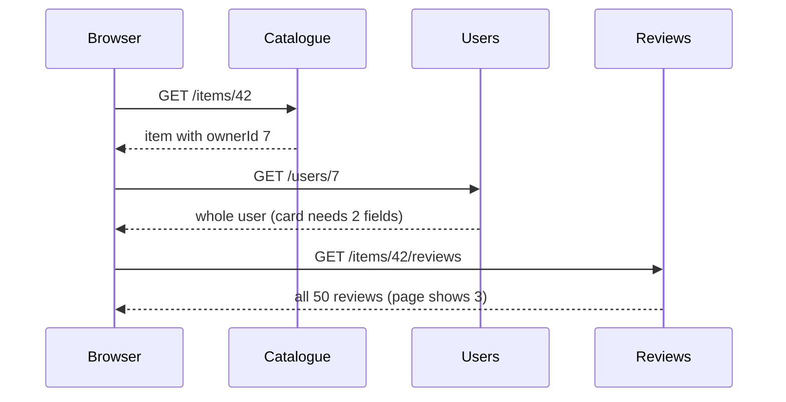
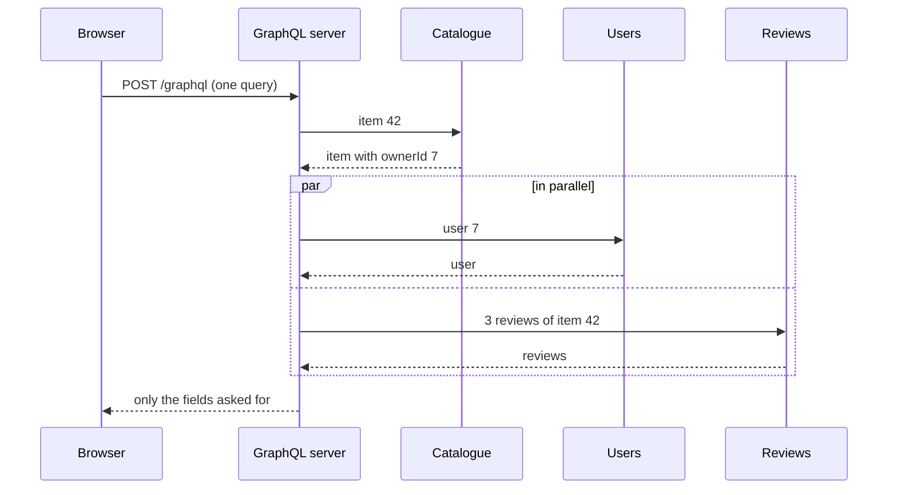
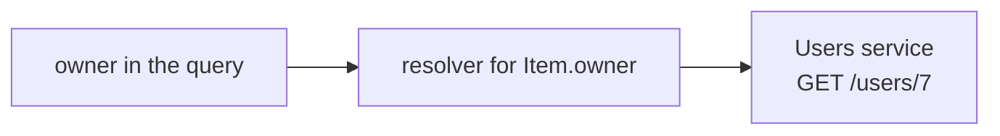
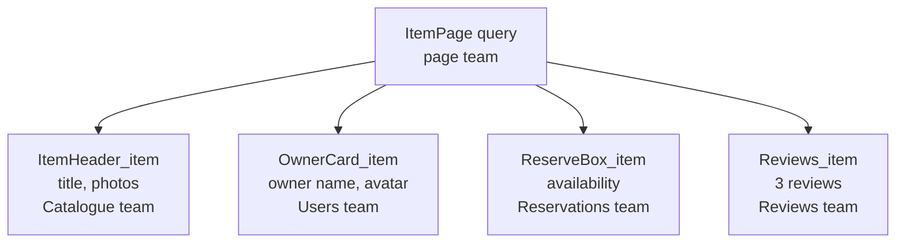
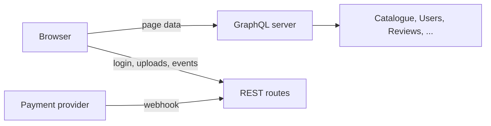

# GraphQL vs REST, and why large sites use both

> You built a REST API with Express, and for one team and one app it is the right tool. Now picture the Lending Desk item page pulling its data from six services, each run by a different team. GraphQL lets that page ask for exactly the data it needs in one request, and lets each component declare its own part. We look at what that solves, what it costs, and why large sites run both.

**Duration:** about 40 minutes

## Contents

- [Where you are coming from](#where-you-are-coming-from)
- [One page, six services](#one-page-six-services)
- [GraphQL in five minutes](#graphql-in-five-minutes)
- [Each component declares its own data](#each-component-declares-its-own-data)
- [What GraphQL costs, and where REST still wins](#what-graphql-costs-and-where-rest-still-wins)
- [When to use which](#when-to-use-which)
- [Takeaways](#takeaways)
- [Further reading](#further-reading)

## Where you are coming from

In an earlier evening you built a REST API with Express: one route per resource, `GET /items/:id`, `POST /reservations`, JSON in and out. For Project 2 that fits. One team owns the API and the frontend, so when a page needs a new field, you add it to the route handler and deploy both.

Now let's grow the Lending Desk into a company-wide platform with millions of users. The item catalogue, users, availability, reservations, reviews and recommendations each belong to a different team and run as a separate service. The item page shows data from all six, and the frontend team owns none of them.

**The core idea of this topic:** GraphQL lets the page fetch all of it in one request. Each component names the fields it needs. That costs things REST gives you for free, so large sites use both.

## One page, six services

Let's load the item page from the REST services. The owner card needs the owner's name, but the item only contains `ownerId`, so the browser has to wait for the item before it can ask for the owner.



Three problems show up:

- **Waterfall.** Each request waits for the one before. `Promise.all` helps only for independent calls: the owner still waits for the item.
- **Over-fetching.** The whole user and all 50 reviews arrive, though the page shows two fields and three reviews.
- **Under-fetching.** The item lacks the owner's name, so you need a second request.

REST has answers: `?include=owner` embeds the owner, sparse fieldsets (`?fields[users]=name`) trim the fields, `?limit=3` caps the reviews. Or you build an endpoint for the page, or a **backend for frontend (BFF)**: a server for one frontend that combines the calls.

For one team, these work well. Here, the frontend team owns none of the six services, so every new `include`, field or page endpoint waits in another team's backlog. And when five teams build one page, a page endpoint belongs to nobody, or to one team that becomes the bottleneck.

GraphQL standardises that combining layer. The browser sends one request to one GraphQL server, which calls the services and returns only the fields asked for.



The waterfall has not disappeared. It moved into the data centre, where a round trip takes a few milliseconds. But the GraphQL server is one more service: a team has to build and run it.

Docs: [JSON:API: inclusion and sparse fieldsets](https://jsonapi.org/format/#fetching-includes), [Sam Newman: Backends for Frontends](https://samnewman.io/patterns/architectural/bff/)

## GraphQL in five minutes

If you know REST, you know most of the ideas already:

| REST | GraphQL | In plain words |
| --- | --- | --- |
| An OpenAPI document | The **schema** | Every type and field the API offers |
| A DTO, the shape of a JSON body | A **type** | One named shape, such as `Item` |
| An endpoint, `GET /items/:id` | A field on `Query`, `item(id: ...)` | An entry point for reading |
| `GET` | A **query** | A read that lists the fields it wants |
| `POST`, `PUT`, `DELETE` | A **mutation** | A write |
| A route handler | A **resolver** | The server function behind one field |
| The status code | The `errors` list | Errors travel in the response body |

**The schema** is like a TypeScript interface for the whole API. `type Query` lists the entry points for reading, like your `GET` routes. `item(id: ID!)` takes an argument, `[Review!]` is a list of reviews, and `!` means "never null".

```graphql
type Query {
  item(id: ID!): Item
}

type Item {
  id: ID!
  title: String!
  owner: User!
  # 👇 may be null, so a failing Reviews service does not break the item
  reviews(first: Int!): [Review!]
}

type User {
  name: String!
  avatarUrl: String
}

type Review {
  rating: Int!
  text: String!
}
```

On the server, each field has a **resolver**. The one for `Item.owner` calls the Users service:



**A query** names the fields the client wants, and the response has the same shape. `$id` is a **variable** of type `ID!`: its value travels next to the query as JSON, like a route parameter.

<table>
<tr><th>Query</th><th>Response</th></tr>
<tr>
<td>

```graphql
query ItemPage($id: ID!) {
  item(id: $id) {
    title
    owner {
      name
    }
    reviews(first: 2) {
      rating
      text
    }
  }
}
```

</td>
<td>

```json
{
  "data": {
    "item": {
      "title": "Cordless drill",
      "owner": { "name": "Mira" },
      "reviews": [
        { "rating": 5, "text": "Strong battery" },
        { "rating": 4, "text": "A bit heavy" }
      ]
    }
  }
}
```

</td>
</tr>
</table>

Every operation goes to the same URL, usually as a `POST` with the query and variables in the JSON body.

If the Reviews service fails, the rest still arrives, with `reviews` set to `null` and an entry in `errors`:

```json
{
  "data": { "item": { "title": "Cordless drill", "owner": { "name": "Mira" }, "reviews": null } },
  "errors": [{ "message": "Reviews unavailable", "path": ["item", "reviews"] }]
}
```

The HTTP status is still a 2xx, usually `200`, so check `errors` yourself. Only a request the server cannot run at all, such as an invalid query, can get a 4xx.

Writes look the same, with the keyword `mutation` instead of `query`, and return the fields you ask for after the change.

Docs: [Queries](https://graphql.org/learn/queries/), [Schemas and types](https://graphql.org/learn/schema/), [Mutations](https://graphql.org/learn/mutations/), [Response](https://graphql.org/learn/response/), [Serving over HTTP](https://graphql.org/learn/serving-over-http/)

<details>
<summary>Going further: one graph, many teams (federation)</summary>

A single GraphQL server that calls every REST service helps, but every new field needs the team that runs it, so it becomes a bottleneck. Large sites therefore often move to a **federated graph**. Each team runs a **subgraph**: a GraphQL service with its own part of the schema. A **gateway** (also called router) composes all subgraphs into one schema and splits each query among them.

Several subgraphs contribute fields to the same type. `@key` says how to identify an item, so the gateway can take the `id` from the Catalogue subgraph and ask the Reviews subgraph for the reviews of that item.

```graphql
# Catalogue subgraph
type Item @key(fields: "id") {
  id: ID!
  title: String!
}

# Reviews subgraph
type Item @key(fields: "id") {
  id: ID!
  reviews(first: Int!): [Review!]
}
```

This is Apollo Federation syntax, with the `@link` header that imports `@key` left out.

Docs: [graphql.org: Federation](https://graphql.org/learn/federation/), [Apollo Federation: entities](https://www.apollographql.com/docs/graphos/schema-design/federated-schemas/entities/intro)

</details>

## Each component declares its own data

One query per page solves the waterfall. But who writes it?

- If **the page** writes it, it lists every field of every team. Each new field means editing the page team's file, and nobody dares remove a field, so the query only grows.
- If **every component** fetches its own data, the teams are independent again, but we are back to many requests and waterfalls.

The answer is **colocation**: each component declares its fields next to its code, as a **fragment**. A fragment is a named list of fields on one type, and `...Name` inserts it into a query. The page composes the fragments into one query. A name like `OwnerCard_item` means: what `OwnerCard` needs from `item`.



Queries and fragments are plain strings, so TypeScript cannot check them. A code generator such as GraphQL Codegen reads them with the schema and writes a type for each, like OpenAPI codegen does for REST. You wrap each string in its generated `graphql(...)` function to get that type.

```tsx
import { graphql, type FragmentType, getFragmentData } from "./gql";

export const OwnerCardFragment = graphql(`
  fragment OwnerCard_item on Item {
    owner { name avatarUrl }
  }
`);

type OwnerCardProps = { item: FragmentType<typeof OwnerCardFragment> };

export function OwnerCard(props: OwnerCardProps) {
  // 👇 unmask: only the fields of OwnerCard_item
  const item = getFragmentData(OwnerCardFragment, props.item);
  return <p>Lent by {item.owner.name}</p>;
}
```

`props.item` arrives **masked**: its type hides every field. `getFragmentData` unmasks it with the component's own fragment.

The page spreads the fragments into its query and hands each component the item:

```tsx
export const itemPageQuery = graphql(`
  query ItemPage($id: ID!) {
    item(id: $id) {
      title
      ...OwnerCard_item
      ...Reviews_item
    }
  }
`);

// ... run the query with your GraphQL client
return (
  <>
    <h1>{item.title}</h1>
    <OwnerCard item={item} />
    <Reviews item={item} />
  </>
);
```

The fragments become part of the query, so the page still sends one request.

This is **data masking**: a component sees only the fields its own fragment lists. In `ItemPage`:

```tsx
item.title; // fine: the page asked for it
item.owner.name; // TypeScript error: only OwnerCard asked for it
```

So no team depends on another team's fields by accident, and removing a field from your fragment breaks only your own component.

Docs: [The Guild: fragments with GraphQL Codegen](https://the-guild.dev/blog/unleash-the-power-of-fragments-with-graphql-codegen)

<details>
<summary>Going further: Relay and the Codegen setup</summary>

**Relay**, Meta's GraphQL client for React, introduced this model. Its compiler expects fragment names that start with the module name, generates the types, and masks the data at runtime too, not only in TypeScript. A component reads its fragment with the `useFragment` hook. Relay's ESLint rule `relay/unused-fields` reports fields a module requests but never reads.

In GraphQL Codegen's client preset, `getFragmentData` is called `useFragment` by default, though it is not a hook. The `unmaskFunctionName` option renames it.

Docs: [Relay: Thinking in Relay](https://relay.dev/docs/principles-and-architecture/thinking-in-relay/), [Relay: fragments](https://relay.dev/docs/guided-tour/rendering/fragments/), [eslint-plugin-relay](https://github.com/relayjs/eslint-plugin-relay), [Codegen client preset](https://the-guild.dev/graphql/codegen/plugins/presets/preset-client)

</details>

## What GraphQL costs, and where REST still wins

GraphQL moves work from the client to the server and to tooling. Here is where it lands.

| Concern | REST | GraphQL |
| --- | --- | --- |
| **Caching** | The URL is the cache key. Browsers and CDNs (shared caches near the user) store a `GET` with `Cache-Control`. | Usually a `POST` to one URL, which caches skip. A **persisted query** helps: a `GET` with a short ID for a query the server already knows. |
| **HTTP features** | Redirects and file uploads are plain HTTP. | Not part of GraphQL. Files usually go over plain HTTP. |
| **Errors** | One status code per request. | A failed field still returns a 2xx, usually `200`. Monitoring that counts status codes misses it. |
| **Authorization** | Checked in each route handler. | Many queries reach the same field, so check permissions once, in the code the resolvers call. |
| **Expensive queries** | You know every request in advance. | Clients write their own: 100 items with 100 reviews each is 10,000 reviews. Servers limit depth and cost. |
| **Running it** | `fetch` and Express. | A schema, a server a team runs, codegen, schema checks in CI. |

Docs: [Best practices](https://graphql.org/learn/best-practices/), [Authorization](https://graphql.org/learn/authorization/), [Security](https://graphql.org/learn/security/), [Apollo: file upload best practices](https://www.apollographql.com/blog/file-upload-best-practices)

<details>
<summary>Going further: caching with persisted queries</summary>

Queries may be sent with `GET`, which caches can store. Long queries do not fit into URL length limits, so the client sends a short identifier instead of the query text, a **persisted query**: `GET /graphql?documentId=<hash>&variables=...` (parameter names differ between tools). The server still has to send `Cache-Control`, and a response that mixes public item data with the logged-in user's data cannot be cached publicly.

Docs: [Serving over HTTP](https://graphql.org/learn/serving-over-http/), [Relay: persisted queries](https://relay.dev/docs/guides/persisted-queries/)

</details>

<details>
<summary>Going further: the N+1 problem and DataLoader</summary>

A list of 20 reviews, each with an `author` field, runs the `author` resolver 20 times: one request for the list plus 20 for the authors. **DataLoader** collects the keys requested while the query runs and calls your batch function once.

```ts
// one loader per request, so cached users never leak between requests
export function createUserLoader(usersApi: UsersApi) {
  return new DataLoader<string, User>(async (ids) => {
    // 👇 one call for all ids
    const users = await usersApi.getMany(ids);
    return ids.map((id) => users.find((user) => user.id === id) ?? new Error(`No user ${id}`));
  });
}

// resolver for Review.author, with the loader in the request context
const author = (review: Review, _args: unknown, context: Context) =>
  context.userLoader.load(review.authorId);
```

The batch function must return one result per key, in the same order as the keys.

Docs: [graphql.org: Performance](https://graphql.org/learn/performance/), [DataLoader](https://github.com/graphql/dataloader)

</details>

## When to use which

| Situation | Use |
| --- | --- |
| One team, one app, a handful of resources (Project 2) | REST |
| Public data a CDN should cache, file uploads, login redirects, webhooks | REST |
| A page or several clients combining data from many services | GraphQL |
| Many teams building parts of the same page | GraphQL with fragments |

A large Lending Desk ends up with both:



## Takeaways

- GraphQL fetches exactly the fields a page needs from many services in one request. The waterfall moves to the server, close to the data.
- REST can do much of this with `?include=`, sparse fieldsets or a BFF. GraphQL pays off when many teams share a page and the frontend team owns none of the services.
- Fragments let each component declare its own fields, and data masking keeps the teams independent.
- GraphQL costs what REST gives you for free: URL caching, plain HTTP features and status codes. And a team has to run the server.
- Decide per use case, not per company. Most large sites run both.

## Further reading

- [graphql.org: Learn](https://graphql.org/learn/), the official introduction, including performance, security and federation
- [GraphQL over HTTP specification](https://http-spec.graphql.org/draft/), how requests and status codes work
- [Relay: Thinking in Relay](https://relay.dev/docs/principles-and-architecture/thinking-in-relay/), the reasoning behind colocation and data masking
- [GraphQL Codegen: client preset](https://the-guild.dev/graphql/codegen/plugins/presets/preset-client)
- [graphql.org: Governance and versioning](https://graphql.org/learn/governance-versioning/), how to change a schema without `/v2`
- [Apollo Federation documentation](https://www.apollographql.com/docs/graphos/schema-design/federated-schemas/federation)
