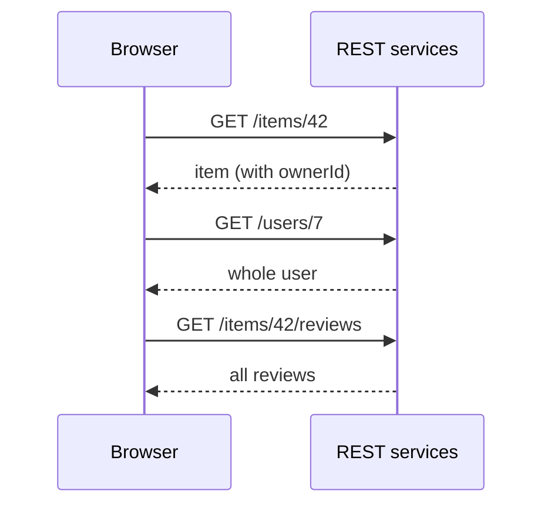
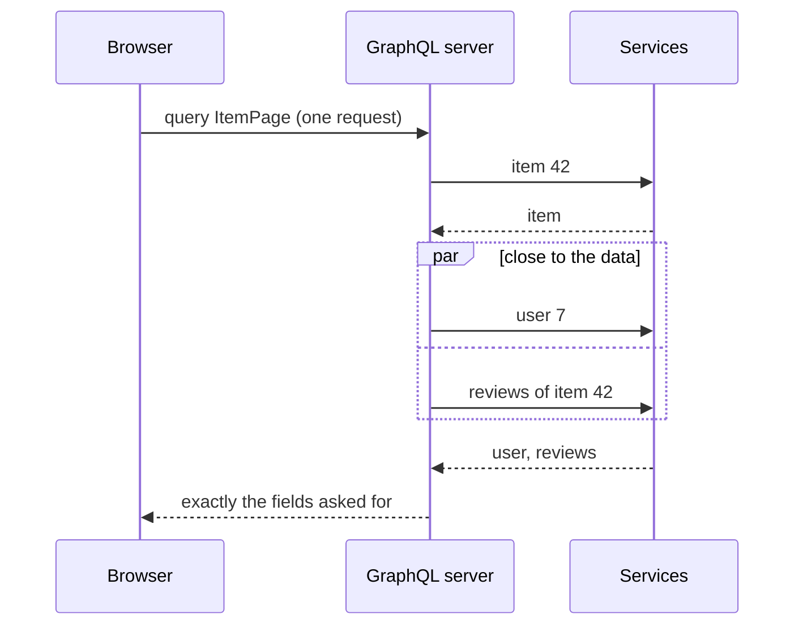
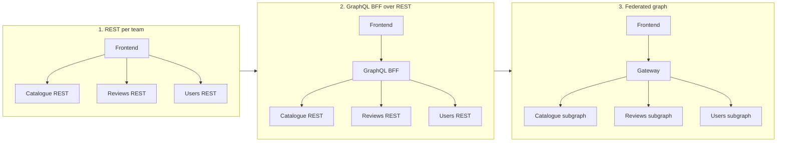
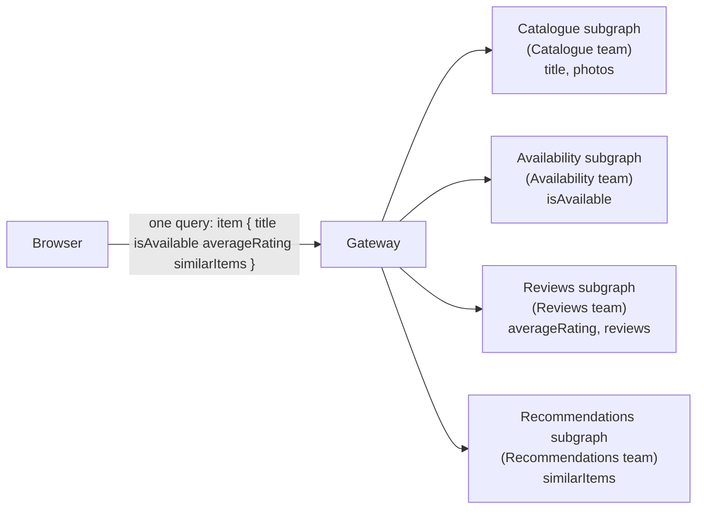

# GraphQL vs REST, and why large sites use both

> You built a REST API with Express, and it does its job. Now picture the Lending Desk with dozens of teams, each running its own service, and an item page that needs data from six of them. We look at the problems GraphQL solves in that setting, how large sites usually get from REST to one federated graph, and why they still keep REST endpoints next to it. You leave with a decision table for your own projects.

**Duration:** about 40 minutes

## Contents

- [Where you are coming from](#where-you-are-coming-from)
- [GraphQL in five minutes](#graphql-in-five-minutes)
- [The problems GraphQL addresses](#the-problems-graphql-addresses)
- [A typical evolution at scale](#a-typical-evolution-at-scale)
- [Where REST still wins](#where-rest-still-wins)
- [What GraphQL costs](#what-graphql-costs)
- [When to use which](#when-to-use-which)
- [Takeaways](#takeaways)
- [Further reading](#further-reading)

## Where you are coming from

In an earlier evening you built a REST API with Express: one route per resource, `GET /items/:id`, `POST /reservations`, JSON in and out. For Project 2 that is a good fit. One team owns the API and the frontend, so when the item page needs a new field, you add it to the route handler and deploy both.

Now let's grow the Lending Desk. Imagine it has become a company-wide platform with millions of users. The item catalogue, availability, reservations, reviews, recommendations and notifications are each owned by a different team and run as a separate service. The item page now shows data from most of them, and the frontend team does not own any of those services.

The questions change:

- Which service do I call for which field, and in which order?
- Who adds a field when my page needs one?
- How do I stop downloading 50 reviews when the page shows three?
- How does a service team change its API without breaking pages it has never seen?

GraphQL is one answer to these questions. It also brings new problems. This topic covers both.

## GraphQL in five minutes

Most of you have not used GraphQL yet, so here is enough to read the rest of this page.

**The schema** describes every type and field the API offers. It is typed, like a TypeScript interface for your whole API. The server publishes it; clients and tools read it.

```graphql
type Item {
  id: ID!
  title: String!
  photos: [Photo!]!
  owner: User!
  reviews(first: Int!): [Review!]!
}

type User {
  id: ID!
  name: String!
  avatarUrl: String
}

type Review {
  id: ID!
  rating: Int!
  text: String!
}

type Query {
  item(id: ID!): Item
}
```

`!` means "never null". `Query` is the entry point for reads.

**A query** asks for exactly the fields the client needs. The response has the same shape as the query.

```graphql
query ItemPage($id: ID!) {
  item(id: $id) {
    title
    owner {
      name
      avatarUrl
    }
    reviews(first: 3) {
      rating
      text
    }
  }
}
```

**A fragment** is a named, reusable selection of fields on one type. Large frontends use one fragment per component, so each component lists the fields it reads.

```graphql
fragment OwnerCard on User {
  name
  avatarUrl
}

query ItemPage($id: ID!) {
  item(id: $id) {
    title
    owner {
      ...OwnerCard # 👇 the fields of OwnerCard are inserted here
    }
  }
}
```

**A mutation** changes data. It looks like a query and returns the fields you ask for after the change.

```graphql
mutation ReserveItem($itemId: ID!, $from: Date!, $to: Date!) {
  reserveItem(itemId: $itemId, from: $from, to: $to) {
    id
    status
  }
}
```

**One endpoint.** A GraphQL server usually serves every operation from a single URL such as `/graphql`. Queries can be sent with `GET`; mutations must be sent with `POST`. Most clients send everything as `POST` by default, with a JSON body that contains the query text and the variables.

**`errors` next to `data`.** If one field fails, GraphQL still returns the fields that worked. The failed field is `null` in `data`, and an entry in `errors` says what went wrong and where (`path`). This is called a partial response. Because HTTP has no status code for "partial success", the server answers with a `2xx` status, in practice `200`.

```json
{
  "data": {
    "item": { "title": "Cordless drill", "owner": { "name": "Mira" }, "reviews": null }
  },
  "errors": [{ "message": "Reviews service unavailable", "path": ["item", "reviews"] }]
}
```

Your `fetch` sees `response.ok === true` here. You have to look at `errors` yourself.

Docs: [Queries](https://graphql.org/learn/queries/), [Schemas and types](https://graphql.org/learn/schema/), [Mutations](https://graphql.org/learn/mutations/), [Response](https://graphql.org/learn/response/), [Serving over HTTP](https://graphql.org/learn/serving-over-http/)

## The problems GraphQL addresses

### Over- and under-fetching

A REST endpoint returns a fixed shape. `GET /users/7` returns the whole user: name, avatar, email, address, preferences. The owner card on the item page needs two of those fields. That is **over-fetching**: you download, parse and maybe serialise data nobody looks at. On a phone on a train, those bytes cost time.

The opposite also happens. `GET /items/42` returns `ownerId: 7` but not the owner's name. You need a second request. That is **under-fetching**.

With GraphQL, the client lists the fields it wants. The server returns those and nothing else.

### Request waterfalls

Let's load the item page from three REST endpoints. A first version usually looks like this:

```ts
const item = await getJson<Item>(`/items/${id}`);
const owner = await getJson<User>(`/users/${item.ownerId}`); // 👇 needs item first
const reviews = await getJson<Review[]>(`/items/${id}/reviews`);
```

Each `await` waits for a full round trip before the next request starts. That chain is a **waterfall**.



You can move the reviews request into a `Promise.all` with the item request, but the owner still waits for the item, because you need `ownerId` first. The best you get is two round trips, and the more related data a page shows, the longer that chain grows.

With GraphQL, the browser sends one query. The server resolves the item, then the owner and reviews, close to the data, where a round trip takes milliseconds instead of a mobile network's hundreds.



The waterfall has not disappeared. It moved to the server, where it is cheaper and where one team can optimise it for every client.

### Who decides the shape of the data

With REST, the **server team** decides what each endpoint returns. When the item page needs a new field, the frontend team asks for it, waits, and the field then goes to every client of that endpoint.

With GraphQL, the work splits differently:

- the **server** decides what is *possible*: the types, fields and arguments in the schema;
- the **client** decides what it *gets*: the fields in its query.

A frontend team can build a new view from existing fields without asking anyone. A service team can add a field without affecting clients that do not ask for it.

### Versioning

With REST, a fixed response shape means almost any change can break someone: renaming a field, changing its type, sometimes even adding one. The usual answer is a new version, `/v2/items`, and running both for a while.

GraphQL avoids versions. The server only returns fields a client explicitly requested, so adding a type or a field breaks nobody. To remove a field, you mark it as deprecated first:

```graphql
type Item {
  title: String!
  name: String! @deprecated(reason: "Use `title`.")
}
```

Tools and editors warn anyone who still uses `name`. The schema evolves continuously instead of in versions. [What GraphQL costs](#what-graphql-costs) shows the catch: you have to know when the last client stopped asking for `name`.

Docs: [Schema design: versioning](https://graphql.org/learn/schema-design/), [Directives: `@deprecated`](https://graphql.org/learn/schema/#directives)

## A typical evolution at scale

Few large sites start with GraphQL. Here is a common path, told as the Lending Desk's story.



### Stage 1: REST services per team

Each team builds and runs its own REST service. That is good for the teams: they deploy independently and own their data. It is harder for the frontend, which now talks to many services, each with its own URL conventions, error format and authentication details. Every page orchestrates its own calls, and the waterfalls from the previous section show up everywhere.

### Stage 2: a GraphQL layer in front of REST

To hide that complexity, a team builds a **Backend for Frontend (BFF)**: a server that exists to serve one frontend. Here the BFF is a GraphQL server. Its resolvers call the existing REST services. The frontend sends one query; the BFF fans out.

This helps a lot, but the schema shows where it came from. It often mirrors the REST endpoints instead of the domain:

```graphql
type Query {
  item(id: ID!): Item
  # 👇 REST-style pagination and IDs passed around as arguments
  reviewsForItem(itemId: ID!, offset: Int, limit: Int): [Review!]!
  reservationsForUser(userId: ID!): [Reservation!]!
}

type Item {
  id: ID!
  title: String!
  ownerId: ID! # an ID instead of a link to the User type
}
```

Typical signs: `offset` and `limit` copied from query strings, `userId` arguments that the client has to fill in (although the server knows who is logged in), and `ownerId` fields instead of `owner: User!`. A graph-shaped design would read `item { owner { name } reviews(first: 3) { ... } }` and `viewer { reservations }`. Cleaning this up later means deprecating fields, which brings us to the costs below.

The BFF has another limit: one team owns it, and every other team needs that team to expose their new fields. It becomes a bottleneck.

### Stage 3: a federated graph

**Federation** splits the graph back to the teams, without splitting it for the client. Each team runs a **subgraph**: a GraphQL service with its own part of the schema. A **gateway** (also called router) composes all subgraphs into one schema, the supergraph, and serves it at one endpoint. For each query, the gateway works out which subgraphs to ask and merges the results.

The key idea is that one type can get its fields from many services. An `Item` is identified by its `id` (the **key**), and each subgraph contributes the fields it owns:

```graphql
# Catalogue subgraph
type Item @key(fields: "id") {
  id: ID!
  title: String!
  photos: [Photo!]!
}

# Availability subgraph
type Item @key(fields: "id") {
  id: ID!
  isAvailable(from: Date!, to: Date!): Boolean!
}

# Reviews subgraph
type Item @key(fields: "id") {
  id: ID!
  averageRating: Float
  reviews(first: Int!): [Review!]!
}
```



The client sees one `Item` type. It does not know or care that four teams serve it. Each team deploys its subgraph independently, and the gateway checks at composition time that the subgraphs fit together.

Two public implementations you will meet:

- **Apollo Federation** introduced the approach and its `@key` directive. The schema snippet above uses that syntax.
- **GraphQL Fusion** from ChilliCream is a gateway built on the GraphQL Composite Schemas specification, an open standard that the GraphQL Foundation's working group develops so that gateways and subgraphs from different vendors work together.

Federation needs real infrastructure: a gateway, a schema registry that checks every subgraph change against the others, and usually a team that runs both and helps the other teams design their parts.

Docs: [Federation](https://graphql.org/learn/federation/), [Apollo Federation: entities](https://www.apollographql.com/docs/graphos/schema-design/federated-schemas/entities/intro), [Fusion](https://chillicream.com/docs/fusion)

## Where REST still wins

A company that runs a federated graph still has plenty of REST endpoints. That is not a migration left unfinished. In these cases REST is the better tool.

**HTTP and CDN caching.** A `GET /items/42/photos` response with `Cache-Control: public, max-age=300` can be cached by the browser, by every proxy and by the CDN, with no code on your side. The URL is the cache key. GraphQL requests are usually `POST` to one URL, which those caches do not store. More on this in [What GraphQL costs](#what-graphql-costs).

**File uploads.** The GraphQL specification has no file type. Uploading a photo through GraphQL needs a community extension (the multipart request spec) and extra protection against cross-site request forgery. Apollo's own guidance is to upload outside the GraphQL server: a mutation hands out a signed URL, and the browser sends the file there as a plain HTTP upload.

**Endpoints whose job is a side effect on HTTP itself.** Logging in, logging out, switching the language or accepting cookies set or clear cookies and then often redirect. That is HTTP's job: `Set-Cookie` headers and `303` redirects. A route handler that does exactly that is clearer than a mutation whose return value nobody reads.

**Fire-and-forget beacons.** Analytics events and error reports are often sent while the user leaves the page. With `keepalive: true`, the browser finishes the request even after the page is gone. The body is limited to 64 KiB, and you never read the response, so a GraphQL round trip adds nothing.

```ts
export function trackEvent(event: TrackingEvent): void {
  fetch("/api/events", {
    method: "POST",
    headers: { "Content-Type": "application/json" },
    body: JSON.stringify(event),
    keepalive: true, // 👇 survives navigation and tab close
  });
}
```

**Third-party APIs and webhooks.** Payment providers, shipping companies and identity providers offer REST APIs and call your webhooks with REST requests. You adapt to them, not the other way round. Some of those calls are wrapped in a subgraph later; the webhook receiver stays a REST endpoint.

**Small apps.** If one team owns the API and its only client, as in Project 2, most of the problems in this topic do not exist yet. A schema, a gateway and a code generator are overhead you do not need.

Docs: [MDN: `fetch` `keepalive`](https://developer.mozilla.org/en-US/docs/Web/API/RequestInit#keepalive), [GraphQL multipart request spec](https://github.com/jaydenseric/graphql-multipart-request-spec), [Apollo: file upload best practices](https://www.apollographql.com/blog/file-upload-best-practices)

## What GraphQL costs

GraphQL moves complexity from the client to the server and to tooling. Here is where it lands.

### No CDN cache by default

A `POST` to `/graphql` is not cached by browsers or CDNs. For pages whose data is the same for everyone, such as a public item page, you lose the cheapest cache there is.

You can get some of it back. Queries may be sent with `GET`, which caches can store. Long queries do not fit into URL length limits, so the client sends a short hash of the query instead of its text, a **persisted query**. `GET /graphql?documentId=<hash>&variables=...` is a URL a CDN can cache (parameter names differ between tools). The server still has to send `Cache-Control` headers, and a response that mixes public item data with the logged-in user's data cannot be cached publicly.

### Persisted operations couple deploys together

**Persisted operations** (also called **trusted documents**) take the idea one step further. At build time, the client's tooling extracts every operation the app contains and registers it with the server. In production, the server accepts only registered operations. Anything else is rejected.

This turns the list of operations into an **allow-list**. An attacker cannot send an expensive query you never wrote. The cost is coupling: each frontend deploy must register its operations **before** the new code reaches users, or its requests fail. And the server must keep the operations of old versions registered as long as old clients may still send them.

Automatic persisted queries (APQ), where the client registers unknown hashes at runtime, save bandwidth but are not a security feature.

### Schema evolution never ends

"Deprecate instead of breaking" is the rule, and it is cheap to say. Removing a deprecated field is safe only when no client asks for it any more. On a large site, old clients live longer than you think:

- tabs that stay open for days and keep running yesterday's JavaScript;
- cached or statically generated pages that reference an old bundle;
- mobile apps that users do not update;
- bots and scrapers that replay old requests.

So teams measure field usage in production and remove a field only once the numbers show no client is still asking for it. Some fields stay deprecated for months.

### Checking the client against the production schema

The Relay compiler and GraphQL Codegen check your operations against a schema file at build time. That check is only as good as the file. If your local schema is newer than production, your code may use a field that is not deployed yet.

Large teams therefore check twice in CI:

- the **client** against the schema that is in production now, for example with `graphql-inspector validate`, which also reports use of deprecated fields;
- every **schema change** against the operations that active client versions send, which a schema registry can do.

### Partial errors

`200 OK` no longer means "it worked". Every client has to decide, field by field, what a `null` plus an `errors` entry means: hide the reviews section, show a fallback, or fail the page. Monitoring that counts HTTP status codes sees none of it, so you need to log GraphQL errors separately.

### Query cost and N+1 on the server

A client can now write queries that are expensive to run. `items(first: 100) { reviews(first: 100) { author { ... } } }` is one small request and up to ten thousand lookups. Servers protect themselves with pagination limits, depth limits and cost analysis, and persisted operations help because only known queries run.

Inside a single query there is a second trap: the **N+1 problem**. A list of 20 reviews, each with an `author` field, runs the `author` resolver 20 times. Done naively, that is one request for the list plus 20 requests for the authors. The usual fix is **DataLoader**: it collects all keys requested in the same tick and calls your batch function once.

```ts
import DataLoader from "dataloader";

// Create one loader per request, so the cache never leaks between users.
export function createLoaders(usersApi: UsersApi) {
  return {
    user: new DataLoader<string, User>(async (ids) => {
      const users = await usersApi.getMany(ids); // 👇 one call for all ids
      const byId = new Map(users.map((user) => [user.id, user]));
      return ids.map((id) => byId.get(id) ?? new Error(`User ${id} not found`));
    }),
  };
}

// In the resolver for Review.author:
// author: (review, _args, context) => context.loaders.user.load(review.authorId)
```

The batch function must return one result per key, in the same order as the keys.

### Tooling complexity

A GraphQL frontend at scale usually involves a schema registry, a gateway, a compiler or code generator, generated types, an operation registry, lint rules and schema checks in CI. Each piece solves a real problem, and each needs someone who understands it. Count that cost before you start.

Docs: [Performance](https://graphql.org/learn/performance/), [Serving over HTTP: GET and persisted documents](https://graphql.org/learn/serving-over-http/), [Trusted documents](https://benjie.dev/graphql/trusted-documents), [Relay: persisted queries](https://relay.dev/docs/guides/persisted-queries/), [GraphQL Inspector: validate](https://the-guild.dev/graphql/inspector/docs/commands/validate), [DataLoader](https://github.com/graphql/dataloader)

## When to use which

| Situation | REST | GraphQL | Both |
| --- | --- | --- | --- |
| One team, one app, a handful of resources (Project 2) | ✓ | | |
| Public data that should be cached by a CDN | ✓ | possible with persisted `GET` queries | |
| File uploads, cookies, redirects, beacons | ✓ | | |
| Webhooks and third-party integrations | ✓ | | |
| A page that combines data from several services | | ✓ | |
| Many clients (web, apps) that need different fields of the same data | | ✓ | |
| Many teams contributing to one product | | ✓ (federated) | |
| A large site with all of the above | | | ✓ GraphQL for page data, REST for the HTTP-shaped jobs |

A useful rule of thumb: use GraphQL for **reading and changing domain data** that pages compose, and keep REST for everything that is really about **HTTP**: caching by URL, files, cookies, redirects and requests that outlive the page.

## Takeaways

- GraphQL addresses problems that appear with many services and many teams: over-fetching, under-fetching, waterfalls, unclear ownership of data shapes, and versioning.
- The usual path is REST per team, then a GraphQL BFF over REST, then a federated graph where each team owns the fields it serves.
- REST stays the better tool for CDN caching, uploads, cookies, beacons, webhooks and small apps.
- GraphQL's costs are real: no CDN cache by default, deploys coupled to registered operations, slow schema evolution, partial errors and server-side cost control.
- Decide per use case, not per company. Most large sites run both.

## Further reading

- [graphql.org: Learn](https://graphql.org/learn/), the official introduction, including the pages on performance, security and federation
- [GraphQL over HTTP specification](https://http-spec.graphql.org/draft/), how requests and status codes work
- [Apollo Federation documentation](https://www.apollographql.com/docs/graphos/schema-design/federated-schemas/federation)
- [GraphQL Federation specification](https://github.com/graphql/graphql-federation-spec), the open standard behind GraphQL Fusion
- [Benjie Gillam: Trusted documents](https://benjie.dev/graphql/trusted-documents)
- [DataLoader on GitHub](https://github.com/graphql/dataloader)
- [Hive: app deployments](https://the-guild.dev/graphql/hive/docs/schema-registry/app-deployments), registering operations per app version
- Related topic: [Who loads which data? Colocation at scale](../data-per-component/README.md)
