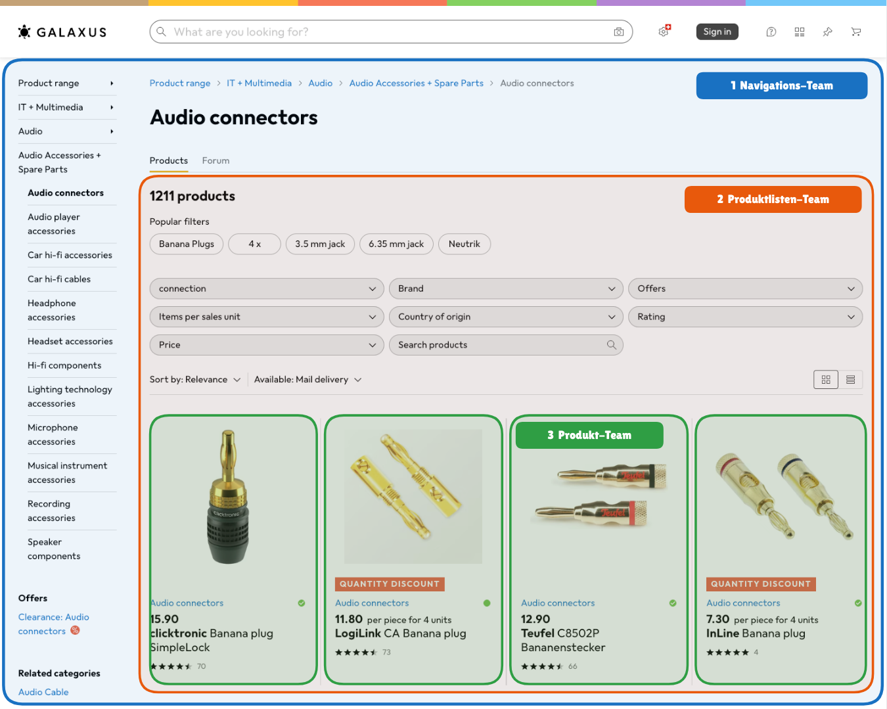
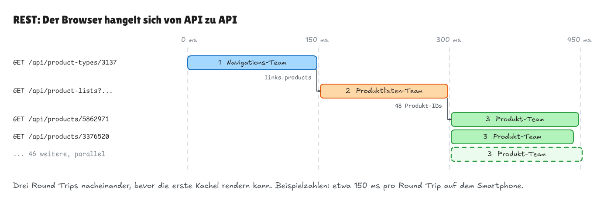
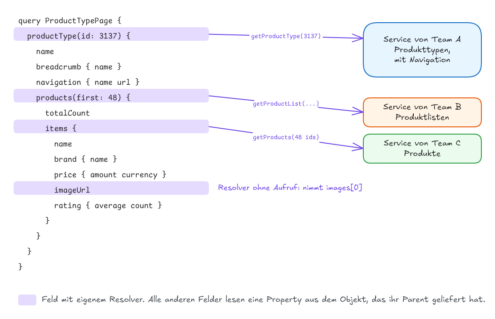
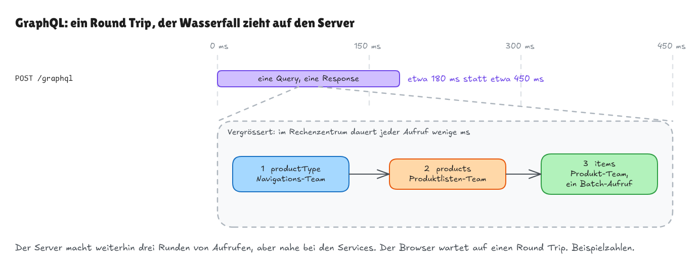
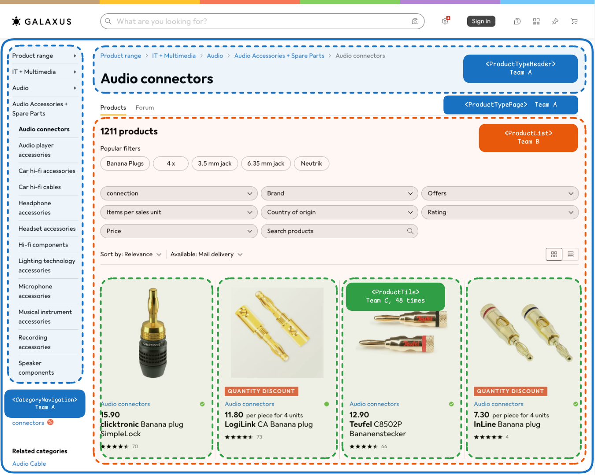
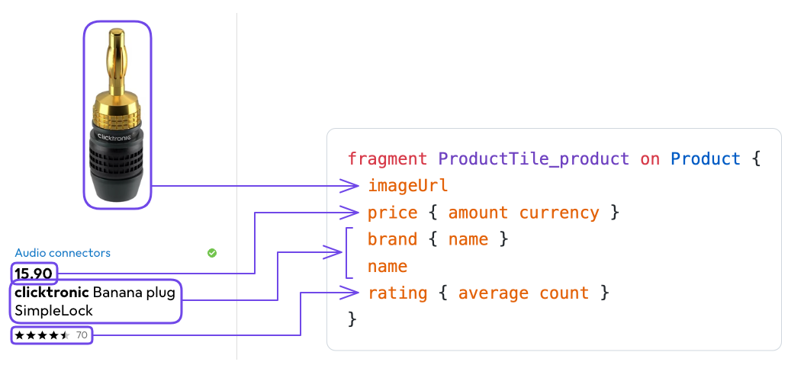
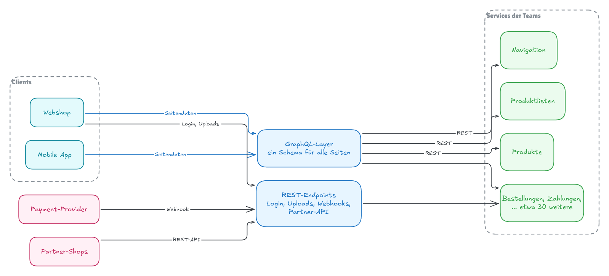

# Over- und Under-Fetching lösen mit GraphQL

**Das Problem:** Die Daten einer Seite kommen von mehreren Services, die verschiedenen Teams gehören. Mit REST lädt der Browser sie in mehreren Runden nacheinander, bekommt Felder, die er nie anzeigt, und muss für fehlende Daten trotzdem nachfragen. Jede Runde kostet einen Round Trip.

**Dauer:** etwa 60 Minuten

## Inhalt

- [REST in Kürze](#rest-in-kürze)
- [Das Beispiel: eine Seite, drei Teams](#das-beispiel-eine-seite-drei-teams)
- [Das Problem: die Seite mit REST laden](#das-problem-die-seite-mit-rest-laden)
- [Die Lösung: GraphQL](#die-lösung-graphql)
- [Fragments: jede Komponente deklariert ihre Daten](#fragments-jede-komponente-deklariert-ihre-daten)
- [Geht das nicht auch mit REST?](#geht-das-nicht-auch-mit-rest)
- [Was GraphQL kostet](#was-graphql-kostet)
- [GraphQL und REST in einer grossen Firma](#graphql-und-rest-in-einer-grossen-firma)
- [Zusammenfassung](#zusammenfassung)

## REST in Kürze

Jede **Ressource** hat eine URL, und HTTP-Methoden sagen, was mit ihr geschehen soll.

```http
GET /api/products/5862971 HTTP/1.1
Accept: application/json
```

```json
{
  "id": 5862971,
  "name": "Banana plug SimpleLock",
  "brand": { "id": 4401, "href": "/api/brands/4401" }
}
```

Verwandte Ressourcen erscheinen oft als Links (`href`), denen der Client mit dem nächsten Request folgt.

Gehören API und Frontend demselben Team, ist ein neues Feld auf einer Seite eine Änderung an einem Route Handler. Das funktioniert nicht mehr, sobald die Seite Daten aus **Services anderer Teams** braucht.

## Das Beispiel: eine Seite, drei Teams

Unser Beispiel ist eine echte Seite: [Audio-Steckverbinder auf galaxus.ch](https://www.galaxus.ch/en/s1/producttype/audio-connectors-3137). Die Teams, APIs und Responses dazu sind **erfunden**. Sie beschreiben nicht, wie Galaxus gebaut ist.

Drei Teams teilen sich die Seite:

- **Team A (Navigation)** gehört die Seite selbst mit Titel, Breadcrumb und Sidebar.
- **Team B (Produktlisten)** gehört die Liste: welche Produkte zu den Filtern passen, wie viele es sind und in welcher Reihenfolge.
- **Team C (Produkte)** gehören die Kacheln: Name, Marke, Preis, Bilder und Bewertungen eines Produkts.



Jedes Team betreibt einen eigenen Service mit eigener REST API. **Die Verschachtelung ist auch die Ladereihenfolge:** Die Seite braucht die Produktliste von Team B, und die Liste braucht die Produkte von Team C.

## Das Problem: die Seite mit REST laden

### Runde 1: der Produkttyp von Team A

Die Produkttyp-ID `3137` steht in der URL. Team A liefert Titel, Breadcrumb und Sidebar:

```jsonc
// GET /api/product-types/3137
{
  "id": 3137,
  "name": "Audio connectors",
  "breadcrumb": [{ "name": "IT + Multimedia", "href": "/api/categories/1" } /* ... */],
  "navigation": [
    { "name": "Audio player accessories", "url": "/en/s1/producttype/2918" } /* ... */
  ],
  // 👇 the page shows none of these
  "seoText": "Explore our comprehensive selection of audio connectors ...",
  "synonyms": ["audio plug", "jack plug"],
  "links": {
    // 👇 where to get the products
    "products": "/api/product-lists?productTypeId=3137"
  }
}
```

### Runde 2: die Produktliste von Team B

Die Produktliste ist nur verlinkt, der Browser muss also **auf Runde 1 warten**:

```jsonc
// GET /api/product-lists?productTypeId=3137&limit=48
{
  "totalCount": 1211,
  "filters": [{ "id": "brand", "name": "Brand", "optionCount": 87 } /* ... */],
  "items": [
    // 👇 only links: the tiles need another round trip
    { "productId": 5862971, "href": "/api/products/5862971" },
    { "productId": 3376520, "href": "/api/products/3376520" }
    // ... 46 more
  ]
}
```

### Runde 3: die Produkte von Team C

Der Browser fragt Team C **für jedes der 48 Produkte** einzeln an:

```jsonc
// GET /api/products/5862971
{
  "id": 5862971,
  "name": "Banana plug SimpleLock",
  "brand": { "id": 4401, "name": "clicktronic", "href": "/api/brands/4401" },
  "price": { "amount": 15.9, "currency": "CHF" },
  "images": ["/images/5862971-1.jpg", "/images/5862971-2.jpg" /* ... 10 more */],
  "rating": { "average": 4.6, "count": 70 },
  // 👇 the tile shows none of these
  "description": "The SimpleLock banana plug fits cables up to 6 mm² ...",
  "specifications": [{ "name": "Connector", "value": "4 mm banana" } /* ... 60 more */],
  "warranty": "2 years",
  "weightGrams": 12
}
```

### Under-Fetching, Over-Fetching und ein Wasserfall



Drei Probleme, und die ersten beiden treten gleichzeitig auf:

- **Under-Fetching.** Einer Response fehlen Daten, die die Seite braucht. Die Produktliste enthält nur Links, jede Kachel braucht einen eigenen Request.
- **Over-Fetching.** Eine Response enthält Daten, die die Seite nicht braucht. Jedes Produkt kommt mit Beschreibung und 60 Spezifikationen, obwohl die Kachel fünf Felder zeigt.
- **Wasserfall.** Jede Runde wartet auf die vorherige. `Promise.all` hilft nur innerhalb einer Runde. HTTP/2 und HTTP/3 ändern daran nichts: Eine Runde, die auf die Daten der vorherigen wartet, wartet trotzdem.

Jede Runde kostet mindestens einen Round Trip. Auf 4G dauert er typischerweise unter 100 ms, auf 3G 100 bis 500 ms ([High Performance Browser Networking](https://hpbn.co/mobile-networks/)). Die Zahlen in den Grafiken sind Beispielwerte.

## Die Lösung: GraphQL

### GraphQL in drei Snippets

Drei Snippets von graphql.org, leicht angepasst.

**Das Schema** beschreibt jeden Typ und jedes Feld, das die API anbietet, wie ein TypeScript-Interface für die ganze API. `type Query` listet die Einstiegspunkte zum Lesen, wie deine `GET`-Routen.

```graphql
type Query {
  project(name: String!): Project
}

type Project {
  name: String
  tagline: String
  contributors: [User]
}
```

`!` bedeutet "nie `null`", `[User]` ist eine Liste.

**Die Query** nennt die Felder, die der Client will:

```graphql
{
  project(name: "GraphQL") {
    tagline
  }
}
```

**Die Response** hat dieselbe Form wie die Query, steckt in `data` und enthält nur die angefragten Felder:

```json
{
  "data": {
    "project": {
      "tagline": "A query language for APIs"
    }
  }
}
```

**Der Client bestimmt, welche Felder zurückkommen.** Die Begriffe, übersetzt in REST:

| GraphQL                 | In REST hiesse das                  |
| ----------------------- | ----------------------------------- |
| **Schema**              | Ein OpenAPI-Dokument                |
| **Typ**, etwa `Project` | Die Form eines JSON-Bodys           |
| **Feld auf `Query`**    | Ein Endpoint, `GET /projects/:name` |
| **Query**               | Ein `GET`-Request                   |
| **Resolver**            | Ein Route Handler                   |

Schreibzugriffe heissen **Mutation**, wie `POST`, `PUT` oder `DELETE`. Jede Query und jede Mutation geht **an dieselbe URL**, meist als `POST /graphql` mit der Query und ihren Variablen im JSON-Body.

Doku: [graphql.org](https://graphql.org/), [Queries](https://graphql.org/learn/queries/), [Schemas und Typen](https://graphql.org/learn/schema/), [Auslieferung über HTTP](https://graphql.org/learn/serving-over-http/)

### Eine Query für die ganze Seite

Ein GraphQL-Server ist **eine eigene Schicht zwischen Browser und Services**. Sein Schema und seine Resolver schreibst du selbst, zum Beispiel mit Apollo Server oder GraphQL Yoga. Für unsere Seite sieht das Schema vereinfacht so aus:

```graphql
type Query {
  productType(id: ID!): ProductType
}

type ProductType {
  name: String!
  breadcrumb: [Category!]!
  navigation: [NavigationEntry!]!
  products(first: Int!): ProductList!
}

type ProductList {
  totalCount: Int!
  items: [Product!]
}

type Product {
  id: ID!
  name: String!
  brand: Brand!
  price: Money!
  imageUrl: String!
  rating: Rating
}

# Category, NavigationEntry, Brand, Money and Rating are left out
```

**Das Schema versteckt die Services.** `ProductType.products` sieht aus wie ein gewöhnliches Feld, obwohl der Service von Team B es beantwortet.

Die Seite schickt **eine Query mit allem, was sie anzeigt**. `$id` ist eine **Variable**: Ihr Wert reist als JSON neben der Query mit, wie ein Routenparameter.

**Query**

<!-- prettier-ignore -->
```graphql
query ProductTypePage($id: ID!) {
  productType(id: $id) {
    name
    breadcrumb { name }
    navigation { name url }
    products(first: 48) {
      totalCount
      items {
        name
        brand { name }
        price { amount currency }
        imageUrl
        rating { average count }
      }
    }
  }
}
```

**Response**

```jsonc
{
  "data": {
    "productType": {
      "name": "Audio connectors",
      "breadcrumb": [{ "name": "IT + Multimedia" } /* ... */],
      "navigation": [
        { "name": "Audio player accessories", "url": "/en/s1/producttype/2918" } /* ... */
      ],
      "products": {
        "totalCount": 1211,
        "items": [
          {
            "name": "Banana plug SimpleLock",
            "brand": { "name": "clicktronic" },
            "price": { "amount": 15.9, "currency": "CHF" },
            "imageUrl": "/images/5862971-1.jpg",
            "rating": { "average": 4.6, "count": 70 }
          }
          // ... 47 more
        ]
      }
    }
  }
}
```

Ein Request, kein `seoText`, keine Spezifikationen, keine Links zum Folgen. **Zwischen Browser und Server sind Over-Fetching und Under-Fetching weg.**

Doku: [Variablen](https://graphql.org/learn/queries/#variables)

### Resolver: wie der Server die Daten sammelt

Der GraphQL-Server trägt die Daten aus den drei Services mit **Resolvern** zusammen: Funktionen, die den Wert eines Felds liefern. **Nicht jedes Feld braucht einen.** Die Felder eines zurückgegebenen Objekts liest GraphQL direkt daraus. Ein eigener Resolver ist nur nötig, wenn die Daten von woanders kommen oder Arbeit brauchen:



Jeder Resolver bekommt den Rückgabewert des übergeordneten Felds (`parent`), die Argumente des Felds (`args`) und einen `context` mit den API-Clients für diesen Request:

```ts
const resolvers = {
  Query: {
    // 👇 Team A: one call returns name, breadcrumb and navigation as well
    productType: (_parent, args, context) => context.teamA.getProductType(args.id)
  },
  ProductType: {
    products: (productType, args, context) =>
      context.teamB.getProductList({
        productTypeId: productType.id,
        limit: args.first
      })
  },
  ProductList: {
    // 👇 Team B returns ids only, so fetch all 48 products from Team C in one call
    items: (list, _args, context) =>
      context.teamC.getProducts(list.items.map((item) => item.productId))
  },
  Product: {
    // a resolver that calls nothing: the schema offers one image, the service returns a list
    imageUrl: (product) => product.images[0]
  }
};
```

Alle anderen Felder liest GraphQL aus dem `parent`-Objekt. Deshalb ist `getProductType` **ein Aufruf, nicht einer pro Feld**.

Der Server führt die Resolver Ebene für Ebene aus: `products` wartet auf `productType`, und `items` wartet auf `products`. **Der Wasserfall ist noch da, aber er läuft im Rechenzentrum**, wo ein Aufruf wenige Millisekunden dauert. Der Browser wartet nur noch auf einen Round Trip:



Auch das Over-Fetching ist umgezogen: Team C liefert weiterhin das ganze Produkt, aber an den GraphQL-Server im selben Rechenzentrum. **Zum Smartphone reisen nur die angefragten Felder.**

Doku: [graphql.org: Execution](https://graphql.org/learn/execution/), [Apollo Server: Resolver](https://www.apollographql.com/docs/apollo-server/data/resolvers)

<details>
<summary>Weiterführend: das N+1-Problem und DataLoader</summary>

Unser `items`-Resolver holt alle 48 Produkte in einem Aufruf, weil er die ganze Liste der IDs auf einmal bekommt. Angenommen, `brand` käme aus einem eigenen Service und hätte deshalb einen Resolver: Ein `Product.brand`-Resolver läuft einmal pro Produkt, also gibt es 48 Requests für die Marken, dazu den einen für die Liste (1 + 48). Das ist das **N+1-Problem**.

**DataLoader** sammelt die Keys aller `load()`-Aufrufe innerhalb eines Event-Loop-Ticks und ruft eine Batch-Funktion einmal auf:

```ts
// one loader per request, so cached brands never leak between requests
export function createBrandLoader(teamC: TeamCApi) {
  return new DataLoader<number, Brand>(async (ids) => {
    // 👇 one call for all ids
    const brands = new Map((await teamC.getBrands(ids)).map((brand) => [brand.id, brand]));
    return ids.map((id) => brands.get(id) ?? new Error(`No brand ${id}`));
  });
}

// resolver for Product.brand, with the loader in the context
const brand = (product: Product, _args: unknown, context: Context) =>
  context.brandLoader.load(product.brandId);
```

Die Batch-Funktion muss pro Key ein Ergebnis zurückgeben, in derselben Reihenfolge wie die Keys.

Doku: [graphql.org: Performance](https://graphql.org/learn/performance/), [DataLoader](https://github.com/graphql/dataloader)

</details>

### Wenn ein Service ausfällt

**Fällt ein Service aus, kommt der Rest trotzdem an**, solange das betroffene Feld `null` sein darf. Bei einem Feld mit `!` wird stattdessen das nächste nullable Feld darüber `null`. Deshalb hat `items` im Schema kein `!`. Fällt Team C aus, ist `items` `null`, und `errors` sagt, wo:

```json
{
  "data": {
    "productType": { "name": "Audio connectors", "products": { "totalCount": 1211, "items": null } }
  },
  "errors": [{ "message": "Products unavailable", "path": ["productType", "products", "items"] }]
}
```

Der HTTP-Statuscode ist trotzdem `200`, also **prüfe `errors` selbst**. Apollo Client verwirft `data` bei Fehlern standardmässig, mit `errorPolicy: 'all'` bleiben die Teildaten erhalten.

Aus der Praxis: Der GraphQL-Server selbst steht selten im Weg, aber **die Fehlerbehandlung wird aufwändiger**. Für jede mögliche Teilantwort braucht die Seite ein sinnvolles Verhalten.

Doku: [Response](https://graphql.org/learn/response/), [Spec: Handling Execution Errors](https://spec.graphql.org/September2025/#sec-Handling-Execution-Errors), [Apollo Client: Error Handling](https://www.apollographql.com/docs/react/data/error-handling)

## Fragments: jede Komponente deklariert ihre Daten

Eine Query pro Seite löst den Wasserfall für den Browser. **Aber wer schreibt sie?** Die Seite besteht aus Komponenten, und die Komponenten gehören den drei Teams:



- Schreibt **die Seite** die Query, listet sie jedes Feld jedes Teams auf. Jedes neue Feld auf einer Kachel heisst, die Query der Seite anzupassen, und niemand wagt es, ein Feld zu entfernen, also wächst die Query nur.
- Holt **jede Komponente** ihre eigenen Daten, sind die Teams wieder unabhängig, aber wir sind zurück bei vielen Requests und Wasserfällen.

Die Lösung heisst **Colocation**: Jede Komponente deklariert ihre Felder direkt neben ihrem Code, als **Fragment**. Ein Fragment ist eine benannte Liste von Feldern auf einem Typ, und `...Name` fügt es in eine Query ein. Ein Name wie `ProductTile_product` bedeutet: was `ProductTile` von einem `product` braucht.

### Die Produktkachel und ihr Fragment

Das Fragment der Kachel listet ihre fünf Felder:



Queries und Fragments sind gewöhnliche Strings, deshalb **kann TypeScript sie nicht prüfen**. Ein Codegenerator wie GraphQL Codegen liest sie zusammen mit dem Schema und schreibt für jede einen Typ, so wie OpenAPI-Codegen das für REST tut. Du packst jeden String in die generierte Funktion `graphql(...)`, um diesen Typ zu bekommen.

```tsx
import { graphql, type FragmentType, getFragmentData } from "./gql";

export const ProductTileFragment = graphql(`
  fragment ProductTile_product on Product {
    imageUrl
    price {
      amount
      currency
    }
    brand {
      name
    }
    name
    rating {
      average
      count
    }
  }
`);

type ProductTileProps = { product: FragmentType<typeof ProductTileFragment> };

export function ProductTile(props: ProductTileProps) {
  // 👇 unmask: only the fields of ProductTile_product
  const product = getFragmentData(ProductTileFragment, props.product);
  return (
    <article>
      
      <p>
        {product.price.currency} {product.price.amount.toFixed(2)}
      </p>
      <h3>
        <strong>{product.brand.name}</strong> {product.name}
      </h3>
      <Rating average={product.rating?.average} count={product.rating?.count} />
    </article>
  );
}
```

Was `getFragmentData` macht, erklärt der Abschnitt [Data Masking](#data-masking). Im Codegen-Standard heisst sie `useFragment` (siehe Detail unten).

### Die Query der Seite zusammensetzen

`ProductList` fragt die Anzahl an und setzt das Fragment der Kachel in jedes Item ein:

```tsx
export const ProductListFragment = graphql(`
  fragment ProductList_productType on ProductType {
    products(first: 48) {
      totalCount
      items {
        id
        ...ProductTile_product
      }
    }
  }
`);

export function ProductList(props: ProductListProps) {
  const productType = getFragmentData(ProductListFragment, props.productType);
  return (
    <>
      <h2>{productType.products.totalCount} products</h2>
      {productType.products.items?.map((item) => (
        <ProductTile key={item.id} product={item} />
      ))}
    </>
  );
}
```

`ProductTypePage`, die Seitenkomponente von Team A, setzt nur die Fragments der direkt untergeordneten Komponenten zusammen:

```graphql
query ProductTypePage($id: ID!) {
  productType(id: $id) {
    ...ProductTypeHeader_productType
    ...CategoryNavigation_productType
    ...ProductList_productType
  }
}
```

An jeder Stelle `...Name` setzt GraphQL die Felder des Fragments ein. Beim Server kommen also dieselben Felder an wie in der Query weiter oben (plus `id`), und **die Seite schickt weiterhin einen Request**.

Fügt Team C der Kachel ein Feld hinzu, das es im Schema schon gibt, ändert das Team nur `ProductTile` und dessen Fragment. **Die Query der Seite bleibt, wie sie ist.**

### Data Masking

**Data Masking** versteckt die Felder anderer Teams. `props.product` kommt maskiert an: Sein Typ zeigt kein Feld, bis die Komponente es mit ihrem eigenen Fragment und `getFragmentData` demaskiert. In `ProductList` heisst das:

```tsx
item.id; // fine: ProductList asked for it
item.price; // TypeScript error: only ProductTile asked for it
```

**Entfernst du ein Feld aus deinem Fragment, kann nur deine eigene Komponente kaputtgehen** (zumindest bei den Typen).

Doku: [graphql.org: Fragments](https://graphql.org/learn/queries/#fragments), [The Guild: Fragments mit GraphQL Codegen](https://the-guild.dev/blog/unleash-the-power-of-fragments-with-graphql-codegen), [Codegen Client Preset](https://the-guild.dev/graphql/codegen/plugins/presets/preset-client)

<details>
<summary>Weiterführend: Relay und die Codegen-Einstellungen</summary>

**Relay**, der GraphQL-Client von Meta für React, hat dieses Modell eingeführt. Sein Compiler generiert die Typen und maskiert die Daten auch zur Laufzeit, nicht nur in TypeScript. Die ESLint-Regel `relay/unused-fields` meldet Felder, die eine Komponente anfragt, aber nie liest.

Im Client Preset von GraphQL Codegen heisst `getFragmentData` standardmässig `useFragment`, obwohl die Funktion kein React Hook ist. Die Option `fragmentMasking: { unmaskFunctionName: 'getFragmentData' }` benennt sie um.

Doku: [Relay: Thinking in Relay](https://relay.dev/docs/principles-and-architecture/thinking-in-relay/), [Relay: Fragments](https://relay.dev/docs/guided-tour/rendering/fragments/), [eslint-plugin-relay](https://github.com/relayjs/eslint-plugin-relay)

</details>

## Geht das nicht auch mit REST?

### Parallel laden, Batch und BFF

Unser REST-Beispiel ist bewusst naiv. Ein REST-Team kann den Wasserfall stark verkürzen:

- **Parallel laden.** Die Seite kennt `productTypeId` aus ihrer URL. Produkttyp und Liste warten nur aufeinander, weil wir dem Link folgen.
- **Ein Batch-Endpoint.** `GET /api/products?ids=5862971,3376520,...` statt 48 einzelner Requests.
- **Ein Backend for Frontend (BFF).** Ein Server, der die Services im Rechenzentrum aufruft und pro Seite einen Endpoint anbietet, etwa `GET /bff/product-type-page/3137`. Dann braucht die Seite einen Round Trip, wie mit GraphQL.

Der Unterschied liegt also nicht in der Anzahl Requests. **Ein BFF braucht für jede Seite und jede Feldänderung Arbeit am Endpoint. Mit GraphQL bestimmt der Client die Form, und ein Schema gilt für alle Seiten.**

### `?include=`: verwandte Daten einbetten

REST kennt ein Muster gegen Under-Fetching: Der Client verlangt, dass eine Response verwandte Ressourcen einbettet.

```http
GET /api/product-lists?productTypeId=3137&include=products
```

JSON:API nennt das **Inclusion of Related Resources**, Stripe **Expanding** einer Response (`expand[]=...`). Das löst das Problem nur teilweise:

- **Over-Fetching bleibt meist.** Ohne Sparse Fieldsets kommt jedes eingebettete Produkt mit Beschreibung und 60 Spezifikationen. JSON:API kennt dafür `fields[...]`, aber auch das muss jeder Endpoint selbst umsetzen.
- **Die Daten müssen dort erreichbar sein.** Der Service von Team B kann Produkte nur einbetten, wenn er an die Daten von Team C herankommt. Kann er das nicht, funktioniert das Muster gar nicht.
- **Jeder Endpoint implementiert es neu**, auch für tiefere Daten wie `include=products.brand`.

Aus der Praxis: Bei den Kommentaren eines Blogposts haben wir die Antworten auf jeden Kommentar per `include` mitgeladen, also eine verschachtelte Pagination in einem Request. Die Benutzerdaten zu den Kommentaren kamen aber nicht mit, dafür brauchte es einen weiteren Request pro Kommentar. Der Gewinn war bescheiden.

GraphQL löst die Verknüpfung einmal in den Resolvern (gegen N+1 mit DataLoader), und jede Query nutzt sie.

Doku: [JSON:API: Inclusion of Related Resources](https://jsonapi.org/format/#fetching-includes), [Stripe: Expanding Responses](https://docs.stripe.com/expand)

### Was GraphQL zusätzlich bringt

- **Ein normalisierter Client-Cache.** Clients wie Apollo Client oder Relay speichern jedes Objekt einmal, unter seiner ID. Ändert eine Mutation ein Produkt, aktualisiert sich jede Stelle, die es zeigt.
- **Ein Schema, das sich ohne `/v2` weiterentwickelt.** Neue Felder kommen dazu, alte markierst du mit `@deprecated`, und Tools zeigen, welche Clients ein Feld noch nutzen.

Doku: [Apollo Client: Caching](https://www.apollographql.com/docs/react/caching/overview), [graphql.org: Schema-Design und Versionierung](https://graphql.org/learn/schema-design/)

## Was GraphQL kostet

GraphQL verschiebt Arbeit vom Client auf den Server und ins Tooling:

| Thema             | REST                                                                                                                   | GraphQL                                                                                                                                                                   |
| ----------------- | ---------------------------------------------------------------------------------------------------------------------- | ------------------------------------------------------------------------------------------------------------------------------------------------------------------------- |
| **Caching**       | Die URL ist der Cache-Key. Browser und CDNs (Caches nahe bei den Nutzenden) speichern einen `GET` mit `Cache-Control`. | Meist ein `POST` an eine URL, den Caches überspringen. Abhilfe: **Persisted Queries** (siehe unten).                                                                      |
| **HTTP-Features** | Redirects und Datei-Uploads sind gewöhnliches HTTP.                                                                    | Nicht Teil von GraphQL. Dateien laufen meist über gewöhnliches HTTP.                                                                                                      |
| **Fehler**        | Ein Statuscode pro Request.                                                                                            | Ein fehlgeschlagenes Feld liefert meist `200`. Monitoring, das Statuscodes zählt, verpasst es.                                                                            |
| **Autorisierung** | Wird in jedem Route Handler geprüft.                                                                                   | Viele Queries erreichen dasselbe Feld. Prüfe Berechtigungen deshalb einmal, im Code hinter den Resolvern, nicht pro Query. Vergisst du es, ist jeder Pfad zum Feld offen. |
| **Teure Queries** | Jeder Request ist im Voraus bekannt.                                                                                   | Clients schreiben ihre eigenen. In Produktion erlaubt der Server oft nur bekannte Queries (**Trusted Documents**) und begrenzt Tiefe und Kosten.                          |
| **Betrieb**       | Endpoints, die die Teams ohnehin betreiben.                                                                            | Ein zusätzlicher Server, den ein Team betreibt, dazu Codegen und Schema-Checks im CI.                                                                                     |

Doku: [Best Practices](https://graphql.org/learn/best-practices/), [Autorisierung](https://graphql.org/learn/authorization/), [Sicherheit](https://graphql.org/learn/security/)

<details>
<summary>Weiterführend: Caching mit Persisted Queries</summary>

Queries dürfen mit `GET` geschickt werden, und das können Caches speichern. Lange Queries passen nicht in die Längenlimits von URLs, deshalb schickt der Client statt des Query-Texts eine kurze Kennung, eine **Persisted Query**: `GET /graphql?documentId=<hash>&variables=...` (die Parameternamen unterscheiden sich je nach Tool). Der Server muss trotzdem `Cache-Control` senden, und eine Response, die öffentliche Produktdaten mit Daten der eingeloggten Person mischt, darf nicht öffentlich gecacht werden.

Doku: [Auslieferung über HTTP](https://graphql.org/learn/serving-over-http/), [Relay: Persisted Queries](https://relay.dev/docs/guides/persisted-queries/)

</details>

## GraphQL und REST in einer grossen Firma

Ein grosser Shop nutzt **beides**. Im Hintergrund betreibt jedes Team eigene Services mit eigener Datenbank, untereinander meist mit REST APIs verbunden. Davor sitzen zwei Arten von Einstiegspunkten:



- **Ein GraphQL-Server** für die Seiten des Webshops und der Mobile App. Beide Clients fragen dasselbe Schema nach genau dem, was jeder Screen braucht.
- **REST-Endpoints** für alles, was gewöhnliches HTTP ist oder mit der Aussenwelt spricht: Login mit seinen Redirects, Datei-Uploads, Webhooks eines Payment-Providers und eine öffentliche API für Partnershops, die stabile URLs und eine Dokumentation in OpenAPI erwarten.

GitHub zum Beispiel bietet seine öffentliche API als REST und als GraphQL an und [vergleicht beide in der Doku](https://docs.github.com/en/rest/about-the-rest-api/comparing-githubs-rest-api-and-graphql-api).

Ein einzelner GraphQL-Server, der 30 Services aufruft, **wird selbst zum Flaschenhals**: Jedes neue Feld braucht das Team, das ihn betreibt. Grosse Firmen teilen den Graphen deshalb oft auf, sodass jedes Team seinen Teil des Schemas betreibt und ein Gateway die Teile zu einem zusammenfügt. Das nennt sich **Federation**.

| Situation                                                                                          | Einsatz               |
| -------------------------------------------------------------------------------------------------- | --------------------- |
| Ein Team, eine App, eine Handvoll Ressourcen                                                       | REST                  |
| Ein Client, dessen Team auch einen BFF betreiben kann                                              | REST mit BFF          |
| Öffentliche Daten, die ein CDN cachen soll, Datei-Uploads, Login-Redirects, Webhooks, Partner-APIs | REST                  |
| Mehrere Clients oder viele Seiten, die Daten aus vielen Services kombinieren                       | GraphQL               |
| Viele Teams, die Teile derselben Seite bauen                                                       | GraphQL mit Fragments |

Doku: [graphql.org: Federation](https://graphql.org/learn/federation/)

## Zusammenfassung

- **GraphQL löst Over- und Under-Fetching für den Browser:** Die Seite fragt in einem Request genau ihre Felder an, Resolver holen sie bei den Services der Teams.
- Mit Fragments deklariert jede Komponente ihre eigenen Felder, und die Teams bleiben unabhängig.
- Mit REST lädt dieselbe Seite als Wasserfall. Batch-Endpoints und ein BFF helfen, brauchen aber Arbeit pro Seite.
- Der Preis: Mit GraphQL verlierst du das Caching über die URL und ehrliche Statuscodes, dazu kommen aufwändigere Fehlerbehandlung und ein Server, den jemand betreibt.
- An den Rändern bleibt REST: Login, Uploads, Webhooks und öffentliche APIs.
