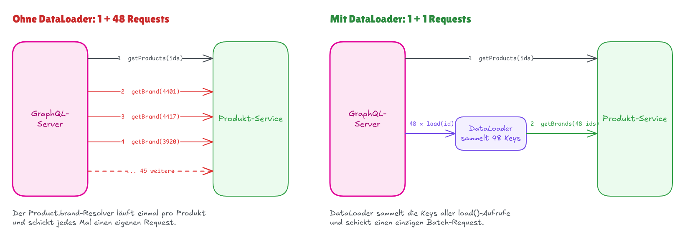

# Over- und Under-Fetching lösen mit GraphQL

**Das Problem:** Mit REST lädt eine Seite ihre Daten aus mehreren Services in Runden nacheinander (Wasserfall) und bekommt zu viele und zu wenige Daten.

**Dauer:** etwa 60 Minuten

## Inhalt

- [REST in Kürze](#rest-in-kürze)
- [Das Beispiel: eine Seite, drei Domänen](#das-beispiel-eine-seite-drei-domänen)
- [Das Problem: die Seite mit REST laden](#das-problem-die-seite-mit-rest-laden)
- [Die Lösung: GraphQL](#die-lösung-graphql)
- [Fragments: jede Komponente deklariert ihre Daten](#fragments-jede-komponente-deklariert-ihre-daten)
- [Geht das nicht auch mit REST?](#geht-das-nicht-auch-mit-rest)
- [Was GraphQL kostet](#was-graphql-kostet)
- [GraphQL und REST in einer grossen Firma](#graphql-und-rest-in-einer-grossen-firma)
- [Zusammenfassung](#zusammenfassung)

## REST in Kürze

Jede **Ressource** hat eine URL, und HTTP-Methoden sagen, was mit ihr geschehen soll.

```http
GET /api/products/5862971 HTTP/1.1
Accept: application/json
```

```json
{
  "id": 5862971,
  "name": "Banana plug SimpleLock",
  "brand": { "id": 4401, "href": "/api/brands/4401" }
}
```

Verwandte Ressourcen erscheinen oft als Links (`href`), denen der Client mit dem nächsten Request folgt.

Braucht eine Seite Daten aus einer einzigen API, ist ein neues Feld eine Änderung an einem Route Handler. Das reicht nicht mehr, sobald die Seite Daten aus **mehreren Services** braucht.

## Das Beispiel: eine Seite, drei Domänen

Unser Beispiel ist eine echte Seite: [Audio-Steckverbinder auf galaxus.ch](https://www.galaxus.ch/en/s1/producttype/audio-connectors-3137). Die APIs und Responses dazu sind **erfunden**. Sie beschreiben nicht, wie Galaxus gebaut ist.

Die Daten der Seite kommen aus drei Domänen:

- **Navigation:** die Seite selbst mit Titel, Breadcrumb und Sidebar.
- **Produktlisten:** welche Produkte zu den Filtern passen, wie viele es sind und in welcher Reihenfolge.
- **Produkte:** Name, Marke, Preis, Bilder und Bewertungen jeder Kachel.


Jede Domäne hat einen eigenen Service mit eigener REST API. **Die Verschachtelung ist auch die Ladereihenfolge:** Die Seite braucht die Produktliste, und die Liste braucht die Produkte.

## Das Problem: die Seite mit REST laden

### Runde 1: der Produkttyp aus der Navigation

Die Produkttyp-ID `3137` steht in der URL. Der Navigations-Service liefert Titel, Breadcrumb und Sidebar:

```jsonc
// GET /api/product-types/3137
{
  "id": 3137,
  "name": "Audio connectors",
  "breadcrumb": [{ "name": "IT + Multimedia", "href": "/api/categories/1" } /* ... */],
  "navigation": [
    { "name": "Audio player accessories", "url": "/en/s1/producttype/2918" } /* ... */
  ],
  // 👇 the page shows none of these
  "seoText": "Explore our comprehensive selection of audio connectors ...",
  "synonyms": ["audio plug", "jack plug"],
  "links": {
    // 👇 where to get the products
    "products": "/api/product-lists?productTypeId=3137"
  }
}
```

### Runde 2: die Produktliste

Die Produktliste ist nur verlinkt, der Browser muss also **auf Runde 1 warten**:

```jsonc
// GET /api/product-lists?productTypeId=3137&limit=48
{
  "totalCount": 1211,
  "filters": [{ "id": "brand", "name": "Brand", "optionCount": 87 } /* ... */],
  "items": [
    // 👇 only links: the tiles need another round trip
    { "productId": 5862971, "href": "/api/products/5862971" },
    { "productId": 3376520, "href": "/api/products/3376520" }
    // ... 46 more
  ]
}
```

### Runde 3: die Produkte

Der Browser fragt den Produkt-Service **für jedes der 48 Produkte** einzeln an:

```jsonc
// GET /api/products/5862971
{
  "id": 5862971,
  "name": "Banana plug SimpleLock",
  "brand": { "id": 4401, "name": "clicktronic", "href": "/api/brands/4401" },
  "price": { "amount": 15.9, "currency": "CHF" },
  "images": ["/images/5862971-1.jpg", "/images/5862971-2.jpg" /* ... 10 more */],
  "rating": { "average": 4.6, "count": 70 },
  // 👇 the tile shows none of these
  "description": "The SimpleLock banana plug fits cables up to 6 mm² ...",
  "specifications": [{ "name": "Connector", "value": "4 mm banana" } /* ... 60 more */],
  "warranty": "2 years",
  "weightGrams": 12
}
```

### Under-Fetching, Over-Fetching und ein Wasserfall


Drei Probleme, und die ersten beiden treten gleichzeitig auf:

- **Under-Fetching.** Einer Response fehlen Daten, die die Seite braucht. Die Produktliste enthält nur Links, jede Kachel braucht einen eigenen Request.
- **Over-Fetching.** Eine Response enthält Daten, die die Seite nicht braucht. Jedes Produkt kommt mit Beschreibung und 60 Spezifikationen, obwohl die Kachel fünf Felder zeigt.
- **Wasserfall.** Jede Runde wartet auf die vorherige.

Jede Runde kostet mindestens einen Round Trip. Die zweite Runde kann erst gestartet werden, wenn die 1. Runde fertig ist.

## Die Lösung: GraphQL

### GraphQL in drei Snippets

**Das Schema** beschreibt jeden Typ und jedes Feld, das die API anbietet, wie ein TypeScript-Interface für die ganze API. `type Query` listet die Einstiegspunkte zum Lesen, wie deine `GET`-Routen.

```graphql
type Query {
  project(name: String!): Project
}

type Project {
  name: String
  tagline: String
  contributors: [User]
}
```

`!` bedeutet "nie `null`", `[User]` ist eine Liste.

**Die Query** nennt die Felder, die der Client will:

```graphql
{
  project(name: "GraphQL") {
    tagline
  }
}
```

**Die Response** hat dieselbe Form wie die Query, steckt in `data` und enthält nur die angefragten Felder:

```json
{
  "data": {
    "project": {
      "tagline": "A query language for APIs"
    }
  }
}
```

**Der Client bestimmt, welche Felder zurückkommen.**

Schreibzugriffe heissen **Mutation** (wie `POST`, `PUT`, `DELETE`). Alles geht **an dieselbe URL**, meist `POST /graphql`.

Doku: [Queries](https://graphql.org/learn/queries/), [Schemas und Typen](https://graphql.org/learn/schema/)

### Eine Query für die ganze Seite

Ein GraphQL-Server ist **eine eigene Schicht zwischen Browser und Services**. Sein Schema und seine Resolver schreibst du selbst. Für unsere Seite sieht das Schema vereinfacht so aus:

```graphql
type Query {
  productType(id: ID!): ProductType
}

type ProductType {
  id: ID!
  name: String!
  breadcrumb: [Category!]!
  navigation: [NavigationEntry!]!
  products(first: Int!, after: String): ProductList!
}

type ProductList {
  totalCount: Int!
  items: [Product!]
}

type Product {
  id: ID!
  name: String!
  brand: Brand!
  price: Money!
  imageUrl: String!
  rating: Rating
}

# Category, NavigationEntry, Brand, Money and Rating are left out
```

**Das Schema versteckt die Services.** `ProductType.products` sieht aus wie ein gewöhnliches Feld, obwohl der Produktlisten-Service es beantwortet.

Die Seite schickt **eine Query mit allem, was sie anzeigt**. `$id` ist eine **Variable**, wie ein Routenparameter.

**Query**

<!-- prettier-ignore -->
```graphql
query ProductTypePage($id: ID!) {
  productType(id: $id) {
    name
    breadcrumb { name }
    navigation { name url }
    products(first: 48) {
      totalCount
      items {
        name
        brand { name }
        price { amount currency }
        imageUrl
        rating { average count }
      }
    }
  }
}
```

**Response**

```jsonc
{
  "data": {
    "productType": {
      "name": "Audio connectors",
      "breadcrumb": [{ "name": "IT + Multimedia" } /* ... */],
      "navigation": [
        { "name": "Audio player accessories", "url": "/en/s1/producttype/2918" } /* ... */
      ],
      "products": {
        "totalCount": 1211,
        "items": [
          {
            "name": "Banana plug SimpleLock",
            "brand": { "name": "clicktronic" },
            "price": { "amount": 15.9, "currency": "CHF" },
            "imageUrl": "/images/5862971-1.jpg",
            "rating": { "average": 4.6, "count": 70 }
          }
          // ... 47 more
        ]
      }
    }
  }
}
```

Ein Request, kein `seoText`, keine Spezifikationen, keine Links zum Folgen. **Zwischen Browser und Server sind Over-Fetching und Under-Fetching weg.**

### Resolver: wie der Server die Daten sammelt

Der GraphQL-Server trägt die Daten aus den drei Services mit **Resolvern** zusammen: Funktionen, die den Wert eines Felds liefern. **Nicht jedes Feld braucht einen.** Ein eigener Resolver ist nur nötig, wenn die Daten von woanders kommen oder Arbeit brauchen. Alle anderen Felder liest GraphQL aus dem zurückgegebenen Objekt:


Unsere Resolver rufen die REST APIs der Services direkt mit `fetch` auf. Die Services antworten mit denselben JSON-Formen wie in den REST-Runden oben, hier gekürzt als Typen:

```ts
// GET http://navigation/api/product-types/:id
type ProductTypeResponse = {
  id: number;
  name: string;
  breadcrumb: { name: string; href: string }[];
  navigation: { name: string; url: string }[];
};

// GET http://product-lists/api/product-lists?productTypeId=…&limit=…
type ProductListResponse = {
  totalCount: number;
  items: { productId: number; href: string }[];
};

// GET http://products/api/products?ids=…
type ProductResponse = {
  id: number;
  name: string;
  brand: { id: number; name: string };
  price: { amount: number; currency: string };
  images: string[];
  rating: { average: number; count: number } | null;
};
```

Ein Resolver bekommt `parent` (den Rückgabewert des übergeordneten Resolvers) und `args` (die Argumente des Felds). Was ein Resolver zurückgibt, ist das `parent` der Felder darunter:

```ts
const resolvers = {
  Query: {
    // 👇 one call returns name, breadcrumb and navigation as well
    productType: async (parent, args: { id: string }): Promise<ProductTypeResponse> => {
      const res = await fetch(`http://navigation/api/product-types/${args.id}`);
      return res.json();
    }
  },
  ProductType: {
    // 👇 parent is the ProductTypeResponse from above
    products: async (
      parent: ProductTypeResponse,
      args: { first: number }
    ): Promise<ProductListResponse> => {
      const res = await fetch(
        `http://product-lists/api/product-lists?productTypeId=${parent.id}&limit=${args.first}`
      );
      return res.json();
    }
  },
  ProductList: {
    // 👇 the list holds ids only, so fetch all 48 products in one call
    items: async (parent: ProductListResponse): Promise<ProductResponse[]> => {
      const ids = parent.items.map((item) => item.productId).join(",");
      const res = await fetch(`http://products/api/products?ids=${ids}`);
      return res.json();
    }
  },
  Product: {
    // a resolver without a call: the schema offers one image, the service returns a list
    imageUrl: (parent: ProductResponse) => parent.images[0]
  }
};
```

So lädt der Produkttyp mit **einem Aufruf, nicht einem pro Feld**.

Der Server führt die Resolver Ebene für Ebene aus: `products` wartet auf `productType`, und `items` wartet auf `products`. **Der Wasserfall ist noch da, aber er läuft im Rechenzentrum**, wo ein Aufruf wenige Millisekunden dauert. Der Browser wartet nur noch auf einen Round Trip:


Auch das Over-Fetching ist umgezogen: Der Produkt-Service liefert weiterhin das ganze Produkt, aber an den GraphQL-Server im selben Rechenzentrum. **Zum Smartphone reisen nur die angefragten Felder.**

Doku: [Execution](https://graphql.org/learn/execution/)

<details>
<summary>Weiterführend: das N+1-Problem und DataLoader</summary>

Unser `items`-Resolver holt alle 48 Produkte in einem Aufruf, weil er die ganze Liste der IDs auf einmal bekommt. Angenommen, `brand` hätte einen eigenen Resolver. Er läuft einmal pro Produkt: 48 Requests für die Marken plus 1 für die Liste (1 + 48). Das ist das **N+1-Problem**.



**DataLoader** sammelt die Keys aller `load()`-Aufrufe innerhalb eines Event-Loop-Ticks und ruft eine Batch-Funktion einmal auf. Der Loader entsteht pro Request im `context`, dem dritten Argument jedes Resolvers:

```ts
import DataLoader from "dataloader";
import { createSchema, createYoga } from "graphql-yoga";

type Brand = { id: number; name: string };
type Context = { brandLoader: DataLoader<number, Brand> };

function createBrandLoader() {
  return new DataLoader<number, Brand>(async (ids) => {
    // 👇 one call for all ids
    const res = await fetch(`http://products/api/brands?ids=${ids.join(",")}`);
    const brands: Brand[] = await res.json();
    const byId = new Map(brands.map((brand) => [brand.id, brand]));
    return ids.map((id) => byId.get(id) ?? new Error(`No brand ${id}`));
  });
}

const resolvers = {
  // ... Query, ProductType, ProductList as above
  Product: {
    // 👇 runs 48 times, but the 48 load() calls become one request
    brand: (parent: { brandId: number }, _args: unknown, context: Context) =>
      context.brandLoader.load(parent.brandId)
  }
};

const yoga = createYoga({
  schema: createSchema({ typeDefs, resolvers }),
  // 👇 a new loader for every request, so cached brands never leak between requests
  context: (): Context => ({ brandLoader: createBrandLoader() })
});
```

Die Batch-Funktion muss pro Key ein Ergebnis zurückgeben, in derselben Reihenfolge wie die Keys.

Doku: [DataLoader](https://github.com/graphql/dataloader), [GraphQL Yoga: Context](https://the-guild.dev/graphql/yoga-server/docs/features/context)

</details>

### Wenn ein Service ausfällt

**Fällt ein Service aus, kommt der Rest trotzdem an**, solange das betroffene Feld `null` sein darf. Bei einem Feld mit `!` wird stattdessen das nächste nullable Feld darüber `null`. Deshalb hat `items` im Schema kein `!`. Fällt der Produkt-Service aus, ist `items` `null`, und `errors` sagt, wo:

```json
{
  "data": {
    "productType": {
      "name": "Audio connectors",
      "products": {
        "totalCount": 1211,
        "items": null
      }
    }
  },
  "errors": [
    {
      "message": "Products unavailable",
      "path": ["productType", "products", "items"]
    }
  ]
}
```

Der HTTP-Statuscode ist trotzdem `200`, also **prüfe `errors` selbst**. Relay gibt die Teildaten an die Komponenten weiter, das fehlerhafte Feld ist `null`.

> [!NOTE]
> **Aus der Praxis:** Der GraphQL-Server selbst steht selten im Weg, aber **die Fehlerbehandlung wird aufwändiger**. Für jede mögliche Teilantwort braucht die Seite ein sinnvolles Verhalten.

Doku: [Response](https://graphql.org/learn/response/), [Relay: Field Errors](https://relay.dev/docs/guides/catch-directive/)

## Fragments: jede Komponente deklariert ihre Daten

Eine Query pro Seite löst den Wasserfall für den Browser. **Aber wer schreibt diese Query?**  
Die Seite besteht aus Komponenten, und jede braucht Daten aus einer anderen Domäne:


- Schreibt **die Seite** die Query, listet sie jedes Feld jeder Komponente auf. Jedes neue Feld auf einer Kachel heisst, die Query der Seite anzupassen, und niemand wagt es, ein Feld zu entfernen, also wächst die Query nur.
- Holt **jede Komponente** ihre eigenen Daten, sind die Komponenten unabhängig, aber wir sind zurück bei vielen Requests und Wasserfällen.

Die Lösung heisst **Colocation**: Jede Komponente deklariert ihre Felder direkt neben ihrem Code, als **Fragment**. Ein Fragment ist eine benannte Liste von Feldern auf einem Typ, und `...Name` fügt es in eine Query ein. Ein Name wie `ProductTile_product` bedeutet: was `ProductTile` von einem `product` braucht.

### Die Produktkachel und ihr Fragment

Das Fragment der Kachel listet ihre fünf Felder:


_Die Frontend-Beispiele auf dieser Seite nutzen den GraphQL-Client [Relay](https://relay.dev)._

Ein Compiler liest die `graphql`-Tags zusammen mit dem Schema und erzeugt TypeScript-Typen, wie OpenAPI-Codegen bei REST. `useFragment` liefert der Komponente genau die Felder ihres Fragments:

```tsx
import type { FunctionComponent } from "react";
import { graphql, useFragment } from "react-relay";
import type { ProductTile_product$key } from "./__generated__/ProductTile_product.graphql";

type ProductTileProps = {
  product: ProductTile_product$key;
};

export const ProductTile: FunctionComponent<ProductTileProps> = ({ product: productKey }) => {
  const product = useFragment(
    graphql`
      fragment ProductTile_product on Product {
        imageUrl
        price {
          amount
          currency
        }
        brand {
          name
        }
        name
        rating {
          average
          count
        }
      }
    `,
    productKey
  );
  return (
    <article>
      
      <p>
        {product.price.currency} {product.price.amount.toFixed(2)}
      </p>
      <h3>
        <strong>{product.brand.name}</strong> {product.name}
      </h3>
      <Rating average={product.rating?.average} count={product.rating?.count} />
    </article>
  );
};
```

### Die Query der Seite zusammensetzen

`ProductList` fragt die Anzahl an und setzt das Fragment der Kachel in jedes Item ein:

```tsx
type ProductListProps = {
  productType: ProductList_productType$key;
};

export const ProductList: FunctionComponent<ProductListProps> = ({
  productType: productTypeKey
}) => {
  const productType = useFragment(
    graphql`
      fragment ProductList_productType on ProductType {
        products(first: 48) {
          totalCount
          items {
            id
            ...ProductTile_product
          }
        }
      }
    `,
    productTypeKey
  );
  return (
    <>
      <h2>{productType.products.totalCount} products</h2>
      <ul>
        {productType.products.items?.map((item) => (
          <li key={item.id}>
            <ProductTile product={item} />
          </li>
        ))}
      </ul>
    </>
  );
};
```

`ProductTypePage`, die Seitenkomponente, setzt nur die Fragments der direkt untergeordneten Komponenten zusammen und lädt die Daten mit `useLazyLoadQuery`:

```tsx
type ProductTypePageProps = {
  id: string;
};

export const ProductTypePage: FunctionComponent<ProductTypePageProps> = ({ id }) => {
  const data = useLazyLoadQuery<ProductTypePageQuery>(
    graphql`
      query ProductTypePageQuery($id: ID!) {
        productType(id: $id) {
          ...ProductTypeHeader_productType
          ...CategoryNavigation_productType
          ...ProductList_productType
        }
      }
    `,
    { id }
  );
  // 👇 the 404 case: no product type exists for the id from the URL
  if (!data.productType) return null;
  return (
    <>
      <ProductTypeHeader productType={data.productType} />
      <CategoryNavigation productType={data.productType} />
      <ProductList productType={data.productType} />
    </>
  );
};
```

Steht in der URL eine ID, zu der es keinen Produkttyp gibt, antwortet der Server mit `productType: null`. Das ist der 404-Fall. `null` kommt aber auch, wenn der Resolver mit einem Fehler abbricht, dann zusätzlich mit einem Eintrag in `errors`. **Das Beispiel unterscheidet die beiden Fälle nicht, eine echte Anwendung muss das**: Bei einem 404 zeigt sie eine Seite "nicht gefunden", bei einem Fehler eine Fehlermeldung.

An jeder Stelle `...Name` setzt GraphQL die Felder des Fragments ein. Beim Server kommen also dieselben Felder an wie in der Query weiter oben (plus `id`), und **die Seite schickt weiterhin einen Request**.

### Eine Kachel für viele Seiten

Die Kachel bringt ihr Fragment mit. **Damit passt sie auf jede Seite, die Produkte zeigt**: Produkttyp, Suche, Merkliste, Empfehlungen. Jede dieser Seiten setzt `...ProductTile_product` in ihre Query ein, zum Beispiel eine Merkliste:

```graphql
query WishlistPageQuery {
  wishlist {
    items {
      id
      ...ProductTile_product
    }
  }
}
```

Braucht die Kachel ein neues Feld, änderst du nur ihr Fragment. **Jede Query, die das Fragment einsetzt, lädt das Feld ab dann automatisch mit.** Keine der Seiten muss ihre Query anpassen.

Doku: [Fragments](https://graphql.org/learn/queries/#fragments)

## Geht das nicht auch mit REST?

### Parallel laden, Batch und BFF

Unser REST-Beispiel ist bewusst naiv. Auch mit REST lässt sich der Wasserfall stark verkürzen:

- **Parallel laden.** Die Seite kennt `productTypeId` aus ihrer URL. Produkttyp und Liste warten nur aufeinander, weil wir dem Link folgen.
- **Ein Batch-Endpoint.** `GET /api/products?ids=5862971,3376520,...` statt 48 einzelner Requests.
- **Ein Backend for Frontend (BFF).** Ein Server, der die Services im Rechenzentrum aufruft und pro Seite einen Endpoint anbietet, etwa `GET /bff/product-type-page/3137`. Dann braucht die Seite einen Round Trip, wie mit GraphQL.

Der Unterschied liegt also nicht in der Anzahl Requests. **Ein BFF braucht für jede Seite und jede Feldänderung Arbeit am Endpoint. Mit GraphQL bestimmt der Client die Form, und ein Schema gilt für alle Seiten.**

### `?include=`: verwandte Daten einbetten

REST kennt ein Muster gegen Under-Fetching: Der Client verlangt, dass eine Response verwandte Ressourcen einbettet.

```http
GET /api/product-lists?productTypeId=3137&include=products
```

JSON:API nennt das **Inclusion of Related Resources**, Stripe **Expanding** einer Response (`expand[]=...`). Das löst das Problem nur teilweise:

- **Over-Fetching bleibt.** Jedes eingebettete Produkt kommt mit Beschreibung und 60 Spezifikationen.
- **Die Daten müssen dort erreichbar sein.** Der Produktlisten-Service kann Produkte nur einbetten, wenn er an die Daten des Produkt-Services herankommt. Kann er das nicht, funktioniert das Muster gar nicht.
- **Jeder Endpoint implementiert es neu**, auch für tiefere Daten wie `include=products.brand`.

GraphQL löst die Verknüpfung einmal in den Resolvern (gegen N+1 mit DataLoader), und jede Query nutzt sie.

Doku: [JSON:API: Inclusion of Related Resources](https://jsonapi.org/format/#fetching-includes), [Stripe: Expanding Responses](https://docs.stripe.com/expand)

### Was GraphQL zusätzlich bringt

- **Ein normalisierter Client-Cache.** Clients wie Apollo Client oder Relay speichern jedes Objekt einmal, unter seiner ID. Ändert eine Mutation ein Produkt, aktualisiert sich jede Stelle, die es zeigt.
- **Ein Schema, das sich ohne `/v2` weiterentwickelt.** Neue Felder kommen dazu, alte markierst du mit `@deprecated`.

Doku: [Apollo Client: Caching](https://www.apollographql.com/docs/react/caching/overview), [graphql.org: Schema-Design und Versionierung](https://graphql.org/learn/schema-design/)

## Was GraphQL kostet

GraphQL verschiebt Arbeit vom Client auf den Server und ins Tooling:

| Thema             | REST                                                                                   | GraphQL                                                                                                                                                                                                                                 |
| ----------------- | -------------------------------------------------------------------------------------- | --------------------------------------------------------------------------------------------------------------------------------------------------------------------------------------------------------------------------------------- |
| **Caching**       | Die URL ist der Cache-Key. Browser und CDNs speichern einen `GET` mit `Cache-Control`. | Meist ein `POST` an eine URL, den HTTP-Caches überspringen. Gecacht wird stattdessen im Client.                                                                                                                                         |
| **HTTP-Features** | Redirects und Datei-Uploads sind gewöhnliches HTTP.                                    | Nicht Teil von GraphQL. Dateien laufen meist über gewöhnliches HTTP.                                                                                                                                                                    |
| **Fehler**        | Ein Statuscode pro Request.                                                            | Ein fehlgeschlagenes Feld liefert meist `200`. Monitoring, das Statuscodes zählt, verpasst es.                                                                                                                                          |
| **Autorisierung** | Wird in jedem Route Handler geprüft.                                                   | Viele Queries erreichen dasselbe Feld. Prüfe Berechtigungen deshalb einmal, im Code hinter den Resolvern, nicht pro Query. Vergisst du es, ist jeder Pfad zum Feld offen.                                                               |
| **Teure Queries** | Jeder Request ist im Voraus bekannt.                                                   | Clients schreiben ihre eigenen. In Produktion erlaubt der Server oft nur bekannte Queries: Der Client schickt statt des Query-Texts eine ID (**Persisted Queries**, auch Trusted Documents). Dazu begrenzt der Server Tiefe und Kosten. |
| **Betrieb**       | Die Endpoints der Services, die es ohnehin gibt.                                       | Ein zusätzlicher Server, den jemand betreiben muss, dazu Codegen und Schema-Checks im CI.                                                                                                                                               |

Doku: [Autorisierung](https://graphql.org/learn/authorization/), [Sicherheit](https://graphql.org/learn/security/)

## GraphQL und REST in einer grossen Firma

Ein grosser Shop nutzt **beides**. Im Hintergrund hat jede Domäne einen eigenen Service mit eigener Datenbank. Davor sitzen zwei Arten von Einstiegspunkten:


- **Ein GraphQL-Server** für die Seiten des Webshops und der Mobile App. Beide Clients fragen dasselbe Schema nach genau dem, was jeder Screen braucht.
- **REST-Endpoints** für alles, was gewöhnliches HTTP ist oder mit der Aussenwelt spricht: Login mit seinen Redirects, Datei-Uploads, Webhooks eines Payment-Providers und eine öffentliche API für Partnershops, die stabile URLs und eine Dokumentation in OpenAPI erwarten.

Hinter dem GraphQL-Server müssen keine REST-Services stehen. **Bieten die Services selbst GraphQL an**, fragt der Server auch dort nur die Felder an, die er braucht. Sprechen sie REST, gibt es Over- und Under-Fetching weiterhin, nur im internen Netz.

GitHub zum Beispiel bietet seine öffentliche API als REST und als GraphQL an und [vergleicht beide in der Doku](https://docs.github.com/en/rest/about-the-rest-api/comparing-githubs-rest-api-and-graphql-api).

Ein einzelner GraphQL-Server, der 30 Services aufruft, **wird selbst zum Flaschenhals**: Jedes neue Feld muss durch diesen einen Server. Grosse Firmen teilen das Schema deshalb nach Domänen auf: Jeder Domänen-Service liefert seinen Teil, und ein Gateway fügt die Teile zu einem Schema zusammen. Das nennt sich **Federation**.

| Situation                                                                                          | Einsatz               |
| -------------------------------------------------------------------------------------------------- | --------------------- |
| Eine App, eine Handvoll Ressourcen                                                                 | REST                  |
| Ein Client, für den sich ein eigener BFF lohnt                                                     | REST mit BFF          |
| Öffentliche Daten, die ein CDN cachen soll, Datei-Uploads, Login-Redirects, Webhooks, Partner-APIs | REST                  |
| Mehrere Clients oder viele Seiten, die Daten aus vielen Services kombinieren                       | GraphQL               |
| Viele Komponenten, die Daten aus mehreren Domänen brauchen                                         | GraphQL mit Fragments |

Doku: [graphql.org: Federation](https://graphql.org/learn/federation/)

## Zusammenfassung

- **GraphQL löst Over- und Under-Fetching für den Browser:** Die Seite fragt in einem Request genau ihre Felder an, Resolver holen sie bei den Services der Domänen.
- Mit Fragments deklariert jede Komponente ihre eigenen Felder und bleibt unabhängig von den anderen.
- Mit REST lädt dieselbe Seite als Wasserfall. Batch-Endpoints und ein BFF helfen, brauchen aber Arbeit pro Seite.
- Der Preis: Mit GraphQL verlierst du das Caching über die URL und ehrliche Statuscodes, dazu kommen aufwändigere Fehlerbehandlung und ein Server, den jemand betreibt.
- An den Rändern bleibt REST: Login, Uploads, Webhooks und öffentliche APIs.
