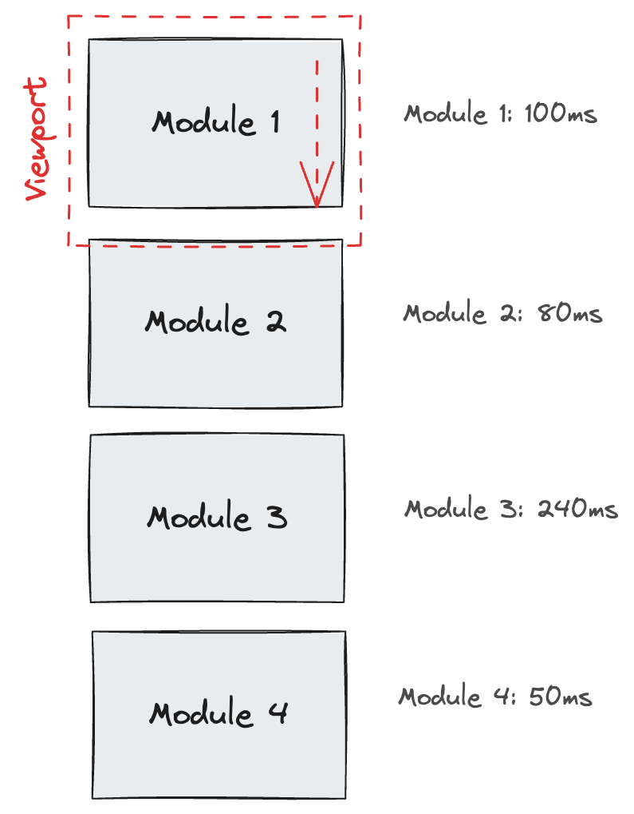
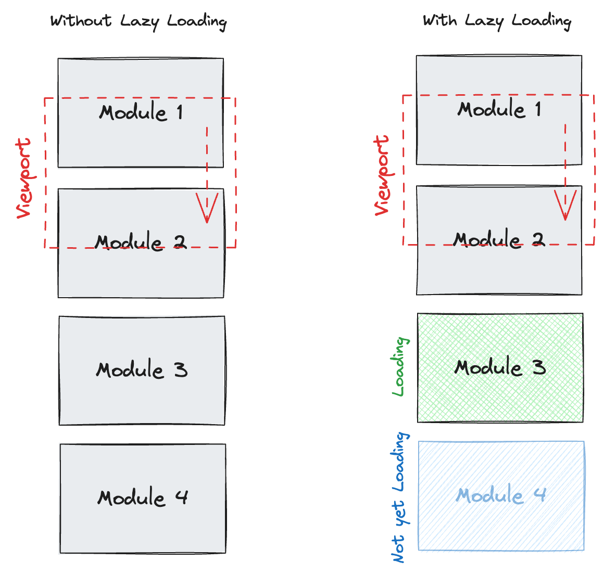
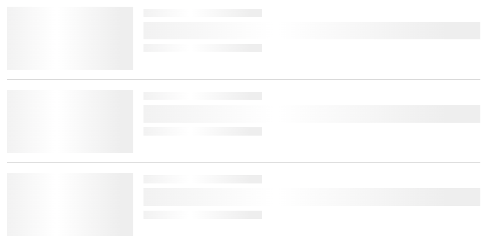

# Ladeverhalten: Lazy Loading mit React

> Deine Seite schickt alle Komponenten, Bilder und Daten-Requests auf einmal los, auch für die Teile, zu denen niemand scrollt. Wir laden diese Teile erst, wenn der Benutzer sie gleich sieht: mit dem `IntersectionObserver`, dem nativen Attribut `loading="lazy"` und Reacts `lazy`. Die Layout Shifts, die dabei entstehen, beheben wir mit Skeletons. Danach drehen wir es um und laden die nächste Seite, bevor der Benutzer klickt.

**Dauer:** etwa 45 Minuten

## Inhalt

* [Das Problem](#das-problem)
* [Lazy Loading](#lazy-loading)
* [Lazy Loading in React](#lazy-loading-in-react)
* [Alles kombinieren](#alles-kombinieren)
* [Vor dem Klick laden: Prefetching](#vor-dem-klick-laden-prefetching)
* [Zusammenfassung](#zusammenfassung)

## Das Problem

Unsere Webseiten und Apps enthalten viele Komponenten. Wenn ein Benutzer unsere Seite besucht, wartet er, bis alles geladen, geparst und ausgeführt ist. Bei langsamen Verbindungen und älteren Geräten kann das lange dauern. Das schadet der Benutzererfahrung. Je länger die Ladezeit, desto höher die Absprungrate. Das senkt die Conversion-Rate und schadet auch dem SEO, weil das Suchranking die [Core Web Vitals](https://web.dev/explore/learn-core-web-vitals) berücksichtigt.

Webseiten und Apps hängen zudem von interner Kommunikation zwischen Services ab, besonders beim Server-Side Rendering (SSR). Ist ein Service langsam, kann er die ganze App ausbremsen. Das passiert zum Beispiel, wenn ein Service eine langsame Datenbankabfrage macht. Die App muss warten, bis die Abfrage fertig ist, bevor sie weitermachen kann. Die Folge ist eine lange Ladezeit.



## Lazy Loading

### Was ist Lazy Loading?

Lazy Loading ist eine Technik, bei der Ressourcen wie Bilder oder JavaScript erst geladen werden, wenn sie benötigt werden, zum Beispiel wenn sie im sichtbaren Bereich der Seite (Viewport) erscheinen. Das verkürzt die initiale Ladezeit und verbessert die Benutzererfahrung, weil der Browser grosse Dateien nicht schon zu Beginn lädt.



### Natives Lazy Loading für Bilder und iframes

Für Bilder und iframes brauchst du kein JavaScript. Mit `loading="lazy"` schiebt der Browser den Request auf, bis das Element einen bestimmten Abstand zum Viewport erreicht. Alle aktuellen Browser unterstützen das für beide Elemente.

```html

<iframe src="https://example.com/map" title="Pick-up location" loading="lazy"></iframe>
```

Setze `width` und `height`, damit der Browser den Platz reservieren kann, bevor das Bild da ist. Lade die Bilder, die beim ersten Laden sichtbar sind, nie lazy, vor allem nicht das grösste: Das verzögert deinen Largest Contentful Paint (LCP). Für dieses Bild sagt `fetchpriority="high"` dem Browser, dass er es vor anderen Bildern laden soll.

Doku: [MDN: Lazy loading](https://developer.mozilla.org/en-US/docs/Web/Performance/Guides/Lazy_loading), [web.dev: Browser-level image lazy loading](https://web.dev/articles/browser-level-image-lazy-loading), [web.dev: Fetch Priority](https://web.dev/articles/fetch-priority)

Für alles andere (JavaScript-Module, Daten, Komponenten) musst du selbst wissen, wann ein Element in den Viewport kommt. Dafür gibt es den `IntersectionObserver`.

### IntersectionObserver

Der `IntersectionObserver` ist eine JavaScript-API, mit der du überwachst, wann ein HTML-Element in den Viewport eintritt oder ihn verlässt. Genau in diesem Moment kannst du Aktionen auslösen.

```html
<div class="page page-1">
  <h1>Page 1</h1>
</div>
<div class="page page-2">
  <h1>Page 2</h1>
</div>
<div class="page page-3">
  <h1>Page 3</h1>
</div>
<div class="page page-4">
  <h1>Page 4</h1>
</div>
```

```js
// Create the IntersectionObserver instance
// We provide a callback that is run when the Observer detects a change 
// (and when an element is first observed)
const observer = new IntersectionObserver((entries) => {
  // entries contains all IntersectionObserver Entries where a change was detected
  entries.forEach(entry => {
    // Toggles the class in-view, depending on entry.isIntersecting
    entry.target.classList.toggle("in-view", entry.isIntersecting)
  })
})

// Tell our IntersectionObserver to observe our elements
document.querySelectorAll(".page").forEach(page => {
  observer.observe(page);
})
```

**Demo** 🤯

- [IntersectionObserver Basic](https://codesandbox.io/s/2sk7t8?file=/src/index.mjs)

#### Die Option [`rootMargin`](https://developer.mozilla.org/en-US/docs/Web/API/IntersectionObserver/IntersectionObserver#rootmargin)

Die Option `rootMargin` definiert einen Offset um den Viewport. Damit sagst du dem `IntersectionObserver`, dass er das Callback ausführen soll, bevor das Element den Viewport tatsächlich betritt. Das Element gilt zu diesem Zeitpunkt bereits als `isIntersecting`.

```js
const observer = new IntersectionObserver((entries) => {
  entries.forEach(entry => {
    entry.target.classList.toggle("in-view", entry.isIntersecting);
  });
}, {
  // Element is considered intersecting 200px before it enters the viewport
  // This works for both directions (top and bottom)
  rootMargin: "200px",
});
```

**Demo** 🤯

🚧 CodeSandbox hat Probleme mit `rootMargin`.
Um den Effekt zu sehen, öffne das Sandbox-Resultat in einem neuen Fenster.

- [IntersectionObserver rootMargin (Sandbox)](https://codesandbox.io/s/28rdfr?file=/src/index.mjs)
- [IntersectionObserver rootMargin (Resultat)](https://28rdfr.csb.app/)

#### Die Option [`threshold`](https://developer.mozilla.org/en-US/docs/Web/API/IntersectionObserver/IntersectionObserver#threshold)

Die Option `threshold` definiert, welcher Anteil des Elements im Viewport sein muss, damit es als `isIntersecting` gilt. Sie akzeptiert auch ein Array von Werten, um mehrere Schwellenwerte zu definieren.

```js
const observer = new IntersectionObserver((entries) => {
  entries.forEach(entry => {
    entry.target.classList.toggle("in-view", entry.isIntersecting);
  });
}, {
  // Element is considered intersecting even when only one pixel is visible.
  // This is the default value.
  threshold: 0,

  // Element is considered intersecting when 25% of it is visible.
  threshold: 0.25,

  // Element is considered intersecting when 99% of it is visible.
  threshold: 0.99,
});
```

**Demo** 🤯

- [IntersectionObserver threshold](https://codesandbox.io/s/d2xxff?file=/src/index.mjs)

#### Nur einmal beobachten

Mit dem `IntersectionObserver` kannst du ein Element auch nur einmal beobachten. Sobald das Element zum ersten Mal den Viewport betritt, beobachtest du es nicht mehr.

```js
const observer = new IntersectionObserver((entries, observer) => {
  entries.forEach(entry => {
    entry.target.classList.toggle("in-view", entry.isIntersecting);
    console.log({ element: entry.target.className, isIntersection: entry.isIntersecting});

    // Stop observing the element, once it is intersecting
    if(entry.isIntersecting) {
      console.log(`No longer observing ${entry.target.className}`);
      observer.unobserve(entry.target);
    }
  });
}, {
  threshold: 0.25,
});

document.querySelectorAll(".page").forEach(page => {
  observer.observe(page);
});
```

**Demo** 🤯

- [IntersectionObserver Once](https://codesandbox.io/s/ldppv2?file=/src/index.mjs)

> **Das Wichtigste in Kürze**
>  
> * Der `IntersectionObserver` führt ein Callback aus, wenn ein Element in den Viewport eintritt oder ihn verlässt
> * Mit `rootMargin` führst du das Callback aus, bevor das Element den Viewport betritt
> * Mit `threshold` definierst du, wie viel des Elements im Viewport sein muss, damit es als `isIntersecting` gilt
> * Du kannst den `IntersectionObserver` für alle möglichen Side Effects nutzen, zum Beispiel für Tracking

**Hilfreiche Links**

* [IntersectionObserver](https://developer.mozilla.org/en-US/docs/Web/API/IntersectionObserver)

### Lazy Loading in Aktion

Mit dem `IntersectionObserver` kannst du jetzt Lazy Loading umsetzen. Du lädst Ressourcen wie JavaScript-Module, Daten oder Bilder erst, wenn sie gebraucht werden. Das reduziert die initiale Ladezeit und entlastet den Main Thread, der zu Beginn weniger verarbeiten muss. Beides verbessert die Benutzererfahrung.

**Demo** 🤯

- [Lazy Loading in action](https://codesandbox.io/s/nmm4kc?file=/src/index.js)

## Lazy Loading in React

In React lädst du mit `lazy` den Code einer Komponente erst, wenn sie zum ersten Mal gerendert wird. Anstatt die Komponente direkt mit `import LazyComponent from './LazyComponent.tsx'` zu importieren, erstellst du mit `lazy` eine neue Komponente, die einen dynamischen Import von `LazyComponent` ausführt.

Dabei gelten drei Regeln. Das Modul muss die Komponente als `default`-Export exportieren. Deklariere die Lazy-Komponente auf oberster Ebene des Moduls, nie innerhalb einer anderen Komponente, sonst wird ihr State bei jedem Render zurückgesetzt. Und während der Code lädt, suspendiert die Komponente. Pack sie deshalb in eine `<Suspense>`-Boundary mit Fallback.

```tsx
import { lazy, Suspense } from "react";

const LazyComponent = lazy(() => import("./LazyComponent.tsx"));

export default function App() {
  return (
    <div className="App">
      <Suspense fallback={<p>Loading…</p>}>
        {/* When this is rendered, the Component is downloaded */}
        <LazyComponent />
      </Suspense>
    </div>
  );
}
```

Doku: [react.dev: lazy](https://react.dev/reference/react/lazy), [react.dev: Suspense](https://react.dev/reference/react/Suspense)

Anstatt in React direkt mit dem `IntersectionObserver` zu arbeiten, kannst du das [`react-intersection-observer`-Package](https://www.npmjs.com/package/react-intersection-observer) nutzen. Es wird aktiv gepflegt und unterstützt React 19. Es nutzt den `IntersectionObserver` unter der Haube und stellt dir einen Hook zur Verfügung, der dir sagt, ob ein Element im Viewport ist.

```tsx
import { lazy, Suspense } from "react";
import { useInView } from "react-intersection-observer";

const LazyComponent = lazy(() => import("./LazyComponent.tsx"));

export default function App() {
  const { ref, inView } = useInView({
    triggerOnce: true
  });

  return (
    <div className="App">
      <div className="page page-1">
        <h1>Page 1</h1>
      </div>

      {/* The ref has to be placed on the element we want to observe with the 
          IntersectionObserver */}
      <div ref={ref}>
        {/* LazyComponent will render if the parent is intersecting */}
        <Suspense fallback={null}>
          {inView ? <LazyComponent /> : null}
        </Suspense>
      </div>

      <div className="page page-3">
        <h1>Page 3</h1>
      </div>
    </div>
  );
}
```

**Demo** 🤯

- [React Lazy with IntersectionObserver (Sandbox)](https://codesandbox.io/s/dvjl33?file=/src/App.tsx)
- [React Lazy with IntersectionObserver (Resultat)](https://dvjl33.csb.app/)

### Layout Shifts

Wie die Demo zeigt, verhält sich Page 3 merkwürdig: Sie rutscht nach unten, sobald die Komponente auf Page 2 geladen ist. Das nennt man einen Layout Shift. Layout Shifts beeinträchtigen die Benutzererfahrung erheblich, weil der Inhalt der Seite plötzlich springt. Sie kosten dich auch beim SEO ([Cumulative Layout Shift](https://web.dev/articles/cls)).

Layout Shifts entstehen, wenn Elemente auf der Seite noch nicht bereit sind, wenn der Benutzer sie zum ersten Mal sieht. Manchmal wollen wir Inhalte aber gar nicht von Anfang an anzeigen. Was können wir also gegen diese Layout Shifts tun?

**Demo** 🤯

- [Pokémon-Liste mit Layout Shifts (Sandbox)](https://codesandbox.io/s/kzdh37?file=/src/App.tsx)
- [Pokémon-Liste mit Layout Shifts (Resultat)](https://kzdh37.csb.app/)

Die Demo zeigt: Die vielen Pokémon-Namen auf dem Bildschirm lösen unsere `useInView`-Hooks aus, und die App lädt Daten für viel zu viele Pokémon.

Die Lösung ist, den Platz für den Inhalt von Anfang an zu reservieren. Eine Möglichkeit dafür sind Skeletons. Ein Skeleton sieht ungefähr aus wie der echte Inhalt, nur ohne die Details. Weil wir nicht wissen, welchen Inhalt das Backend liefert, können wir den Platz nur ungefähr reservieren. Das ist nicht perfekt, aber deutlich besser als nichts.



**Hilfreiche Links**

- [Skeleton Screen - Galaxus](https://www.galaxus.ch/designsystem/patterns/skeleton-screen)

## Alles kombinieren

Kombiniert ergibt das eine Lösung, die performant ist und dem Benutzer eine gute Erfahrung bietet.

- [Pokémon-Liste mit Skeletons (Sandbox)](https://codesandbox.io/s/58tdkj?file=/src/Pokemon.tsx)
- [Pokémon-Liste mit Skeletons (Resultat)](https://58tdkj.csb.app/)

## Vor dem Klick laden: Prefetching

Lazy Loading spart Arbeit auf der aktuellen Seite. Den Preis zahlst du auf der nächsten: Wenn der Benutzer auf einen Link klickt, sind Code und Daten für diese Seite noch nicht geladen, und er wartet. Prefetching heisst, die Ressourcen für einen wahrscheinlichen nächsten Schritt im Hintergrund zu laden, bevor der Benutzer danach fragt.

### Prefetching bei Absicht

Das stärkste Signal ist das Verhalten des Benutzers selbst. Ruht der Mauszeiger auf einem Link oder bekommt der Link den Tastaturfokus, ist ein Klick wahrscheinlich. Starte bei `mouseenter` und `focus` einen kurzen Timer (etwa 100 ms) und brich ihn bei `mouseleave` und `blur` ab. Die Verzögerung filtert den Mauszeiger heraus, der nur auf dem Weg woandershin über einen Link fährt. Auf Touchscreens gibt es kein Hover, also lade bei `touchstart` vor: Das Event feuert einen Moment vor dem Klick.

```tsx
import { useEffect, useRef } from "react";

const INTENT_DELAY_MS = 100;

export function usePrefetchOnIntent<T extends HTMLElement>(prefetch: () => void) {
  const ref = useRef<T>(null);

  useEffect(() => {
    const element = ref.current;
    if (!element) return;

    const controller = new AbortController();
    const { signal } = controller;
    let timer: ReturnType<typeof setTimeout> | undefined;

    const cancel = () => clearTimeout(timer);
    const run = () => {
      cancel();
      controller.abort(); // 👇 prefetch once, then remove all listeners
      prefetch();
    };
    const start = () => { timer = setTimeout(run, INTENT_DELAY_MS); };

    element.addEventListener("mouseenter", start, { signal });
    element.addEventListener("focus", start, { signal });
    element.addEventListener("mouseleave", cancel, { signal });
    element.addEventListener("blur", cancel, { signal });
    element.addEventListener("touchstart", run, { signal, passive: true });

    return () => {
      cancel();
      controller.abort();
    };
  }, [prefetch]);

  return ref;
}
```

Übergib eine stabile Funktion, zum Beispiel eine in `useCallback` gewrappte, und setze das zurückgegebene `ref` auf den Link. In der Funktion rufst du auf, was den nächsten Schritt lädt: ein `fetch()` für die Daten der nächsten Seite oder den `import()` einer Lazy-Komponente.

### Prefetching, wenn der Browser idle ist

Manche Links sind auch ohne Hover wahrscheinlich, etwa der "Nächste Seite"-Link einer Liste. Diese kannst du vorladen, wenn der Browser nichts anderes zu tun hat. `requestIdleCallback` führt ein Callback in einer Leerlaufphase des Main Threads aus. Gib ihm ein `timeout` mit, sonst wartet das Callback unter Umständen sekundenlang. Safari unterstützt es noch nicht, nimm dort `setTimeout` als Fallback.

Kombiniere beide Bedingungen: Lade einen Link nur vor, wenn er im Viewport ist *und* der Browser idle ist. Beobachte den Link mit einem `IntersectionObserver`. Kommt er in den Viewport, plane das Prefetching mit `requestIdleCallback` ein. Verlässt er den Viewport, bevor das Callback gelaufen ist, brich es mit `cancelIdleCallback` ab. So löst ein Benutzer, der schnell durch eine lange Liste scrollt, nicht für jeden Link unterwegs ein Prefetching aus.

Doku: [MDN: requestIdleCallback](https://developer.mozilla.org/en-US/docs/Web/API/Window/requestIdleCallback)

### Warum alles vorzuladen schadet

Prefetching ist eine Wette: Du setzt Bandbreite, Datenvolumen und CPU des Benutzers für eine Seite ein, die er vielleicht öffnet. Jedes Prefetching, das nie genutzt wird, ist verschwendet. Schlimmer noch: Prefetches konkurrieren mit den Requests, die jetzt zählen, also dem LCP-Bild, den Daten für die Seite, die der Benutzer gerade ansieht, und dem JavaScript, das sie interaktiv macht. Auf einer langsamen mobilen Verbindung kann sich eine Seite mit 50 vorgeladenen Links langsamer anfühlen als eine ohne. Auch deine Server zahlen: Jedes Prefetching ist ein Request, den sie beantworten müssen, oft ein vollständiges Rendering der Seite.

Deshalb raten grosse Websites nicht. Sie vergleichen Prefetching-Strategien in A/B-Tests anhand echter Benutzermetriken und Serverkosten. Oft ist das Ergebnis, pauschales Link-Prefetching abzuschalten und nur gezieltes Prefetching bei Absicht oder für wenige wertvolle Links zu behalten.

### Die Lösung der Plattform: Speculation Rules API

Der Browser kann das für dich übernehmen. Mit der Speculation Rules API beschreibst du in JSON, welche Links der Browser vorladen (das HTML der Seite herunterladen) oder vorrendern (die ganze Seite in einem versteckten Tab laden und rendern) darf. `eagerness` bestimmt den Zeitpunkt: `conservative` bei Pointer- oder Touch-Down, `moderate` nach etwa 200 ms Hover auf dem Desktop, `eager` und `immediate` früher.

```html
<script type="speculationrules">
  {
    "prefetch": [{
      "where": { "href_matches": "/items/*" },
      "eagerness": "moderate"
    }]
  }
</script>
```

Die Regeln gelten für vollständige Dokument-Navigationen. Sie passen deshalb besser zu Multi-Page-Sites als zur clientseitigen Navigation in einer Single-Page-App. Stand Oktober 2026 unterstützen Chrome und Edge sie vollständig. Safari ab 26.2 unterstützt Prefetch nur hinter einem Feature Flag, Firefox nur in Preview-Builds. Browser ohne Unterstützung ignorieren das Script, du kannst es also gefahrlos als Progressive Enhancement einbauen.

Doku: [MDN: Speculation Rules API](https://developer.mozilla.org/en-US/docs/Web/API/Speculation_Rules_API), [Chrome for Developers: Prerender pages](https://developer.chrome.com/docs/web-platform/prerender-pages)

## Zusammenfassung

* Lade nur, was der Benutzer jetzt braucht. Schiebe den Rest auf, bis er gleich in den Viewport kommt.
* Nutze für Bilder und iframes `loading="lazy"`, aber nie für Inhalte, die beim ersten Laden sichtbar sind.
* Erkenne für Komponenten und Daten den Viewport mit dem `IntersectionObserver` (oder `react-intersection-observer`) und lade den Code mit `lazy` innerhalb einer `<Suspense>`-Boundary.
* Reserviere den Platz für Lazy-Inhalte mit Abmessungen oder Skeletons, damit die Seite nicht springt.
* Lade den nächsten Schritt bei Absicht oder im Idle-Zustand des Browsers vor, nicht alles auf einmal, und miss, ob es hilft.
