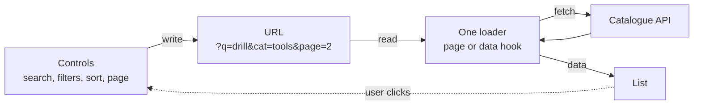
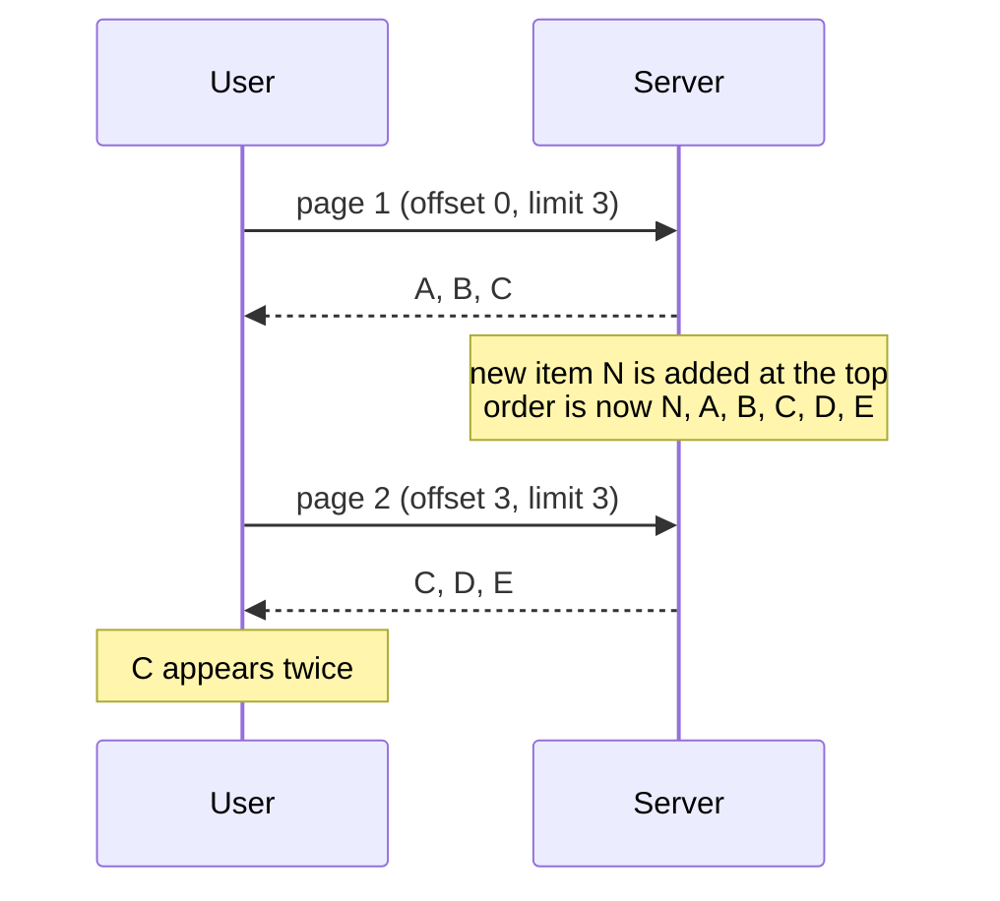
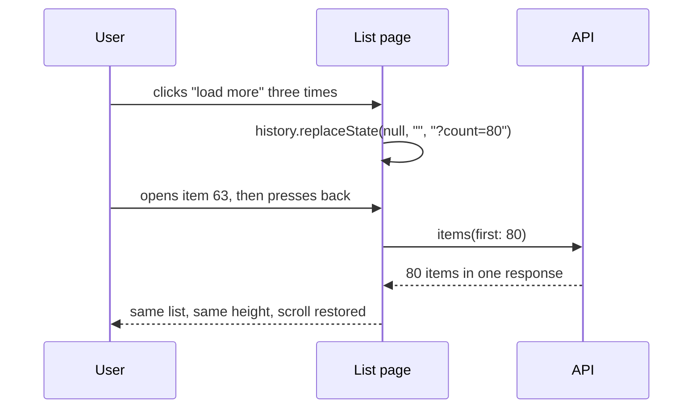
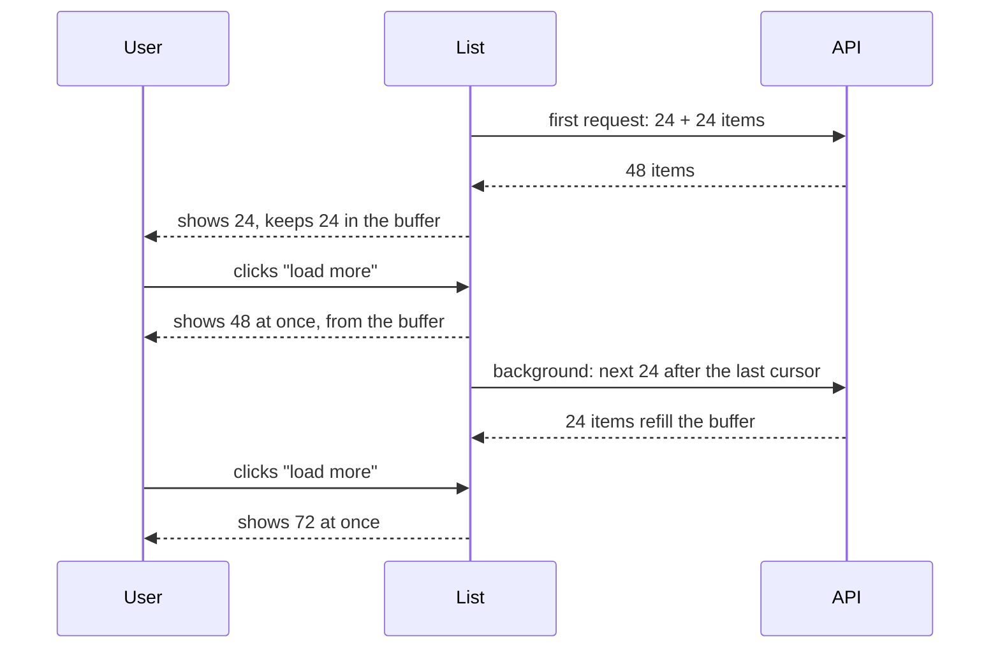

# Lists, filters and pagination that survive reload and the back button

> You filter a list, open an item, press back, and your filters are gone. In this topic we make the URL the single source of truth for a list, so that reload, shared links and the back button all restore exactly what the user saw. We look at one direction of data flow, keeping the old list on screen while the next one loads, offset versus cursor pagination, and a "load more" button that feels instant. At the end we see how to change URL formats without breaking links people have already shared.

**Duration:** about 30 minutes

## Contents

- [Where you are coming from](#where-you-are-coming-from)
- [The URL as the single source of truth](#the-url-as-the-single-source-of-truth)
- [One direction of data flow](#one-direction-of-data-flow)
- [Keeping the old list visible while loading](#keeping-the-old-list-visible-while-loading)
- [Pagination](#pagination)
- [A "load more" buffer](#a-load-more-buffer)
- [Changing URLs later](#changing-urls-later)
- [Takeaways](#takeaways)
- [Further reading](#further-reading)

## Where you are coming from

In Project 2 you probably built a list with a search box and a filter or two. The quickest way to do that is `useState`:

```tsx
const [query, setQuery] = useState("");
const [category, setCategory] = useState<string | null>(null);
const [page, setPage] = useState(1);
```

It works until the user does something ordinary:

- **Reload:** the state is gone and the list starts at page 1 without filters.
- **Share a link:** a colleague opens the link and sees a different list.
- **Back button:** the user opens an item, presses back, and lands on an unfiltered list at the top.

Now picture the Lending Desk grown into a company-wide platform. The item catalogue, availability, reservations, reviews and recommendations each belong to their own team and service, and millions of people use it. The catalogue holds millions of items. The list page has a search, a category filter, filters for brand, location and price, a sort order, and pagination. Users share filtered lists in chat, and search engines index category pages. Losing the list state is no longer a small annoyance. It costs bookings and search traffic.

## The URL as the single source of truth

The fix is to store the list state in the URL and nowhere else. A **single source of truth** means there is exactly one place that holds a value, and everything else reads it from there. If the URL holds the filters, reload, sharing and the back button work for free, because the browser already handles URLs for all three.

### What belongs in the URL

Ask one question: "If someone opens this link, should they see the same thing?"

| Belongs in the URL                         | Does not belong in the URL       |
| ------------------------------------------ | -------------------------------- |
| Search text                                | Hover state                      |
| Filters (category, brand, price range)     | Whether a dropdown is open       |
| Sort order                                 | Focus and text selection         |
| Current page, or how many items are loaded | Half-typed text before debounce  |
| Selected tab, if it changes the content    | Tooltips, animations, toasts     |

A rule of thumb: state that changes **what data** you show goes in the URL. State that only changes **how the UI looks right now** stays in React state.

### Typed parsing and serialising

Everything in a URL is a string. Your components want typed values: a number for the page, a union type for the sort order, an array for categories. So you need two functions: one that **parses** the URL into a typed object, and one that **serialises** the object back into a URL.

```ts
const SORTS = ["relevance", "newest", "name"] as const;
type Sort = (typeof SORTS)[number];

export type ListParams = {
  query: string;
  categories: string[];
  sort: Sort;
  page: number;
};

export function parseListParams(params: URLSearchParams): ListParams {
  const sort = params.get("sort");
  const page = Number.parseInt(params.get("page") ?? "", 10);

  return {
    query: params.get("q")?.trim().slice(0, 100) ?? "",
    categories: (params.get("cat") ?? "").split(".").filter(Boolean),
    // 👇 unknown values fall back to a default instead of throwing
    sort: SORTS.includes(sort as Sort) ? (sort as Sort) : "relevance",
    page: Number.isInteger(page) && page >= 1 ? Math.min(page, 500) : 1,
  };
}
```

### Invalid URLs must not crash

URLs come from outside your app. People edit them by hand, old bookmarks carry old formats, and bots send garbage. `?page=banana`, `?page=-3` or `?sort=<script>` must never throw or render a broken page. The parser above has three rules:

- **Every field has a default.** An unknown or missing value becomes the default.
- **Clamp ranges.** A page below 1 becomes 1. A page above what you allow becomes the maximum, so nobody can ask the database for page 10 million.
- **Allow-list enums.** Only known sort values pass through.

If a value is invalid, you can also redirect to the cleaned-up URL, so the address bar and the page agree.

### A compact encoding for many filters

With five filters and several values each, the default format grows fast:

```text
?category=cameras&category=tripods&brand=3&brand=7&brand=12&priceMin=100&priceMax=400
```

URLs have practical length limits in browsers, servers and CDNs, and long URLs are hard to read in chat. Two ideas help:

- **Short keys and one key per filter:** `?cat=cameras.tripods&brand=3.7.12&price=100-400`. Pick a separator that never appears in your values.
- **Canonical order:** sort the values and the keys before you write the URL. Then the same filter state always produces the same URL. That matters for caching (CDN and server caches see one URL, not six) and for search engines (one page, not duplicates).

```ts
export function serialiseListParams(state: ListParams): string {
  const params = new URLSearchParams();

  if (state.query) params.set("q", state.query);
  if (state.categories.length > 0) {
    params.set("cat", [...state.categories].sort().join("."));
  }
  // 👇 leave defaults out, so the plain list keeps a short, clean URL
  if (state.sort !== "relevance") params.set("sort", state.sort);
  if (state.page > 1) params.set("page", String(state.page));

  params.sort();
  return params.toString();
}
```

Docs: [URLSearchParams on MDN](https://developer.mozilla.org/en-US/docs/Web/API/URLSearchParams)

### A `useUrlState` hook

Components should not call `parseListParams` and the History API themselves. Wrap both in a hook that works like `useState`, but reads from and writes to the URL. It needs two pieces.

A provider holds the current query string in React state. Writes go through `history.pushState` or `history.replaceState`, which change the URL without reloading the page. Back and forward fire a `popstate` event, and the provider reads the URL again.

```tsx
type Mode = "push" | "replace";
const UrlContext = createContext<{ search: string; navigate: (query: string, mode: Mode) => void } | null>(null);

export function UrlStateProvider({ initialSearch, children }: { initialSearch: string; children: ReactNode }) {
  // 👇 the server passes the request's query string, the browser passes location.search
  const [search, setSearch] = useState(initialSearch);

  useEffect(() => {
    // pushState and replaceState never fire popstate; only back and forward do
    const onPopState = () => setSearch(window.location.search);
    window.addEventListener("popstate", onPopState);
    return () => window.removeEventListener("popstate", onPopState);
  }, []);

  const navigate = useCallback((query: string, mode: Mode) => {
    const url = query ? `?${query}` : window.location.pathname;
    history[mode === "push" ? "pushState" : "replaceState"](null, "", url);
    setSearch(query ? `?${query}` : "");
  }, []);

  return <UrlContext value={{ search, navigate }}>{children}</UrlContext>;
}
```

The hook reads one key with a typed `parse` and writes it back with `serialize`. Returning `null` from `serialize` removes the key, so defaults stay out of the URL.

```tsx
type Codec<T> = { parse: (raw: string | null) => T; serialize: (value: T) => string | null };

export function useUrlState<T>(key: string, { parse, serialize }: Codec<T>) {
  const { search, navigate } = useUrlContext(); // useContext(UrlContext), throws outside the provider
  const value = parse(new URLSearchParams(search).get(key));

  const setValue = (next: T, mode: Mode = "push") => {
    // 👇 start from the live URL, so two setters in one event do not overwrite each other
    const params = new URLSearchParams(window.location.search);
    const raw = serialize(next);
    if (raw === null) params.delete(key);
    else params.set(key, raw);
    params.sort();
    navigate(params.toString(), mode);
  };

  return [value, setValue] as const;
}
```

Docs: [History API on MDN](https://developer.mozilla.org/en-US/docs/Web/API/History_API), [pushState](https://developer.mozilla.org/en-US/docs/Web/API/History/pushState), [popstate event](https://developer.mozilla.org/en-US/docs/Web/API/Window/popstate_event), [useContext](https://react.dev/reference/react/useContext)

### Libraries

You do not have to write this by hand. **nuqs** wraps the same idea in hooks and ships an adapter for a plain React app (`nuqs/adapters/react`), as well as for several routers. It offers typed parsers such as `parseAsInteger` and `parseAsStringLiteral`, and defaults with `.withDefault()`. If a value is invalid for its parser, nuqs returns the default, or `null` if there is none.

```tsx
import { parseAsInteger, parseAsStringLiteral, useQueryStates } from "nuqs";

const SORTS = ["relevance", "newest", "name"] as const;

export function useListParams() {
  return useQueryStates({
    sort: parseAsStringLiteral(SORTS).withDefault("relevance"),
    page: parseAsInteger.withDefault(1),
  });
}
```

Docs: [nuqs adapters](https://nuqs.dev/docs/adapters), [nuqs built-in parsers](https://nuqs.dev/docs/parsers/built-in)

## One direction of data flow

Once the URL holds the state, a new problem appears. A common first attempt keeps the filters in `useState`, writes them to the URL in one effect, and reads the URL back in another effect. Now there are two sources of truth that sync in a circle, and you get double fetches, flickering inputs and, in the worst case, an endless loop.

The fix is **one direction of data flow**:

1. Controls (search box, filter chips, pagination) only **write** the URL.
2. One place **reads** the URL and loads the data.
3. The list renders what that one place returns.



No control ever fetches data, and no control keeps its own copy of the filter state. The controls read their current value from the URL too.

### One place reads the URL

The simplest "one place" is the component at the top of the list page. It reads the query string once, parses it, and passes typed values down as props. On the server, the same `parseListParams` runs on the request's query string, so the first render and every later one use the same rules.

```tsx
import { parseListParams } from "./listParams";

export function ItemsPage() {
  const { search } = useUrlContext();
  // 👇 the only place that turns the URL into a data request
  const params = parseListParams(new URLSearchParams(search));
  const items = useItems(params); // your data hook: Relay, TanStack Query, fetch

  return <ItemList items={items} params={params} />;
}
```

Child components receive `params` as props, or read single keys with `useUrlState`. None of them keeps its own copy.

### Controls write the URL: `replace` or `push`

A control writes a new URL with one of two History API methods:

- `history.pushState(state, "", url)` adds a new entry to the browser history. The back button undoes the change.
- `history.replaceState(state, "", url)` replaces the current entry. The back button skips the change.

Choose per control, based on what "back" should mean to the user:

- **Discrete choices** such as a category, the sort order or a page number: `push` is reasonable, so back undoes the last choice.
- **Continuous input** such as typing or dragging a slider: `replace`, otherwise the user needs twenty back clicks to leave the page.

Neither method scrolls the page, so a filter change keeps the user where they are and you decide yourself where to scroll. On back and forward, the browser restores the scroll position of the entry by default (`history.scrollRestoration` is `"auto"`).

When one change touches several keys, update them together. A new filter, for example, also resets the page:

```tsx
import { parseListParams, serialiseListParams, type ListParams } from "./listParams";

export function useUpdateListParams() {
  const { navigate } = useUrlContext();

  return (change: Partial<ListParams>, mode: "push" | "replace" = "push") => {
    const current = parseListParams(new URLSearchParams(window.location.search));
    // 👇 a new filter starts again at page 1
    const next = { ...current, page: 1, ...change };
    navigate(serialiseListParams(next), mode);
  };
}
```

Docs: [pushState](https://developer.mozilla.org/en-US/docs/Web/API/History/pushState), [replaceState](https://developer.mozilla.org/en-US/docs/Web/API/History/replaceState), [scrollRestoration](https://developer.mozilla.org/en-US/docs/Web/API/History/scrollRestoration)

### When the client loads the data

In a large application the list often loads on the client, for example with Relay or TanStack Query, while the server already rendered the first page for the first view. Then the "one place" is a single hook that reacts to the URL. Two details matter here.

**Skip the first reload.** When the server already rendered the first page, it did so with the current URL. If your hook fetches again on mount, the user pays for the same data twice and may see the list flicker. Compare the URL against what the server rendered, and only fetch when they differ.

**Compare a serialised snapshot, not array identity.** `parseListParams` returns a new `categories` array on every render. React compares effect dependencies with `Object.is`, so a new array counts as a change every time and the effect runs on every render. Compare a string instead: the canonical query string from `serialiseListParams`.

```tsx
import { useEffect, useRef } from "react";

export function useListLoader(initialKey: string, load: (key: string) => void) {
  const { search } = useUrlContext();
  // 👇 a string compares by value; a fresh array would differ every render
  const key = serialiseListParams(parseListParams(new URLSearchParams(search)));
  const lastLoaded = useRef(initialKey);

  useEffect(() => {
    if (key === lastLoaded.current) return; // the server already rendered this
    lastLoaded.current = key;
    load(key);
  }, [key, load]);
}
```

Data libraries do most of this for you. TanStack Query hashes its query keys by value, and Relay compares variables. The principle stays the same: the variables of the request come from the parsed URL, and nothing else.

### Debounce or batch URL writes

A price slider fires an event for every pixel the user drags. If every event writes the URL, you get dozens of history updates, re-renders and requests per second. Separate the two speeds:

- The slider shows its position from local state while the user drags.
- The URL is written when the user stops, either debounced (for example, 300 ms after the last change) or on `pointerup`.

```tsx
import { useEffect, useState } from "react";

export function PriceSlider({ value, onCommit }: { value: number; onCommit: (v: number) => void }) {
  const [draft, setDraft] = useState(value);

  useEffect(() => setDraft(value), [value]); // back button moves the slider too

  useEffect(() => {
    if (draft === value) return;
    // 👇 one URL write after the user pauses, not one per pixel
    const timer = setTimeout(() => onCommit(draft), 300);
    return () => clearTimeout(timer);
  }, [draft, value, onCommit]);

  return (
    <input type="range" min={0} max={1000} value={draft}
      onChange={(event) => setDraft(Number(event.target.value))} />
  );
}
```

The draft value is UI state and stays out of the URL. The committed value is list state and goes into the URL.

nuqs has this built in. It throttles URL updates by default, offers `limitUrlUpdates: debounce(ms)`, and defaults to `history: "replace"`.

Docs: [nuqs options](https://nuqs.dev/docs/options)

## Keeping the old list visible while loading

The user changes a filter and the list disappears behind a spinner, then reappears. On a fast connection this is a flash. On a slow one the page jumps, the scroll position is lost, and the user loses context.

A better pattern: keep the old list on screen, dim it a little, and swap in the new list when it is ready. React supports this with **Transitions**. A Transition marks an update as non-urgent. React keeps showing the content that is already on screen instead of replacing it with a Suspense fallback, and `isPending` tells you that work is in progress.

```tsx
import { useTransition } from "react";

const categoryCodec = {
  parse: (raw: string | null) => raw ?? "all",
  serialize: (value: string) => (value === "all" ? null : value),
};

export function CategoryFilter() {
  const [, setCategory] = useUrlState("cat", categoryCodec);
  const [isPending, startTransition] = useTransition();

  const select = (category: string) => {
    startTransition(() => {
      setCategory(category, "push");
    });
  };

  return (
    // 👇 the old list stays; a pending flag drives the subtle loading state
    <div data-pending={isPending || undefined}>
      {/* ... buttons that call select(category) */}
    </div>
  );
}
```

This works because the provider keeps the query string in React state, so `setSearch` inside `startTransition` is a Transition update. When the list suspends on the new data, React keeps the old list on screen. A hook built on `useSyncExternalStore` would not do this: updates from an external store cannot be marked as Transitions, so they show the nearest Suspense fallback. The `isPending` flag tells you the new list is on its way. Use it to dim the list or show a small progress bar, and set `aria-busy` on the list for screen readers.

Docs: [useTransition](https://react.dev/reference/react/useTransition), [nuqs `startTransition` option](https://nuqs.dev/docs/options)

## Pagination

With millions of items, nobody loads the whole list. How you split it into pieces affects correctness, database cost, the back button and search engines.

### Offset versus cursor

**Offset pagination** says "skip 40, take 20" (`?page=3`, SQL `LIMIT 20 OFFSET 40`). It takes little code and lets the user jump to any page. It has two problems at scale.

**Items get skipped or duplicated when data changes.** Offsets count positions, not items. If a new item arrives at the top while the user reads page 1, every item moves down one position, and page 2 starts with the last item of page 1. If an item is deleted, one item is skipped.



**Large offsets are expensive.** To answer `OFFSET 100000`, the database still has to walk past 100,000 rows and throw them away. Deep pages get slower the deeper you go.

**Cursor pagination** says "take 20 after this item". A **cursor** is an opaque string that marks a position in the list, typically built from the sort key of the last item you received (for example, its creation date and ID). The database can use an index to jump straight to that position, so page 5,000 costs about the same as page 1. And because the cursor points at an item rather than a position, inserts and deletes before it do not shift the next page.

The trade-off: with cursors you cannot jump to "page 37", only move forward or backward from a known position.

| | Offset (`?page=3`) | Cursor (`after: "abc"`) |
| --- | --- | --- |
| Jump to any page | Yes | No |
| Stable when data changes | No | Yes |
| Cost of deep pages | Grows with the offset | About constant |
| Good fit | Small or rarely changing lists, admin tables | Large, live lists, feeds, infinite scroll |

### The GraphQL connection spec

If your API uses GraphQL, the **connection spec** is the common shape for cursor pagination. Relay requires it, and many other clients and servers follow it.

```graphql
query ItemList($first: Int!, $after: String) {
  items(first: $first, after: $after) {
    edges {
      cursor
      node { id name }
    }
    pageInfo {
      hasNextPage
      endCursor
    }
  }
}
```

- A **connection** field takes `first` and `after` to page forward, or `last` and `before` to page backward.
- It returns `edges`. Each **edge** has a `node` (the item) and a `cursor` (its position).
- `pageInfo` has `hasNextPage`, `hasPreviousPage`, `startCursor` and `endCursor`.
- Clients must treat cursors as opaque: never parse or build them yourself.

To load the next page you send `after: pageInfo.endCursor`. Relay's `usePaginationFragment` does this for you and returns `loadNext`, `hasNext` and `isLoadingNext`.

Docs: [GraphQL Cursor Connections Specification](https://relay.dev/graphql/connections.htm), [Relay pagination](https://relay.dev/docs/guided-tour/list-data/pagination/)

### Pages, "load more" or infinite scroll

| | Numbered pages | "Load more" button | Infinite scroll |
| --- | --- | --- | --- |
| User control | High: jump and compare | High: the user decides | Low: content keeps coming |
| Back button | Works: the page is in the URL | Needs the loaded count in the URL | Hard: needs count and scroll position |
| Footer reachable | Yes | Yes | Only when the list ends |
| Search engines | Good: each page has a URL | Good, if every chunk also has a link | Poor without a paginated fallback |
| Good fit | Catalogue, search results | Catalogue on mobile, reviews | Social feeds, activity streams |

Search engine crawlers do not click buttons or scroll. They follow `<a href>` links. So whatever you show the user, give every chunk of the list its own URL (for example `?page=3`), link the chunks in sequence with real links, and do not mark page 1 as the canonical page for all of them. A "load more" button can be a real link to the next page that your JavaScript intercepts.

Docs: [Google: pagination and incremental page loading](https://developers.google.com/search/docs/specialty/ecommerce/pagination-and-incremental-page-loading)

### Store "how many are loaded" in the URL

With "load more", the user clicks three times, sees 80 items, opens item 63 and presses back. If the URL only says `/items`, they land on the first 20 items, far from where they were.

Store the window in the URL instead: `?count=80` (or `?pages=4`). When the user comes back:

1. The page reads `count=80` and loads the first 80 items in **one** request.
2. The list has the same height as before.
3. The browser restores the scroll position, and the user is back at item 63.



This works well with cursors: "the first 80 items from the start" is a valid request even after the data changed. Cap the value (for example at a few hundred) so a hand-edited `?count=100000` cannot overload the API.

## A "load more" buffer

Even with all of this, every "load more" click means a round trip: the user clicks, waits for the network, and then sees new items. You can hide that wait.

The idea: **request N + k items, show N, and keep k in a buffer.** When the user clicks "load more", show the k buffered items immediately, and at the same moment fetch the next k items in the background to refill the buffer.



```tsx
import { useState } from "react";

const PAGE = 24;

export function useBufferedList<T>(initial: T[], loadAfter: (cursor: number) => Promise<T[]>) {
  const [items, setItems] = useState(initial); // shown + buffered
  const [visible, setVisible] = useState(Math.min(PAGE, initial.length));
  const [loading, setLoading] = useState(false);

  const showMore = async () => {
    // 👇 reveal what is already in memory, then refill in the background
    setVisible((count) => Math.min(count + PAGE, items.length));
    if (loading) return;
    setLoading(true);
    const next = await loadAfter(items.length);
    setItems((current) => [...current, ...next]);
    setLoading(false);
  };

  return { visibleItems: items.slice(0, visible), hasMore: visible < items.length, showMore };
}
```

The snippet uses the item count as the position to keep it short. With a GraphQL API you pass the `endCursor` of the last **fetched** item, not the last shown one. The URL stores the **shown** count, so the back button restores what the user saw.

A side benefit: because you always know whether more items exist before the user clicks, the "load more" button never leads to an empty result.

**The trade-off:** every request carries more data than the user sees. The first response is larger, which can slow the first render, and the last buffered chunk is wasted if the user never clicks. Use the buffer where users click "load more" often and the items are small. Keep k small, or skip the buffer, where items are heavy or most users never load a second page. If the user clicks faster than the buffer refills, show a normal pending state.

## Changing URLs later

URLs are a public interface. Users bookmark them, paste them in chat, and search engines index them. Once a format is live, you cannot change it without a plan. Suppose the Lending Desk switches from `?category=drills&category=saws` to the compact `?cat=drills.saws`.

**Redirect old formats to new ones.** Keep a translation from the old format to the new one, and redirect permanently so browsers and search engines update their links. The redirect must come from the server, as an HTTP status: a `replaceState` in the browser cleans up the address bar, but search engines never see it. Put the translation in front of the list page, for example as an Express route handler that runs before the page is rendered:

```ts
import express from "express";

const app = express();

app.get("/items", (req, res, next) => {
  const url = new URL(req.originalUrl, "http://localhost"); // base only for parsing
  const legacy = url.searchParams.getAll("category");
  if (legacy.length === 0) return next();

  url.searchParams.delete("category");
  url.searchParams.set("cat", [...legacy].sort().join("."));
  url.searchParams.sort();
  // 👇 308: browsers and search engines remember the new URL
  res.redirect(308, `${url.pathname}${url.search}`);
});
```

Reading the query through `URL` and `URLSearchParams` keeps the handler independent of the server's query parser, and `getAll` collects repeated keys. For simple, fixed mappings, a rule in your CDN or reverse proxy does the same job without code.

Keep the redirect for a long time, track how often it still fires, and only remove it when the numbers say nobody needs it any more.

Docs: [res.redirect in Express](https://expressjs.com/en/5x/api/response/#resredirect), [URLSearchParams.getAll on MDN](https://developer.mozilla.org/en-US/docs/Web/API/URLSearchParams/getAll), [308 Permanent Redirect on MDN](https://developer.mozilla.org/en-US/docs/Web/HTTP/Reference/Status/308)

## Takeaways

- Put every piece of state that changes **what data** a list shows into the URL, parse it into typed values with defaults, and never let an invalid URL crash the page.
- Let data flow in one direction: controls write the URL, one place reads it and loads the data. Compare serialised snapshots, skip the reload the server already did, and debounce fast inputs.
- Use a Transition so the old list stays visible while the new one loads.
- Prefer cursor pagination for large, changing lists, store how many items are loaded in the URL, and give every chunk a crawlable link.
- Treat URLs as a public interface: when the format changes, redirect the old one.

## Further reading

- [MDN: Working with the History API](https://developer.mozilla.org/en-US/docs/Web/API/History_API/Working_with_the_History_API)
- [MDN: URLSearchParams](https://developer.mozilla.org/en-US/docs/Web/API/URLSearchParams)
- [React: useTransition](https://react.dev/reference/react/useTransition)
- [nuqs documentation](https://nuqs.dev/docs)
- [GraphQL Cursor Connections Specification](https://relay.dev/graphql/connections.htm)
- [Relay: Pagination](https://relay.dev/docs/guided-tour/list-data/pagination/)
- [TanStack Query: Infinite queries](https://tanstack.com/query/latest/docs/framework/react/guides/infinite-queries)
- [Google Search Central: Pagination and incremental page loading](https://developers.google.com/search/docs/specialty/ecommerce/pagination-and-incremental-page-loading)
- [Markus Winand: We need tool support for keyset pagination](https://use-the-index-luke.com/no-offset), on why offsets get slow
