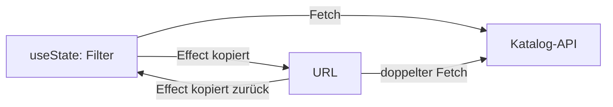
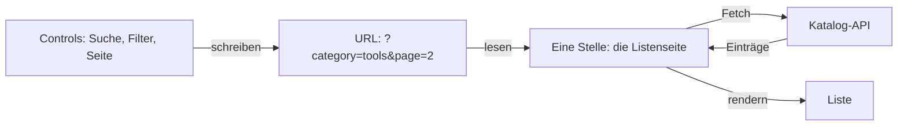
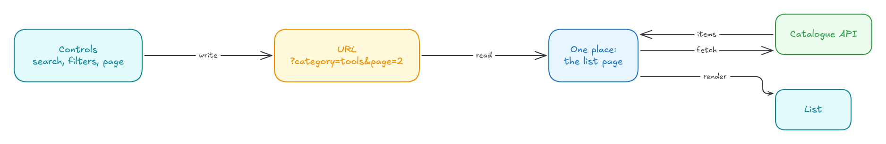
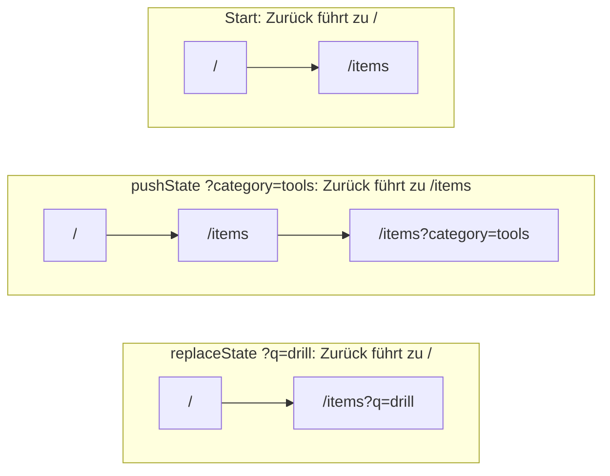
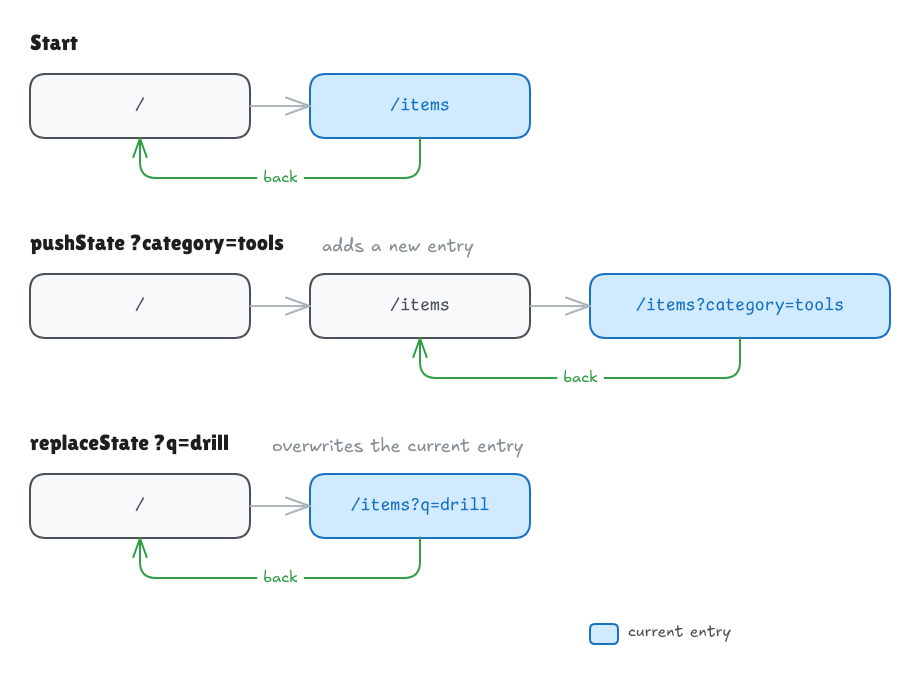
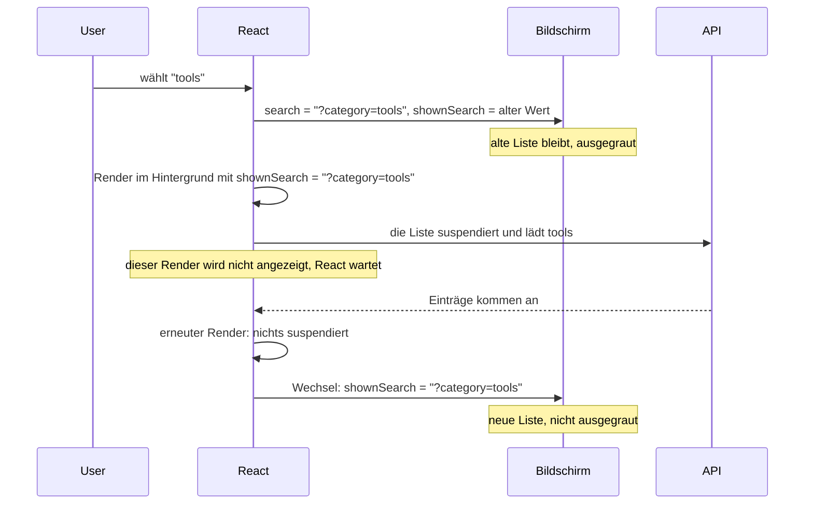
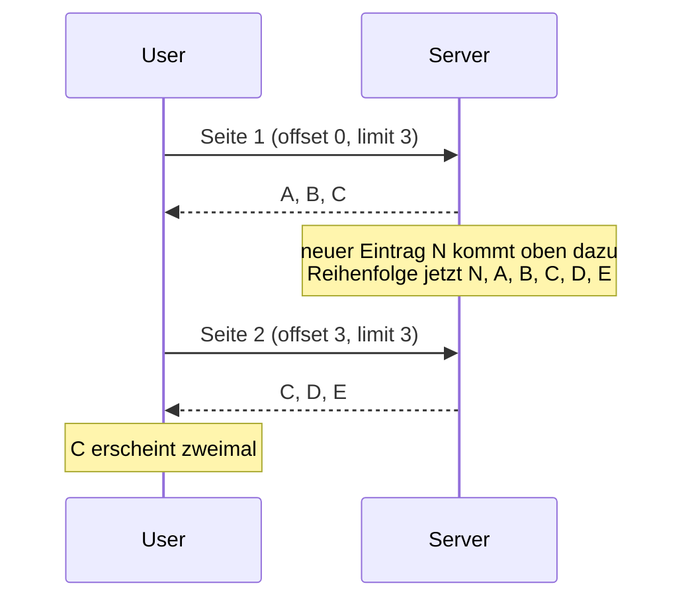
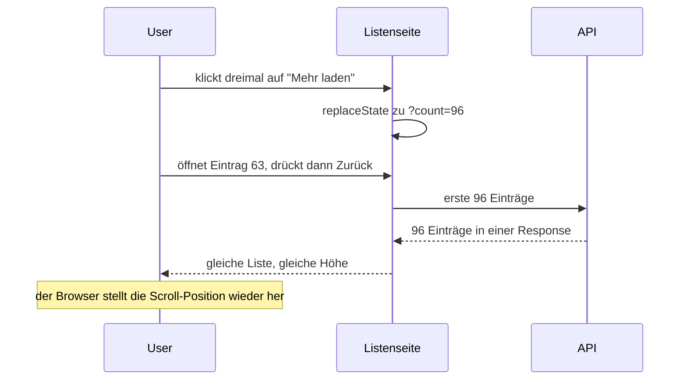

# Listen, Filter und Pagination

**Das Problem:** Nach einem Reload, einem geteilten Link oder Zurück sind die Filter einer Liste weg.

**Dauer:** etwa 30 Minuten

## Inhalt

- [Ausgangslage](#ausgangslage)
- [Die URL als Single Source of Truth](#die-url-als-single-source-of-truth)
- [Was in die URL gehört](#was-in-die-url-gehört)
- [Push oder Replace](#push-oder-replace)
- [URL-State mit nuqs](#url-state-mit-nuqs)
- [Die alte Liste beim Laden sichtbar halten](#die-alte-liste-beim-laden-sichtbar-halten)
- [Offset- oder Cursor-Pagination](#offset--oder-cursor-pagination)
- ["Mehr laden", das den Zurück-Button übersteht](#mehr-laden-das-den-zurück-button-übersteht)
- [Das Wichtigste](#das-wichtigste)
- [Weiterführende Links](#weiterführende-links)

## Ausgangslage

Eine typische Liste hat ein Suchfeld und ein, zwei Filter, gespeichert in `useState`:

```tsx
// 👇 lives in memory only: gone on reload, unknown to a shared link
const [category, setCategory] = useState<string | null>(null);
const [page, setPage] = useState(1);
```

Das funktioniert, bis jemand etwas Alltägliches tut:

| Wer...                                 | bekommt                            |
| -------------------------------------- | ---------------------------------- |
| die Seite neu lädt                     | Seite 1, keine Filter              |
| den Link an eine Kollegin schickt      | eine andere Liste                  |
| einen Eintrag öffnet und Zurück drückt | eine ungefilterte Liste, ganz oben |

Stell dir jetzt vor, der Lending Desk ist zu einer firmenweiten Plattform mit Millionen von Einträgen gewachsen. Leute teilen gefilterte Listen im Chat, und Suchmaschinen indexieren Kategorieseiten.

## Die URL als Single Source of Truth

Eine **Single Source of Truth** ist die eine Stelle, die einen Wert hält; alles andere liest ihn von dort. Bei einer Liste ist diese Stelle die URL:

```text
/items?q=drill&category=tools&sort=newest&page=2
```

Der Browser behält URLs schon bei Reload, beim Teilen und beim Zurück-Button. Liegt der State der Liste dort, funktionieren alle drei ohne zusätzlichen Code.

Ein häufiger erster Versuch hält die Filter in `useState` und synchronisiert sie in zwei Effects mit der URL. Dann halten zwei Stellen denselben Wert und kopieren ihn hin und her: doppelte Fetches, flackernde Inputs, manchmal eine Endlosschleife.

**Zwei Sources of Truth:**



**Eine Source of Truth:**





Die Daten fliessen in eine Richtung. Controls schreiben die URL und lesen ihren aktuellen Wert aus ihr. Daten lädt allein die Listenseite.

## Was in die URL gehört

Eine Frage entscheidet: "Wenn jemand diesen Link öffnet, soll er dasselbe sehen?"

| In die URL: ändert, **welche Daten** du zeigst | In React-State: ändert, **wie das UI aussieht** |
| ---------------------------------------------- | ----------------------------------------------- |
| Suchtext                                       | Hover und Fokus                                 |
| Filter, etwa Kategorie oder Preisspanne        | Ob ein Dropdown offen ist                       |
| Sortierung                                     | Getippter, noch nicht abgeschickter Text        |
| Seite oder Anzahl geladener Einträge           | Tooltips, Animationen, Toasts                   |

URLs kommen von ausserhalb deiner App: Leute bearbeiten sie von Hand, und Bots schicken Unsinn. Gib jedem Key einen Default und behandle `?page=banana` oder `?sort=<script>` als Default, statt abzustürzen.

## Push oder Replace

Ein Control ändert die URL über die History API. `history.pushState` und `history.replaceState` ändern beide die URL, ohne eine Seite zu laden. Das Neurendern übernimmt dein Router oder eine Library wie nuqs. Die beiden unterscheiden sich darin, was sie mit der Browser-History machen, dem Stapel von Verlaufseinträgen, durch den Zurück geht:





Wähle die Methode danach, was "Zurück" bedeuten soll:

| Methode                | Browser-History                      | Verwenden für                                                                     |
| ---------------------- | ------------------------------------ | --------------------------------------------------------------------------------- |
| `history.pushState`    | legt einen Verlaufseintrag obendrauf | eine Kategorie, die Sortierung, eine Seitenzahl: Zurück macht die Wahl rückgängig |
| `history.replaceState` | ersetzt den obersten Verlaufseintrag | Tippen, einen Slider, "Mehr laden": Zurück verlässt die Liste                     |

Doku: [pushState](https://developer.mozilla.org/en-US/docs/Web/API/History/pushState), [replaceState](https://developer.mozilla.org/en-US/docs/Web/API/History/replaceState)

## URL-State mit nuqs

Eine URL enthält nur Strings, deine Komponenten wollen typisierte Werte. **nuqs** ist eine kleine Library mit Hooks wie `useState`, die auf der URL aufbauen. Zurück und Vorwärts aktualisieren sie automatisch.

Wickle die App einmal in den Adapter für React ohne Framework:

```tsx
import { NuqsAdapter } from "nuqs/adapters/react";

createRoot(document.getElementById("root")!).render(
  <NuqsAdapter>
    <App />
  </NuqsAdapter>
);
```

Dann beschreibst du jeden Key einmal mit einem **Parser**: seinem Typ und seinem Default.

```tsx
import { parseAsInteger, parseAsString, parseAsStringLiteral } from "nuqs";

const SORTS = ["relevance", "newest", "name"] as const;

export const listParsers = {
  q: parseAsString.withDefault(""),
  category: parseAsString.withDefault(""),
  sort: parseAsStringLiteral(SORTS).withDefault("relevance"),
  page: parseAsInteger.withDefault(1)
};
```

Ein Control liest und schreibt über diese Parser. `useQueryStates` behandelt mehrere Keys in einem Hook und einem Update, `useQueryState` einen einzelnen Key. Setzt du einen Key auf `null`, verschwindet er aus der URL. Hier ein Kategorie-Chip:

```tsx
const [{ category }, setParams] = useQueryStates(listParsers);

// 👇 a new filter starts again at page 1, and back undoes the choice
const selectCategory = (next: string) =>
  setParams({ category: next, page: null }, { history: "push" });
```

Das übernimmt nuqs für dich:

- Ein ungültiger Wert ergibt den Default: `?sort=<script>` wird als `"relevance"` gelesen.
- Setzt du den Default, verschwindet der Key ebenfalls, so bleibt die URL der ungefilterten Liste kurz.
- Schreibvorgänge verwenden `replace`, ausser du verlangst `push`.

nuqs prüft Typen, keine Wertebereiche: `?page=-3` wird als `-3` gelesen. Begrenze die Seite, bevor du sie an die API schickst.

Doku: [nuqs adapters](https://nuqs.dev/docs/adapters), [basic usage](https://nuqs.dev/docs/basic-usage), [parsers](https://nuqs.dev/docs/parsers/built-in), [options](https://nuqs.dev/docs/options)

## Die alte Liste beim Laden sichtbar halten

Jemand wählt eine Kategorie, und die Liste verschwindet hinter einem Spinner. Bei langsamer Verbindung springt die Seite, und die Person verliert ihre Position. Lass die alte Liste ausgegraut stehen, bis die neue bereit ist.

Das macht Reacts `useDeferredValue`. Es braucht eine Liste, die **suspendiert** (englisch "suspends", von React Suspense): Die Komponente ist noch nicht bereit, weil ihre Daten noch laden, also wartet React auf sie. Data-Libraries wie TanStack Query (`useSuspenseQuery`) suspendieren für dich.

Die Listenseite hält zwei Werte: `search`, was die URL jetzt sagt, und `shownSearch`, die verzögerte Kopie, die die Liste rendert. React rendert den neuen Wert im Hintergrund und wechselt erst, wenn nichts mehr suspendiert:



Vergleiche Strings, keine Objekte: React prüft, ob sich der Wert geändert hat, und ein neues Params-Objekt ist bei jedem Render ein anderes, auch wenn die URL gleich blieb. `createSerializer` von nuqs macht aus den geparsten Params einen einzigen Query-String. Es geht von den geparsten Werten aus und lässt Werte weg, die dem Default entsprechen (`clearOnDefault`, seit nuqs 2 Standard). Darum ergeben `?page=banana` und gar keine Seitenangabe denselben String.

```tsx
const serialize = createSerializer(listParsers);

export function ItemsPage() {
  const [params] = useQueryStates(listParsers);
  // 👇 a string: equal URLs give equal values
  const search = serialize(params); // "?category=tools&page=2"
  const shownSearch = useDeferredValue(search);
  const isStale = search !== shownSearch;

  return (
    <div aria-busy={isStale} style={{ opacity: isStale ? 0.5 : 1 }}>
      <Suspense fallback={<ListSkeleton />}>
        <ItemList search={shownSearch} />
      </Suspense>
    </div>
  );
}
```

Der Fallback erscheint nur beim ersten Laden, wenn es noch keine alte Liste gibt.

Doku: [useDeferredValue](https://react.dev/reference/react/useDeferredValue), [aria-busy auf MDN](https://developer.mozilla.org/en-US/docs/Web/Accessibility/ARIA/Reference/Attributes/aria-busy)

## Offset- oder Cursor-Pagination

**Offset-Pagination** sagt "überspringe 3, nimm 3" (`?page=2`, SQL `LIMIT 3 OFFSET 3`). Offsets zählen Positionen, nicht Einträge. Kommt oben ein neuer Eintrag dazu, während jemand Seite 1 liest, rutscht alles um eine Position nach unten:



Tiefe Offsets sind zudem langsam: `OFFSET 100000` liest trotzdem an 100'000 Zeilen vorbei.

**Cursor-Pagination** sagt "nimm 3 nach Eintrag C". Ein **Cursor** ist ein opaker String vom Server, der die Position eines Eintrags markiert. Du schickst ihn unverändert zurück.

```text
page 1:  A B C              the server returns endCursor = C
page 2:  after=C → D E F    a new item N at the top shifts nothing
```

|                                | Offset (`?page=3`)             | Cursor (`after=...`)                               |
| ------------------------------ | ------------------------------ | -------------------------------------------------- |
| Zu Seite 37 springen           | ja                             | nein, nur nächste und vorherige                    |
| Stabil, wenn sich Daten ändern | nein                           | ja                                                 |
| Kosten tiefer Seiten           | wachsen mit dem Offset         | etwa konstant, mit einem Index auf dem Sortier-Key |
| Passt zu                       | kleinen Listen, Admin-Tabellen | grossen, sich ändernden Listen und Feeds           |

Für kleine Listen reicht Offset. Wechsle zu Cursors, wenn die Liste gross ist und sich ändert, während Leute sie lesen.

## "Mehr laden", das den Zurück-Button übersteht

Jemand klickt dreimal auf den Button "Mehr laden" (im Code "Load more"), sieht 96 Einträge, öffnet Eintrag 63 und drückt Zurück. Steht in der URL nur `/items`, enthält die Seite jetzt 24 Einträge, und die Scroll-Position existiert nicht mehr.

Speichere, wie viele Einträge angezeigt werden: `?count=96`. Beim Zurückkehren fragt die Seite die ersten 96 Einträge in einem Request an und braucht dafür keinen Cursor.



Der Browser stellt die Scroll-Position bei Zurück selbst wieder her. Das klappt nur, weil die Liste so lang ist wie vorher.

`useItems` steht hier für deinen Data-Hook: Er lädt die ersten `first` Einträge und sagt dir, ob es weitere gibt.

```tsx
const PAGE_SIZE = 24;
const MAX_COUNT = 480;

export function ItemFeed() {
  const [count, setCount] = useQueryState("count", parseAsInteger.withDefault(PAGE_SIZE));
  // 👇 a hand-edited ?count=100000 must not reach the API
  const shown = Math.min(Math.max(count, PAGE_SIZE), MAX_COUNT);
  const { items, hasNextPage } = useItems({ first: shown });

  return (
    <>
      <ItemList items={items} />
      {hasNextPage && shown < MAX_COUNT && (
        <button onClick={() => setCount(shown + PAGE_SIZE)}>Load more</button>
      )}
    </>
  );
}
```

Jeder Klick lädt die ganze sichtbare Liste neu: 48 Einträge, dann 72. Das ist der Preis für eine einzige Regel, "die URL sagt, wie viele, die Liste zeigt so viele", und die Obergrenze hält ihn klein.

Doku: [scrollRestoration auf MDN](https://developer.mozilla.org/en-US/docs/Web/API/History/scrollRestoration)

<details>
<summary>Weiterführend: nummerierte Seiten, "Mehr laden" oder Infinite Scroll</summary>

|                    | Nummerierte Seiten                       | "Mehr laden"-Button                      | Infinite Scroll                               |
| ------------------ | ---------------------------------------- | ---------------------------------------- | --------------------------------------------- |
| Kontrolle für User | hoch: springen und vergleichen           | hoch: User entscheiden selbst            | tief: es kommt immer mehr Inhalt              |
| Zurück-Button      | funktioniert: die Seite steht in der URL | braucht die Anzahl in der URL            | schwierig: braucht Anzahl und Scroll-Position |
| Footer erreichbar  | ja                                       | ja                                       | erst, wenn die Liste endet                    |
| Suchmaschinen      | gut: jede Seite hat eine URL             | gut, wenn jeder Abschnitt einen Link hat | schlecht ohne paginierten Fallback            |

Crawler klicken keine Buttons und scrollen nicht; sie folgen `<a href>`-Links. Gib darum jedem Abschnitt eine eigene URL, etwa `?page=3`, und verlinke sie.

Doku: [Google: pagination and incremental page loading](https://developers.google.com/search/docs/specialty/ecommerce/pagination-and-incremental-page-loading)

Wenn das Neuladen der ganzen Liste bei jedem Klick stört: Relays `usePaginationFragment` lädt die ersten `count` einmal und danach nur die nächsten 24 nach dem letzten Cursor.

Doku: [Relay pagination](https://relay.dev/docs/guided-tour/list-data/pagination/)

</details>

## Das Wichtigste

- Die URL ist die Single Source of Truth für eine Liste. Alles, was ändert, **welche Daten** du zeigst, gehört dorthin, mit einem Default für jeden Key.
- Die Daten fliessen in eine Richtung: Controls schreiben die URL, eine Stelle liest sie und lädt die Daten, die Liste rendert das Ergebnis.
- Nimm `push` für Entscheidungen, die man rückgängig machen will, `replace` für Tippen und "Mehr laden".
- `useDeferredValue` mit einer suspendierenden Datenquelle hält die alte Liste sichtbar, während die neue lädt.
- Nimm Cursors für grosse, sich ändernde Listen. Speichere bei "Mehr laden" die Anzahl in der URL, damit Zurück die Liste wiederherstellt.

## Weiterführende Links

- [nuqs-Dokumentation](https://nuqs.dev/docs)
- [MDN: Working with the History API](https://developer.mozilla.org/en-US/docs/Web/API/History_API/Working_with_the_History_API)
- [React: useDeferredValue](https://react.dev/reference/react/useDeferredValue)
- [GraphQL Cursor Connections Specification](https://relay.dev/graphql/connections.htm), das Cursor-Format, dem die meisten GraphQL-APIs folgen: Du schickst `first` und `after` und bekommst `pageInfo.endCursor` und `hasNextPage` zurück
- [TanStack Query: Infinite queries](https://tanstack.com/query/latest/docs/framework/react/guides/infinite-queries)
- [Markus Winand: We need tool support for keyset pagination](https://use-the-index-luke.com/no-offset), dazu, warum Offsets langsam werden
