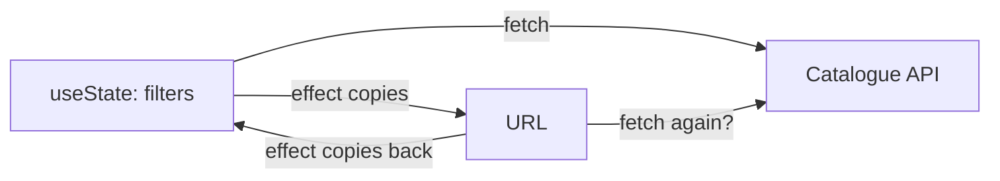
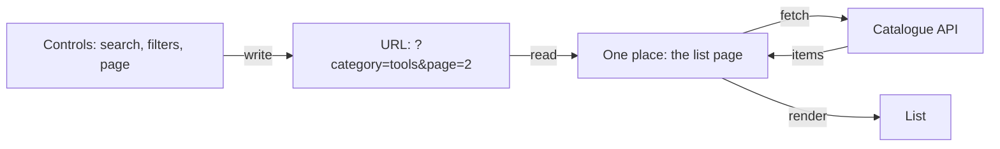
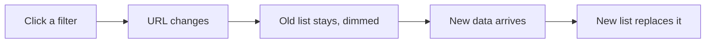
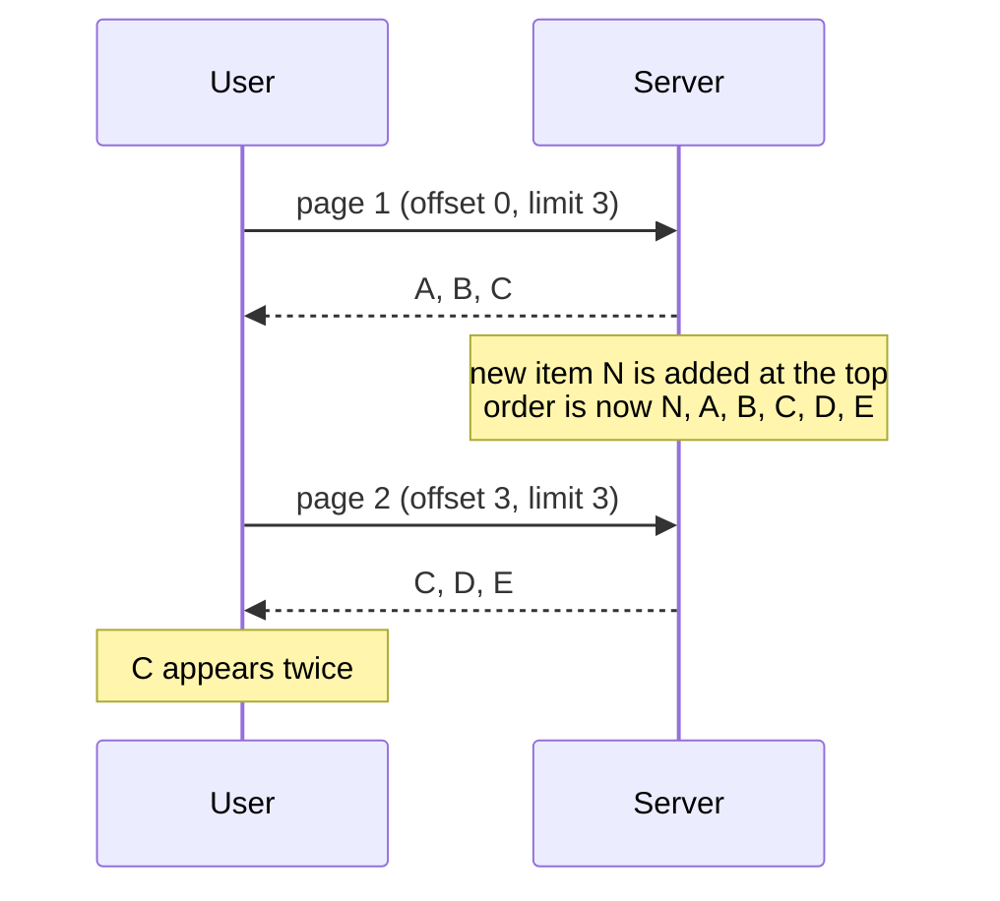
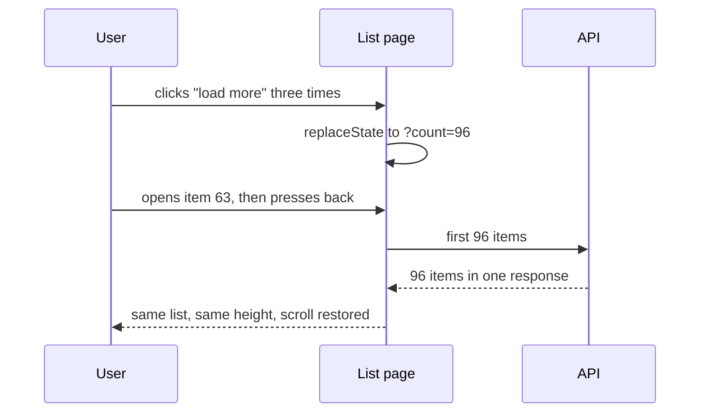

# Lists, filters and pagination

> You filter a list, open an item, press back, and your filters are gone. In this topic we make the URL the single source of truth for a list: controls write the URL, one place reads it, and the list renders what that returns. Reload, shared links and the back button then work for free. We also keep the old list on screen while the next one loads, and see why large lists page with cursors instead of page numbers.

**Duration:** about 30 minutes

## Contents

- [Where you are coming from](#where-you-are-coming-from)
- [The URL as the single source of truth](#the-url-as-the-single-source-of-truth)
- [What belongs in the URL](#what-belongs-in-the-url)
- [Push or replace](#push-or-replace)
- [URL state with nuqs](#url-state-with-nuqs)
- [Keeping the old list visible while loading](#keeping-the-old-list-visible-while-loading)
- [Offset or cursor pagination](#offset-or-cursor-pagination)
- ["Load more" that survives the back button](#load-more-that-survives-the-back-button)
- [Takeaways](#takeaways)
- [Further reading](#further-reading)

## Where you are coming from

In Project 2 you probably built a list with a search box and a filter or two, kept in `useState`:

```tsx
// 👇 lives in memory only: gone on reload, unknown to a shared link
const [category, setCategory] = useState<string | null>(null);
const [page, setPage] = useState(1);
```

It works until the user does something ordinary:

| The user...                         | What they get                   |
| ----------------------------------- | ------------------------------- |
| reloads the page                    | page 1, no filters              |
| sends the link to a colleague       | a different list                |
| opens an item and presses back      | an unfiltered list, at the top  |

Now picture the Lending Desk grown into a company-wide platform with millions of items. People share filtered lists in chat, and search engines index category pages.

## The URL as the single source of truth

A **single source of truth** is the one place that holds a value; everything else reads it. For a list, that place is the URL:

```text
/items?q=drill&category=tools&sort=newest&page=2
```

The browser already keeps URLs across reload, sharing and the back button. Put the list state there, and all three work without extra code.

A common first attempt keeps the filters in `useState` and syncs them with the URL in two effects. Now two places hold the same value and copy it back and forth: double fetches, flickering inputs, sometimes an endless loop.

**Two sources of truth:**



**One source of truth:**



Data flows in one direction. Controls write the URL and read their current value from it. Only the list page loads data.

## What belongs in the URL

Ask one question: "If someone opens this link, should they see the same thing?"

| In the URL: changes **what data** you show | In React state: changes **how the UI looks** |
| ------------------------------------------- | -------------------------------------------- |
| Search text                                 | Hover and focus                              |
| Filters, such as category or price range    | Whether a dropdown is open                   |
| Sort order                                  | Text typed but not yet sent                  |
| Page, or how many items are loaded          | Tooltips, animations, toasts                 |

URLs come from outside your app: people edit them and bots send garbage. Give every key a default, and treat `?page=banana` or `?sort=<script>` as the default instead of crashing.

## Push or replace

A control changes the URL with the History API. Choose the method by what "back" should mean:

| Method                 | Browser history              | Use for                                                           |
| ---------------------- | ---------------------------- | ----------------------------------------------------------------- |
| `history.pushState`    | adds an entry                | a category, the sort order, a page number: back undoes the choice |
| `history.replaceState` | overwrites the current entry | typing, a slider, "load more": back leaves the list               |

Docs: [pushState](https://developer.mozilla.org/en-US/docs/Web/API/History/pushState), [replaceState](https://developer.mozilla.org/en-US/docs/Web/API/History/replaceState)

## URL state with nuqs

A URL holds only strings, and your components want typed values. **nuqs** is a small library with `useState`-like hooks backed by the URL. Back and forward update them automatically.

Wrap the app once in the adapter for plain React:

```tsx
import { NuqsAdapter } from "nuqs/adapters/react";

createRoot(document.getElementById("root")!).render(
  <NuqsAdapter>
    <App />
  </NuqsAdapter>,
);
```

Then describe each key once with a **parser**: its type and its default.

```tsx
import { parseAsInteger, parseAsString, parseAsStringLiteral } from "nuqs";

const SORTS = ["relevance", "newest", "name"] as const;

export const listParsers = {
  q: parseAsString.withDefault(""),
  category: parseAsString.withDefault(""),
  sort: parseAsStringLiteral(SORTS).withDefault("relevance"),
  page: parseAsInteger.withDefault(1),
};
```

A control reads and writes through these parsers. Here a category chip:

```tsx
const [{ category }, setParams] = useQueryStates(listParsers);

// 👇 a new filter starts again at page 1, and back undoes the choice
const selectCategory = (next: string) =>
  setParams({ category: next, page: null }, { history: "push" });
```

What nuqs does for you:

- An invalid value returns the default: `?sort=<script>` reads as `"relevance"`.
- Setting `null`, or the default, removes the key, so the plain list keeps a short URL.
- Writes use `replace` unless you ask for `push`.

nuqs checks types, not ranges: `?page=-3` reads as `-3`. Clamp the page before you send it to the API.

Docs: [nuqs adapters](https://nuqs.dev/docs/adapters), [basic usage](https://nuqs.dev/docs/basic-usage), [parsers](https://nuqs.dev/docs/parsers/built-in), [options](https://nuqs.dev/docs/options)

## Keeping the old list visible while loading

The user picks a category, and the list vanishes behind a spinner. On a slow connection the page jumps and the user loses their place. Keep the old list on screen, dimmed, until the new one is ready.



React's `useDeferredValue` does this. It returns the previous value until React has rendered the new one. For that, the list must **suspend**: pause rendering until its data has loaded. While it is suspended, React keeps showing the old list instead of the `<Suspense>` fallback. Relay, TanStack Query's `useSuspenseQuery` and a cached promise read with `use` all suspend.

First, turn the URL state into one string. `createSerializer` from nuqs turns parsed params back into a query string:

```tsx
import { createSerializer, useQueryStates } from "nuqs";

const serialize = createSerializer(listParsers);

const [params] = useQueryStates(listParsers);
const search = serialize(params); // "?category=tools&page=2"
```

Then the list page, the one place that reads the URL, defers that string:

```tsx
export function ItemsPage() {
  // ...
  // 👇 defer a string, not an object: objects differ on every render
  const shownSearch = useDeferredValue(search);
  const isStale = search !== shownSearch;

  return (
    <div aria-busy={isStale} style={{ opacity: isStale ? 0.5 : 1 }}>
      <Suspense fallback={<ListSkeleton />}>
        <ItemList search={shownSearch} />
      </Suspense>
    </div>
  );
}
```

The fallback appears only on the first load, when there is no old list to show.

Docs: [useDeferredValue](https://react.dev/reference/react/useDeferredValue), [aria-busy on MDN](https://developer.mozilla.org/en-US/docs/Web/Accessibility/ARIA/Reference/Attributes/aria-busy)

## Offset or cursor pagination

With millions of items, nobody loads the whole list at once.

**Offset pagination** says "skip 3, take 3" (`?page=2`, SQL `LIMIT 3 OFFSET 3`). Offsets count positions, not items. If a new item arrives at the top while the user reads page 1, everything moves down one place:



Deep offsets are also slow: `OFFSET 100000` still reads past 100,000 rows.

**Cursor pagination** says "take 3 after item C". A **cursor** is an opaque string from the server that marks an item's position. You send it back unchanged.

```text
page 1:  A B C              the server returns endCursor = C
page 2:  after=C → D E F    a new item N at the top shifts nothing
```

|                          | Offset (`?page=3`)            | Cursor (`after=...`)                          |
| ------------------------ | ----------------------------- | --------------------------------------------- |
| Jump to page 37          | yes                           | no, only next and previous                    |
| Stable when data changes | no                            | yes                                           |
| Cost of deep pages       | grows with the offset         | about constant, with an index on the sort key |
| Good fit                 | small lists, admin tables     | large, live lists and feeds                   |

For Project 2, offset is fine. Switch to cursors when the list is large and changes while people read it. GraphQL APIs usually follow the [connection spec](https://relay.dev/graphql/connections.htm): you send `first` and `after`, and get back `pageInfo.endCursor` and `hasNextPage`.

## "Load more" that survives the back button

The user clicks "load more" three times, sees 96 items, opens item 63 and presses back. If the URL says only `/items`, the page now holds 24 items, and the scroll position no longer exists.

Store how many items are shown: `?count=96`. On the way back, the page asks for the first 96 items in one request, so it needs no cursor.



Here `useItems` stands for your data hook: it loads the first `first` items and tells you whether more exist.

```tsx
const PAGE_SIZE = 24;
const MAX_COUNT = 480;

export function ItemFeed() {
  const [count, setCount] = useQueryState("count", parseAsInteger.withDefault(PAGE_SIZE));
  // 👇 a hand-edited ?count=100000 must not reach the API
  const shown = Math.min(Math.max(count, PAGE_SIZE), MAX_COUNT);
  const { items, hasNextPage } = useItems({ first: shown });

  return (
    <>
      <ItemList items={items} />
      {hasNextPage && shown < MAX_COUNT && (
        <button onClick={() => setCount(shown + PAGE_SIZE)}>Load more</button>
      )}
    </>
  );
}
```

Each click refetches the whole visible list: 48 items, then 72. That is the price of one rule, "the URL says how many, the list shows that many", and the cap keeps it small. If it hurts, Relay's `usePaginationFragment` can load the first `count` once, then only the next 24 after the last cursor.

nuqs writes with `replace` by default, so back leaves the list instead of undoing one click at a time.

Docs: [scrollRestoration on MDN](https://developer.mozilla.org/en-US/docs/Web/API/History/scrollRestoration), [Relay pagination](https://relay.dev/docs/guided-tour/list-data/pagination/)

<details>
<summary>Going further: numbered pages, "load more" or infinite scroll</summary>

|                  | Numbered pages                | "Load more" button             | Infinite scroll                       |
| ---------------- | ----------------------------- | ------------------------------ | ------------------------------------- |
| User control     | high: jump and compare        | high: the user decides         | low: content keeps coming             |
| Back button      | works: the page is in the URL | needs the count in the URL     | hard: needs count and scroll position |
| Footer reachable | yes                           | yes                            | only when the list ends               |
| Search engines   | good: each page has a URL     | good, if each chunk has a link | poor without a paginated fallback     |

Crawlers do not click buttons or scroll; they follow `<a href>` links, so give every chunk its own URL, such as `?page=3`, and link to it.

Docs: [Google: pagination and incremental page loading](https://developers.google.com/search/docs/specialty/ecommerce/pagination-and-incremental-page-loading)

</details>

## Takeaways

- The URL is the single source of truth for a list. Everything that changes **what data** you show goes there, with a default for every key.
- Data flows one way: controls write the URL, one place reads it and loads the data, the list renders the result.
- Use `push` for choices the user may want to undo, `replace` for typing and "load more".
- `useDeferredValue` with a suspending data source keeps the old list visible while the new one loads.
- Use cursors for large, changing lists. For "load more", store the count in the URL so back restores the list.

## Further reading

- [nuqs documentation](https://nuqs.dev/docs)
- [MDN: Working with the History API](https://developer.mozilla.org/en-US/docs/Web/API/History_API/Working_with_the_History_API)
- [React: useDeferredValue](https://react.dev/reference/react/useDeferredValue)
- [GraphQL Cursor Connections Specification](https://relay.dev/graphql/connections.htm)
- [TanStack Query: Infinite queries](https://tanstack.com/query/latest/docs/framework/react/guides/infinite-queries)
- [Markus Winand: We need tool support for keyset pagination](https://use-the-index-luke.com/no-offset), on why offsets get slow
