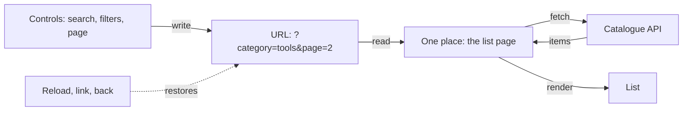
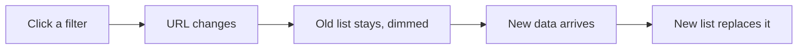
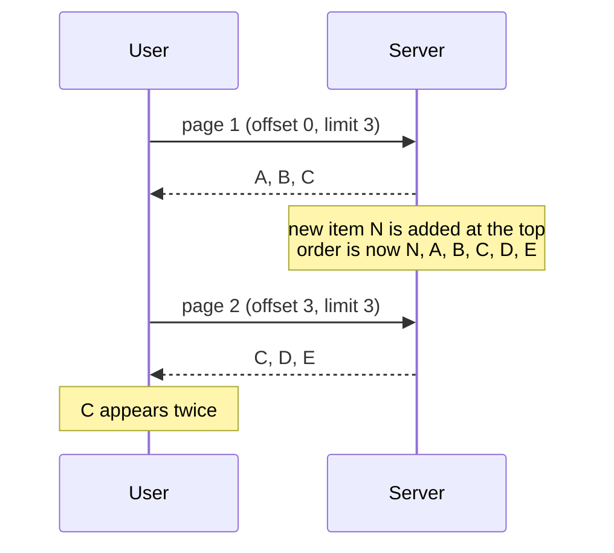
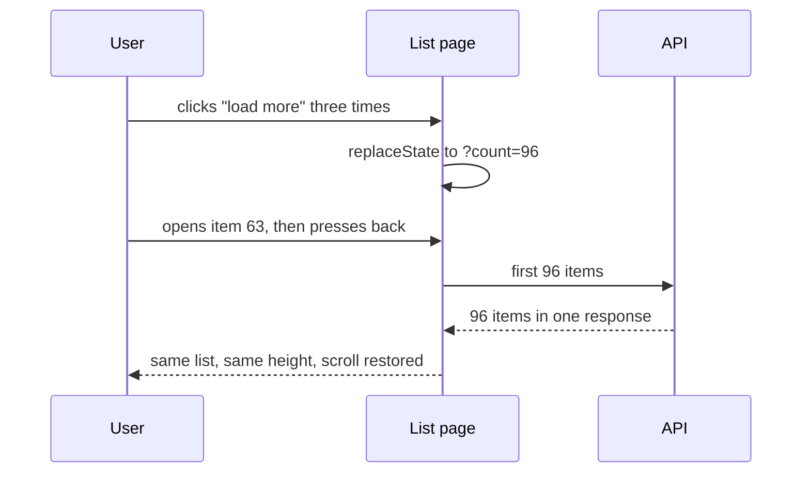

# Lists, filters and pagination

> You filter a list, open an item, press back, and your filters are gone. In this topic we make the URL the single source of truth for a list: controls write the URL, one place reads it, and the list renders what that returns. Reload, shared links and the back button then work for free. We also keep the old list on screen while the next one loads, and see why large lists page with cursors instead of page numbers.

**Duration:** about 30 minutes

## Contents

- [Where you are coming from](#where-you-are-coming-from)
- [The URL as the single source of truth](#the-url-as-the-single-source-of-truth)
- [What belongs in the URL](#what-belongs-in-the-url)
- [One direction of data flow](#one-direction-of-data-flow)
- [URL state with nuqs](#url-state-with-nuqs)
- [Keeping the old list visible while loading](#keeping-the-old-list-visible-while-loading)
- [Offset or cursor pagination](#offset-or-cursor-pagination)
- ["Load more" that survives the back button](#load-more-that-survives-the-back-button)
- [Takeaways](#takeaways)
- [Further reading](#further-reading)

## Where you are coming from

In Project 2 you probably built a list with a search box and a filter or two, kept in `useState`:

```tsx
// 👇 lives in memory only: gone on reload, unknown to a shared link
const [category, setCategory] = useState<string | null>(null);
const [page, setPage] = useState(1);
```

It works until the user does something ordinary:

| The user...                         | What they get                   |
| ----------------------------------- | ------------------------------- |
| reloads the page                    | page 1, no filters              |
| sends the link to a colleague       | a different list                |
| opens an item and presses back      | an unfiltered list, at the top  |

Now picture the Lending Desk grown into a company-wide platform with millions of items and users. People share filtered lists in chat, and search engines index category pages. Losing the list state now costs bookings.

## The URL as the single source of truth

A **single source of truth** is the one place that holds a value. Everything else reads it from there. For a list, that place is the URL:

```text
/items?q=drill&category=tools&sort=newest&page=2
```

The browser already keeps URLs across reload, sharing and the back button. Put the list state there, and all three work without extra code.



## What belongs in the URL

Ask one question: "If someone opens this link, should they see the same thing?"

| In the URL: changes **what data** you show | In React state: changes **how the UI looks** |
| ------------------------------------------- | -------------------------------------------- |
| Search text                                 | Hover and focus                              |
| Filters, such as category or price range    | Whether a dropdown is open                   |
| Sort order                                  | Text typed but not yet sent                  |
| Page, or how many items are loaded          | Tooltips, animations, toasts                 |

URLs come from outside your app. People edit them, old bookmarks carry old values, and bots send garbage. `?page=banana` or `?sort=<script>` must never crash the page:

| Rule                   | Example                                    |
| ---------------------- | ------------------------------------------ |
| Every key has a default | missing or invalid `page` becomes `1`     |
| Allow-list enums       | only `relevance`, `newest`, `name` pass    |
| Clamp ranges           | `page=-3` becomes `1`, `page=99999` a maximum |

<details>
<summary>Going further: changing the URL format later</summary>

Once a URL format is live, it is a public interface: people bookmark it and search engines index it. If you change the format, the server keeps translating the old one and answers with a permanent redirect. It has to be an HTTP status from the server, because search engines never see a `history.replaceState` in the browser.

| Old URL                                 | New URL                    | Response          |
| --------------------------------------- | -------------------------- | ----------------- |
| `/items?category=drills&category=saws`  | `/items?cat=drills.saws`   | `308` to the new URL |

Keep the redirect until your logs show that nobody hits it any more.

Docs: [308 Permanent Redirect on MDN](https://developer.mozilla.org/en-US/docs/Web/HTTP/Reference/Status/308)

</details>

## One direction of data flow

A common first attempt keeps the filters in `useState`, copies them to the URL in one effect, and copies the URL back in another. Now there are two sources of truth that sync in a circle. You get double fetches, flickering inputs, and sometimes an endless loop.

Instead, let data flow in one direction:

1. Controls (search box, filter chips, pagination) only **write** the URL.
2. One place, the list page, **reads** the URL and loads the data.
3. The list renders what that place returns.

No control fetches data or keeps its own copy of the filters. Controls read their current value from the URL, too.

A control writes the URL in one of two ways. Choose by what "back" should mean:

| Method                 | Browser history         | Use for                                 |
| ---------------------- | ----------------------- | --------------------------------------- |
| `history.pushState`    | adds an entry           | a category, the sort order, a page number: back undoes the choice |
| `history.replaceState` | overwrites the current entry | typing, a slider, "load more": back leaves the list |

Neither method reloads the page. For fast inputs, also wait until the user pauses before you write, for example 300 ms after the last keystroke.

Docs: [pushState](https://developer.mozilla.org/en-US/docs/Web/API/History/pushState), [replaceState](https://developer.mozilla.org/en-US/docs/Web/API/History/replaceState)

## URL state with nuqs

Everything in a URL is a string, and your components want typed values. **nuqs** is a small library that gives you `useState`-like hooks backed by the URL, with typed parsers and defaults. For a plain React app, wrap the app once in `<NuqsAdapter>` from `nuqs/adapters/react`. Back and forward update the hooks automatically.

```tsx
import { parseAsInteger, parseAsString, parseAsStringLiteral, useQueryStates } from "nuqs";

const SORTS = ["relevance", "newest", "name"] as const;

export const listParsers = {
  q: parseAsString.withDefault(""),
  category: parseAsString.withDefault(""),
  sort: parseAsStringLiteral(SORTS).withDefault("relevance"),
  page: parseAsInteger.withDefault(1),
};

export function CategoryChips({ categories }: { categories: string[] }) {
  const [{ category }, setParams] = useQueryStates(listParsers);

  // 👇 a new filter starts again at page 1, and back undoes the choice
  const select = (next: string) => setParams({ category: next, page: null }, { history: "push" });

  return categories.map((name) => (
    <button key={name} aria-pressed={name === category} onClick={() => select(name)}>{name}</button>
  ));
}
```

What nuqs does for you:

- An invalid value returns the default: `?sort=<script>` reads as `"relevance"`.
- Setting `null`, or the default, removes the key, so the plain list keeps a short URL.
- Writes use `replace` unless you ask for `push`. `limitUrlUpdates: debounce(300)` waits for a pause.

nuqs checks types, not ranges: `?page=-3` reads as `-3`. Clamp the page before you send it to the API.

Docs: [nuqs adapters](https://nuqs.dev/docs/adapters), [basic usage](https://nuqs.dev/docs/basic-usage), [parsers](https://nuqs.dev/docs/parsers/built-in), [options](https://nuqs.dev/docs/options)

<details>
<summary>Going further: how it works under the hood</summary>

A URL hook needs three things: read `location.search`, write with the History API, and re-render when the URL changes. Back and forward fire a `popstate` event. `pushState` and `replaceState` fire nothing, so the hook notifies its own listeners. A minimal version for one key:

```tsx
const listeners = new Set<() => void>();

function subscribe(onChange: () => void) {
  listeners.add(onChange);
  window.addEventListener("popstate", onChange);
  return () => {
    listeners.delete(onChange);
    window.removeEventListener("popstate", onChange);
  };
}

export function useUrlParam(key: string) {
  const search = useSyncExternalStore(subscribe, () => location.search, () => "");

  const setValue = (next: string | null, mode: "push" | "replace" = "replace") => {
    const params = new URLSearchParams(location.search);
    if (next === null) params.delete(key);
    else params.set(key, next);
    const query = params.toString();
    history[mode === "push" ? "pushState" : "replaceState"](null, "", query ? `?${query}` : location.pathname);
    listeners.forEach((notify) => notify());
  };

  return [new URLSearchParams(search).get(key), setValue] as const;
}
```

The third argument of `useSyncExternalStore` is the value during server rendering. A real version returns the request's query string there, so the server and the browser render the same list. On top of this, nuqs adds typed parsers, defaults, several keys per update and rate limiting.

Docs: [popstate event on MDN](https://developer.mozilla.org/en-US/docs/Web/API/Window/popstate_event), [useSyncExternalStore](https://react.dev/reference/react/useSyncExternalStore)

</details>

## Keeping the old list visible while loading

The user picks a category, the list vanishes behind a spinner, and then comes back. On a slow connection the page jumps and the user loses their place. A calmer pattern keeps the old list on screen, dims it, and swaps in the new one when it is ready.



React's `useDeferredValue` does this. It hands the list an older value while React renders the new one in the background. If that render suspends while the data loads, React keeps showing the old list instead of the Suspense fallback. This is the one place that reads the URL:

```tsx
import { createSerializer, useQueryStates } from "nuqs";
import { Suspense, useDeferredValue } from "react";

const serialize = createSerializer(listParsers);

export function ItemsPage() {
  const [params] = useQueryStates(listParsers);
  // 👇 a string, so React compares it by value: "?category=tools&page=2"
  const search = serialize(params);
  const shownSearch = useDeferredValue(search);
  const isStale = search !== shownSearch;

  return (
    <div aria-busy={isStale} style={{ opacity: isStale ? 0.5 : 1 }}>
      <Suspense fallback={<ListSkeleton />}>
        <ItemList search={shownSearch} />
      </Suspense>
    </div>
  );
}
```

`ItemList` loads its items with a data source that suspends, such as Relay, TanStack Query's `useSuspenseQuery`, or a cached promise read with `use`. The fallback appears only on the first load. Pass a string or a number to `useDeferredValue`, not an object built during render, or every render counts as a change.

Docs: [useDeferredValue](https://react.dev/reference/react/useDeferredValue), [aria-busy on MDN](https://developer.mozilla.org/en-US/docs/Web/Accessibility/ARIA/Reference/Attributes/aria-busy)

## Offset or cursor pagination

With millions of items, nobody loads the whole list. There are two common ways to split it.

**Offset pagination** says "skip 3, take 3" (`?page=2`, SQL `LIMIT 3 OFFSET 3`). Offsets count positions, not items. If a new item arrives at the top while the user reads page 1, everything moves down one place:



Large offsets are also slow: for `OFFSET 100000`, the database still walks past 100,000 rows.

**Cursor pagination** says "take 3 after item C". A **cursor** is an opaque string the server gives you to mark an item's position. You send it back as it is, without reading or building it yourself. Inserts before the cursor no longer shift the next page, and the database can jump straight to the position with an index.

|                          | Offset (`?page=3`)            | Cursor (`after=...`)          |
| ------------------------ | ----------------------------- | ----------------------------- |
| Jump to page 37          | yes                           | no, only next and previous    |
| Stable when data changes | no                            | yes                           |
| Cost of deep pages       | grows with the offset         | about constant                |
| Good fit                 | small lists, admin tables     | large, live lists and feeds   |

For Project 2, offset is fine. Switch to cursors when the list is large and changes while people read it. GraphQL APIs usually follow the [connection spec](https://relay.dev/graphql/connections.htm) for this: you send `first` and `after`, and get back `pageInfo.endCursor` and `hasNextPage`.

## "Load more" that survives the back button

With a "load more" button, the user clicks three times, sees 96 items, opens item 63 and presses back. The browser tries to restore the scroll position, but if the URL says only `/items`, the page now holds 24 items. The list is too short, and the user lands far from item 63.

Store how many items are shown: `?count=96`. On the way back, the page loads all 96 in one request, the list has its old height, and the scroll position fits again.



```tsx
const PAGE_SIZE = 24;
const MAX_COUNT = 480;

export function ItemFeed() {
  const [count, setCount] = useQueryState("count", parseAsInteger.withDefault(PAGE_SIZE));
  // 👇 a hand-edited ?count=100000 must not reach the API
  const shown = Math.min(Math.max(count, PAGE_SIZE), MAX_COUNT);
  const { items, hasNextPage } = useItems({ first: shown });

  return (
    <>
      <ItemList items={items} />
      {hasNextPage && shown < MAX_COUNT && (
        <button onClick={() => setCount(shown + PAGE_SIZE)}>Load more</button>
      )}
    </>
  );
}
```

nuqs writes with `replace` by default, so back leaves the list instead of undoing one click at a time. `useItems` stands for your data hook. On a click it should fetch only the next 24 after the last cursor and append them. Relay's `usePaginationFragment` and TanStack Query's infinite queries do this for you.

Docs: [scrollRestoration on MDN](https://developer.mozilla.org/en-US/docs/Web/API/History/scrollRestoration), [Relay pagination](https://relay.dev/docs/guided-tour/list-data/pagination/)

<details>
<summary>Going further: numbered pages, "load more" or infinite scroll</summary>

|                  | Numbered pages               | "Load more" button             | Infinite scroll                     |
| ---------------- | ---------------------------- | ------------------------------ | ----------------------------------- |
| User control     | high: jump and compare       | high: the user decides         | low: content keeps coming           |
| Back button      | works: the page is in the URL | needs the count in the URL    | hard: needs count and scroll position |
| Footer reachable | yes                          | yes                            | only when the list ends             |
| Search engines   | good: each page has a URL    | good, if each chunk has a link | poor without a paginated fallback   |

Search engine crawlers do not click buttons or scroll. They follow `<a href>` links. Give every chunk its own URL, for example `?page=3`, and link the chunks in sequence. A "load more" button can be a real link to the next page that your JavaScript intercepts.

Docs: [Google: pagination and incremental page loading](https://developers.google.com/search/docs/specialty/ecommerce/pagination-and-incremental-page-loading)

</details>

## Takeaways

- The URL is the single source of truth for a list. Everything that changes **what data** you show goes there, with a default for every key.
- Data flows one way: controls write the URL, one place reads it and loads the data, the list renders the result.
- Use `push` for choices the user may want to undo, `replace` for typing and "load more".
- `useDeferredValue` keeps the old list visible while the new one loads.
- Use cursors for large, changing lists, and store the loaded count in the URL so back restores it.

## Further reading

- [nuqs documentation](https://nuqs.dev/docs)
- [MDN: Working with the History API](https://developer.mozilla.org/en-US/docs/Web/API/History_API/Working_with_the_History_API)
- [React: useDeferredValue](https://react.dev/reference/react/useDeferredValue)
- [GraphQL Cursor Connections Specification](https://relay.dev/graphql/connections.htm)
- [TanStack Query: Infinite queries](https://tanstack.com/query/latest/docs/framework/react/guides/infinite-queries)
- [Markus Winand: We need tool support for keyset pagination](https://use-the-index-luke.com/no-offset), on why offsets get slow
