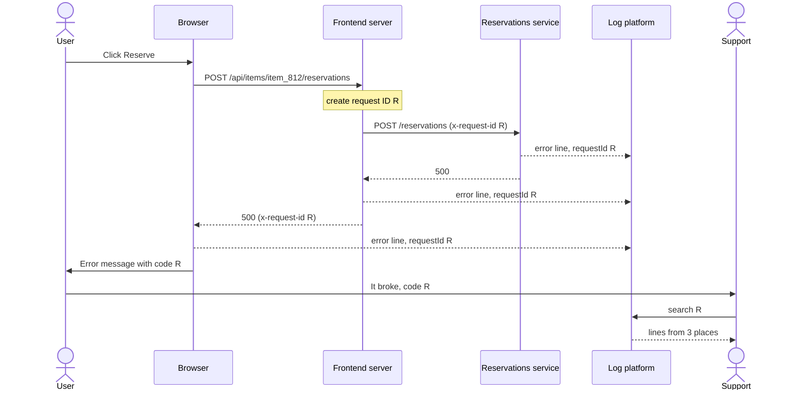
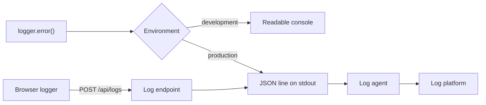
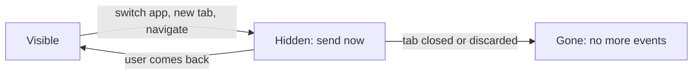

# Logging and debugging in production

> In Project 2 you read errors in your own console. In production, the error happens in a stranger's browser or on one of hundreds of servers, and all you hear is "it broke on Tuesday". Let's send structured logs with context from the server and the browser, and tie them all to one ID that the user sees as a support code. Then one support request leads straight to the log lines that explain it.

**Duration:** about 40 minutes

## Contents

- [Where you are coming from](#where-you-are-coming-from)
- [One ID from click to cause](#one-id-from-click-to-cause)
- [Structured log lines](#structured-log-lines)
- [Context on every server line](#context-on-every-server-line)
- [Getting browser errors to a server](#getting-browser-errors-to-a-server)
- [Show the ID to the user](#show-the-id-to-the-user)
- [What never to log](#what-never-to-log)
- [Takeaways](#takeaways)
- [Further reading](#further-reading)

## Where you are coming from

In Project 2 you write `console.log`, open DevTools or the terminal, and read the output. There is one developer, one browser and one server, and the output is right in front of you.

Now imagine the Lending Desk, the equipment lending service you know from an earlier evening, has grown into a company-wide platform: item catalogue, availability, reservations, reviews and notifications, each owned by its own team and service, with millions of users. A reservation fails, and three things break:

- **Browser output vanishes.** A `console.log` in production writes to the console of a user you will never meet.
- **Server output is unsearchable.** Hundreds of server instances print free text. Nobody can find "all failed reservations in the last hour" in that.
- **The report leads nowhere.** The user says "it broke on Tuesday afternoon". Among millions of log lines, a rough time is not enough.

## One ID from click to cause

Here is the core idea of this topic: **send structured logs with context from the server and the browser, and tie every line to one ID that the user can also see.** Then one report leads to the cause.

The diagram shows the whole chain. `R` stands for one request ID, for example `7c1e9a2b-5d3f-4e8a-9b1c-2f6d8e0a4b37`.



The ID travels in an HTTP header. `x-request-id` is a common name for it, not a standard. Each section below builds one piece: the log line, the context on the server, the browser errors, and the code the user sees.

## Structured log lines

### Levels and fields

Every part of the code logs through one small API with four **levels**. A level says how serious a line is, so you can filter and alert on it.

| Level   | Use it for                                          |
| ------- | --------------------------------------------------- |
| `debug` | Details you only want while developing              |
| `info`  | Normal, noteworthy events ("reservation created")   |
| `warn`  | Something is off, but the user is not blocked       |
| `error` | Something failed for the user, a person should look |

A **structured** line keeps the message fixed and puts the variable parts into named fields:

```ts
// ❌ a sentence: counting failures per item needs a regular expression
console.log("Reservation " + id + " failed for item " + itemId);

// ✅ a fixed message plus fields the log platform can filter and count
logger.error("Reservation failed", { reservationId: id, itemId });
```

### From the code to the log platform

In development you want readable output in the terminal. In production you want one JSON object per line on standard output (stdout). A **log agent** is a program that runs next to your server, reads stdout and forwards each line to a **log platform**, where you search all lines of all servers in one place. Fluent Bit and the OpenTelemetry Collector are agents; Grafana Loki and Datadog are platforms. Your server does not need to know which one you use.



Browser errors take the lower path. We build it later in this topic.

### A small logger

Two details matter. `JSON.stringify` turns an `Error` into `{}`, because `name`, `message` and `stack` are not enumerable, so copy them out. And the logger must never throw: it runs inside `catch` blocks, and an exception there hides the original error.

```ts
const isProduction = process.env.NODE_ENV === "production";

const toJson = (value: unknown) =>
  value instanceof Error ? { name: value.name, message: value.message, stack: value.stack } : value;

function log(level: Level, message: string, fields: Fields = {}) {
  try {
    const context = requestContext.getStore(); // 👇 filled per request, see below
    const line = { time: new Date().toISOString(), level, message, ...context, ...redact(fields) };
    if (isProduction) {
      process.stdout.write(JSON.stringify({ ...line, error: toJson(fields.error) }) + "\n");
    } else {
      console[level](`${level.toUpperCase()} ${message}`, fields);
    }
  } catch {
    process.stdout.write(JSON.stringify({ level, message, logFailed: true }) + "\n");
  }
}

export const logger = {
  info: (message: string, fields?: Fields) => log("info", message, fields),
  error: (message: string, fields?: Fields) => log("error", message, fields),
  // ... debug, warn
};
```

`JSON.stringify` throws on circular objects and on `BigInt`. The `catch` block then writes a minimal line instead. `redact()` follows in [What never to log](#what-never-to-log).

Docs: [`JSON.stringify()` exceptions](https://developer.mozilla.org/en-US/docs/Web/JavaScript/Reference/Global_Objects/JSON/stringify#exceptions)

A finished line in production looks like this:

```json
{
  "time": "2026-10-28T18:42:07.109Z",
  "level": "error",
  "message": "Reservation failed",
  "requestId": "7c1e9a2b-5d3f-4e8a-9b1c-2f6d8e0a4b37",
  "path": "/api/items/item_812/reservations",
  "release": "2026.10.28-3",
  "loggedIn": true,
  "itemId": "item_812",
  "error": { "name": "ServiceError", "message": "Reservations service answered 500", "stack": "..." }
}
```

## Context on every server line

"Reservation failed" is only half useful. You also want the request ID, the path, the release that was running and whether the user was logged in. Passing that into every function would change every signature in the codebase.

Node's `AsyncLocalStorage` stores a value that follows one request through `await`, timers and callbacks. You start it once per request with `run()`, and any code inside that request reads it with `getStore()`. This is the same middleware that creates the request ID and returns it in a response header:

```ts
import { AsyncLocalStorage } from "node:async_hooks";
import { randomUUID } from "node:crypto";

type RequestContext = { requestId: string; path: string; release: string; loggedIn: boolean };
export const requestContext = new AsyncLocalStorage<RequestContext>();

app.use((req, res, next) => {
  const requestId = randomUUID();
  res.setHeader("x-request-id", requestId); // the browser can read it on every response
  const context = {
    requestId,
    path: req.path, // without the query string
    release: process.env.RELEASE ?? "dev",
    loggedIn: Boolean(req.session?.userId),
  };
  // 👇 everything awaited inside next() sees this context
  requestContext.run(context, next);
});
```

The server creates the ID itself. Accept an ID from an incoming request only from a server you trust, such as your own load balancer, and check its format: it ends up in every log line.

Docs: [Node.js `AsyncLocalStorage`](https://nodejs.org/api/async_context.html#class-asynclocalstorage)

### Pass it on, and log once at the end

Every call to another service sends the same ID along, so that service can put it on its own lines:

```ts
export function callService(url: string, init: RequestInit = {}) {
  const headers = new Headers(init.headers);
  headers.set("x-request-id", requestContext.getStore()?.requestId ?? "none");
  return fetch(url, { ...init, headers });
}
```

Errors that no route handles reach one error-handling middleware, registered after all routes. Express 5 forwards rejected `async` handlers there automatically. It still runs inside the request context, so the line carries the request ID.

```ts
app.use((error: unknown, req: Request, res: Response, next: NextFunction) => {
  if (res.headersSent) return next(error);
  logger.error("Unhandled request error", { error });
  res.status(500).json({ message: "Something went wrong" });
});
```

Docs: [Express: Error handling](https://expressjs.com/en/guide/error-handling.html)

<details>
<summary>Going further: errors outside any request</summary>

Errors that escape everything, such as a rejected promise nobody awaited, never reach the middleware. Node's guidance is clear: after an uncaught exception, "it is not safe to resume normal operation". Log it, let the process exit, and let an external supervisor (your container platform, for example) start a new one.

The `uncaughtExceptionMonitor` event lets you log without changing that behaviour. With the default `--unhandled-rejections=throw` mode, unhandled rejections arrive there too, with `origin` set to `"unhandledRejection"`.

```ts
process.on("uncaughtExceptionMonitor", (error, origin) => {
  logger.error("Process is crashing", { error, origin });
});
```

Avoid an `unhandledRejection` listener that only logs: it stops Node from treating the rejection as an uncaught exception, and the process runs on in an unknown state.

Docs: [Node.js `uncaughtExceptionMonitor`](https://nodejs.org/api/process.html#event-uncaughtexceptionmonitor), [Warning: using `uncaughtException` correctly](https://nodejs.org/api/process.html#warning-using-uncaughtexception-correctly), [`--unhandled-rejections`](https://nodejs.org/api/cli.html#--unhandled-rejectionsmode)

</details>

<details>
<summary>Going further: W3C Trace Context and OpenTelemetry</summary>

With about 30 services, each team inventing its own header does not scale. The W3C **Trace Context** Recommendation defines a standard header:

```http
traceparent: 00-4bf92f3577b34da6a3ce929d0e0e4736-00f067aa0ba902b7-01
```

Its four parts are the version, a 32-character **trace ID** shared by the whole request, a 16-character **parent ID** for the calling step, and flags (`01` means "sampled", the caller may record this trace). A **trace** is the record of one request across all services, made of **spans**, one per unit of work, each with a start and a duration.

**OpenTelemetry** is the open standard and set of SDKs that create and pass on this header, and record traces, metrics and logs. If every service uses it, the trace ID can serve as your request ID: put it on every log line and in the response header. You rarely write `traceparent` by hand; the SDK generates it. For the browser, the OpenTelemetry docs say that client instrumentation "is experimental and mostly unspecified".

Docs: [W3C Trace Context](https://www.w3.org/TR/trace-context/), [OpenTelemetry: Context propagation](https://opentelemetry.io/docs/concepts/context-propagation/), [OpenTelemetry: Browser](https://opentelemetry.io/docs/languages/js/getting-started/browser/)

</details>

## Getting browser errors to a server

The server is under your control. The browser is where most surprises happen, and by default every one of them stays in the user's console.

### Where browser errors come from

| Source                                   | Catches                                                | Note                                            |
| ---------------------------------------- | ------------------------------------------------------ | ----------------------------------------------- |
| `error` event on `window`                | Uncaught exceptions                                    | `event.error` holds the thrown value            |
| `unhandledrejection` event on `window`   | Rejected promises that nothing handles                 | `event.reason` can be any value, not an `Error` |
| React root options (React 19)            | Errors in components, with the component stack         | Passed to `createRoot` or `hydrateRoot`         |
| Your own code around `fetch`             | Failed API calls, with the request ID                  | See [Show the ID to the user](#show-the-id-to-the-user) |

React has three root options: `onUncaughtError` (no error boundary caught it), `onCaughtError` (an error boundary caught it) and `onRecoverableError` (React recovered on its own, for example after a hydration mismatch).

```tsx
window.addEventListener("error", (event) => {
  browserLogger.error(event.message, { error: event.error, source: event.filename });
});

window.addEventListener("unhandledrejection", (event) => {
  browserLogger.error("Unhandled rejection", { error: event.reason });
});

hydrateRoot(container, <App />, {
  onUncaughtError: (error, info) =>
    browserLogger.error("React error", { error, componentStack: info.componentStack }),
  onCaughtError: (error, info) =>
    browserLogger.error("React error caught", { error, componentStack: info.componentStack }),
  // ... onRecoverableError, logged as warn
});
```

Docs: [`Window: error` event](https://developer.mozilla.org/en-US/docs/Web/API/Window/error_event), [`Window: unhandledrejection` event](https://developer.mozilla.org/en-US/docs/Web/API/Window/unhandledrejection_event), [React `hydrateRoot` options](https://react.dev/reference/react-dom/client/hydrateRoot#parameters)

### When to send

One request per line is too expensive with millions of users. Collect lines in a queue and send them together every few seconds. The last batch matters most: it often holds the error that made the user leave. So send it the moment the page becomes hidden.



The `visibilitychange` event fires when the page becomes hidden. MDN calls it the most reliable moment to send data at the end of a session; it recommends against `unload`, `beforeunload` and `pagehide`.

### How to send

| Way to send                    | Survives leaving the page? | Body limit | Note                                                            |
| ------------------------------ | -------------------------- | ---------- | --------------------------------------------------------------- |
| `fetch()`                      | No, it is cancelled        | None       | Fine while the page stays open                                  |
| `fetch()` with `keepalive`     | Yes                        | 64 KiB     | You set the `Content-Type` and can read the response            |
| `navigator.sendBeacon()`       | Yes                        | 64 KiB     | POST only, no response; a string body arrives as `text/plain`   |
| A request in an `unload` handler | Often never runs         | –          | Chrome 155 and later no longer fire `unload`; it also blocks the back/forward cache |

`fetch` with `keepalive` works while the page is open and while it is leaving, so we use it for every batch. Send the `Content-Type: application/json` header: without it, a string body arrives as `text/plain`, and `express.json()` leaves `req.body` empty.

```ts
const queue: LogLine[] = [];

export const browserLogger = {
  error: (message: string, fields: Fields = {}) => {
    const time = new Date().toISOString();
    queue.push({ time, level: "error", message, page: location.pathname, ...fields, error: toJson(fields.error) });
    if (queue.length > 200) queue.shift(); // never grow without limit
  },
  // ... warn, info
};

function flush() {
  if (queue.length === 0) return;
  fetch("/api/logs", {
    method: "POST",
    // 👇 finishes even after the page is gone
    keepalive: true,
    headers: { "Content-Type": "application/json" },
    body: JSON.stringify(queue.splice(0, 20)),
  }).catch(() => {}); // logging must never break the page
}

setInterval(flush, 5000);
document.addEventListener("visibilitychange", () => {
  if (document.visibilityState === "hidden") flush();
});
```

The `/api/logs` endpoint parses the batch, caps its size, and writes each line through the server logger with `source: "browser"`. Treat it as untrusted input: anyone can post to it.

In a large platform, an error-tracking SDK often does this batching for you. The ideas stay the same.

Docs: [`RequestInit.keepalive`](https://developer.mozilla.org/en-US/docs/Web/API/RequestInit#keepalive), [`navigator.sendBeacon()`](https://developer.mozilla.org/en-US/docs/Web/API/Navigator/sendBeacon), [`Document: visibilitychange` event](https://developer.mozilla.org/en-US/docs/Web/API/Document/visibilitychange_event), [Chrome: `unload` deprecation](https://developer.chrome.com/blog/unload-deprecated-in-chrome)

<details>
<summary>Going further: too many errors</summary>

Once the browser sends its errors, most of what arrives is not yours to fix. A few patterns appear in almost every large frontend:

| Symptom                                        | Why                                                                         | Action                                                       |
| ---------------------------------------------- | --------------------------------------------------------------------------- | ------------------------------------------------------------ |
| `Script error.` with no file or stack          | A script from another origin threw, and the browser hides the details       | Load your own scripts with `crossorigin` and CORS headers; drop the rest |
| Stack frames from `chrome-extension://` or `moz-extension://` | A browser extension injected the script                       | Drop                                                         |
| `ResizeObserver loop completed with undelivered notifications.` | A resize callback causes more resizing; users may see a flash of broken layout | Fix the layout loop first, then filter it              |
| `AbortError`                                   | Your code cancelled a request, usually because the user moved on            | Not a failure; drop or log as `info`                         |
| The same message 50 times in a second          | A broken component inside a list                                            | Keep one line with a `repeated` count                        |

If the volume is still too high, **sample per session**: decide once per session whether it sends logs, and keep that decision in `sessionStorage`. You get complete stories from fewer users instead of fragments from many. Give developers a cookie that forces full logging while they reproduce a bug.

Docs: [`<script>` `crossorigin`](https://developer.mozilla.org/en-US/docs/Web/HTML/Reference/Elements/script#crossorigin), [`ResizeObserver` observation errors](https://developer.mozilla.org/en-US/docs/Web/API/ResizeObserver#observation_errors)

</details>

## Show the ID to the user

The user still only sees "Something went wrong". Let's give them the ID. When a request fails, the browser reads the ID from the response header, puts it on its own log line, and shows the same value. If the request never reached a server, for example because the user is offline, the browser creates an ID itself.

```ts
export async function reserve(itemId: string): Promise<Reservation> {
  let response: Response;
  try {
    response = await fetch(`/api/items/${itemId}/reservations`, { method: "POST" });
  } catch (error) {
    // 👇 no server answered, so no server ID
    throw logFailure(crypto.randomUUID(), { itemId, error });
  }
  if (!response.ok) {
    const requestId = response.headers.get("x-request-id") ?? crypto.randomUUID();
    throw logFailure(requestId, { itemId, status: response.status });
  }
  return response.json();
}

function logFailure(requestId: string, fields: Fields): ReservationError {
  // 👇 the log line and the user get the same ID
  browserLogger.error("Reservation failed", { requestId, ...fields });
  return new ReservationError(requestId);
}
```

The error UI shows it as a **support code**:

```tsx
export function ReservationErrorMessage({ requestId }: { requestId: string }) {
  return (
    <div role="alert">
      <p>We could not create your reservation. Please try again.</p>
      <p>
        If it keeps happening, contact support with this code: <code>{requestId}</code>
      </p>
    </div>
  );
}
```

Show the whole ID. A short prefix of 8 or 12 characters looks friendlier, but with millions of requests, two of them will share it. Support pastes the code into the log platform and gets every line of that request:

| Time         | Source               | Level   | Message                     |
| ------------ | -------------------- | ------- | --------------------------- |
| 18:42:07.104 | Reservations service | `error` | Availability did not answer |
| 18:42:07.109 | Frontend server      | `error` | Reservation failed          |
| 18:42:07.311 | Browser              | `error` | Reservation failed          |

"It broke on Tuesday" has become three lines that name the cause. The code reveals nothing about your system.

If the API runs on another origin, the browser hides custom response headers from JavaScript until the server lists them in `Access-Control-Expose-Headers`. `crypto.randomUUID()` needs a secure context: HTTPS, or `localhost` during development.

Docs: [`Access-Control-Expose-Headers`](https://developer.mozilla.org/en-US/docs/Web/HTTP/Reference/Headers/Access-Control-Expose-Headers), [`Crypto.randomUUID()`](https://developer.mozilla.org/en-US/docs/Web/API/Crypto/randomUUID)

<details>
<summary>Going further: readable stack traces</summary>

Production JavaScript is minified, so a browser stack says `at e (main-3f9a.js:1:48213)`. A **source map** maps that position back to the original file and line.

With **hidden source maps**, the build creates the maps but does not reference them from the bundle. You upload them to your error platform during deployment, and it shows readable stacks; webpack calls this `hidden-source-map`. Hidden maps are not a security control: never put anything into client code you would not publish. Key the maps by release version, so yesterday's error is decoded with yesterday's maps.

On the server, `node --enable-source-maps` maps stack traces of bundled or compiled TypeScript back to the source. The Node docs note that it can add latency when code reads `Error.stack` often.

Docs: [webpack `devtool`](https://webpack.js.org/configuration/devtool/), [Node.js `--enable-source-maps`](https://nodejs.org/api/cli.html#--enable-source-maps)

</details>

## What never to log

Logs are stored for weeks, copied into tools and read by many people. Anything personal that goes into a line goes to all of those places. Treat the log pipeline like any system that processes personal data: set a retention period and restrict who can read it.

| Data                                         | Risk                                     | Rule                                                              |
| -------------------------------------------- | ---------------------------------------- | ----------------------------------------------------------------- |
| `Cookie` and `Authorization` headers         | Anyone who reads logs can take over a session | Log only an allowlist: `user-agent`, `accept-language`, `x-request-id` |
| Query strings (`?email=`, `?token=`)         | Personal data and secrets                | Log the path without the query, or a route pattern (`/items/:id`) |
| Response bodies and form input               | Addresses, names, free text              | Log the status code and a short, known error code                 |
| Fields named `password`, `token`, `email`    | Slip in through `{ ...user }`            | Remove them in one central `redact()` step                        |

Use an allowlist rather than a blocklist: a blocklist fails the day someone adds a new sensitive header. The `redact()` step runs on every line before it is written:

```ts
const SENSITIVE = /pass(word)?|token|secret|authorization|cookie|email/i;

export function redact(fields: Fields): Fields {
  return Object.fromEntries(
    Object.entries(fields).map(([key, value]) => [key, SENSITIVE.test(key) ? "[redacted]" : value]),
  );
}
```

A real version also walks nested objects and masks values that look like email addresses.

## Takeaways

- In production you cannot see the user's console or the server's terminal. Send logs to one place you can search.
- Log structured lines: a fixed message, a level and named fields, as JSON on stdout. The logger never throws and serialises `Error` explicitly.
- Add context to every server line with `AsyncLocalStorage`, and catch browser errors from `error`, `unhandledrejection` and React's root options. Send them with `fetch` and `keepalive` when the page becomes hidden.
- Create one request ID per request, pass it to every service, return it in a response header, and show the whole ID to the user as a support code.
- Never log cookies, tokens, query strings or response bodies. Allowlist headers and redact every line.

## Further reading

- [Node.js: Asynchronous context tracking](https://nodejs.org/api/async_context.html)
- [MDN: `navigator.sendBeacon()`](https://developer.mozilla.org/en-US/docs/Web/API/Navigator/sendBeacon), including when to send
- [React: `createRoot` error options](https://react.dev/reference/react-dom/client/createRoot#parameters)
- [The Twelve-Factor App: Logs](https://12factor.net/logs)
- [W3C: Trace Context](https://www.w3.org/TR/trace-context/)
- Related topic: [When only part of the data fails](../partial-failures/README.md), on error boundaries
