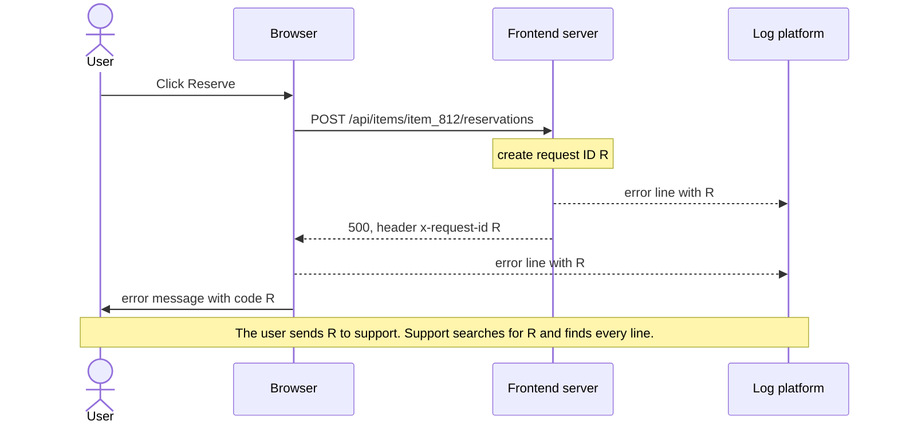
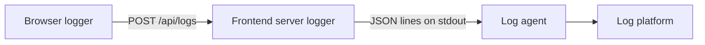
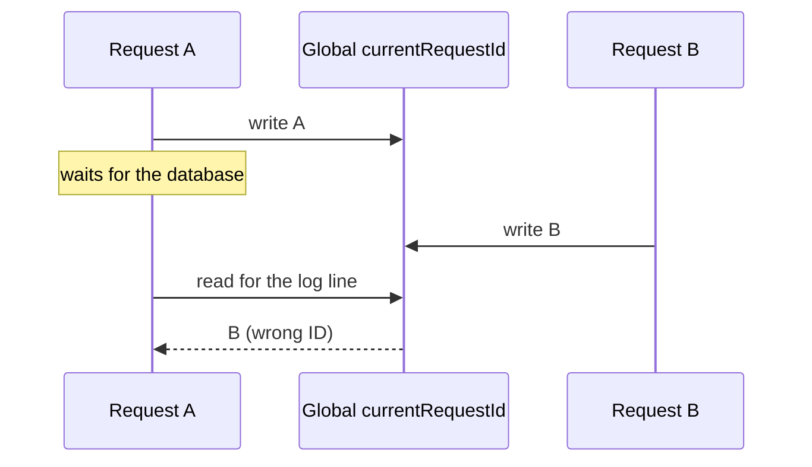

# Logging and debugging in production

> In Project 2 you read errors in your own console. In production, the error happens in a stranger's browser or on one of hundreds of servers, and all you hear is "it broke on Tuesday". Let's give every request one ID, put it on every log line and show it to the user as a support code. Then one support request leads straight to the log lines that explain it.

**Duration:** about 40 minutes

## Contents

- [Where you are coming from](#where-you-are-coming-from)
- [One ID from click to cause](#one-id-from-click-to-cause)
- [Structured log lines](#structured-log-lines)
- [Context on every server line](#context-on-every-server-line)
- [Getting browser errors to a server](#getting-browser-errors-to-a-server)
- [Show the ID to the user](#show-the-id-to-the-user)
- [What never to log](#what-never-to-log)
- [Takeaways](#takeaways)
- [Further reading](#further-reading)

## Where you are coming from

In Project 2 you write `console.log`, open DevTools or the terminal, and read the output. There is one developer, one browser and one Express server.

Now imagine the Lending Desk, the equipment lending service from an earlier evening, has grown into a company-wide platform: item catalogue, availability, reservations, reviews and notifications, each owned by its own team and service, with millions of users. Your Express server is now the **frontend server**: it serves the page and calls the other services. A reservation fails, and three things break:

- **Browser output vanishes.** A `console.log` in production writes to the console of a user you will never meet.
- **Server output is unsearchable.** Hundreds of server instances print free text. Nobody can find "all failed reservations in the last hour" in that.
- **The report leads nowhere.** The user says "it broke on Tuesday afternoon". Among millions of log lines, a rough time is not enough.

## One ID from click to cause

Here is the core idea of this topic: **give every request one ID, put it on every log line and show it to the user.** Then one support request finds the cause.

The lines go to a **log platform**: a service that stores the log lines of all servers and browsers and lets you search them in one place.

The diagram shows the whole chain. `R` stands for one request ID, for example `7c1e9a2b-5d3f-4e8a-9b1c-2f6d8e0a4b37`.



The ID travels in an HTTP header. `x-request-id` is a common name for it, not a standard. The sections below build the chain piece by piece.

## Structured log lines

### Levels and fields

Every part of the code logs through one small API with four **levels**. A level says how serious a line is, so you can filter and alert on it.

| Level   | Use it for                                          |
| ------- | --------------------------------------------------- |
| `debug` | Details you only want while developing              |
| `info`  | Normal, noteworthy events ("reservation created")   |
| `warn`  | Something is off, but the user is not blocked       |
| `error` | Something failed for the user, a person should look |

A **structured** line keeps the message fixed and puts the variable parts into named fields:

```ts
// ❌ a sentence: counting failures per item needs a regular expression
console.log("Reservation " + id + " failed for item " + itemId);

// ✅ a fixed message plus fields the log platform can filter and count
logger.error("Reservation failed", { reservationId: id, itemId });
```

Here are both lines as they arrive in the log:

```text
Reservation res_4410 failed for item item_812
{"level":"error","message":"Reservation failed","reservationId":"res_4410","itemId":"item_812"}
```

In the second line, "all failed reservations for `item_812`" is one filter.

### From the code to the log platform

In development, print readable lines to the terminal. In production, print each line as JSON to standard output (stdout), the stream `console.log` also writes to. A **log agent** collects that output and sends it to the log platform. Fluent Bit is a common agent, Grafana Loki a common platform.



We build the browser path later in this topic.

### A small logger

The logger adds the request context, removes sensitive fields and writes one line, the same in both branches.

```ts
const isProduction = process.env.NODE_ENV === "production";

function log(level: Level, message: string, fields: Fields = {}) {
  const context = requestContext.getStore(); // filled per request, see the next section
  // 👇 context and redacted fields go on every line
  const line = { time: new Date().toISOString(), level, message, ...context, ...redact(fields) };
  if (isProduction) {
    process.stdout.write(JSON.stringify(line) + "\n");
  } else {
    console[level](`${level.toUpperCase()} ${message}`, line);
  }
}

export const logger = {
  error: (message: string, fields?: Fields) => log("error", message, fields),
  // ... debug, info, warn
};
```

`redact()` removes passwords, tokens and similar fields; see [What never to log](#what-never-to-log). One trap: `JSON.stringify(error)` gives `{}`. Copy `name`, `message` and `stack` yourself, with a small `toJson()` helper.

<details>
<summary>Going further: a logger that never fails</summary>

`toJson()` copies the error fields out, because they are not enumerable:

```ts
const toJson = (value: unknown) =>
  value instanceof Error ? { name: value.name, message: value.message, stack: value.stack } : value;
```

Use it for the `error` field before `JSON.stringify`.

The logger must also never throw. It runs inside `catch` blocks, and an exception there hides the original error. `JSON.stringify` throws on circular objects and on `BigInt`, so wrap the body of `log()` in `try`, and in the `catch` write a minimal line:

```ts
process.stdout.write(JSON.stringify({ level, message, logFailed: true }) + "\n");
```

Docs: [`JSON.stringify()` exceptions](https://developer.mozilla.org/en-US/docs/Web/JavaScript/Reference/Global_Objects/JSON/stringify#exceptions)

</details>

## Context on every server line

"Reservation failed" alone does not say which request failed. Every line also needs the request ID, the path, the **release** (the deployed version) and whether the user was logged in. Passing these into every function would change every signature.

### Why a global variable fails

A shared variable `currentRequestId` looks like the answer. But the server handles many requests at the same time. While request A waits for the database, request B starts and overwrites the variable:



Request A now logs with the ID of request B.

### One box per request

Node's `AsyncLocalStorage` solves this. Think of it as a box that belongs to one request. You fill it once with `run()`, and any code in that request reads it with `getStore()`, also after `await` and in timers. Two requests at the same time each see their own box.

The middleware creates the request ID, returns it in a response header and fills the box:

```ts
import { AsyncLocalStorage } from "node:async_hooks";
import { randomUUID } from "node:crypto";

type RequestContext = { requestId: string; path: string; release: string; loggedIn: boolean };
export const requestContext = new AsyncLocalStorage<RequestContext>();

app.use((req, res, next) => {
  const requestId = randomUUID();
  res.setHeader("x-request-id", requestId); // the browser reads it later
  const context = {
    requestId,
    path: req.path, // without the query string
    release: process.env.RELEASE ?? "dev",
    loggedIn: Boolean(req.session?.userId),
  };
  // 👇 everything inside next(), also after await, sees this context
  requestContext.run(context, next);
});
```

Docs: [Node.js `AsyncLocalStorage`](https://nodejs.org/api/async_context.html#class-asynclocalstorage)

Now every line carries the context:

```json
{
  "time": "2026-10-28T18:42:07.109Z",
  "level": "error",
  "message": "Reservation failed",
  "requestId": "7c1e9a2b-5d3f-4e8a-9b1c-2f6d8e0a4b37",
  "path": "/api/items/item_812/reservations",
  "release": "2026.10.28-3",
  "loggedIn": true,
  "itemId": "item_812"
}
```

### Pass the ID on

Every call to another service sends the same ID in the `x-request-id` header, read with `requestContext.getStore()?.requestId`. That service puts it on its own lines, so one search finds them too.

One last middleware catches every error a route did not handle. It still runs inside the request context, so its line carries the ID.

<details>
<summary>Going further: server errors and edge cases</summary>

**The last middleware.** Register it after all routes. Express 5 forwards rejected `async` handlers to it automatically.

```ts
app.use((error: unknown, req: Request, res: Response, next: NextFunction) => {
  if (res.headersSent) return next(error);
  logger.error("Unhandled request error", { error });
  res.status(500).json({ message: "Something went wrong" });
});
```

**Errors outside any request.** A rejected promise nobody awaited never reaches the middleware. Node's guidance: after an uncaught exception, "it is not safe to resume normal operation". Log it, let the process exit, and let your container platform start a new one. The `uncaughtExceptionMonitor` event lets you log without changing that behaviour. With the default `--unhandled-rejections=throw` mode, unhandled rejections arrive there too.

```ts
process.on("uncaughtExceptionMonitor", (error, origin) => {
  logger.error("Process is crashing", { error, origin });
});
```

**IDs from outside.** The middleware creates the ID itself. Accept an ID from an incoming request only from a server you trust, such as your own load balancer, and check its format: it ends up in every log line.

**Lost context.** Some callback-based APIs can lose the store. Node's docs suggest `util.promisify()` or `AsyncResource` for those.

Docs: [Express: Error handling](https://expressjs.com/en/guide/error-handling.html), [Node.js `uncaughtExceptionMonitor`](https://nodejs.org/api/process.html#event-uncaughtexceptionmonitor), [Warning: using `uncaughtException` correctly](https://nodejs.org/api/process.html#warning-using-uncaughtexception-correctly), [Node.js: Troubleshooting context loss](https://nodejs.org/api/async_context.html#troubleshooting-context-loss)

</details>

<details>
<summary>Going further: W3C Trace Context and OpenTelemetry</summary>

With about 30 services, each team inventing its own header does not scale. The W3C **Trace Context** Recommendation defines a standard header:

```http
traceparent: 00-4bf92f3577b34da6a3ce929d0e0e4736-00f067aa0ba902b7-01
```

**OpenTelemetry** is the open standard and set of SDKs that create and pass on this header. It records a **trace** per request, made of **spans**, one per unit of work with a start and a duration. If every service uses it, the trace ID can serve as your request ID.

Docs: [W3C Trace Context](https://www.w3.org/TR/trace-context/), [OpenTelemetry: Context propagation](https://opentelemetry.io/docs/concepts/context-propagation/)

</details>

## Getting browser errors to a server

The browser is where most surprises happen, and by default every one of them stays in the user's console.

### Where browser errors come from

| Source                                 | Catches                                        |
| -------------------------------------- | ---------------------------------------------- |
| `error` event on `window`              | Uncaught exceptions                            |
| `unhandledrejection` event on `window` | Rejected promises that nothing handles         |
| React root options (React 19)          | Errors in components, with the component stack |

```tsx
window.addEventListener("error", (event) => {
  browserLogger.error(event.message, { error: event.error, source: event.filename });
});

window.addEventListener("unhandledrejection", (event) => {
  browserLogger.error("Unhandled rejection", { error: event.reason }); // reason can be any value
});

hydrateRoot(container, <App />, {
  onUncaughtError: (error, info) =>
    browserLogger.error("React error", { error, componentStack: info.componentStack }),
});
```

React also has `onCaughtError`, for errors an error boundary caught. If your boundaries already report their errors, leave it out, or each error is logged twice.

Docs: [`Window: error` event](https://developer.mozilla.org/en-US/docs/Web/API/Window/error_event), [`Window: unhandledrejection` event](https://developer.mozilla.org/en-US/docs/Web/API/Window/unhandledrejection_event), [React `hydrateRoot` options](https://react.dev/reference/react-dom/client/hydrateRoot#parameters)

### When and how to send

One request per line is too expensive with millions of users. Collect lines in a queue instead. The newest lines matter most: they often hold the error that made the user leave. So when the queue is full, drop the oldest line:

```ts
const queue: LogLine[] = [];

export const browserLogger = {
  error: (message: string, fields: Fields = {}) => {
    const time = new Date().toISOString();
    queue.push({ time, level: "error", message, ...fields, error: toJson(fields.error) });
    // 👇 keep the newest 20 lines
    if (queue.length > 20) queue.shift();
  },
  // ... warn, info
};
```

Send the whole queue every few seconds, and at once when the page becomes hidden:

```ts
function flush() {
  if (queue.length === 0) return;
  fetch("/api/logs", {
    method: "POST",
    // 👇 finishes even after the page is gone
    keepalive: true,
    headers: { "Content-Type": "application/json" },
    body: JSON.stringify(queue.splice(0)), // all lines, the newest included
  }).catch(() => {}); // logging must never break the page
}

setInterval(flush, 5000);
document.addEventListener("visibilitychange", () => {
  if (document.visibilityState === "hidden") flush();
});
```

The `visibilitychange` event fires when the user switches tabs, switches apps or leaves the page. MDN calls it the most reliable moment to send data at the end of a session. A `keepalive` body is limited to 64 KiB, which is why the queue stays small.

On the server, `/api/logs` writes each line through the server logger with `source: "browser"`. Treat it as untrusted input: anyone can post to it. Error-tracking SDKs often do this batching for you, with the same ideas.

Docs: [`RequestInit.keepalive`](https://developer.mozilla.org/en-US/docs/Web/API/RequestInit#keepalive), [`Document: visibilitychange` event](https://developer.mozilla.org/en-US/docs/Web/API/Document/visibilitychange_event)

<details>
<summary>Going further: other ways to send</summary>

| Way to send                      | Survives leaving the page? | Body limit | Note                                                              |
| -------------------------------- | -------------------------- | ---------- | ----------------------------------------------------------------- |
| `fetch()`                        | No, it is cancelled        | None       | Fine while the page stays open                                    |
| `fetch()` with `keepalive`       | Yes                        | 64 KiB     | You set the `Content-Type` and can read the response              |
| `navigator.sendBeacon()`         | Yes                        | 64 KiB     | POST only, no response; a string body arrives as `text/plain`     |
| A request in an `unload` handler | Often never runs           | –          | Chrome no longer fires `unload` by default since Chrome 155; it also blocks the back/forward cache |

Send the `Content-Type: application/json` header with `fetch`. Without it, a string body arrives as `text/plain`, and `express.json()` leaves `req.body` empty.

Docs: [`navigator.sendBeacon()`](https://developer.mozilla.org/en-US/docs/Web/API/Navigator/sendBeacon), [Chrome: `unload` deprecation](https://developer.chrome.com/blog/unload-deprecated-in-chrome)

</details>

<details>
<summary>Going further: too many errors</summary>

Once the browser sends its errors, most of what arrives is not yours to fix. A few patterns appear in almost every large frontend:

| Symptom                                        | Why                                                                         | Action                                                       |
| ---------------------------------------------- | --------------------------------------------------------------------------- | ------------------------------------------------------------ |
| `Script error.` with no file or stack          | A script from another origin threw, and the browser hides the details       | Load your own scripts with `crossorigin` and CORS headers; drop the rest |
| Stack frames from `chrome-extension://` or `moz-extension://` | A browser extension injected the script                       | Drop                                                         |
| `ResizeObserver loop completed with undelivered notifications.` | A resize callback causes more resizing; users may see a flash of broken layout | Fix the layout loop first, then filter it              |
| `AbortError`                                   | Your code cancelled a request, usually because the user moved on            | Not a failure; drop or log as `info`                         |
| The same message 50 times in a second          | A broken component inside a list                                            | Keep one line with a `repeated` count                        |

If the volume is still too high, **sample per session**: decide once per session whether it sends logs, and keep that decision in `sessionStorage`. You get complete stories from fewer users instead of fragments from many. Give developers a cookie that forces full logging while they reproduce a bug.

Docs: [`<script>` `crossorigin`](https://developer.mozilla.org/en-US/docs/Web/HTML/Reference/Elements/script#crossorigin), [`ResizeObserver` observation errors](https://developer.mozilla.org/en-US/docs/Web/API/ResizeObserver#observation_errors)

</details>

## Show the ID to the user

The user still only sees "Something went wrong". Let's give them the ID. When a request fails, the browser reads the ID from the response header, puts it on its own log line and shows the same value:

```ts
export async function reserve(itemId: string): Promise<Reservation> {
  const response = await fetch(`/api/items/${itemId}/reservations`, { method: "POST" });
  if (!response.ok) {
    const requestId = response.headers.get("x-request-id") ?? crypto.randomUUID();
    // 👇 the log line and the user get the same ID
    browserLogger.error("Reservation failed", { requestId, itemId, status: response.status });
    throw new ReservationError(requestId);
  }
  return response.json();
}
```

The error message shows the ID as a **support code**, the value the user copies into the support request:

> We could not create your reservation. Please try again.
> If it keeps happening, contact support with this code: `7c1e9a2b-5d3f-4e8a-9b1c-2f6d8e0a4b37`

Show the whole ID. A short prefix of 8 characters looks friendlier, but with millions of requests, two of them will share it. Support pastes the code into the log platform and gets every line of that request:

| Time         | Source               | Level   | Message                     |
| ------------ | -------------------- | ------- | --------------------------- |
| 18:42:07.104 | Reservations service | `error` | Availability did not answer |
| 18:42:07.109 | Frontend server      | `error` | Reservation failed          |
| 18:42:07.311 | Browser              | `error` | Reservation failed          |

"It broke on Tuesday" has become three lines that name the cause. The code reveals nothing about your system.

<details>
<summary>Going further: offline, other origins and secure contexts</summary>

**Offline.** If `fetch` itself rejects, no server answered and there is no server ID. Create one in the browser and log it the same way:

```ts
const response = await fetch(`/api/items/${itemId}/reservations`, { method: "POST" }).catch((error: unknown) => {
  // 👇 no server answered, so no server ID
  const requestId = crypto.randomUUID();
  browserLogger.error("Reservation failed", { requestId, itemId, error });
  throw new ReservationError(requestId);
});
```

**Other origins.** If the API runs on another origin, the browser hides custom response headers from JavaScript until the server lists them in `Access-Control-Expose-Headers`.

**Secure context.** `crypto.randomUUID()` needs a secure context: HTTPS, or `localhost` during development.

Docs: [`Access-Control-Expose-Headers`](https://developer.mozilla.org/en-US/docs/Web/HTTP/Reference/Headers/Access-Control-Expose-Headers), [`Crypto.randomUUID()`](https://developer.mozilla.org/en-US/docs/Web/API/Crypto/randomUUID)

</details>

<details>
<summary>Going further: readable stack traces</summary>

Production JavaScript is minified, so a browser stack says `at e (main-3f9a.js:1:48213)`. A **source map** maps that position back to the original file and line.

With **hidden source maps**, the build creates the maps but does not reference them from the bundle. You upload them to your error platform during deployment, and it shows readable stacks; webpack calls this `hidden-source-map`. Hidden maps are not a security control: never put anything into client code you would not publish. Key the maps by release version, so yesterday's error is decoded with yesterday's maps.

On the server, `node --enable-source-maps` maps stack traces of bundled or compiled TypeScript back to the source. The Node docs note that it can add latency when code reads `Error.stack` often.

Docs: [webpack `devtool`](https://webpack.js.org/configuration/devtool/), [Node.js `--enable-source-maps`](https://nodejs.org/api/cli.html#--enable-source-maps)

</details>

## What never to log

Logs are stored for weeks, copied into tools and read by many people. Anything personal in a line goes to all of those places.

| Data                                         | Risk                                     | Rule                                                              |
| -------------------------------------------- | ---------------------------------------- | ----------------------------------------------------------------- |
| `Cookie` and `Authorization` headers         | Anyone who reads logs can take over a session | Log only an allowlist: `user-agent`, `accept-language`, `x-request-id` |
| Query strings (`?email=`, `?token=`)         | Personal data and secrets                | Log the path without the query, or a route pattern (`/items/:id`) |
| Response bodies and form input               | Addresses, names, free text              | Log the status code and a short, known error code                 |
| Fields named `password`, `token`, `email`    | Slip in through `{ ...user }`            | Remove them in one central `redact()` step                        |

Use an allowlist rather than a blocklist: a blocklist fails the day someone adds a new sensitive header. The `redact()` step runs on every line before it is written, in development and in production.

<details>
<summary>Going further: a small redact()</summary>

```ts
const SENSITIVE = /pass(word)?|token|secret|authorization|cookie|email/i;

export function redact(fields: Fields): Fields {
  return Object.fromEntries(
    Object.entries(fields).map(([key, value]) => [key, SENSITIVE.test(key) ? "[redacted]" : value]),
  );
}
```

A real version also walks nested objects and masks values that look like email addresses.

</details>

## Takeaways

- Give every request one ID, put it on every log line and show the whole ID to the user as a support code.
- Log structured lines as JSON: a fixed message, a level and named fields.
- `AsyncLocalStorage` puts the request context on every server line. A global variable mixes up requests that run at the same time.
- Queue browser errors and send them with `fetch` and `keepalive` when the page becomes hidden.
- Never log cookies, tokens, query strings or response bodies. Redact every line.

## Further reading

- [Node.js: Asynchronous context tracking](https://nodejs.org/api/async_context.html)
- [MDN: `navigator.sendBeacon()`](https://developer.mozilla.org/en-US/docs/Web/API/Navigator/sendBeacon), including when to send
- [React: `createRoot` error options](https://react.dev/reference/react-dom/client/createRoot#parameters)
- [The Twelve-Factor App: Logs](https://12factor.net/logs)
- [W3C: Trace Context](https://www.w3.org/TR/trace-context/)
- Related topic: [When only part of the data fails](../partial-failures/README.md), on error boundaries
