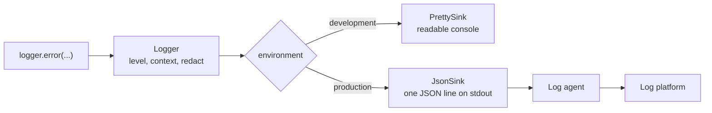
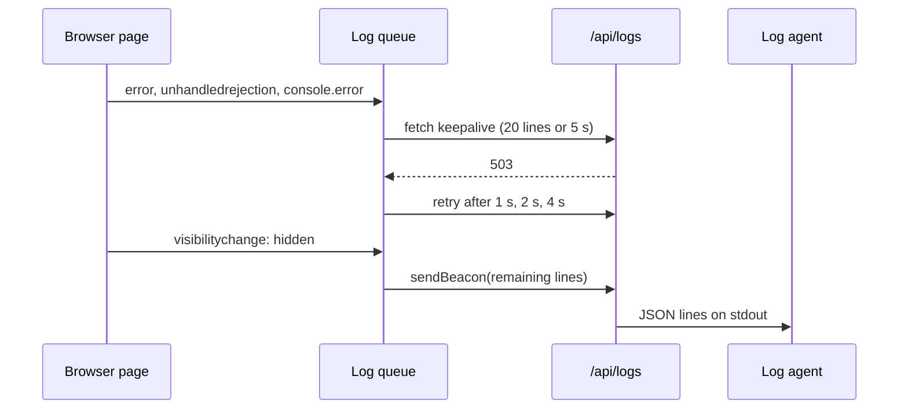

# Logging in a large application

> In Project 2 you debug with `console.log` and DevTools, and that works because the only user is you. In production, every `console.log` ends up in a stranger's browser and is gone. Let's design a logger for a platform with millions of users: one API, structured lines, context on every line, browser errors that actually reach a server, and filters that keep the signal and drop the noise. We finish with the part most teams forget: logs leak personal data, and log messages quietly become contracts.

**Duration:** about 40 minutes

## Contents

- [Where you are coming from](#where-you-are-coming-from)
- [Designing the logger](#designing-the-logger)
- [Context on every line](#context-on-every-line)
- [Capturing browser errors](#capturing-browser-errors)
- [Shipping them](#shipping-them)
- [Signal vs noise](#signal-vs-noise)
- [Hygiene](#hygiene)
- [Logs as contracts](#logs-as-contracts)
- [Where logs sit among the other signals](#where-logs-sit-among-the-other-signals)
- [Takeaways](#takeaways)
- [Further reading](#further-reading)

## Where you are coming from

In Project 2 you write `console.log`, open DevTools or the terminal, and read the output. There is one developer, one browser and one server, and the output is right in front of you.

The Lending Desk, the equipment lending service you know from an earlier evening, had a small `log.ts`. It called `console.log` in development and did nothing in production. It had an `/api/logs` endpoint, but nothing ever sent anything to it.

Now imagine the Lending Desk has grown into a company-wide platform: item catalogue, availability, reservations, reviews, recommendations and notifications, each owned by its own team and service, with millions of users. Three things break:

- **Browser output vanishes.** A `console.log` in production writes to the console of a user you will never meet. You cannot read it.
- **Server output is unreadable.** Hundreds of server instances print free text. Nobody can search "all errors on the reservation page for logged-in users in the last hour" across that.
- **Nobody knows whose problem it is.** An error appears, but there are many teams. Without context on the line, it lands on a shared channel and waits.

The rest of this topic builds the pieces that fix this.

## Designing the logger

### One logger, with levels

Every part of the code should log through one small API. Levels say how serious a line is, so you can filter and alert on them later.

| Level   | Use it for                                                 |
| ------- | ---------------------------------------------------------- |
| `debug` | Details you only want while developing                     |
| `info`  | Normal, noteworthy events ("reservation created")          |
| `warn`  | Something is off, but the user is not blocked              |
| `error` | Something failed for the user, and a person should look   |

### Structured fields instead of string concatenation

Compare these two lines:

```ts
console.log("Reservation " + id + " failed for item " + itemId + ": " + err.message);

logger.error("Reservation failed", { reservationId: id, itemId, error: err });
```

The first is a sentence. To count failures per item, you need a regular expression that breaks the day someone rewords it. The second keeps a stable message and puts the variable parts into named fields. Your log platform can filter, group and count by `itemId` without parsing text.

### Pluggable sinks: the strategy pattern

Where a line goes depends on the environment. In development you want readable, coloured output in the terminal. In production you want one JSON object per line on standard output (stdout). A **log agent** is a program that runs next to your server, reads stdout, and forwards the lines to a log platform. Grafana Loki, Datadog and the OpenTelemetry Collector are examples of this kind of tool. Your server does not need to know any of them.

A **sink** is the part that writes a finished line somewhere. The logger builds the line, the sink decides where it goes. Swapping the sink without changing the logger is the strategy pattern.



```ts
type Level = "debug" | "info" | "warn" | "error";
type Fields = Record<string, unknown>;
type LogLine = { level: Level; message: string; time: string } & Fields;

interface Sink {
  write(line: LogLine): void;
}

const prettySink: Sink = {
  write: ({ level, message, time, ...fields }) =>
    console[level](`${time} ${level.toUpperCase()} ${message}`, fields),
};

const jsonSink: Sink = {
  write: (line) => process.stdout.write(JSON.stringify(line) + "\n"),
};

export function createLogger(sink: Sink) {
  const log = (level: Level, message: string, fields: Fields = {}) => {
    // 👇 a logger that throws turns a small problem into an outage
    try {
      sink.write({ ...fields, level, message, time: new Date().toISOString() });
    } catch {
      // ...
    }
  };
  return {
    debug: (m: string, f?: Fields) => log("debug", m, f),
    info: (m: string, f?: Fields) => log("info", m, f),
    warn: (m: string, f?: Fields) => log("warn", m, f),
    error: (m: string, f?: Fields) => log("error", m, f),
  };
}
```

### The logger must never throw

Logging runs inside error handlers, in `catch` blocks and on every request. If the logger throws there, it hides the original error or crashes the request it was meant to describe. `JSON.stringify` alone can throw: on a circular object, or on a `BigInt`. Catch everything inside the logger, and fall back to a minimal line when serialising fails.

Docs: [`JSON.stringify()` exceptions](https://developer.mozilla.org/en-US/docs/Web/JavaScript/Reference/Global_Objects/JSON/stringify#exceptions)

### The shape of a JSON line

Agree on the field names once, for every team. A sketch:

```json
{
  "time": "2026-10-28T18:42:07.311Z",
  "level": "error",
  "message": "Reservation failed",
  "route": "/items/[id]/reserve",
  "team": "reservations",
  "loggedIn": true,
  "release": "2026.10.28-3",
  "requestId": "4bf92f3577b34da6a3ce929d0e0e4736",
  "itemId": "item_812",
  "error": { "name": "TimeoutError", "message": "Availability did not answer", "stack": "..." }
}
```

Note that `error` is an object, not a string. An `Error` serialises to `{}` with `JSON.stringify`, because `name`, `message` and `stack` are not enumerable own properties. Copy them out explicitly before writing the line.

## Context on every line

### Request-scoped context on the server

A line that says "Reservation failed" is only half useful. You also want to know which route, which team owns it, whether the user was logged in, and which release was running. You could pass that context into every function, but that touches every signature in the codebase.

Node's `AsyncLocalStorage` solves this. It stores a value that follows one piece of work through `await`, timers and callbacks, much like thread-local storage in other languages. You start it once per request with `run()`, and any code inside that request reads it with `getStore()`. Outside a `run()` call, `getStore()` returns `undefined`.

```ts
import { AsyncLocalStorage } from "node:async_hooks";

type RequestContext = {
  route: string;
  team: string;
  loggedIn: boolean;
  release: string;
  requestId: string;
};

export const requestContext = new AsyncLocalStorage<RequestContext>();

// In your request entry point, for example Express middleware:
app.use((req, res, next) => {
  const context: RequestContext = {
    route: req.path,
    team: ownerOfRoute(req.path), // ...
    loggedIn: Boolean(req.session?.userId),
    release: process.env.RELEASE_VERSION ?? "unknown",
    requestId: req.get("x-request-id") ?? crypto.randomUUID(),
  };
  // 👇 everything awaited inside next() sees this context
  requestContext.run(context, next);
});

// Inside the logger:
const line = { ...requestContext.getStore(), ...fields, level, message };
```

Use `run()` rather than `enterWith()`. The Node docs recommend it, because `enterWith()` leaks the context into the rest of the synchronous execution.

Docs: [Node.js `AsyncLocalStorage`](https://nodejs.org/api/async_context.html#class-asynclocalstorage)

### An owning team on every line

With about 30 services and many frontend teams, "an error happened" is not actionable. "An error happened in code owned by the reservations team" is. Put a `team` field on every line, from the request context, and let a single line override it when the code that logs belongs to someone else, for example a shared date picker inside the reservation page.

```ts
logger.error("Calendar failed to render", { team: "design-system", error });
```

Your log platform can then route alerts per team, and each team gets a view with only its own errors. The topic [Debugging production](../debugging-production/README.md) shows how to generate that ownership data from code.

### Downgrade known, harmless errors

Some errors are real exceptions in the code, but not problems. A user cancels a request by navigating away. A bot calls a reservation URL with an invalid ID. A third-party script fails on an old browser. If these stay at `error`, the alert for real errors fires all day, and people learn to ignore it.

Keep a short, reviewed list of known, harmless cases and log them as `warn`. Each entry should say why it is harmless. Review the list now and then: a harmless error can become a real one.

### Avoid duplicate logs

The same error can pass through several places that log it. A route handler catches it, logs it and rethrows. Express passes it on to your error-handling middleware, which logs it again. An error-tracking library that wraps your handlers may report it a third time. Error counts double, and alerts trigger early.

Pick one place per error path. A common split: catch and log errors you handle yourself, where you have the most context. Let every other error reach one central handler, and log it only there. On an Express server that is the error-handling middleware for errors inside a request, and a `process.on("unhandledRejection")` listener for rejected promises that nothing awaited. Mark an error as logged, for example with a symbol property, so the central handler can skip it.

```ts
import type { ErrorRequestHandler } from "express";

export const logged = Symbol("logged");

// Four arguments make this error-handling middleware. Register it after all routes.
const handleError: ErrorRequestHandler = (error, req, res, next) => {
  if (res.headersSent) return next(error);
  // 👇 skip errors a route has already logged
  if (!(error instanceof Error && logged in error)) {
    logger.error("Unhandled request error", { error });
  }
  res.status(500).json({ requestId: requestContext.getStore()?.requestId });
};
app.use(handleError);

process.on("unhandledRejection", (reason) => {
  logger.error("Unhandled rejection", { error: reason });
});
```

With an `unhandledRejection` listener in place, Node no longer raises the rejection as an uncaught exception, so the process keeps running. Decide on purpose whether that is what you want.

Docs: [Express: Error handling](https://expressjs.com/en/guide/error-handling.html), [Node.js `unhandledRejection` event](https://nodejs.org/api/process.html#event-unhandledrejection), [Node.js `--unhandled-rejections`](https://nodejs.org/api/cli.html#--unhandled-rejectionsmode)

## Capturing browser errors

The server side is under your control. The browser is where most surprises happen, and by default every one of them stays in the user's console.

### Three entry points

- The `error` event on `window` fires for uncaught exceptions. It is an `ErrorEvent` with `message`, `filename`, `lineno`, `colno` and `error`.
- The `unhandledrejection` event fires when a promise rejects and nothing handles it. Its `reason` is whatever was rejected, which may be a string or a plain object, not an `Error`.
- Errors that your code or a library catches and passes to `console.error`. React reports some errors this way too. To see them, you wrap `console.error`.

When you wrap `console.error`, keep a reference to the original function. Your logger must write to that original, never to the wrapped one. Otherwise a logger that prints its own errors with `console.error` calls itself again, and again: a feedback loop.

```ts
const originalConsole = { error: console.error.bind(console) };

console.error = (...args: unknown[]) => {
  originalConsole.error(...args);
  // 👇 never call the patched console.error from in here
  browserLogger.error("console.error", { args: args.map(serialise) });
};

window.addEventListener("error", (event) => {
  browserLogger.error(event.message, {
    source: event.filename,
    line: event.lineno,
    column: event.colno,
    error: serialise(event.error),
  });
});

window.addEventListener("unhandledrejection", (event) => {
  browserLogger.error("Unhandled rejection", { error: serialise(event.reason) });
});
```

The browser logger itself also uses `originalConsole` for its development output.

Docs: [`Window: error` event](https://developer.mozilla.org/en-US/docs/Web/API/Window/error_event), [`Window: unhandledrejection` event](https://developer.mozilla.org/en-US/docs/Web/API/Window/unhandledrejection_event)

### Detect errors by duck typing

The `serialise()` helper needs to know whether a value is an error. `instanceof Error` looks like the answer, but it fails across realms. A **realm** is one JavaScript environment with its own global object and its own built-in constructors. Every iframe and every window has its own realm. An error thrown in an iframe was created by that iframe's `Error` constructor, so `error instanceof Error` in your page returns `false`.

Check the shape instead: if a value has a string `message` and a string `name`, treat it as an error. This is duck typing. It also covers objects that libraries throw which look like errors but are not.

```ts
type ErrorLike = { name: string; message: string; stack?: string };

function isErrorLike(value: unknown): value is ErrorLike {
  return (
    typeof value === "object" &&
    value !== null &&
    typeof (value as ErrorLike).message === "string" &&
    typeof (value as ErrorLike).name === "string"
  );
}

function serialise(value: unknown) {
  if (isErrorLike(value)) {
    const { name, message, stack } = value;
    return { name, message, stack };
  }
  return { value: String(value) };
}
```

`Error.isError()` is a newer built-in that does this check across realms. It is not yet Baseline, so keep the duck-typing fallback for now.

Docs: [`instanceof` and multiple realms](https://developer.mozilla.org/en-US/docs/Web/JavaScript/Reference/Operators/instanceof#instanceof_and_multiple_realms), [`Error.isError()`](https://developer.mozilla.org/en-US/docs/Web/JavaScript/Reference/Global_Objects/Error/isError)

## Shipping them

Capturing errors in the browser is half the work. Now they need to reach a server endpoint, like the `/api/logs` route the Lending Desk never used. Sending one request per line is too expensive: some pages log dozens of lines in the first second, and millions of users do that at the same time.

### Batch by count, size and time

Collect lines in a queue and send them together when the first of three limits is reached:

- **count:** for example 20 lines;
- **size:** stay well below 64 KiB, the limit for both `keepalive` requests and beacons;
- **time:** for example 5 seconds after the first line in the batch.

### Send with `fetch` and `keepalive`

A normal `fetch` is cancelled when the user navigates away. With `keepalive: true`, the browser finishes the request even after the page is gone. The body is limited to 64 KiB.

Docs: [`RequestInit.keepalive`](https://developer.mozilla.org/en-US/docs/Web/API/RequestInit#keepalive)

### Flush when the page is hidden

The last batch is the most interesting one: it often contains the error that made the user leave. Flush it when `visibilitychange` fires with `document.visibilityState === "hidden"`. MDN calls this the last event a page can reliably observe, for example when a mobile user switches to another app. `pagehide` is a fallback where `visibilitychange` is not available. Do not use `unload`: browsers often do not fire it, especially on mobile, and it prevents the back/forward cache.

For this last flush, `navigator.sendBeacon()` is a good fit. It queues a small POST request that the browser sends in the background, without delaying the next page. It returns `false` if the browser could not queue the data, for example because it exceeds the size limit.

Docs: [`navigator.sendBeacon()`](https://developer.mozilla.org/en-US/docs/Web/API/Navigator/sendBeacon), [`Document: visibilitychange` event](https://developer.mozilla.org/en-US/docs/Web/API/Document/visibilitychange_event), [`Window: pagehide` event](https://developer.mozilla.org/en-US/docs/Web/API/Window/pagehide_event)

### Retry with backoff, with a bounded queue

The log endpoint can fail too, often exactly during an incident. Retry failed batches with exponential backoff: wait 1 second, then 2, then 4, up to a limit. Keep the queue bounded, for example 200 lines, and drop the oldest lines when it is full. An unbounded queue on a broken endpoint fills the user's memory, and the logger must never hurt the page it observes.

```ts
const queue: LogLine[] = [];
const MAX_QUEUE = 200;
const MAX_BATCH = 20;
let retryDelay = 1000;

export function enqueue(line: LogLine) {
  queue.push(line);
  if (queue.length > MAX_QUEUE) queue.shift(); // drop the oldest
  if (queue.length >= MAX_BATCH) void flush();
}

async function flush() {
  const batch = queue.splice(0, MAX_BATCH);
  if (batch.length === 0) return;
  try {
    // 👇 survives navigation, body limited to 64 KiB
    await fetch("/api/logs", { method: "POST", body: JSON.stringify(batch), keepalive: true });
    retryDelay = 1000;
  } catch {
    queue.unshift(...batch);
    setTimeout(flush, retryDelay);
    retryDelay = Math.min(retryDelay * 2, 60_000);
  }
}

setInterval(flush, 5000);

document.addEventListener("visibilitychange", () => {
  if (document.visibilityState === "hidden" && queue.length > 0) {
    navigator.sendBeacon("/api/logs", JSON.stringify(queue.splice(0)));
  }
});
```

A production version also checks `response.ok`, measures the byte size of each batch, and splits the final beacon when it is too large. The shape stays the same.



## Signal vs noise

Once the browser ships its errors, you will receive a lot of them. Most of them are not yours to fix. If you keep everything, storage costs explode and real errors drown.

### Sample per session

**Sampling** means keeping only a share of the data. Decide once per session, not per line: either a session logs everything, or it logs nothing. Per-line sampling gives you random fragments of many stories. Per-session sampling gives you complete stories from fewer users.

- Store the decision, for example in `sessionStorage`, so it survives page navigations.
- Provide an override that forces full logging: a cookie or a URL flag that a developer or a support agent can set while reproducing a problem.
- Use a lower rate for bots. Crawlers produce many sessions and few useful errors.
- Never sample away the errors you alert on, or adjust your alert thresholds to the sample rate.

```ts
function isSessionSampled(): boolean {
  if (document.cookie.includes("debug_logging=1")) return true; // forced while debugging
  const stored = sessionStorage.getItem("log-sampled");
  if (stored !== null) return stored === "1";
  const rate = /bot|crawler|spider/i.test(navigator.userAgent) ? 0.01 : 0.1;
  // 👇 decided once, then reused for the whole session
  const sampled = Math.random() < rate;
  sessionStorage.setItem("log-sampled", sampled ? "1" : "0");
  return sampled;
}
```

The rates here are examples. Choose yours from your traffic and your budget.

### Filter known noise

A few patterns appear in almost every large frontend:

- **`Script error.`** When a script from another origin throws and was not loaded with CORS, the browser hides the details. The `error` event arrives with the message `Script error.`, an empty file name and no error object. There is nothing to debug. Add the `crossorigin` attribute and CORS headers to scripts you control, and drop the rest.
- **Browser extensions.** Extensions inject scripts into your page. Their errors have stack frames with URLs such as `chrome-extension://` or `moz-extension://`. Drop them.
- **`ResizeObserver loop completed with undelivered notifications.`** The browser fires this on `window` when resize callbacks cause more resizing within one frame. It protects the browser from locking up and is usually harmless. Downgrade it to `warn` or drop it.
- **Aborted requests.** A fetch cancelled with an `AbortController` rejects with a `DOMException` named `AbortError`. It usually means the user moved on. That is not a failure.

```ts
function isNoise(message: string, stack = ""): boolean {
  return (
    message === "Script error." ||
    message.startsWith("ResizeObserver loop") ||
    /(chrome|moz|safari-web)-extension:\/\//.test(stack)
  );
}
```

Docs: [`<script>` `crossorigin`](https://developer.mozilla.org/en-US/docs/Web/HTML/Reference/Elements/script#crossorigin), [`ResizeObserver` observation errors](https://developer.mozilla.org/en-US/docs/Web/API/ResizeObserver#observation_errors), [`AbortController.abort()`](https://developer.mozilla.org/en-US/docs/Web/API/AbortController/abort)

### Drop identical messages in a burst

A broken component inside a list can throw the same error 50 times in one render. Keep a small map from message to the time it was last sent, and drop an identical message that repeats within about a second. Add a `repeated` count to the line you keep, so you still know how bad it was.

## Hygiene

Logs are data. They are stored for weeks, copied into tools, and read by many people. Anything personal that goes into a log line goes to all of those places.

### Allowlist request headers

It is tempting to log all request headers "for debugging". Do not. The `Cookie` header contains session tokens, and `Authorization` contains credentials. Anyone who can read the logs could take over a session.

Use an **allowlist**: name the headers you log, and log nothing else. A short list is usually enough: `user-agent`, `accept-language`, `referer` and your request ID header. A blocklist fails the day someone adds a new sensitive header.

### URLs and query strings

URLs look harmless, but they often carry personal data: `/users/anna.meier@example.com/reservations`, `?email=...`, `?token=...`, a search query with a name in it. The same is true for the `Referer` header. Strip the query string, or keep only an allowlist of parameters, and replace IDs in paths with the route pattern (`/users/[id]/reservations`). The route pattern is also better for grouping.

### Response bodies in error messages

A common pattern is ``throw new Error(`Request failed: ${await response.text()}`)``. The body of a failed response may contain the user's address, a validation message that repeats their input, or an HTML error page with internal details. Log the status code and a short, known error code from the body, not the body itself.

### A `redact()` step

Even with care, something will slip through. Give the logger one central `redact()` step that runs on every line before the sink:

- remove fields with known sensitive names (`password`, `token`, `email`, `authorization`, `cookie`);
- mask values that look like email addresses, card numbers or tokens;
- cut long strings to a maximum length.

```ts
const SENSITIVE_KEYS = /pass(word)?|token|secret|authorization|cookie|email/i;
const EMAIL = /[^\s@]+@[^\s@]+\.[^\s@]+/g;

export function redact(value: unknown, key = ""): unknown {
  if (SENSITIVE_KEYS.test(key)) return "[redacted]";
  if (typeof value === "string") return value.replace(EMAIL, "[email]").slice(0, 2000);
  if (Array.isArray(value)) return value.map((item) => redact(item));
  if (value !== null && typeof value === "object") {
    return Object.fromEntries(
      Object.entries(value).map(([k, v]) => [k, redact(v, k)]),
    );
  }
  return value;
}
```

A real version also guards against circular objects, in line with the rule that the logger never throws.

### Logs are often forgotten

Product analytics usually gets a privacy review: user IDs are hashed or pseudonymised, and consent decides what is sent. Logs often get no review at all, although they contain the same kind of data and sometimes more. Treat the log pipeline as a system that processes personal data, because it does. Set a retention period, restrict who can read it, and review new fields like you review an analytics event.

## Logs as contracts

Someone builds a dashboard that counts lines where `message` equals `"Reservation failed"`. Someone else sets an alert on lines that contain `"availability timeout"`. A month later, a developer improves the wording to `"Could not create reservation"`. The dashboard shows zero failures, and the alert never fires again. Nothing failed in CI.

When a dashboard or an alert depends on a message's wording or a field's name, that wording is an API. Treat it like one:

- Keep the message a stable constant and put the variable parts into fields.
- Document next to the code that something depends on it, and where.
- Change it like any other API: add the new form, migrate the dashboard, then remove the old one.

```ts
/**
 * Contract: the "Reservations failing" alert and the team dashboard
 * count this message. Keep the wording and the `itemId` field stable.
 */
export const RESERVATION_FAILED = "Reservation failed";

logger.error(RESERVATION_FAILED, { itemId, reason: "availability-timeout" });
```

## Where logs sit among the other signals

Logs tell you what happened, line by line, for developers. They are one of four signals. **Metrics** count how often and how much, and drive alerts. **Traces** show where the time went as one request crosses many services. **Product analytics** records what users did, for product people. In a large platform, one incident shows up in all four, and an ID that ties them together is what makes it findable. The topic [Debugging production](../debugging-production/README.md) follows one error through all of them.

## Takeaways

- Use one logger with levels and structured fields, and swap sinks per environment: readable output in development, JSON lines on stdout in production. The logger never throws.
- Add context to every line automatically, on the server with `AsyncLocalStorage`: route, owning team, logged-in state and release version.
- Capture browser errors from `error`, `unhandledrejection` and `console.error`, detect errors by duck typing, and ship them in bounded batches with `keepalive` and `sendBeacon`.
- Keep the signal: sample per session, filter known noise, drop repeats, and downgrade harmless errors to `warn`.
- Logs contain personal data and act as contracts. Allowlist headers, redact every line, and keep messages that dashboards depend on stable.

## Further reading

- [Node.js: Asynchronous context tracking](https://nodejs.org/api/async_context.html)
- [MDN: `navigator.sendBeacon()`](https://developer.mozilla.org/en-US/docs/Web/API/Navigator/sendBeacon)
- [MDN: `RequestInit`, including `keepalive`](https://developer.mozilla.org/en-US/docs/Web/API/RequestInit)
- [Chrome for Developers: Page Lifecycle API](https://developer.chrome.com/docs/web-platform/page-lifecycle-api)
- [MDN: `instanceof` and multiple realms](https://developer.mozilla.org/en-US/docs/Web/JavaScript/Reference/Operators/instanceof#instanceof_and_multiple_realms)
- [The Twelve-Factor App: Logs](https://12factor.net/logs)
- [OpenTelemetry: Signals](https://opentelemetry.io/docs/concepts/signals/)
- [Express: Error handling](https://expressjs.com/en/guide/error-handling.html)
- [Node.js: `process` events](https://nodejs.org/api/process.html#process-events)
- Related topic: [Debugging production: following one error from end to end](../debugging-production/README.md)
