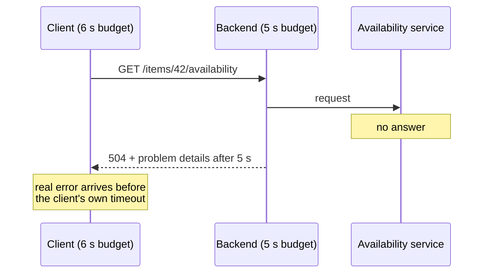
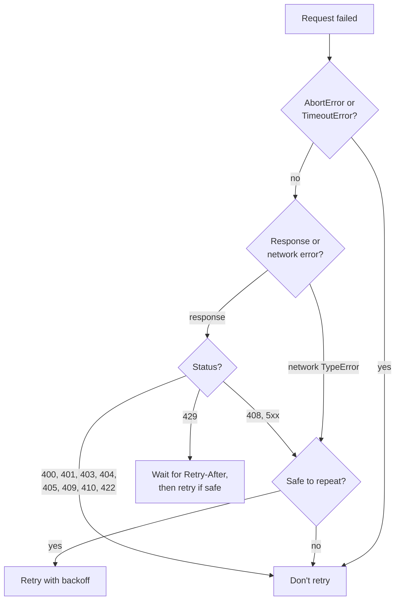
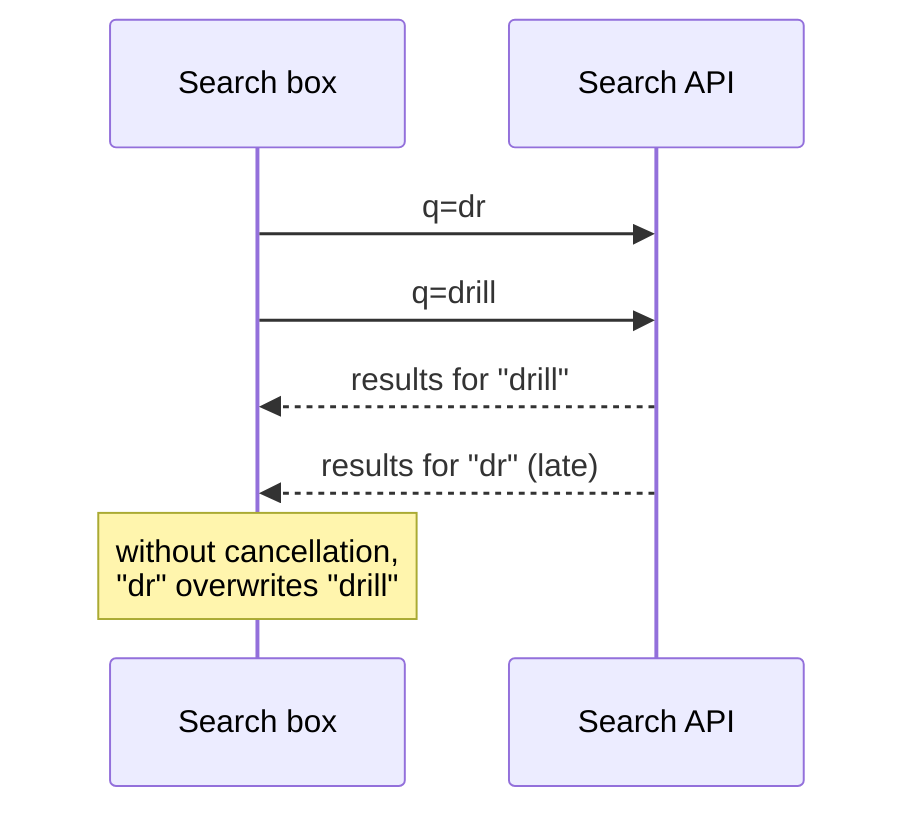

# When the network lets you down

> Requests hang, fail, return HTML instead of JSON, or arrive in the wrong order. You have seen all of this in a chaos panel. Now we build the systematic answer: a time budget for every request, retries only where they are safe, cancellation that doesn't flood your logs, and error responses you can actually read. At the end we look briefly at what large platforms add on top.

**Duration:** about 30 minutes

## Contents

- [Where you are coming from](#where-you-are-coming-from)
- [Timeouts](#timeouts)
- [Retries](#retries)
- [Cancellation](#cancellation)
- [Reading error responses](#reading-error-responses)
- [Briefly, at scale](#briefly-at-scale)
- [Takeaways](#takeaways)
- [Further reading](#further-reading)

## Where you are coming from

In an earlier evening, a chaos panel made an API slow, flaky, or broken on purpose: a 500 here, a 409 or 429 there, a request that never completes, an HTML page where JSON was expected. You saw how quickly a happy-path `fetch` falls apart. You also know that `res.ok` exists and that `AbortController` can cancel a request.

In a large application these aren't test scenarios, they happen every minute. Picture the Lending Desk grown into a company-wide platform with millions of users: catalogue, availability, reservations, reviews and notifications each run as their own service, and every page talks to several of them. At that size, someone's request is always hitting a slow pod, a deploy, or a full rate limit. This topic turns the chaos panel's lessons into rules you can apply to every request.

## Timeouts

`fetch` has no default timeout of its own. If the server never answers, your request waits as long as the browser or the operating system lets it, often minutes. A user won't wait that long, and a server-rendered page holding a connection open is a resource you lose.

### A budget per environment

Give every request a time budget, and choose it by who is waiting:

- **Server rendering:** short. The user stares at a blank tab until the HTML arrives. For an optional section, a second or so is plenty; when it runs out, render the section without that data.
- **Browser:** longer. The page is already visible, and a spinner in one section is acceptable for several seconds, for example 10.

These numbers are examples. Measure your own services and set budgets from their real response times.

### Wait slightly longer than the backend

Many backends have their own timeout for the services they call. If the backend gives up after 5 seconds and the client also gives up after 5 seconds, both stop at the same moment. The client sees its own anonymous timeout, and the backend's real answer, for example a `504` with details, is thrown away.

So set the client's timeout a bit longer than the backend's, for example 6 seconds against 5. Then the backend times out first and sends a real error the client can read and log.



### `AbortSignal.timeout()` and `AbortSignal.any()`

Two static methods make timeouts short to write:

- `AbortSignal.timeout(ms)` returns a signal that aborts after `ms` milliseconds with a `TimeoutError`.
- `AbortSignal.any([a, b])` returns a signal that aborts as soon as any of its inputs does, with that input's reason.

Combine them to get "cancel when the user leaves, or when time is up":

```ts
export async function getAvailability(itemId: string, signal?: AbortSignal) {
  const timeout = AbortSignal.timeout(6_000);
  const res = await fetch(`/api/items/${itemId}/availability`, {
    // 👇 whichever comes first: the caller cancels or time runs out
    signal: signal ? AbortSignal.any([signal, timeout]) : timeout,
  });
  // ...
}
```

The `name` of the error tells you what happened: `TimeoutError` for the timeout, `AbortError` for a cancellation. Both methods have been Baseline "widely available" in browsers since spring 2024, and all current Node.js LTS versions support both.

Docs: [`AbortSignal.timeout()`](https://developer.mozilla.org/en-US/docs/Web/API/AbortSignal/timeout_static) · [`AbortSignal.any()`](https://developer.mozilla.org/en-US/docs/Web/API/AbortSignal/any_static) · [Node.js `AbortSignal`](https://nodejs.org/api/globals.html)

## Retries

Many failures are temporary: a pod restarts, a connection drops, a rate limit resets. Trying again often works. But a retry can also cause damage, so decide before you retry.

### Retry only what is safe to repeat

A request is **idempotent** if sending it twice has the same effect as sending it once. In HTTP, `GET`, `HEAD`, `OPTIONS`, `PUT` and `DELETE` are idempotent; `POST` and `PATCH` are not. A GraphQL query is a read and safe to repeat even when it is sent with `POST`. A mutation is not.

Never blind-retry a mutation. Imagine `POST /reservations` reaches the server, the reservation is created, and then the connection drops before the answer arrives. The client sees a network error. If it retries, the user now has two reservations for the same drill.

The usual fix on large platforms is an **idempotency key**. The client generates a unique key, for example with `crypto.randomUUID()`, and sends it in an `Idempotency-Key` header. The server remembers which keys it has processed. A retry with the same key returns the original result instead of creating a second reservation. The header is specified in an IETF draft of the HTTP APIs working group. It is not an RFC yet (October 2026), but many payment and booking APIs already use it.

Docs: [Idempotent (MDN)](https://developer.mozilla.org/en-US/docs/Glossary/Idempotent) · [IETF draft: The Idempotency-Key HTTP Header Field](https://datatracker.ietf.org/doc/draft-ietf-httpapi-idempotency-key-header/) · [`crypto.randomUUID()`](https://developer.mozilla.org/en-US/docs/Web/API/Crypto/randomUUID)

### Classify before you retry

Not every failure gets better with time. A `404` stays a `404`.



- **Never retry an `AbortError`.** Someone cancelled on purpose. A `TimeoutError` from the caller's own budget means the time is up, so don't start over either.
- **Don't retry 400, 401, 403, 404, 405, 409, 410, 422.** The request itself is wrong, not allowed, or conflicts with the current state. Sending it again gives the same answer.
- **Retry 408, 429 and 5xx.** These say "not now". For `429 Too Many Requests` and `503`, the server may send a `Retry-After` header with seconds or a date. Respect it.
- **Retry a network `TypeError` only for safe requests.** `fetch` rejects with a `TypeError` when the network fails, and you can't know whether the server already processed the request.

Docs: [`fetch()` exceptions](https://developer.mozilla.org/en-US/docs/Web/API/Window/fetch#exceptions) · [HTTP response status codes](https://developer.mozilla.org/en-US/docs/Web/HTTP/Reference/Status) · [`Retry-After`](https://developer.mozilla.org/en-US/docs/Web/HTTP/Reference/Headers/Retry-After)

### Backoff with jitter, and a small budget

If a thousand clients fail at the same moment and all retry after exactly 1 second, the struggling service gets a thousand requests again at the same moment. Two habits prevent this:

- **Exponential backoff:** wait longer after each failure, for example 200 ms, 400 ms, 800 ms.
- **Jitter:** pick a random wait between zero and that value, so the clients spread out.

Keep the number of retries small, two or three attempts in total. Retries also multiply across layers: if the browser, the backend-for-frontend and the backend each try three times, one click can cause 27 calls to the database.

### A typed `fetchWithRetry`

```ts
type RetryOptions = { attempts?: number; baseDelayMs?: number; maxDelayMs?: number; idempotent?: boolean };

const IDEMPOTENT_METHODS = new Set(["GET", "HEAD", "OPTIONS", "PUT", "DELETE"]);
const isRetryableStatus = (s: number) => s === 408 || s === 429 || s >= 500;

export async function fetchWithRetry(url: string, init: RequestInit = {}, options: RetryOptions = {}): Promise<Response> {
  const { attempts = 3, baseDelayMs = 200, maxDelayMs = 2_000 } = options;
  const method = (init.method ?? "GET").toUpperCase();
  const hasKey = new Headers(init.headers).has("Idempotency-Key");
  // 👇 a POST is only retried when the caller marks it safe or sends a key
  const idempotent = options.idempotent ?? (IDEMPOTENT_METHODS.has(method) || hasKey);

  for (let attempt = 1; ; attempt++) {
    const isLast = attempt >= attempts || !idempotent;
    try {
      const res = await fetch(url, init);
      if (isLast || !isRetryableStatus(res.status)) return res;
      const delay = retryAfterMs(res) ?? backoff(attempt, baseDelayMs, maxDelayMs);
      if (delay > maxDelayMs) return res; // the server asks for more time than we have
      await res.body?.cancel();
      await sleep(delay, init.signal);
    } catch (error) {
      // 👇 AbortError and TimeoutError are DOMExceptions, not TypeErrors
      if (isLast || !(error instanceof TypeError)) throw error;
      await sleep(backoff(attempt, baseDelayMs, maxDelayMs), init.signal);
    }
  }
}
```

And the helpers:

```ts
function backoff(attempt: number, baseMs: number, maxMs: number): number {
  return Math.random() * Math.min(maxMs, baseMs * 2 ** (attempt - 1)); // full jitter
}

function retryAfterMs(res: Response): number | undefined {
  const header = res.headers.get("Retry-After");
  if (!header) return undefined;
  const seconds = Number(header);
  const ms = Number.isNaN(seconds) ? Date.parse(header) - Date.now() : seconds * 1_000;
  return Number.isNaN(ms) ? undefined : Math.max(0, ms);
}

function sleep(ms: number, signal?: AbortSignal | null): Promise<void> {
  return new Promise((resolve, reject) => {
    if (signal?.aborted) return reject(signal.reason);
    const timer = setTimeout(resolve, ms);
    signal?.addEventListener("abort", () => {
      clearTimeout(timer);
      reject(signal.reason);
    }, { once: true });
  });
}
```

Combine it with a timeout signal from the previous section. The timeout then covers all attempts together, and the retries never run past your budget.

Docs: [`Headers`](https://developer.mozilla.org/en-US/docs/Web/API/Headers) · [`ReadableStream.cancel()`](https://developer.mozilla.org/en-US/docs/Web/API/ReadableStream/cancel) · [`AbortSignal.reason`](https://developer.mozilla.org/en-US/docs/Web/API/AbortSignal/reason)

## Cancellation

Cancelling is part of normal operation, not an error. The classic case is search-as-you-type.

### Abort the previous request

The user types "d", "dr", "dri", "drill". Each keystroke starts a request. Only the last answer matters, and the other three waste bandwidth and server time. Worse, they can arrive in the wrong order: if the request for "dr" is slow, its results arrive after those for "drill" and overwrite them. The user typed "drill" and sees results for "dr".



In React, abort the previous request in the effect's cleanup, and ignore anything that arrives after the abort:

```tsx
useEffect(() => {
  if (!query) return;
  const controller = new AbortController();

  searchItems(query, controller.signal)
    .then((items) => {
      if (!controller.signal.aborted) setResults(items);
    })
    .catch((error: unknown) => {
      if (controller.signal.aborted) return; // 👇 expected: not an error
      setError(error);
    });

  return () => controller.abort(); // runs before the next query starts
}, [query]);
```

The cleanup aborts the old request before the effect runs again with the new query. The `aborted` check handles the late arrival: a response that has already been received but not yet processed is dropped too. A debounce of a few hundred milliseconds on top saves even more requests.

Docs: [`useEffect`: fetching data](https://react.dev/reference/react/useEffect#fetching-data-with-effects) · [`AbortController`](https://developer.mozilla.org/en-US/docs/Web/API/AbortController)

### Keep aborts out of your logs

Every keystroke now produces one rejected promise. If a global handler sends each rejection to your error monitoring, a busy search page reports thousands of "errors" an hour that aren't errors. Filter them out in one central place:

```ts
export function isAbort(error: unknown): boolean {
  return error instanceof DOMException && error.name === "AbortError";
}

// in your logger
if (isAbort(error)) return;
```

Keep `TimeoutError` in the logs. A cancellation is the user's choice, a timeout is a signal that a service is too slow.

Docs: [`DOMException` names](https://developer.mozilla.org/en-US/docs/Web/API/DOMException#error_names)

## Reading error responses

The chaos panel showed it: an error response can look like anything. Read it carefully before you use it.

### Problem details (RFC 9457)

RFC 9457 defines a standard JSON shape for HTTP API errors, with the media type `application/problem+json`. Its members are:

- `type`: a URI that identifies the kind of problem, `about:blank` if missing. Code should branch on this.
- `title`: a short, human-readable summary of the problem type.
- `status`: the HTTP status code, repeated for convenience.
- `detail`: an explanation of this particular occurrence.
- `instance`: a URI that identifies this particular occurrence, useful in support requests.

```json
{
  "type": "https://lending-desk.example/problems/item-already-reserved",
  "title": "Item already reserved",
  "status": 409,
  "detail": "The drill is reserved from 3 to 5 November.",
  "instance": "/reservations/attempts/8f2c"
}
```

Docs: [RFC 9457: Problem Details for HTTP APIs](https://www.rfc-editor.org/rfc/rfc9457.html)

### Check the content type before `res.json()`

A load balancer, proxy or CDN in front of your API often answers with its own HTML page: "502 Bad Gateway", a maintenance page, a login wall. Some of them even send it with status 200. `res.json()` then rejects with a `SyntaxError` like `Unexpected token '<'`, which tells nobody what really happened. Check the `content-type` header first:

```ts
type ProblemDetails = { type?: string; title?: string; status?: number; detail?: string; instance?: string };

export class HttpError extends Error {
  constructor(readonly status: number, readonly problem?: ProblemDetails) {
    super(problem?.title ?? `HTTP ${status}`);
    this.name = "HttpError";
  }
}

export async function readJson<T>(res: Response): Promise<T> {
  const type = res.headers.get("content-type") ?? "";
  if (!res.ok) {
    const problem = type.includes("application/problem+json") ? ((await res.json()) as ProblemDetails) : undefined;
    throw new HttpError(res.status, problem);
  }
  if (!type.includes("json")) {
    // 👇 an HTML page from a proxy or CDN, sometimes with status 200
    throw new HttpError(res.status, { title: `Expected JSON, got "${type || "nothing"}"` });
  }
  return (await res.json()) as T; // validate the shape with a schema in real code
}
```

Now every failure becomes an `HttpError` with a status and, when the server sends one, a readable problem. The retry logic and the UI can branch on it, and the logs show "502, Expected JSON, got text/html" instead of a parser message.

Docs: [`Response.ok`](https://developer.mozilla.org/en-US/docs/Web/API/Response/ok) · [`Response.json()` exceptions](https://developer.mozilla.org/en-US/docs/Web/API/Response/json#exceptions) · [`Content-Type`](https://developer.mozilla.org/en-US/docs/Web/HTTP/Reference/Headers/Content-Type)

## Briefly, at scale

Three more ideas you will meet on large platforms. Each deserves its own evening, so we only name them here.

- **Deduplicate identical in-flight requests.** When five components on a page ask for the same item at the same moment, send one request and give all five the same promise. Data libraries such as TanStack Query and Relay do this for you. When the page is rendered on the server, a map of in-flight promises that lives for one request does the same.
- **Circuit breakers.** If a service keeps failing, stop calling it for a while and fail fast instead. This gives the service room to recover and saves your users from waiting for timeouts. The pattern has three states: closed (calls go through), open (calls fail immediately) and half-open (a trial call tests whether the service is back).
- **Degrade a section, not the page.** When availability is down, the item page still shows the item, with "Availability can't be loaded right now" and a retry button in one box. All the techniques above exist so that one failing service costs one section.

Docs: [TanStack Query: Important defaults](https://tanstack.com/query/latest/docs/framework/react/guides/important-defaults)

## Takeaways

- Give every request a time budget: short during server rendering, longer in the browser, and slightly longer than the backend's own timeout so you receive its real error.
- Retry only requests that are safe to repeat, and classify first: never aborts, never 4xx except 408 and 429, network errors only for safe requests. Mutations need an idempotency key.
- Use exponential backoff with jitter, respect `Retry-After`, and keep the retry count small, because retries multiply across layers.
- Cancel outdated requests, ignore late responses, and keep `AbortError` out of your logs.
- Check `content-type` before `res.json()`, and turn RFC 9457 problem details into typed errors.

## Further reading

- [MDN: Using the Fetch API](https://developer.mozilla.org/en-US/docs/Web/API/Fetch_API/Using_Fetch)
- [MDN: `AbortSignal`](https://developer.mozilla.org/en-US/docs/Web/API/AbortSignal)
- [RFC 9457: Problem Details for HTTP APIs](https://www.rfc-editor.org/rfc/rfc9457.html)
- [IETF draft: The Idempotency-Key HTTP Header Field](https://datatracker.ietf.org/doc/draft-ietf-httpapi-idempotency-key-header/)
- Marc Brooker: [Exponential Backoff And Jitter](https://aws.amazon.com/blogs/architecture/exponential-backoff-and-jitter/) (AWS Architecture Blog)
- Google SRE book: [Addressing Cascading Failures](https://sre.google/sre-book/addressing-cascading-failures/), on retry budgets and retries across layers
- Martin Fowler: [Circuit Breaker](https://martinfowler.com/bliki/CircuitBreaker.html)
- Related topic: [When only part of the data fails](../partial-failures/README.md)
