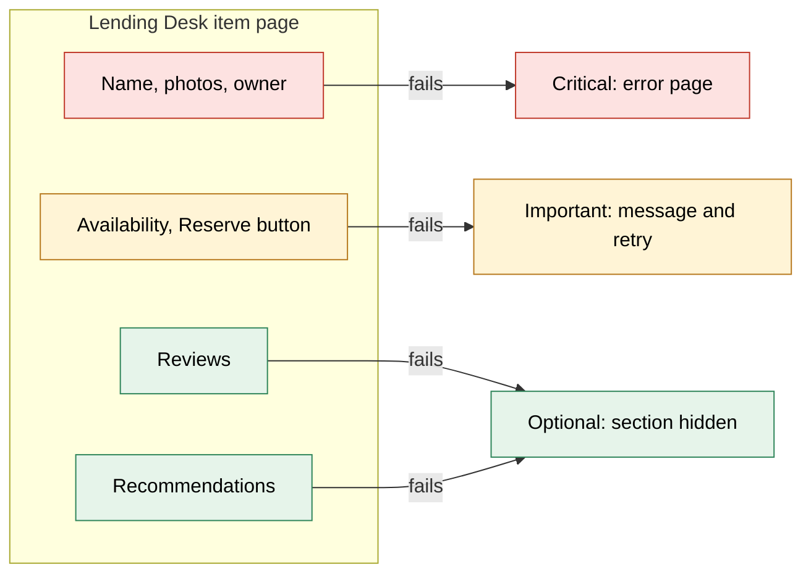
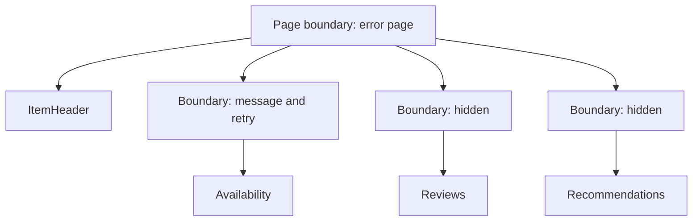
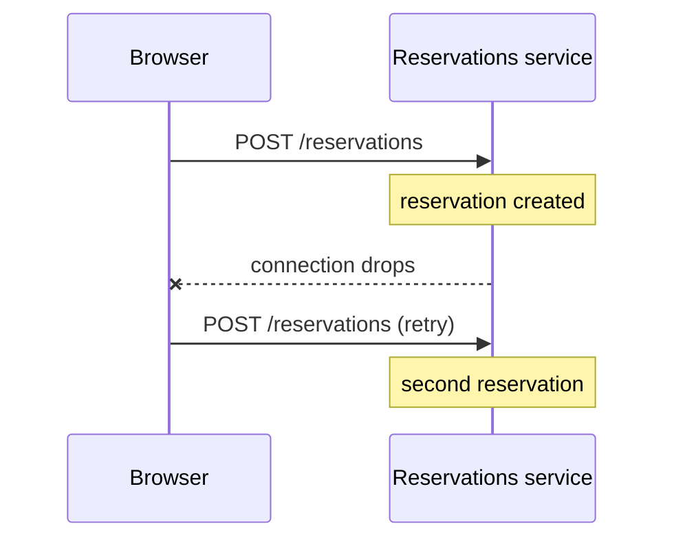
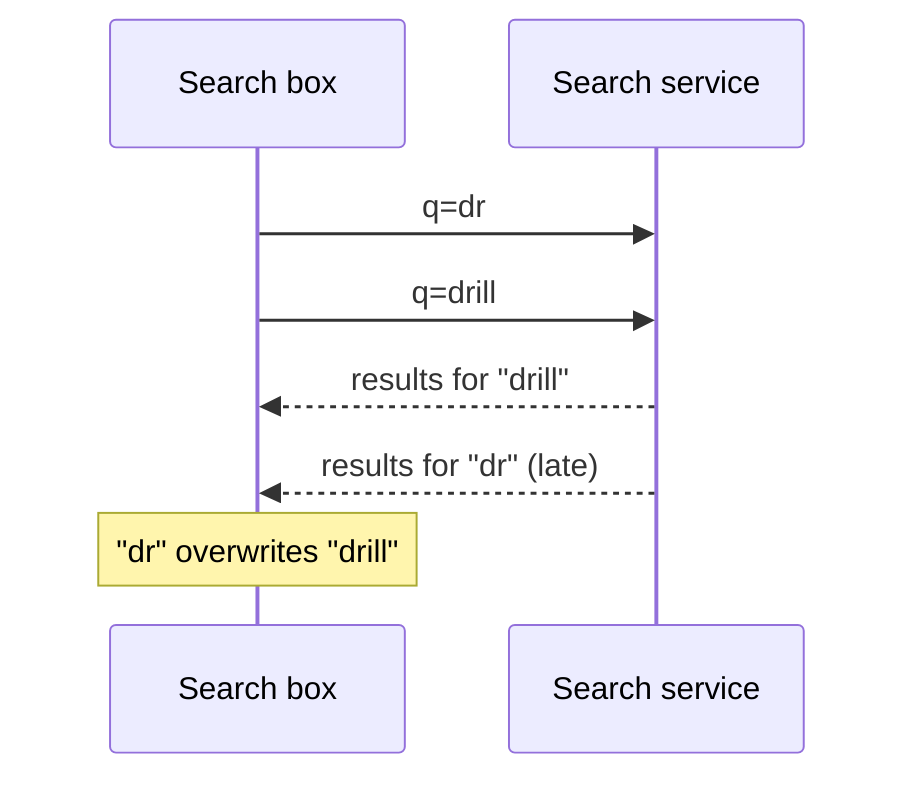

# When parts of the page fail

> A large page draws on many services, and on any given day one of them is slow or down. If one failure takes down the whole page, the page is only as reliable as its weakest service. We decide for every piece of data what happens when it fails, and give each section its own error boundary, so a failure costs one box, not the page. Then we make the network layer fail in a predictable way: a time budget per request, retries only where they are safe, and no outdated answers.

**Duration:** about 40 minutes

## Contents

- [Where you are coming from](#where-you-are-coming-from)
- [What a partial response looks like](#what-a-partial-response-looks-like)
- [Sort the data by impact](#sort-the-data-by-impact)
- [One error boundary per section](#one-error-boundary-per-section)
- [From a failed field to a fallback](#from-a-failed-field-to-a-fallback)
- [Design the fallback](#design-the-fallback)
- [Make requests fail predictably](#make-requests-fail-predictably)
- [Takeaways](#takeaways)
- [Further reading](#further-reading)

## Where you are coming from

In Project 2 you wrap `fetch` in `try`/`catch` and show an error message when it fails. With one API behind your app, that is enough.

Now imagine the Lending Desk has grown into a company-wide platform with millions of users. Item catalogue, availability, reservations, reviews and recommendations each run as their own service: a separate backend with its own team and its own deploys. The item page alone draws on about five of them.

On any given day, one of them is slow or down while the others are fine. The goal of this topic: **when one piece of data fails, only the part of the page that needs it notices.** Two steps get you there: decide per piece of data what happens when it fails, and make every request fail in a predictable way.

## What a partial response looks like

Large pages often load their data with GraphQL: the page sends one query that names the fields it needs, and a server collects them from the services. Here is a query for the item page:

```graphql
query ItemPage {
  item(id: "42") {
    name
    rating
    availability { status nextFreeDate }
  }
}
```

When the availability service times out, the server still answers. It sets the failed field to `null`, adds an entry with the field's `path` to an `errors` list, and delivers the rest:

```json
{
  "data": {
    "item": { "name": "Cordless drill", "rating": null, "availability": null }
  },
  "errors": [
    { "message": "Availability service timed out", "path": ["item", "availability"] }
  ]
}
```

The HTTP status is still a success code, usually `200`, so `res.ok` is `true`. A REST backend that merges several services into one response has the same problem.

### `null` alone tells you nothing

`rating: null` means "nobody has rated this drill yet", a normal state. `availability: null` means "the service failed". A component that only sees the value might show "Not available" for a drill that is free to borrow.

It gets worse with fields the schema marks as never `null`. If such a field fails, the `null` moves up to the nearest parent that may be `null`. One failed `status` can turn the whole `availability` object into `null`.

So whatever reads a value from a partial response must also check whether an error came with it.

Docs: [GraphQL spec, Handling Execution Errors](https://spec.graphql.org/September2025/#sec-Handling-Execution-Errors)

## Sort the data by impact

Not every failure deserves the same reaction. Before you write any error handling, decide for every piece of data what happens when it is missing. Three levels are enough:

- **Critical:** the page makes no sense without it. Show an error page.
- **Important:** the user needs it, but can still do something. Show a message and a retry.
- **Optional:** nice to have. Hide the section.



This is a product decision. Ask the product owner: "If availability is down, can a user still do something useful here?" Write the answer down next to the component.

Two rules of thumb:

- **Keep critical data small.** If everything is critical, one slow service takes down every page.
- **"Not found" is not "failed".** A missing item is a 404 page. A failed catalogue service is an error page. Keep the two apart.

## One error boundary per section

An **error boundary** is a React component that catches errors thrown while rendering its children and shows a fallback instead. React only supports boundaries as class components, and the React docs suggest the small library `react-error-boundary` so you don't have to write the class yourself.

Give every important and optional section its own boundary. The fallback follows from the level you chose:

```tsx
import { ErrorBoundary } from "react-error-boundary";

export function ItemPage({ response }: { response: ItemPageResponse }) {
  return (
    <>
      <ItemHeader response={response} /> {/* critical: its errors reach the page boundary */}
      <ErrorBoundary fallback={<AvailabilityUnknown />} onError={reportFallback}>
        <Availability response={response} />
      </ErrorBoundary>
      {/* 👇 optional: a null fallback hides the section */}
      <ErrorBoundary fallback={null} onError={reportFallback}>
        <Reviews response={response} />
      </ErrorBoundary>
    </>
  );
}
```

An error rises to the nearest boundary above it. One more boundary around the page shows the error page:



Where you put a boundary decides what fails. Three things go wrong when many teams change a page:

- **A missing boundary.** A team adds a recommendations carousel without one. Its error rises to the page boundary, and an optional section replaces the whole page. Make boundaries hard to forget, for example with a `Section` component that always includes one.
- **Critical data inside a section.** A boundary catches everything below it. If the owner's name fails inside the availability section, the user sees "Availability can't be loaded" next to an item without an owner. Render critical data outside every section boundary.
- **A silent fallback.** A hidden section looks fine to everyone, including you. Report every fallback with `onError`, so you notice when reviews disappear on 5% of page views.

Boundaries catch rendering errors only, not errors in event handlers or in callbacks such as `setTimeout`. A failed click on "Reserve" needs its own `try`/`catch`. For a retry button, use `fallbackRender`: it receives a `resetErrorBoundary` function that renders the section again.

Docs: [React: Catching rendering errors with an error boundary](https://react.dev/reference/react/Component#catching-rendering-errors-with-an-error-boundary) · [`react-error-boundary`](https://github.com/bvaughn/react-error-boundary)

<details>
<summary>Going further: boundaries that catch only their own errors</summary>

Keeping critical data outside sections relies on discipline. With twenty teams on one page, an error still ends up in the wrong boundary sometimes. One fix is an addressed error: each section creates a unique token, passes it to the components that may fail, and its boundary handles only errors that carry that token. Anything else it throws again, and an error thrown by a boundary goes to the next boundary up.

```tsx
export class SectionError extends Error {
  readonly token: object;
  constructor(token: object, options?: ErrorOptions) {
    super("Section failed", options);
    this.token = token;
  }
}

export function AvailabilitySection({ response }: SectionProps) {
  const [token] = useState(() => ({})); // a unique object per mounted section
  return (
    <ErrorBoundary
      fallbackRender={({ error }) => {
        // 👇 not ours: pass it to the boundary above
        if (!(error instanceof SectionError) || error.token !== token) throw error;
        return <AvailabilityUnknown />;
      }}
    >
      <Availability response={response} onError={token} />
    </ErrorBoundary>
  );
}
```

`Availability` throws `new SectionError(onError)`. Because `onError` is a required prop, its signature now shows that it can fail. For critical data, share the page boundary's token through context, so "fail the whole page" becomes a choice someone typed.

</details>

## From a failed field to a fallback

The boundary only helps if the component notices the failure. With GraphQL, that means checking the `errors` list for the path the component reads:

```ts
type GraphQLError = { message: string; path?: readonly (string | number)[] };

// true if the field at `path`, or anything inside it, failed
export function failedAt(errors: readonly GraphQLError[] = [], path: readonly string[]): boolean {
  return errors.some((error) => path.every((key, i) => error.path?.[i] === key));
}
```

Now each section reacts in the way its level asks for:

```tsx
export function Availability({ response }: { response: ItemPageResponse }) {
  if (failedAt(response.errors, ["item", "availability"])) {
    throw new Error("Availability failed to load"); // 👇 the section's boundary shows its fallback
  }
  return <AvailabilityBadge availability={response.data.item.availability} />;
}

export function Reviews({ response }: { response: ItemPageResponse }) {
  if (failedAt(response.errors, ["item", "reviews"])) return null; // optional: hide it
  // ...
}
```

Throw when someone higher up must decide what to show. Return early when the component can decide on its own.

<details>
<summary>Going further: errors during server rendering</summary>

Error boundaries don't run while the page is rendered on the server. If a component throws inside a `<Suspense>` boundary, React puts that Suspense fallback into the HTML and tries the component again in the browser, where your error boundary gets its chance. A throw outside every `<Suspense>` boundary leaves React with no HTML to send, and your server must answer with an error page.

So for sections rendered on the server, prefer the early return: check for the error and render the fallback directly.

Docs: [React: Recovering from errors outside the shell](https://react.dev/reference/react-dom/server/renderToPipeableStream#recovering-from-errors-outside-the-shell)

</details>

<details>
<summary>Going further: Relay does the check for you</summary>

Relay, the GraphQL client from Meta, builds the `failedAt` check into the query language and generates matching TypeScript types:

```tsx
const item = useFragment(
  graphql`
    fragment Availability_item on Item {
      availability @catch {
        status
        nextFreeDate
      }
    }
  `,
  itemRef,
);
if (!item.availability.ok) return <AvailabilityUnknown />; // { ok: false, errors }
```

- `@catch` on a field delivers an error as a value, `{ ok: true, value }` or `{ ok: false, errors }`.
- `@throwOnFieldError` on a fragment throws when the component reads a field that has an error, so the section's boundary catches it.

Either way, a failed field never reaches your code as an innocent `null`.

Docs: [Relay `@catch`](https://relay.dev/docs/guides/catch-directive/) · [Relay `@throwOnFieldError`](https://relay.dev/docs/guides/throw-on-field-error-directive/)

</details>

## Design the fallback

The boundary decides _whether_ the user sees a fallback. Design decides _what_ they see.

- **Hide optional sections.** Reviews that disappear are better than an error box nobody can act on.
- **Say what is unknown.** "Availability can't be loaded right now", not "Not available". The second sentence is false.
- **Offer a retry for important data.** The cause is often temporary.
- **Keep the space.** Give a placeholder the size of the content it replaces, so the "Reserve" button doesn't jump.

Test every fallback before users see it: make one service fail with your chaos panel and look at the page.

## Make requests fail predictably

A boundary can only show a fallback once a request has actually failed. A request that hangs for minutes, a careless retry, or an outdated answer breaks that plan. Three habits keep failures predictable.

### A time budget per request

`fetch` has no timeout of its own. If a service never answers, the section shows a spinner for minutes. Give every request a budget:

```ts
export async function getAvailability(itemId: string): Promise<Availability> {
  const res = await fetch(`/api/items/${itemId}/availability`, {
    signal: AbortSignal.timeout(3_000), // 👇 give up after 3 seconds
  });
  if (!res.ok) throw new Error(`HTTP ${res.status}`);
  return (await res.json()) as Availability;
}
```

When the time is up, `fetch` rejects with an error named `TimeoutError`. Choose the budget by who is waiting. During server rendering the user stares at an empty tab, so allow about a second for an optional section, then render without it. In the browser, a spinner in one box is fine for several seconds.

Docs: [`AbortSignal.timeout()`](https://developer.mozilla.org/en-US/docs/Web/API/AbortSignal/timeout_static)

### Retry only safe reads

Many failures are temporary: a service restarts, a connection drops. Trying a read again often works. A read is a request that changes nothing: a `GET`, or a GraphQL query, even when sent with `POST`. Classify the failure first:

| What happened                                     | Retry the read?                                                   |
| ------------------------------------------------- | ----------------------------------------------------------------- |
| `408`, `429`, `502`, `503`, `504`                 | Yes, after a pause, or after `Retry-After` if the server sends it |
| `500`, or a network error (`TypeError`)           | At most once: it can also be a bug or an invalid request          |
| `400`, `403`, `404`, `409`, `422`, `501`          | No: the same request gets the same answer                         |
| `401`                                             | Refresh the login once, then stop                                 |
| `AbortError` or `TimeoutError`                    | No: someone cancelled, or the budget is spent                     |

Wait longer after each attempt, for example 200, 400 and 800 ms, and wait a random part of that (jitter), so a thousand clients don't retry at the same moment. Stop after two or three attempts: if the browser, a middle server and the backend each try three times, one click causes 27 calls. TanStack Query, for example, retries failed queries by default, but not mutations.

Docs: [`fetch()` exceptions](https://developer.mozilla.org/en-US/docs/Web/API/Window/fetch#exceptions) · [`Retry-After`](https://developer.mozilla.org/en-US/docs/Web/HTTP/Reference/Headers/Retry-After)

### Never blind-retry a write

A write such as `POST /reservations` is different. The server can create the reservation, and then the connection drops before the answer arrives. The browser sees a network error and can't tell whether the write happened.



A blind retry gives the user two reservations for the same drill. Show an error instead, and let the user check their reservations.

<details>
<summary>Going further: idempotency keys make writes safe to retry</summary>

The client creates a unique key once per user action and sends it with every attempt. The server stores the keys it has processed and answers a repeat with the original result instead of creating a second reservation.

```ts
const key = crypto.randomUUID(); // once per click, reused for every attempt
await fetch("/api/reservations", {
  method: "POST",
  headers: { "Idempotency-Key": key, "Content-Type": "application/json" },
  body: JSON.stringify({ itemId, from, to }),
});
```

`crypto.randomUUID()` works only on HTTPS or localhost. The `Idempotency-Key` header is an IETF draft, and many payment and booking APIs already use it.

Docs: [IETF draft: The Idempotency-Key HTTP Header Field](https://datatracker.ietf.org/doc/draft-ietf-httpapi-idempotency-key-header/) · [`crypto.randomUUID()`](https://developer.mozilla.org/en-US/docs/Web/API/Crypto/randomUUID)

</details>

### Cancel outdated requests

The user types "dr", then "drill" into the search box. Each keystroke starts a request. If the request for "dr" is slow, its results arrive last and overwrite those for "drill":



Abort the previous request when the query changes, and ignore anything that arrives after the abort:

```tsx
useEffect(() => {
  const controller = new AbortController();
  searchItems(query, controller.signal)
    .then((items) => {
      if (!controller.signal.aborted) setResults(items);
    })
    .catch((error: unknown) => {
      if (controller.signal.aborted) return; // 👇 cancelled on purpose: not an error
      setError(error);
    });
  return () => controller.abort(); // runs before the effect starts the next search
}, [query]);
```

To add a time budget, pass `AbortSignal.any([controller.signal, AbortSignal.timeout(3_000)])`. Keep `AbortError` out of your error reports: a cancellation is not a failure. Data libraries such as TanStack Query handle outdated answers for you.

Docs: [`useEffect`: fetching data](https://react.dev/reference/react/useEffect#fetching-data-with-effects) · [`AbortSignal.any()`](https://developer.mozilla.org/en-US/docs/Web/API/AbortSignal/any_static)

## Takeaways

- On a large page, some data fails every day. Partial responses deliver data and errors together, usually with status `200`, and a `null` alone doesn't tell you which one you have.
- Sort every piece of data as critical, important or optional, and decide the reaction before you write the code.
- Give every important and optional section its own error boundary, keep critical data outside them, and report every fallback.
- Give every request a time budget, retry only safe reads, and never blind-retry a write.
- Cancel outdated requests, and don't report a cancellation as an error.

## Further reading

- [React: Catching rendering errors with an error boundary](https://react.dev/reference/react/Component#catching-rendering-errors-with-an-error-boundary)
- [`react-error-boundary`](https://github.com/bvaughn/react-error-boundary)
- [GraphQL spec: Handling Execution Errors](https://spec.graphql.org/September2025/#sec-Handling-Execution-Errors)
- [GraphQL over HTTP: status codes](https://http-spec.graphql.org/draft/)
- [MDN: `AbortSignal`](https://developer.mozilla.org/en-US/docs/Web/API/AbortSignal)
- [MDN: HTTP response status codes](https://developer.mozilla.org/en-US/docs/Web/HTTP/Reference/Status)
- Marc Brooker: [Exponential Backoff And Jitter](https://aws.amazon.com/blogs/architecture/exponential-backoff-and-jitter/) (AWS Architecture Blog)
- [TanStack Query: Important defaults](https://tanstack.com/query/latest/docs/framework/react/guides/important-defaults)
- Related topic: [GraphQL vs REST, and why large sites use both](../graphql-vs-rest/README.md)
