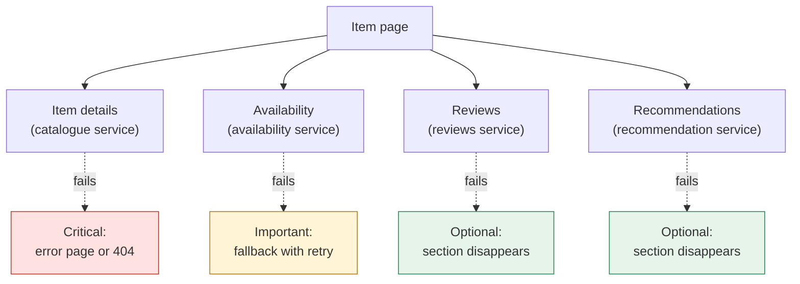
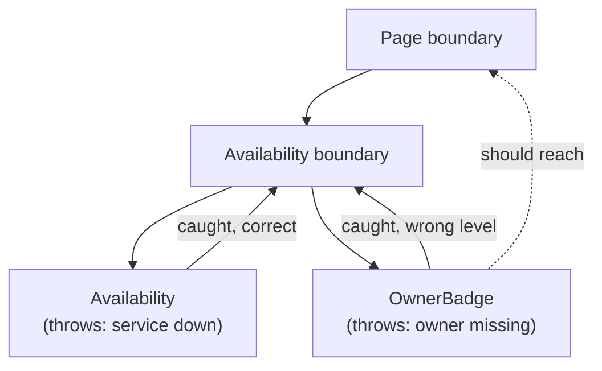
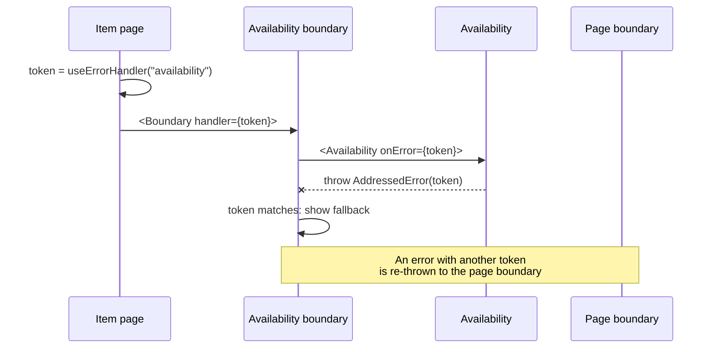

# When only part of the data fails

> A large page draws on dozens of services, and on a normal day one of them is slow or down. So the question isn't "did the request fail?" but "which part failed, and does it matter?" We sort every piece of data by impact: critical, important or optional. Then we build error boundaries that catch only the errors addressed to them, and we look at the tools that keep this working when many teams share a codebase.

**Duration:** about 40 minutes

## Contents

- [Where you are coming from](#where-you-are-coming-from)
- [Partial responses](#partial-responses)
- [Classify data by impact](#classify-data-by-impact)
- [Why plain error boundaries are not enough](#why-plain-error-boundaries-are-not-enough)
- [Pattern: addressed error boundaries](#pattern-addressed-error-boundaries)
- [Errors as values instead of throwing](#errors-as-values-instead-of-throwing)
- [Making it stick at scale](#making-it-stick-at-scale)
- [Designing the fallback](#designing-the-fallback)
- [Takeaways](#takeaways)
- [Further reading](#further-reading)

## Where you are coming from

In Project 2 you wrap `fetch` in `try`/`catch` and show an error message when it fails. Maybe you also wrap the page in a React error boundary, so a crash shows a fallback instead of a blank screen. With one API behind your app, that is enough: the request works or it doesn't.

Now imagine the Lending Desk has grown into a company-wide platform with millions of users. Item catalogue, availability, reservations, reviews, recommendations and notifications each belong to their own team and run as their own service. The item page alone draws on about six of them.

With six services on one page, "the request failed" is rarely the whole story. Usually one service is slow or down and the other five are fine. If any single failure takes down the page, you are only as available as your weakest service. The goal of this topic is the opposite: when part of the data fails, only the part of the page that needs it should notice.

## Partial responses

Let's start with what the server sends back when only some of the data fails.

### GraphQL: `data` and `errors` together

A GraphQL server keeps executing when one field fails. The failed field becomes `null`, the error goes into a separate `errors` list with a `path` to the field, and the rest of `data` is delivered as usual. With the common `application/json` response format, the HTTP status is still `200 OK`.

```json
{
  "data": {
    "item": {
      "name": "Cordless drill",
      "rating": null,
      "availability": null
    }
  },
  "errors": [
    {
      "message": "Availability service timed out",
      "path": ["item", "availability"]
    }
  ]
}
```

`res.ok` is `true` here. A check that only looks at the status code sees a successful response.

Docs: [GraphQL spec, Handling Field Errors](https://spec.graphql.org/October2021/#sec-Handling-Field-Errors) · [GraphQL spec, Errors](https://spec.graphql.org/October2021/#sec-Errors) · [GraphQL over HTTP, status codes](https://http-spec.graphql.org/draft/)

### REST has the same problem

Without GraphQL, the same thing happens one layer up. A backend-for-frontend (a small server that collects data for one page) calls six REST services and merges the answers into one JSON response. If the reviews service fails, the backend-for-frontend has to decide: fail everything, or send the rest with a gap. Most choose the gap, and then the client has the same question as with GraphQL.

### `null` is ambiguous

Look at the example again. `rating: null` and `availability: null` look identical. One means "nobody has rated this item yet", which is a normal state. The other means "we don't know, the service failed". If a component only sees the value, it might show "Not available" for an item that is free to borrow. Worse: the user believes it.

So every place that reads a value from a partial response must also know whether that value comes with an error. Keep this question in mind for the rest of the topic.

## Classify data by impact

Not every failure deserves the same reaction. Before you write any error handling, decide for every piece of data on the page what happens when it is missing. Three levels are enough for most pages:

| Level     | When it fails                                   | Lending Desk item page                    |
| --------- | ----------------------------------------------- | ----------------------------------------- |
| Critical  | The page fails, or shows a 404 if it is missing | The item itself: name, photos, owner      |
| Important | The section shows a fallback with a retry       | Availability and the "Reserve" button     |
| Optional  | The section disappears                          | Reviews, recommendations, "recently seen" |



The classification is a product decision, not only a technical one. Ask the product owner: "If availability is down, can a user still do something useful on this page?" Write the answer down next to the component, because the next developer will ask the same question.

Two rules of thumb:

- **Critical data is small.** If everything is critical, one slow service takes down every page. Most pages have one or two critical reads.
- **"Not found" is not "failed".** A missing item is a 404, and you want search engines and users to see it as one. A failed catalogue service is a 500 or an error page. Keep the two apart.

## Why plain error boundaries are not enough

A React error boundary catches errors thrown while rendering its children and shows a fallback instead. It is a class component with `static getDerivedStateFromError`, and optionally `componentDidCatch` for logging. So why not wrap every section in a boundary and be done?

Docs: [Catching rendering errors with an error boundary](https://react.dev/reference/react/Component#catching-rendering-errors-with-an-error-boundary)

Three problems show up once many teams work on the same page.

**1. A missing boundary takes the whole page down.** An error rises to the nearest boundary above it. If a team adds a recommendations carousel and forgets the boundary, the nearest one is the boundary around the whole page. An optional section now replaces the entire page with an error message.

**2. A boundary catches everything below it.** Suppose the availability section has a boundary, and inside it a component reads the item's owner, which is critical data. When the owner fails, the availability boundary catches the error and shows "Availability is unavailable". The page looks fine, but it shows an item without an owner. The error was meant for the page, and the wrong boundary swallowed it.

**3. You can't see from a component's props that it can fail.** `<Availability itemId={id} />` looks harmless. Whether it throws, and which boundary it expects, is hidden in its implementation. Reviewers can't spot a missing boundary in the diff.



We need boundaries that know which errors are theirs.

## Pattern: addressed error boundaries

The idea: an error carries an address, and a boundary handles only errors addressed to it. Everything else passes through to the boundary above.

It works in five steps:

1. A hook creates a unique **handler token** for one section.
2. The section passes the token to its data-reading component as an `onError` prop. The prop is required, so the component's signature now says "I can fail".
3. When the data fails, the component throws an error that carries the token.
4. The boundary for that section catches the error, compares tokens, and shows its fallback only if they match. Any other error is re-thrown to the next boundary up.
5. For critical data, a **page-level handler** is the explicit way to say "fail the whole page".



### The token and the error

```ts
// errorHandler.ts
import { useState } from "react";

export type ErrorHandler = { readonly section: string };

export class AddressedError extends Error {
  constructor(
    readonly handler: ErrorHandler,
    options?: ErrorOptions,
  ) {
    super(`Section "${handler.section}" failed`, options);
    this.name = "AddressedError";
  }
}

export function useErrorHandler(section: string): ErrorHandler {
  // 👇 a new object per mounted section: compared by identity, never by name
  const [handler] = useState<ErrorHandler>(() => ({ section }));
  return handler;
}
```

The token is an object, and tokens are compared with `===`. Two sections with the same name still get different tokens, so one can't catch the other's errors by accident. The `section` name is only for logs.

### The boundary

React error boundaries must be class components. Ours does one extra thing: in `render`, it re-throws errors that aren't addressed to it. An error thrown while a boundary renders goes to the next boundary up, which is exactly what we want.

```tsx
// addressedBoundary.tsx
import { Component, type ReactNode } from "react";
import { AddressedError, type ErrorHandler } from "./errorHandler.ts";

type Props = { handler: ErrorHandler; fallback: ReactNode; children: ReactNode };
type State = { error: unknown };

export class AddressedBoundary extends Component<Props, State> {
  state: State = { error: null };

  static getDerivedStateFromError(error: unknown): State {
    return { error };
  }

  componentDidCatch(error: unknown) {
    if (this.isMine(error)) reportSectionError(error); // see "Making it stick"
  }

  isMine(error: unknown): error is AddressedError {
    return error instanceof AddressedError && error.handler === this.props.handler;
  }

  render() {
    const { error } = this.state;
    if (error === null) return this.props.children;
    if (this.isMine(error)) return this.props.fallback;
    throw error; // 👇 not addressed to us: pass it upward
  }
}
```

Docs: [`static getDerivedStateFromError`](https://react.dev/reference/react/Component#static-getderivedstatefromerror) · [`componentDidCatch`](https://react.dev/reference/react/Component#componentdidcatch) · [`Error` `cause` option](https://developer.mozilla.org/en-US/docs/Web/JavaScript/Reference/Global_Objects/Error/Error#options)

Good to know: a real boundary also needs a way to recover after a retry, for example a method that sets the state back to `{ error: null }` so the children render again. If you don't want to write the class yourself, the library [`react-error-boundary`](https://github.com/bvaughn/react-error-boundary) is a common base, and you can put the token check inside its fallback.

### A component that can fail, and says so

```tsx
// availability.tsx
import { use } from "react";
import { AddressedError, type ErrorHandler } from "./errorHandler.ts";
// ...

type Props = {
  availability: Promise<Result<Availability, string>>; // started by the parent
  onError: ErrorHandler; // 👇 required: the signature shows this can fail
};

export function AvailabilityBadge({ availability, onError }: Props) {
  const result = use(availability);
  if (!result.ok) throw new AddressedError(onError, { cause: result.error });
  return <Badge status={result.value.status} nextFree={result.value.nextFreeDate} />;
}
```

And the section that wires it together:

```tsx
export function AvailabilitySection({ availability }: SectionProps) {
  const handler = useErrorHandler("availability");
  return (
    <AddressedBoundary handler={handler} fallback={<AvailabilityRetry />}>
      <AvailabilityBadge availability={availability} onError={handler} />
    </AddressedBoundary>
  );
}
```

Docs: [`use`](https://react.dev/reference/react/use)

### The page-level handler: an explicit escape hatch

Critical data needs a way out too. Put one `AddressedBoundary` at the top of the page and share its token through context. A component that reads the item itself asks for that token on purpose:

```tsx
const PageErrorContext = createContext<ErrorHandler | null>(null);

export function usePageErrorHandler(): ErrorHandler {
  const handler = useContext(PageErrorContext);
  if (!handler) throw new Error("usePageErrorHandler needs a page boundary above it");
  return handler;
}

// in a component that renders critical data
<OwnerBadge owner={item.owner} onError={usePageErrorHandler()} />;
```

Now "fail the whole page" is a choice someone typed and a reviewer can see. Any error with no matching boundary on the way up still reaches a plain boundary at the root of the app, so an unexpected bug still gets a safe fallback. And a missing item is not a failure at all: render the 404 page for that, with a 404 status when the page is rendered on the server.

Docs: [`useContext`](https://react.dev/reference/react/useContext)

### Where throwing works, and where it doesn't

Error boundaries don't catch errors during server rendering. When the page is rendered on the server and a component throws inside a `<Suspense>` boundary, React puts that Suspense fallback into the HTML and tries the component again in the browser. The page still loads, but the section renders twice, and the addressed boundary only gets its chance in the browser. A throw outside any `<Suspense>` boundary leaves React with no HTML to send, and the whole page fails.

So on the server, let errors travel as values (next section) and decide on the fallback while rendering.

Docs: [Error boundaries do not catch errors during server rendering](https://react.dev/reference/react/Component#catching-rendering-errors-with-an-error-boundary) · [Recovering from errors outside the shell](https://react.dev/reference/react-dom/server/renderToPipeableStream#recovering-from-errors-outside-the-shell)

## Errors as values instead of throwing

Throwing is one way to report failure. The other way is to return it, as a value the caller must look at. A small type does the job:

```ts
// result.ts
export type Result<T, E = Error> =
  | { ok: true; value: T }
  | { ok: false; error: E };

export async function getReviews(itemId: string): Promise<Result<Review[]>> {
  try {
    const res = await fetch(`${REVIEWS_URL}/items/${itemId}/reviews`);
    if (!res.ok) return { ok: false, error: new Error(`HTTP ${res.status}`) };
    return { ok: true, value: (await res.json()) as Review[] };
  } catch (error) {
    return { ok: false, error: error instanceof Error ? error : new Error(String(error)) };
  }
}
```

TypeScript now forces every caller to check `ok` before it can touch `value`. The server loads the reviews before it renders the page and passes the `Result` down as a prop. The optional section handles the failure right where it reads the data:

```tsx
export function ReviewsSection({ reviews }: { reviews: Result<Review[]> }) {
  if (!reviews.ok) return null; // 👇 optional: the section disappears
  return <ReviewList reviews={reviews.value} />;
}
```

When to use which:

- **Return a value** when the caller can do something sensible right there: hide a section, show "unknown", pick a default. This works the same on the server and the client.
- **Throw** when the component can't render at all and someone higher up must decide. Addressed boundaries make sure the right one does.

### A real-world example: Relay's error directives

Relay, the GraphQL client from Meta, builds both styles into its query language. You decide per fragment and per field, and Relay generates matching TypeScript types.

```ts
const item = useFragment(
  graphql`
    fragment ItemHeader_item on Item @throwOnFieldError {
      name
      owner @required(action: THROW) {
        displayName
      }
      rating @catch
    }
  `,
  itemRef,
);
// item.rating: { ok: true, value: number | null } | { ok: false, errors: [...] }
```

- **`@throwOnFieldError`** on a fragment or query: if a field in it has a field error, Relay throws when the component reads it. A failed field never reaches your code as an innocent `null`. It covers only the fields of this fragment, not fragments spread into it.
- **`@catch`** on a field, fragment, or aliased inline fragment: Relay returns errors as data instead. With the default `to: RESULT` you get `{ ok: true, value }` or `{ ok: false, errors }`. With `to: NULL`, a failed value becomes `null`. Inside a `@catch`, nothing throws.
- **`@required`** is about a `null` *value*, not an error. `action: THROW` throws during render, `LOG` and `NONE` turn the parent into `null`. Here a missing owner is treated as a broken item.

This answers the ambiguity from the start of the topic. A field error is never confused with a real `null`: it either throws or arrives as `ok: false`.

Docs: [Relay `@throwOnFieldError`](https://relay.dev/docs/guides/throw-on-field-error-directive/) · [Relay `@catch`](https://relay.dev/docs/guides/catch-directive/) · [Relay `@required`](https://relay.dev/docs/guides/required-directive/)

## Making it stick at scale

The pattern works on one page with one careful developer. With twenty teams and hundreds of components, it only holds if tools enforce it.

### A lint rule that requires a handler

Make every fallible read visible to a linter. For example: every call to your data hook, or every fragment that uses `@throwOnFieldError`, must receive an `onError` handler, and that handler must come from `useErrorHandler` or `usePageErrorHandler`. A custom ESLint rule can check this with a small AST visitor. A required `onError` prop gives you the same guarantee from TypeScript for components.

The rule turns "did you remember the boundary?" from a review comment into a red line in the editor.

Docs: [ESLint: custom rules](https://eslint.org/docs/latest/extend/custom-rules)

### Simulate a failure on purpose

You can't test fallbacks if the services never fail on your machine. Give developers a switch that makes one field or section fail, for example:

- a query parameter such as `?fail=availability` that the data layer reads in development, or
- a GraphQL directive such as `@simulateError` that your development server or mock layer turns into a field error.

Then open the page and look at the fallback. Two guardrails:

- The switch only exists in development and preview builds. Production ignores it.
- A CI step fails the build if a simulation marker, such as the directive, appears in committed code. A forgotten `@simulateError` must never reach users.

### Report errors in a stable shape

When a section falls back, the user sees a placeholder and nobody else notices. So every boundary reports what it caught, always in the same structure:

```ts
type SectionErrorReport = {
  event: "section_fallback" | "page_failure";
  section: string; // "availability"
  route: string; // "/items/:id", not the full URL
  errorName: string; // "AddressedError"
  cause?: string; // message of error.cause
  path?: readonly (string | number)[]; // GraphQL path, if any
};
```

Stable field names let you count fallbacks per section and alert when "availability" falls back on 5% of page views instead of 0.1%. Use the route pattern, not the full URL, so that reports group well and personal data stays out.

## Designing the fallback

The boundary decides *whether* to show a fallback. Design decides *what* the user sees.

- **Hide** optional sections. Reviews that silently disappear are better than an error box nobody can act on.
- **Show a placeholder** when the user expects the section, and say what is unknown: "Availability can't be loaded right now", not "Not available". The second sentence is false.
- **Offer a retry** for important data. The cause is often temporary, and a button that loads only this section is cheap.
- **Avoid layout shift.** Give the fallback the same size as the content it replaces, or hide sections that sit below the fold. A section that collapses after loading pushes the "Reserve" button away from the user's thumb.
- **Don't hide critical errors.** A page without the item, or an item without its owner, misleads the user. Fail it clearly with an error page, and let monitoring see it.

## Takeaways

- At scale, failures are partial: GraphQL and aggregated REST return data and errors together, often with HTTP 200, and `null` alone can't tell you which one you have.
- Classify every piece of data as critical, important or optional, and decide the reaction before you write the code.
- Plain error boundaries catch too much and too little. Addressed boundaries handle only errors carrying their own token, and failing the whole page becomes an explicit choice.
- Return errors as values where the caller can react locally, and especially when the page is rendered on the server. Throw where someone higher up must decide.
- Make it stick with tools: a lint rule for handlers, a dev-only failure switch with a CI guard, and structured reports from every boundary.

## Further reading

- [React: Catching rendering errors with an error boundary](https://react.dev/reference/react/Component#catching-rendering-errors-with-an-error-boundary)
- [React: Recovering from errors outside the shell](https://react.dev/reference/react-dom/server/renderToPipeableStream#recovering-from-errors-outside-the-shell), on errors during server rendering
- [GraphQL spec: Handling Field Errors](https://spec.graphql.org/October2021/#sec-Handling-Field-Errors)
- [Relay: `@catch`](https://relay.dev/docs/guides/catch-directive/), [`@throwOnFieldError`](https://relay.dev/docs/guides/throw-on-field-error-directive/), [`@required`](https://relay.dev/docs/guides/required-directive/)
- [`react-error-boundary`](https://github.com/bvaughn/react-error-boundary)
- Related topic: [When the network lets you down](../network-failures/README.md)
