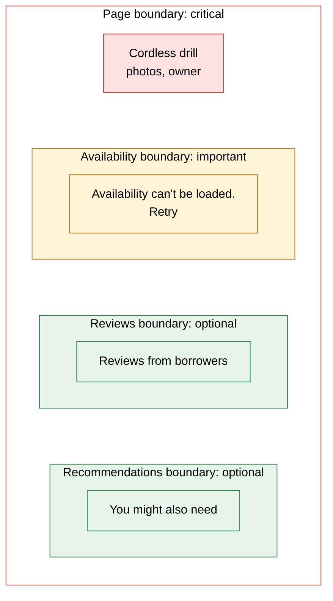
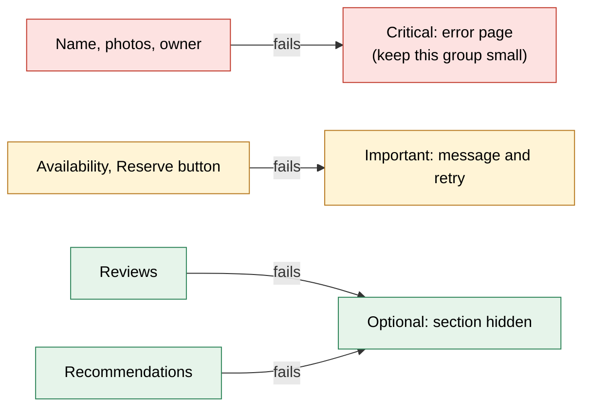
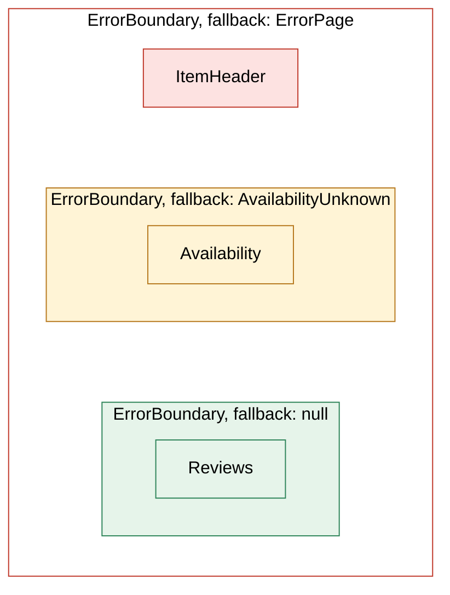
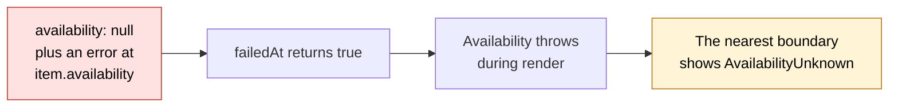
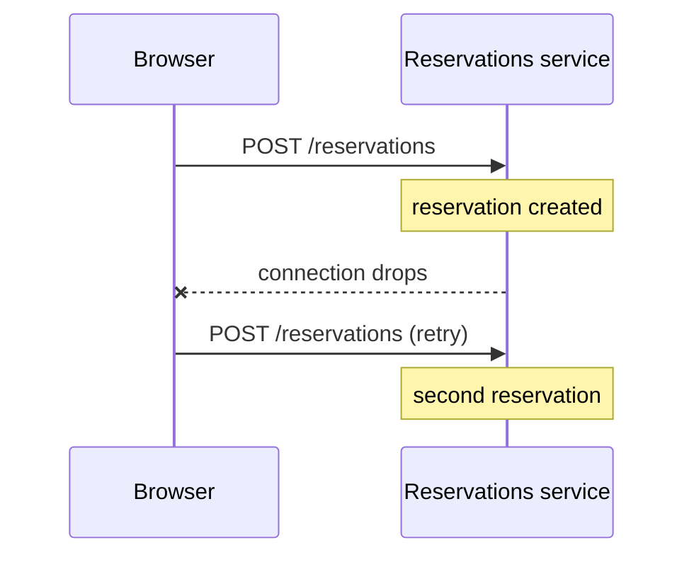

# When parts of the page fail

> A large page draws on many services, and on any given day one of them is slow or down. If one failure takes down the whole page, the page is only as reliable as its weakest service. We decide for every piece of data what happens when it fails, and give each section its own error boundary, so a failure costs one box, not the page. Then we make requests fail in a predictable way: a time budget per request, and retries only where they are safe.

**Duration:** about 40 minutes

## Contents

- [Where you are coming from](#where-you-are-coming-from)
- [What a partial response looks like](#what-a-partial-response-looks-like)
- [Sort the data by impact](#sort-the-data-by-impact)
- [One error boundary per section](#one-error-boundary-per-section)
- [From a failed field to a fallback](#from-a-failed-field-to-a-fallback)
- [Design the fallback](#design-the-fallback)
- [Make requests fail predictably](#make-requests-fail-predictably)
- [Takeaways](#takeaways)
- [Further reading](#further-reading)

## Where you are coming from

In Project 2 you wrap `fetch` in `try`/`catch` and show an error message when it fails. With one API behind your app, that is enough.

Now imagine the Lending Desk has grown into a company-wide platform with millions of users. Catalogue, availability, reservations, reviews and recommendations each run as their own service, with their own team. The item page draws on about five of them, and on any given day one is slow or down. The goal of this topic: **when one piece of data fails, only the part of the page that needs it notices.**

An **error boundary** is a React component you wrap around a section: if anything inside throws while rendering, it shows a fallback instead. Picture the item page with one around each section, coloured by how much the data matters:



Availability has failed, and only its frame shows a fallback. Without the inner frames, the whole page would say "Something went wrong".

## What a partial response looks like

Large pages often load their data with GraphQL: one query names the fields the page needs, and a server collects them from the services:

```graphql
query ItemPage {
  item(id: "42") {
    name
    rating
    reviews { text }
    availability { status nextFreeDate }
  }
}
```

When the availability service times out, the server still answers: `availability` is `null`, the failure is listed under `errors` with its `path`, and the rest arrives.

```json
{
  "data": {
    "item": { "name": "Cordless drill", "rating": null, "reviews": [], "availability": null }
  },
  "errors": [
    { "message": "Availability service timed out", "path": ["item", "availability"] }
  ]
}
```

The HTTP status is a 2xx, usually `200`, so `res.ok` is `true`. Note that `rating` is `null` too, but with no error: nobody has rated this drill yet.

### `null` alone tells you nothing

Both fields are `null`, for different reasons. A component that only sees `availability: null` might show "Not available" for a drill that is free to borrow. So whatever reads a value must also check whether an error came with it.

Docs: [GraphQL spec, Handling Execution Errors](https://spec.graphql.org/September2025/#sec-Handling-Execution-Errors)

## Sort the data by impact

Before you write error handling, decide for every piece of data what happens when it is missing. Three levels are enough:

- **Critical:** the page makes no sense without it. Show an error page.
- **Important:** the user needs it, but can still do something. Show a message and a retry.
- **Optional:** nice to have. Hide the section.



This is a product decision. Ask the product owner: "If availability is down, can a user still do something useful here?"

## One error boundary per section

React offers error boundaries only as class components, so use the library `react-error-boundary` rather than writing one. An error rises to the nearest boundary above it.

The page sends the query once and passes the `response`, the JSON above, to every section. Every frame from the picture becomes an `<ErrorBoundary>`, nested the same way:



```tsx
import { ErrorBoundary } from "react-error-boundary";

export function ItemPage({ response }: { response: ItemPageResponse }) {
  return (
    <ErrorBoundary fallback={<ErrorPage />}>
      <ItemHeader response={response} /> {/* critical: no boundary of its own */}
      <ErrorBoundary fallback={<AvailabilityUnknown />} resetKeys={[response]}>
        <Availability response={response} />
      </ErrorBoundary>
      {/* 👇 optional: a null fallback hides the section */}
      <ErrorBoundary fallback={null}>
        <Reviews response={response} />
      </ErrorBoundary>
    </ErrorBoundary>
  );
}
```

`AvailabilityUnknown` has a Retry button that loads the data again, and `resetKeys` renders the section again when the new `response` arrives. Add `onError` to every boundary to send the error to your error monitoring.

A boundary's position decides how much of the page disappears. Two things go wrong when many teams change a page:

- **A missing boundary.** A team adds a recommendations carousel without one, and its error takes down the whole page. A `Section` component that always includes a boundary prevents this.
- **Critical data inside a section.** If the availability section also reads the owner's name, a failed name shows "Availability can't be loaded" instead of the error page. Render critical data outside every section boundary.

Docs: [React: Catching rendering errors with an error boundary](https://react.dev/reference/react/Component#catching-rendering-errors-with-an-error-boundary) · [`react-error-boundary`](https://github.com/bvaughn/react-error-boundary)

## From a failed field to a fallback

The boundary only helps if the component notices the failure, so each component checks `errors` for the path it reads:

```ts
type Path = readonly (string | number)[];
type GraphQLError = { message: string; path?: Path };

const startsWith = (path: Path, prefix: Path) => prefix.every((key, i) => path[i] === key);

export function failedAt(errors: readonly GraphQLError[] = [], path: Path): boolean {
  return errors.some((error) => {
    if (!error.path) return false;
    const inside = startsWith(error.path, path);
    const around = startsWith(path, error.path);
    return inside || around;
  });
}
```

`failedAt(response.errors, ["item", "availability"])` is `true` for an error at:

- `["item", "availability"]`: the field itself failed.
- `["item", "availability", "status"]`: a field inside it failed.
- `["item"]`: the whole item failed.

An error at `["item", "rating"]` gives `false`.

Now each section reacts in the way its level asks for:

```tsx
export function Availability({ response }: { response: ItemPageResponse }) {
  if (failedAt(response.errors, ["item", "availability"])) {
    throw new Error("Availability failed to load"); // 👇 the section's boundary shows its fallback
  }
  return <AvailabilityBadge availability={response.data.item.availability} />;
}

export function Reviews({ response }: { response: ItemPageResponse }) {
  if (failedAt(response.errors, ["item", "reviews"])) return null; // optional: hide it
  // ...
}
```

Here is the whole path from the response to the fallback:



`ItemHeader` checks the name the same way. It has no boundary of its own, so its error reaches the page boundary and the user sees the error page.

Throw when the section needs a visible fallback, such as a retry; the boundary also catches bugs you did not expect. Return `null` when hiding the section is enough.

A boundary sees only errors thrown during render. An error in `useEffect` or a click handler reaches it only if you hand it over with `showBoundary` from the `useErrorBoundary` hook. In TanStack Query, a popular data-fetching library, the option `throwOnError: true` does the same.

```tsx
export function Recommendations({ itemId }: { itemId: string }) {
  const { showBoundary } = useErrorBoundary();
  const [items, setItems] = useState<Item[]>([]);
  useEffect(() => {
    getRecommendations(itemId).then(setItems).catch(showBoundary); // 👇 now the boundary sees it
  }, [itemId, showBoundary]);
  // ...
}
```

<details>
<summary>Going further: why <code>failedAt</code> looks above and below</summary>

In a GraphQL schema, `!` marks a non-null field, one that may never be `null`. If such a field fails, `null` moves up to the nearest parent that may be `null`. A failed `status!` can turn the whole `availability` object into `null` while the error's `path` points to `status`, below the path you read. A failed `item` nulls everything inside it, with a `path` above yours. Checking only the exact path misses both.

</details>

<details>
<summary>Going further: errors during server rendering</summary>

Error boundaries don't run while the page is rendered on the server: if a component throws inside a `<Suspense>` boundary, React sends that Suspense fallback in the HTML and tries the component again in the browser, where your error boundary catches it. A throw outside every `<Suspense>` boundary leaves no HTML to send, so your server must send a fallback document, such as an error page or a client-only shell.

Docs: [React: Recovering from errors outside the shell](https://react.dev/reference/react-dom/server/renderToPipeableStream#recovering-from-errors-outside-the-shell)

</details>

## Design the fallback

The boundary decides _whether_ the user sees a fallback. Design decides _what_ they see.

- **Hide optional sections.** Missing reviews beat an error box nobody can act on.
- **Say what is unknown.** "Availability can't be loaded right now", not "Not available", which is false.
- **Offer a retry for important data.** The cause is often temporary.
- **Keep the space.** A placeholder the size of the content keeps the "Reserve" button from jumping.
- **Report every fallback.** A hidden section looks fine to everyone. The `onError` report shows when reviews disappear on 5% of page views.

Test every fallback: make one service fail with the chaos panel, the panel from an earlier evening that makes the API fail on demand, and look at the page.

## Make requests fail predictably

A fallback needs a failure. A request that hangs never fails, and a careless retry can book a drill twice.

### A time budget per request

`fetch` has no timeout of its own. If a service never answers, the spinner turns for minutes. Give every request a time budget:

```ts
export async function getAvailability(itemId: string): Promise<Availability> {
  const res = await fetch(`/api/items/${itemId}/availability`, {
    signal: AbortSignal.timeout(3_000), // 👇 give up after 3 seconds
  });
  if (!res.ok) throw new Error(`HTTP ${res.status}`);
  return (await res.json()) as Availability;
}
```

When the time is up, `fetch` rejects with a `TimeoutError`. On the server, give optional data about a second; in the browser, one box can wait several seconds.

Docs: [`AbortSignal.timeout()`](https://developer.mozilla.org/en-US/docs/Web/API/AbortSignal/timeout_static)

### Retry only safe reads

Many failures are temporary: a service restarts, a connection drops. A read, such as a `GET` or a GraphQL query, changes nothing, so trying it again is safe, for the right failures:

| What happened                                                       | Retry the read?             |
| ------------------------------------------------------------------- | --------------------------- |
| `502` Bad Gateway, `503` Service Unavailable, `504` Gateway Timeout | Yes                         |
| `408` Request Timeout, `429` Too Many Requests                      | Yes                         |
| A network error: `fetch` rejects with a `TypeError`                 | Yes                         |
| `500` Internal Server Error                                         | No: often a bug             |
| Any other `4xx`                                                     | No: the request is wrong    |
| Your own time budget ran out: a `TimeoutError`                      | No: the user waited enough  |

Wait longer each time. Add a random offset so a thousand clients don't retry at the same moment:

```ts
const RETRY = new Set([408, 429, 502, 503, 504]);

export async function getWithRetry(url: string, attempts = 3): Promise<Response> {
  for (let attempt = 1; ; attempt++) {
    try {
      const res = await fetch(url, { signal: AbortSignal.timeout(3_000) });
      if (!RETRY.has(res.status) || attempt === attempts) return res;
    } catch (error) {
      if (!(error instanceof TypeError) || attempt === attempts) throw error; // 👇 retry network errors only
    }
    const pause = 200 * 2 ** (attempt - 1); // 200, then 400 ms
    await new Promise((resolve) => setTimeout(resolve, pause * (0.5 + Math.random())));
  }
}
```

Stop after two or three attempts. If the browser, a middle server and the backend each try three times, one click becomes 27 calls.

Docs: [`fetch()` exceptions](https://developer.mozilla.org/en-US/docs/Web/API/Window/fetch#exceptions) · [`Retry-After`](https://developer.mozilla.org/en-US/docs/Web/HTTP/Reference/Headers/Retry-After)

### Never blind-retry a write

A write such as `POST /reservations` is different. The server can create the reservation, and then the connection drops before the answer arrives. The browser can't tell whether the write happened.



A blind retry gives the user two reservations for the same drill. Show an error instead, and let the user check their reservations.

<details>
<summary>Going further: idempotency keys make writes safe to retry</summary>

The client creates a unique key once per user action and sends it with every attempt. The server stores the keys it has processed and answers a repeat with the original result instead of creating a second reservation.

```ts
const key = crypto.randomUUID(); // once per click, reused for every attempt
await fetch("/api/reservations", {
  method: "POST",
  headers: { "Idempotency-Key": key, "Content-Type": "application/json" },
  body: JSON.stringify({ itemId, from, to }),
});
```

`crypto.randomUUID()` works only on HTTPS or localhost. The `Idempotency-Key` header is an IETF draft that many payment APIs, such as Stripe, already use.

Docs: [IETF draft: The Idempotency-Key HTTP Header Field](https://datatracker.ietf.org/doc/draft-ietf-httpapi-idempotency-key-header/) · [Stripe: Idempotent requests](https://docs.stripe.com/api/idempotent_requests) · [`crypto.randomUUID()`](https://developer.mozilla.org/en-US/docs/Web/API/Crypto/randomUUID)

</details>

## Takeaways

- A partial response delivers data and errors together with a success status. A `null` alone doesn't tell you which one you have.
- Sort every piece of data as critical, important or optional before you write the code.
- Give every important and optional section its own error boundary, keep critical data outside them, and report every fallback.
- A component that finds an error for its path throws during render, and the nearest boundary shows the fallback. Hand errors from effects over with `showBoundary`.
- Give every request a time budget, retry only safe reads, and never blind-retry a write.

## Further reading

- [React: Catching rendering errors with an error boundary](https://react.dev/reference/react/Component#catching-rendering-errors-with-an-error-boundary)
- [`react-error-boundary`](https://github.com/bvaughn/react-error-boundary)
- [GraphQL spec: Handling Execution Errors](https://spec.graphql.org/September2025/#sec-Handling-Execution-Errors)
- [GraphQL over HTTP: status codes](https://http-spec.graphql.org/draft/)
- [MDN: `AbortSignal`](https://developer.mozilla.org/en-US/docs/Web/API/AbortSignal)
- [MDN: HTTP response status codes](https://developer.mozilla.org/en-US/docs/Web/HTTP/Reference/Status)
- Marc Brooker: [Exponential Backoff And Jitter](https://aws.amazon.com/blogs/architecture/exponential-backoff-and-jitter/) (AWS Architecture Blog)
- [TanStack Query: Important defaults](https://tanstack.com/query/latest/docs/framework/react/guides/important-defaults)
- Related topic: [GraphQL vs REST, and why large sites use both](../graphql-vs-rest/README.md)
