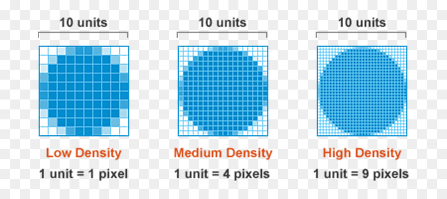
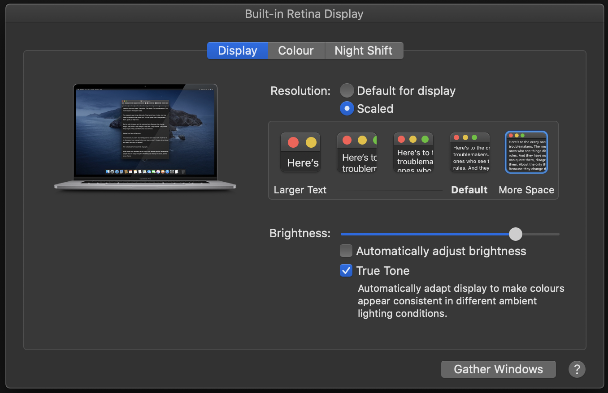
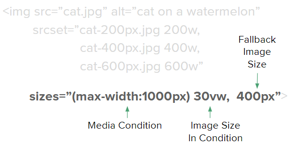
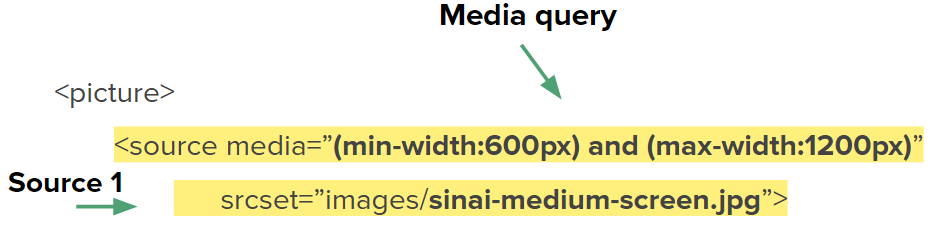
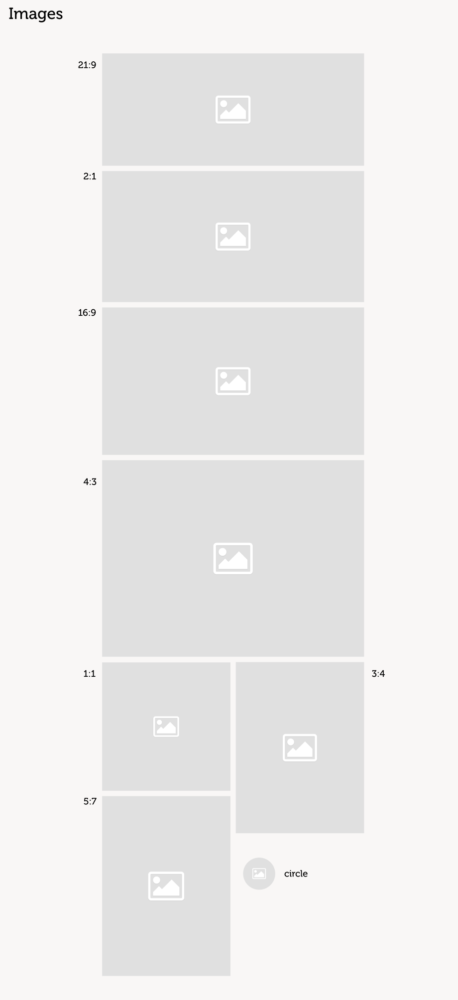
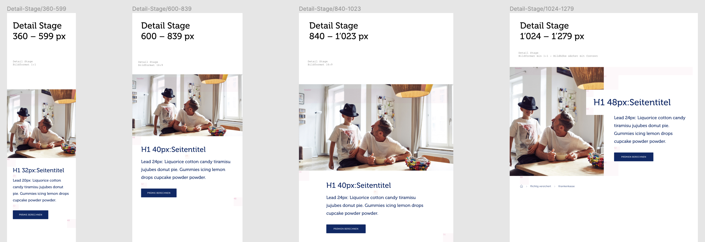
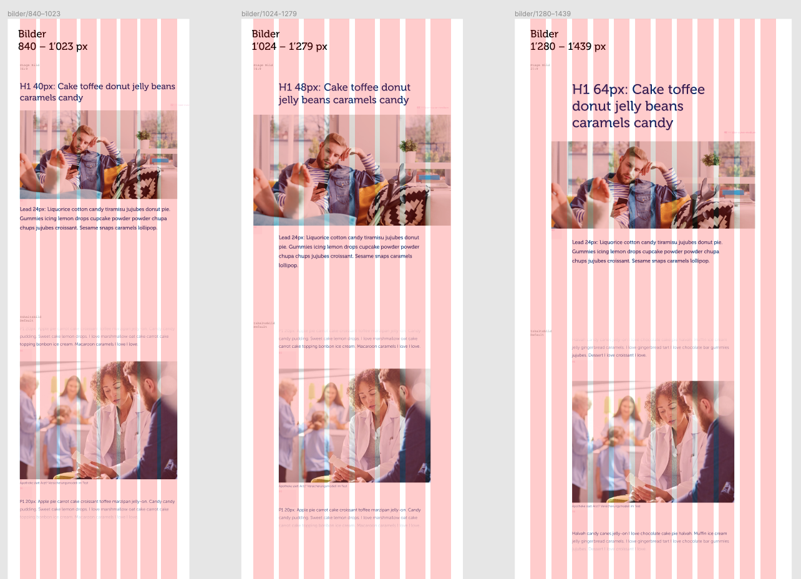
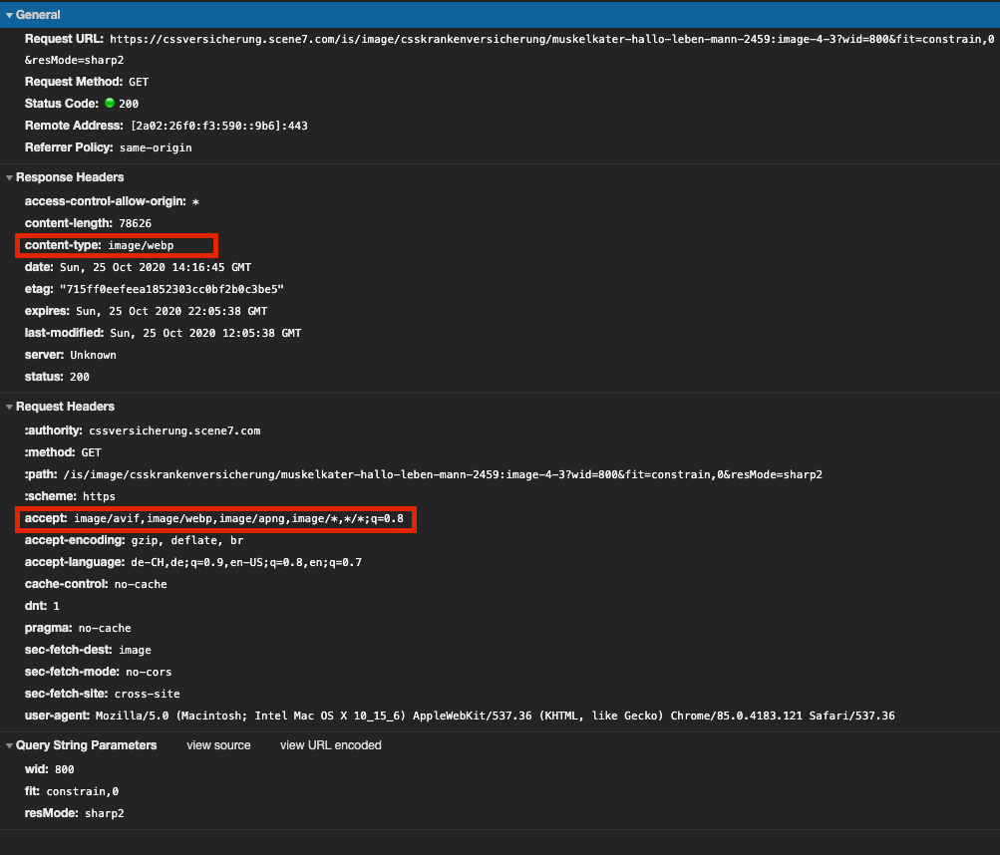

# Responsive Images: Die Umsetzung auf post.ch und css.ch

**Das Problem:** Ein 400 px breites Bild braucht auf einem Smartphone mit 3x-Display 1200 Gerätepixel, um scharf zu sein. Ein falsches `srcset` schickt dafür entweder ein unscharfes Bild oder eine Datei in Desktop-Grösse über die Mobilverbindung.

**Dauer:** etwa 90 Minuten

## Inhalt

- [Intro](#intro)
- [Responsive Images](#responsive-images)
- [Umsetzung](#umsetzung)

## Intro

Wir schauen uns die Umsetzung von Responsive Images an, die auf [post.ch](https://post.ch) und [css.ch](https://www.css.ch) verwendet wird. Die Beispiele zeigen Codeausschnitte aus beiden Projekten.

## Responsive Images

### Recap: Hochauflösende Displays

Man könnte annehmen, dass kleinere Geräte immer kleinere Bilder bekommen sollten. Das ist nicht immer der Fall.

> "A pixel is not a pixel"

Es gibt einen Unterschied zwischen **CSS-Pixeln** und **Gerätepixeln** (physischen Pixeln). CSS-Pixel sind die Einheit für Abmessungen auf unserer Website. Gerätepixel sind die physischen Pixel, die das Gerät nutzt.



**Beispiele für Device Pixel Ratio (DPR)**

| Device                        | Gerätepixel |  CSS-Pixel | Device Pixel Ratio (DPR) |
| ----------------------------- | ----------: | ---------: | :----------------------: |
| iPhone 6, 6s, 7, 8, SE (2020) |  750 x 1334 |  375 x 667 |            2             |
| iPhone 11 Pro, X, XS          | 1125 x 2436 |  375 x 812 |            3             |
| iPad Air 2020                 | 2360 x 1640 | 1180 x 820 |            2             |

**Scharfe Bilder liefern**

Wie gross müssen unsere Bilder also sein, damit sie auf diesen Geräten nicht verschwommen aussehen?

| CSS-Pixel | DPR 1.0 | DPR 2.0 (4x px) | DPR 3.0 (9x px) | DPR 4.0 (16x px) |
| --------: | ------: | --------------: | --------------: | ---------------: |
|      40px |    40px |            80px |           120px |            160px |
|     150px |   150px |           300px |           450px |            600px |
|     400px |   400px |           800px |          1200px |           1600px |

Die Tabelle zeigt: Bei einer DPR von **3x** oder **4x** **wächst die Bildgrösse schnell**, wenn das Bild scharf aussehen soll. Das ist ungünstig, weil in mobilen Geräten meist schwächere Hardware steckt als in Desktop-Geräten. Dazu kommt eine eventuell langsamere Mobilverbindung, was das Problem verstärkt.

**Ungewöhnliche DPRs**

Bisher hatte jedes Gerät eine ganzzahlige DPR (2.0, 3.0 usw.). Gibt es auch eine DPR von z.B. 1.5? Ja, die gibt es.



Ein MacBook Pro 16" lässt sich zum Beispiel so einstellen, dass es eine DPR von **1.5** statt 2.0 hat.  
Um auf diesem Laptop ein Bild in 40px darzustellen, wäre das "perfekte" Bild also 60px breit, und nicht 80px wie bei einer DPR von 2.0.

### Die Schwierigkeiten

Bei Responsive Images musst du auf folgende Schwierigkeiten achten:

- Kleinere Geräte sollten generell kleinere Bilder erhalten
- Die DPR sollte so genutzt werden, dass Bilder möglichst scharf sind, ohne dass die Dateigrösse des Bildes explodiert
- Je nach Modul oder Use Case kann sich das Seitenverhältnis des Bildes von Gerät zu Gerät ändern
- Browser unterstützen unterschiedliche Bildformate. Wie können wir damit umgehen und das nutzen?

### Die Display Density Descriptor Methode

Den Density Descriptor kannst du innerhalb eines `srcset` nutzen. Er gibt dem Browser Metainformationen, damit dieser entscheiden kann, welches Bild er herunterlädt.  
Im Beispiel unten würde ein iPhone 6 (DPR 2) das Bild `cat-400px.jpg` laden, ein iPhone X (DPR 3) das Bild `cat-600px.jpg`.

_Wichtig: Der Descriptor sagt dem Browser nur, welches Bild für welche DPR gedacht ist. Wie breit das Bild ist, erfährt der Browser dadurch nicht._

**Beispiel**

```html

```

**Vorteile**

Mit diesem Descriptor legen wir fest, welches Bild für welche DPR gedacht ist. Auf Geräten mit ganzzahliger DPR (1x, 2x, 3x) sind Bilder so scharf, wie wir sie vorbereitet haben.

**Nachteile**

Ein Gerät mit einer DPR von z.B. 1.5 bekommt in der Regel das nächstgrössere Bild (hier 2x). Auf unserem MacBook 16" mit einer DPR von 1.5 lädt der Browser also meist ein zu grosses Bild, damit es scharf angezeigt wird.

**Demo** 🤯

- [Display Density Descriptor](https://codesandbox.io/s/yb5t4)

**Hilfreiche Links**

- [Use density descriptors](https://web.dev/articles/codelab-density-descriptors)

### Die Width Descriptor Methode mit dem `sizes`-Attribut

Hier kombinieren wir den Width Descriptor mit dem `sizes`-Attribut.  
Mit dem Width Descriptor sagen wir dem Browser, wie breit jede Bilddatei ist.  
Diese Methode ist vor allem dann sinnvoll, wenn sich die Breite eines Bildes mit der Grösse des Viewports ändert. **Das ist der häufigste Fall bei Responsive Images**.

**Beispiel**

```html

```

Diese Information allein nützt dem Browser wenig, da er noch nicht weiss, wie breit das Bild angezeigt wird. Weil sich die Anzeigebreite mit der Breite des Viewports ändert, taugt auch ein festes `width`-Attribut nicht als Angabe der Anzeigebreite. `width` und `height` setzen wir trotzdem (siehe "Laden und Priorität"): Sie liefern dem Browser das Seitenverhältnis.

#### Das `sizes`-Attribut

Das `sizes`-Attribut teilt dem Browser mit, wie breit ein Bild effektiv dargestellt wird. Es nimmt entweder einen Wert oder mehrere, getrennt durch ein **,** (Komma). Im Attribut kannst du Media Queries verwenden. Bei mehreren Werten wertet der Browser sie von _links nach rechts_ aus. Sobald eine Media Query zutrifft, nutzt er diese Grösse als Anzeigebreite des Bildes. Der letzte Wert hat keine Media Query und gilt als Fallback. Ohne `sizes`-Attribut geht der Browser von `100vw` aus.



**Bedingung für die Bildgrösse**

Als Breite sind alle CSS-Längen erlaubt, typischerweise:

- In `vw`
- In `px` (oder `em`, `rem` usw.; relative Einheiten beziehen sich auf das Root-Element)
- Als Kombination davon in einem `calc()`

Prozentwerte sind nicht erlaubt.

**Beispiel**

```html
sizes="(max-width: 399px) 50vw, (min-width: 400px) and (max-width: 900px) calc(30vw - 40px), 100vw"
```

Das nächste Beispiel zeigt ein Bild, dessen Breite immer relativ zum Viewport ist, bis der Viewport eine bestimmte Grösse erreicht. Ab dann ist die Breite des Bildes fix und wird nicht mehr grösser.

```html

```

Mit den Informationen über die **verfügbaren Bilder** und die **Breite**, in der das Bild angezeigt wird, kann der Browser nun entscheiden, welches Bild er herunterlädt, damit es möglichst scharf aussieht. Dafür nutzt er auch die **DPR** des Geräts und z.B. die Verbindungsgeschwindigkeit.

**Avatar-Beispiel**

```html

```

| Viewport-Breite | DPR | Anzeigebreite | Bild               |
| --------------- | --: | ------------: | :----------------- |
| `300px`         |   2 |        `40px` | `avatar-80px.jpg`  |
| `600px`         |   3 |        `40px` | `avatar-120px.jpg` |
| `1400px`        |   1 |        `60px` | `avatar-60px.jpg`  |
| `1400px`        | 1.5 |        `60px` | `avatar-100px.jpg` |
| `1400px`        |   2 |        `60px` | `avatar-120px.jpg` |

**Demo** 🤯

- [Width Descriptor](https://codesandbox.io/s/0erxg)

### Das `<picture>`-Element

Das `<picture>`-Element gibt uns noch mehr Möglichkeiten für Art Direction. So kannst du z.B. ein Bild auf Mobile im Seitenverhältnis 1:1 und auf dem Desktop in 16:9 zeigen. Ausserdem können wir damit mehrere Bildformate anbieten: Der Browser nimmt die erste `<source>`, deren `type` er unterstützt, und alle anderen bekommen den Fallback im ``. Die Reihenfolge ist also wichtig.

### Art Direction mit dem `<picture>`-Element

Mit dem `<source>`-Element kannst du innerhalb des `<picture>`-Elements mehrere verschiedene Bilder angeben, jeweils für unterschiedliche Geräte. Du kannst beliebig viele `<source>`-Elemente verwenden.



Bei mehreren `<source>`-Elementen wertet der Browser sie von _der ersten bis zur letzten_ aus. Sobald er eine `<source>` findet, die alle Kriterien erfüllt, verwendet er dieses Bild.

**Beispiel**

```html
<picture>
  <source media="(min-width:600px) and (max-width:1200px)" srcset="cat-medium.jpg" />
  <source media="(min-width:1201px)" srcset="cat-large.jpg" />
  
</picture>
```

### Verschiedene Bildformate unterstützen

Mit einer `<source>` können wir dasselbe Bild auch in verschiedenen Bildformaten anbieten.  
Unterstützt ein Browser den angegebenen `type` nicht, ignoriert er die ganze Source.

AVIF ergibt meist die kleinsten Dateien, gefolgt von WebP. Beide funktionieren in allen aktuellen Browsern: AVIF ist seit Januar 2024 Baseline (seit Juli 2026 "Widely available"), WebP seit September 2020. Das JPEG im `` bleibt der Fallback für alles andere.

**Beispiel**

```html
<picture>
  <source srcset="cat-avif.avif" type="image/avif" />
  <source srcset="cat-webp.webp" type="image/webp" />
  <source srcset="cat-jpg.jpg" type="image/jpeg" />
  
</picture>
```

Doku: [MDN: Image file type and format guide](https://developer.mozilla.org/en-US/docs/Web/Media/Guides/Formats/Image_types), [MDN: `<picture>`](https://developer.mozilla.org/en-US/docs/Web/HTML/Reference/Elements/picture)

**Hilfreiche Links**

- [AVIF has landed](https://jakearchibald.com/2020/avif-has-landed/)
- [Using WebP Images](https://css-tricks.com/using-webp-images/)

### Laden und Priorität

Die richtige Datei ist erst die halbe Arbeit. Der Browser muss auch wissen, wann er sie laden soll.

- **Platz reservieren.** Setze `width` und `height` auf die intrinsische Grösse des Bildes. Der Browser leitet daraus das Seitenverhältnis ab und reserviert den Platz, bevor die Datei ankommt, damit die Seite nicht verspringt.
- **Was unterhalb des Folds liegt, lazy laden.** `loading="lazy"` verzögert den Download, bis das Bild in die Nähe des Viewports kommt. Alle aktuellen Browser unterstützen das.
- **Das grösste Bild beim ersten Laden nie lazy laden.** Dieses Bild ist oft dein Largest Contentful Paint (LCP). Lass es eager und ergänze `fetchpriority="high"`, damit der Browser es vor anderen Bildern holt.
- **Lazy Images vom Browser messen lassen.** Bei Lazy Images kannst du `sizes` mit `auto` beginnen: Der Browser nimmt dann die tatsächliche Layout-Breite des Bildes. Chrome, Edge und Firefox unterstützen das, Safari noch nicht zuverlässig. Lass deshalb deine berechneten `sizes` als Fallback nach `auto` stehen.

```html

```

Doku: [MDN: ``](https://developer.mozilla.org/en-US/docs/Web/HTML/Reference/Elements/img), [web.dev: Browser-level image lazy loading](https://web.dev/articles/browser-level-image-lazy-loading), [web.dev: Fetch Priority](https://web.dev/articles/fetch-priority), [web.dev: Optimize Largest Contentful Paint](https://web.dev/articles/optimize-lcp)

### Übung 🔥

Öffne diese [**CodeSandbox**](https://codesandbox.io/s/xc76o) als Startpunkt.

Die Übung enthält bereits das Grid-System von Bootstrap.

- [ ] Füge ein Responsive Image ein und nimm dafür die Bilddateien unter `./images/`
  - [ ] Das Bild sollte auf xs 12 Spalten breit sein, auf rg 6 Spalten und ab lg 4 Spalten
  - [ ] Berechne die sizes so, dass die Grösse auf jedem Breakpoint stimmt. Schau dir dazu auch das CSS an: Wie viel Padding haben der Container, die Row und die Col? Berücksichtige diese Werte bei der Berechnung.

Zeit: etwa 15 min

## Umsetzung

Wir schauen uns die konkrete Umsetzung auf [css.ch](https://www.css.ch) an.

### Modularität

Für unsere Umsetzung wollen wir eine generische Komponente, damit wir Redundanzen vermeiden und die Qualität des Bild-HTML einheitlich bleibt.  
Die Komponente sollte sich wie ein **Atom** verhalten und in allen anderen Modulen und Komponenten verwendbar sein.

### Art Direction

Zum einen haben wir viele verschiedene Seitenverhältnisse, die in den verschiedenen Modulen vorkommen können.



_Screenshot aus dem Design_

Zum anderen gibt es Module, die auf Breakpoint x ein anderes Seitenverhältnis haben als auf Breakpoint y.



_Screenshot aus dem Design_

### `srcset` & `sizes`

#### Arbeiten mit einem Grid

In einem Grid erstrecken sich Bilder oft über eine bestimmte Anzahl Spalten.  
In diesem Beispiel ist das zweite Modul auf Tablet 8/8 Spalten breit, auf kleineren Desktops 6/8 Spalten und auf grösseren Desktops schliesslich 8/12 Spalten.



Damit wir die `sizes` richtig berechnen können, müssen wir mehrere Parameter berücksichtigen:

- Die Breite des Containers
- Die Maximalbreite des Containers
- Die Spaltenanzahl auf jedem Breakpoint
- Den Gutter zwischen den Spalten

Mit all diesen Parametern könnte eine Size so aussehen:

**Struktur**

```html
sizes="(min-width: {breakpoint-width}) calc(({base} - 2 * {container-padding} + {gutter}) *
({columns}/{max-columns}) - {gutter})"
```

**Beispiel**

```html
sizes="(min-width: 1441px) calc((1440px - 2 * 128px + 16px) * (3/12) - 16px)"
```

**Demo** 🤯

- [Proof of Concept](https://codepen.io/christiansany/pen/jQGjwd)

_Der Proof of Concept wurde für post.ch gebaut. Seine sizes stimmen nicht genau mit denen von css.ch überein, aber das Prinzip wird sichtbar._

#### Die `sizes` berechnen

**Die sizes innerhalb eines Grids zu berechnen, ist nicht immer trivial.** Deshalb haben wir einen **Helper** gebaut: Du übergibst die Anzahl Spalten, über die sich das Bild erstreckt, und der Helper gibt die richtigen `sizes` zurück.

```typescript
export type BreakpointName = "large" | "medium" | "small";

export type Breakpoint = {
  readonly name: BreakpointName;
  readonly width: string;
  readonly containerPadding: string;
  readonly gutter: string;
};

const breakpoints: Breakpoint[] = [
  {
    name: "large",
    width: "1000px",
    containerPadding: "64px",
    gutter: "16px"
  },
  {
    name: "medium",
    width: "440px",
    containerPadding: "32px",
    gutter: "16px"
  },
  {
    name: "small",
    width: "0px",
    containerPadding: "16px",
    gutter: "16px"
  }
];

export const getBreakpointByName = (name: BreakpointName): Breakpoint => {
  const breakpoint = breakpoints.find((breakpoint) => breakpoint.name === name);
  if (!breakpoint) {
    throw new Error("Given BreakpointName was not found");
  }
  return breakpoint;
};

const widthCalc = (
  width: string,
  containerPadding: string,
  gutter: string,
  columns: number,
  fixGutter?: number
) => {
  let calc = `calc((${width} - 2 * ${containerPadding} + ${gutter}) * (${columns}/12) - ${gutter})`;

  if (fixGutter) {
    calc = `calc(((${width} - 2 * ${containerPadding} + ${gutter}) * (${columns}/12) - ${gutter}) - ${
      fixGutter * 2
    }px)`;
  }

  return calc;
};

export const mapImageSizesToColumns = (
  configs: { name: BreakpointName; columns: number }[]
): string => {
  return configs
    .map((config, index) => {
      const breakpoint = getBreakpointByName(config.name);
      if (breakpoint) {
        if (breakpoint.name === "large") {
          // "large" is the largest breakpoint and should not use 100vw as calc base
          return `(min-width: ${breakpoint.width}) ${widthCalc(
            "1000px",
            breakpoint.containerPadding,
            breakpoint.gutter,
            config.columns,
            undefined
          )}`;
        } else if (breakpoint.name === "small" || configs.length === index + 1) {
          // "small" is the smallest breakpoint and should not have a media query
          return widthCalc(
            "100vw",
            breakpoint.containerPadding,
            breakpoint.gutter,
            config.columns,
            undefined
          );
        }
        // Default has media-query and 100vw as base width
        return `(min-width: ${breakpoint.width}) ${widthCalc(
          "100vw",
          breakpoint.containerPadding,
          breakpoint.gutter,
          config.columns,
          undefined
        )}`;
      }
    })
    .join(",");
};
```

**Beispiel**

```ts
const sizes = mapImageSizesToColumns([
  { name: "large", columns: 4 },
  { name: "medium", columns: 6 },
  { name: "small", columns: 12 }
]);

// sizes
// (min-width: 1000px) calc((1000px - 2 * 64px + 16px) * (4/12) - 16px),
// (min-width: 440px) calc((100vw - 2 * 32px + 16px) * (6/12) - 16px),
// calc((100vw - 2 * 16px + 16px) * (12/12) - 16px)
```

**Demo** 🤯

- [🌟 React-Demo](https://codesandbox.io/p/sandbox/n8mczn?file=%2Fsrc%2FApp.tsx)
- [Playground-Demo](https://codesandbox.io/s/o04l7)
- [Live-Demo post.ch](https://www.post.ch)
- [Live-Demo css.ch](https://www.css.ch)

### Bildformate

Wir haben es uns etwas leichter gemacht und überlassen die Wahl des Bildformats dem Backend, genauer dem CDN, das [css.ch](https://www.css.ch) verwendet. Fordert der Browser z.B. ein .jpg an, liest das CDN den `accept`-Header aus und erkennt, ob `webp`, `avif` oder andere Formate erlaubt sind. Falls ja, liefert es dieses Format in seiner Response.

So müssen wir uns im Frontend nicht um die verschiedenen Bildformate kümmern und brauchen für sie keine eigene `<source>`.


